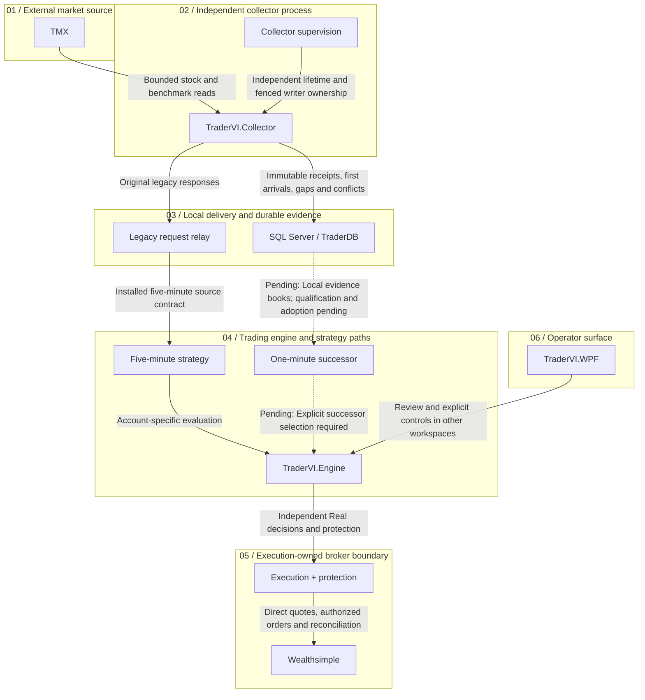
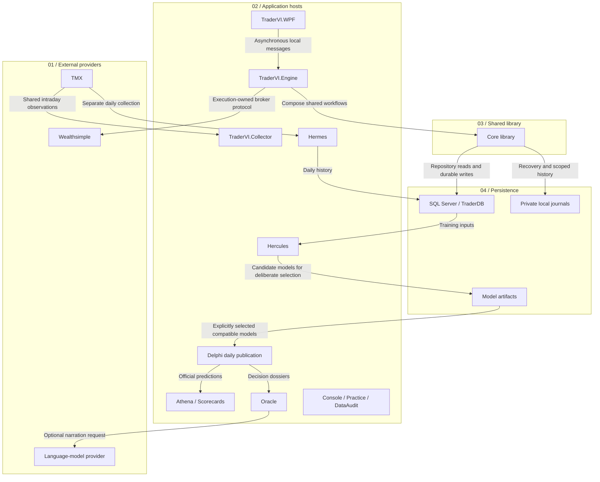
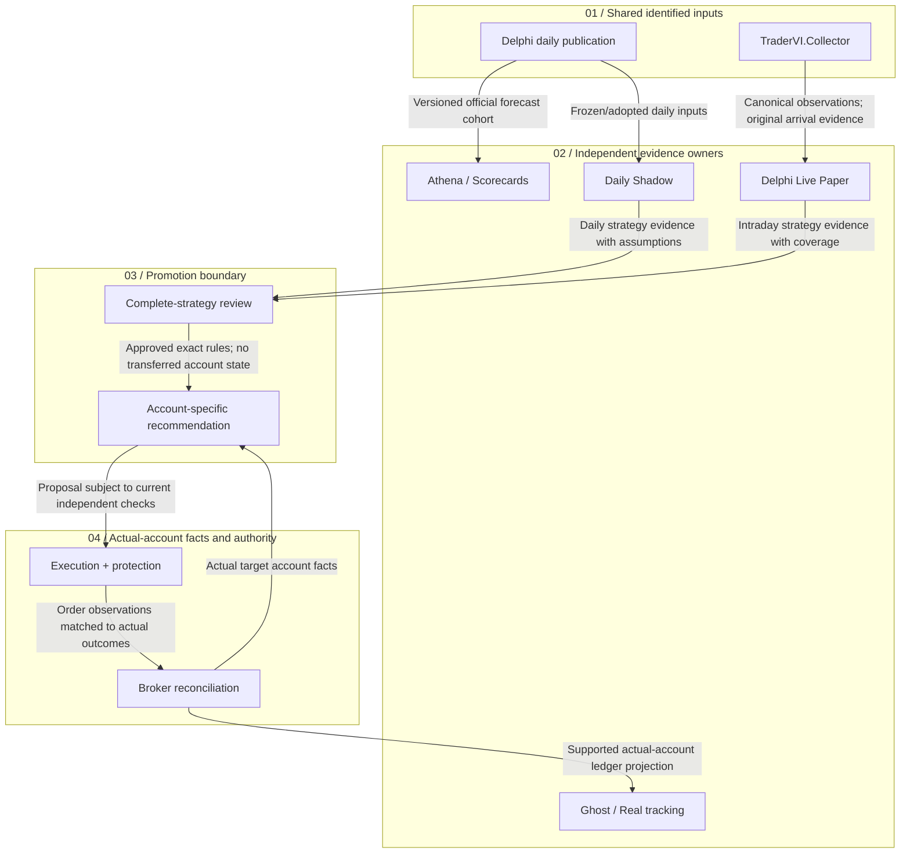
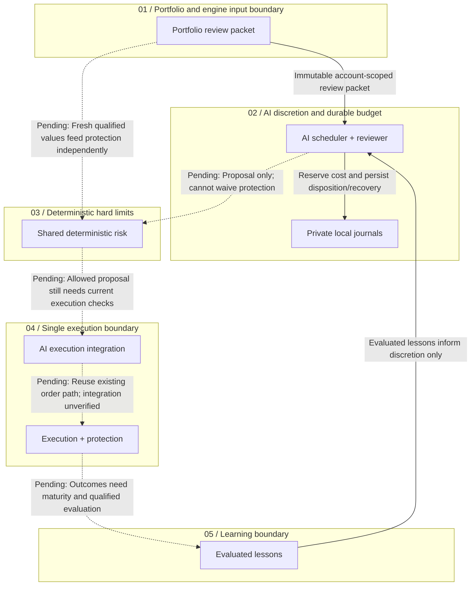

# TraderVI architecture guide

This guide preserves the four maps and component explanations formerly embedded in the desktop
Architecture view. Read it directly on GitHub; no application build is needed to maintain it.
The desktop Docs and Architecture sections are retired by [ADR-0112](adr/0112-repository-documentation-outside-desktop.md).

**Source snapshot: October 28, 2026.** The operational references below retain the **13:45 Toronto**
checkpoint. AI implementation references retain the **September 30** snapshot and were not
operationally reverified. Migrating the guide does not refresh those facts or grant authority.
Use [project status](project-status.md) for later observations, [system design](system-design.md)
for responsibilities, and the governing [ADRs](adr/README.md) for decisions.

Jump to [Collector & trading](#collector--trading), [Components](#components),
[Evidence](#evidence), [AI authority](#ai-authority), or the [component reference](#component-reference).

## Reading and maintaining the maps

Solid arrows describe the documented relationship; they do not certify deployment. Dashed arrows
marked **Pending** preserve unqualified or unadopted paths. In particular, the AI map is an accepted
target with partial foundations. Component links below each map lead to the full explanation.

When responsibilities, process lifetime, data paths, evidence ownership or AI authority change,
update the authoritative source first, then the affected map and component description here.
Retain evidence dates and qualification limits. Keep private account details, credentials and
routine monitoring observations out of this guide. Check diagram endpoints and source links.

## Collector & trading

Follow the independent collector into two explicit local delivery paths, then into account-specific trading and protection.

**Boundary:** At the 2026-10-28 13:45 Toronto checkpoint: collector installed, five-minute Real resumed. One-minute adoption remains pending. A running collector does not keep protection running when the engine stops.

| Group | Component explanations |
|---|---|
| 01 / External market source | [TMX](#component-tmx) |
| 02 / Independent collector process | [TraderVI.Collector](#component-collector), [Collector supervision](#component-supervisor) |
| 03 / Local delivery and durable evidence | [Legacy request relay](#component-relay), [SQL Server / TraderDB](#component-sql) |
| 04 / Trading engine and strategy paths | [TraderVI.Engine](#component-engine), [Five-minute strategy](#component-legacy), [One-minute successor](#component-minute) |
| 05 / Execution-owned broker boundary | [Execution + protection](#component-execution), [Wealthsimple](#component-broker) |
| 06 / Operator surface | [TraderVI.WPF](#component-wpf) |

## Components

Separate application processes share a Core library. Storage and external providers have explicit ownership boundaries.

**Boundary:** Core boxes describe library responsibilities, not additional deployed services. This guide does not discover processes or check connectivity.

| Group | Component explanations |
|---|---|
| 01 / External providers | [TMX](#component-tmx), [Wealthsimple](#component-broker), [Language-model provider](#component-llm) |
| 02 / Application hosts | [TraderVI.Collector](#component-collector), [TraderVI.Engine](#component-engine), [TraderVI.WPF](#component-wpf), [Hermes](#component-hermes), [Hercules](#component-hercules), [Delphi daily publication](#component-delphi), [Athena / Scorecards](#component-athena), [Oracle](#component-oracle), [Console / Practice / DataAudit](#component-tools) |
| 03 / Shared library | [Core library](#component-core) |
| 04 / Persistence | [SQL Server / TraderDB](#component-sql), [Model artifacts](#component-artifacts), [Private local journals](#component-journals) |

## Evidence

Share market facts and strategy definitions while preserving separate money, fills, confirmation and evidence histories.

**Boundary:** A recommendation is not an order; an order is not a confirmed fill. Paper performance is conditional on its execution assumptions and is not Real account performance.

| Group | Component explanations |
|---|---|
| 01 / Shared identified inputs | [TraderVI.Collector](#component-collector), [Delphi daily publication](#component-delphi) |
| 02 / Independent evidence owners | [Athena / Scorecards](#component-athena), [Daily Shadow](#component-shadow), [Delphi Live Paper](#component-live), [Ghost / Real tracking](#component-tracked) |
| 03 / Promotion boundary | [Complete-strategy review](#component-review), [Account-specific recommendation](#component-recommendation) |
| 04 / Actual-account facts and authority | [Broker reconciliation](#component-reconciliation), [Execution + protection](#component-execution) |

## AI authority

Accepted AI design: scoped evidence → discretionary proposal → deterministic risk → one execution path → qualified learning.

**Boundary:** Historical AI implementation snapshot: 2026-09-30; deployment not reverified on 2026-10-28. This is an accepted target with partial foundations, not a verified operating AI portfolio.

| Group | Component explanations |
|---|---|
| 01 / Portfolio and engine input boundary | [Portfolio review packet](#component-packet) |
| 02 / AI discretion and durable budget | [AI scheduler + reviewer](#component-reviewer), [Private local journals](#component-journals) |
| 03 / Deterministic hard limits | [Shared deterministic risk](#component-risk) |
| 04 / Single execution boundary | [AI execution integration](#component-ai-execution), [Execution + protection](#component-execution) |
| 05 / Learning boundary | [Evaluated lessons](#component-learning) |

## Component reference

### TMX

**Provider — Shared stock and benchmark observations.** Supply market observations for explicit source contracts.

**Inputs:** Symbol, interval and bounded history requests.

**Outputs:** Bars, quotes and source responses.

**Responsibilities:** External market-data source; original event and receipt times matter.

**Boundaries:** Successful requests do not prove timely, complete or venue-qualified minute coverage. Hermes daily requests remain separate.

**Evidence:** Architecture reviewed 2026-10-28; this description does not report runtime health.

Sources: [Docs/adr/0111-independent-collector-and-recovered-confirmation.md](adr/0111-independent-collector-and-recovered-confirmation.md).

### Wealthsimple

**Provider — Broker accounts, executable quotes and orders.** Provide actual account observations and broker order outcomes.

**Inputs:** Authenticated reads and explicitly authorized order requests.

**Outputs:** Cash, holdings, quotes, order observations and fills.

**Responsibilities:** Broker-side account and order service.

**Boundaries:** Only the trading engine owns the broker execution path. An acknowledgement is not a fill; a fresh bid cannot repair stale indicator history.

**Evidence:** Architecture reviewed 2026-10-28; this description does not report runtime health.

Sources: [Docs/adr/0103-real-execution-independent-of-paper-research.md](adr/0103-real-execution-independent-of-paper-research.md), [Docs/system-design.md](system-design.md).

### Language-model provider

**Provider — Optional budgeted model calls.** Return narration or structured proposals through configured clients.

**Inputs:** Dossiers or scoped review packets and call budgets.

**Outputs:** Model responses and usage evidence.

**Responsibilities:** External model inference.

**Boundaries:** A model response is neither a deterministic gate nor order authority. Optional calls can cost money; reading this guide never invokes them.

**Evidence:** Architecture reviewed 2026-10-28; this description does not report runtime health.

Sources: [Docs/adr/0087-ai-momentum-portfolio-boundaries.md](adr/0087-ai-momentum-portfolio-boundaries.md), [Docs/oracle-rules.md](oracle-rules.md).

### TraderVI.Collector

**Process — Independent intraday collection.** Keep shared observations available independently of the trading process.

**Inputs:** Candidate, benchmark, held-symbol and pending-exit subscriptions; TMX responses.

**Outputs:** Immutable minute receipts in SQL and original legacy responses over the local relay.

**Responsibilities:** Own shared intraday requests, bounded backfill, gap/conflict capture and subscription union.

**Boundaries:** No broker credentials, order adapter or financial activation. Trader restart does not stop collection; collector survival does not keep protection running when the engine is stopped.

**Evidence:** Dated checkpoint: 2026-10-28 13:45 Toronto, from Docs/project-status.md. Not live status.

Sources: [Docs/adr/0111-independent-collector-and-recovered-confirmation.md](adr/0111-independent-collector-and-recovered-confirmation.md), [Docs/project-status.md](project-status.md).

### Collector supervision

**Ownership — Separate lifetime and fenced writer.** Maintain one collector owner and reject writes from a former owner.

**Inputs:** Process lifecycle and database-clock lease generation.

**Outputs:** Bounded restart supervision and fenced ownership.

**Responsibilities:** Keep collector lifetime independent of WPF and trader; prevent stale writers committing.

**Boundaries:** Installed supervision is for the current login at the cited checkpoint. Reboot/login startup is not installed; broader native recovery acceptance remains.

**Evidence:** Dated checkpoint: 2026-10-28 13:45 Toronto, from Docs/project-status.md. Not live status.

Sources: [Docs/adr/0111-independent-collector-and-recovered-confirmation.md](adr/0111-independent-collector-and-recovered-confirmation.md), [Docs/project-status.md](project-status.md).

### Legacy request relay

**Local delivery — Installed five-minute contract.** Deliver legacy intraday observations through the collector.

**Inputs:** Same-user local requests under the frozen legacy source contract.

**Outputs:** Original responses with original request and receipt times.

**Responsibilities:** Route shared requests without a trading-process market HTTP fallback.

**Boundaries:** Never substitute minute aggregates for legacy observations. Consumer still owns publication, audit and Paper lifecycle.

**Evidence:** Dated checkpoint: 2026-10-28 13:45 Toronto, from Docs/project-status.md. Not live status.

Sources: [Docs/adr/0111-independent-collector-and-recovered-confirmation.md](adr/0111-independent-collector-and-recovered-confirmation.md), [Docs/project-status.md](project-status.md).

### SQL Server / TraderDB

**Storage — Durable facts and separate ledgers.** Store shared market evidence and independently owned financial/research histories.

**Inputs:** Collector receipts, daily publications, account events and revisions.

**Outputs:** Coherent local reads, durable records and audit evidence.

**Responsibilities:** Preserve identities, first arrivals, failures, gaps, conflicts and transaction boundaries.

**Boundaries:** One physical database does not merge Paper and Real ownership. Backfill does not rewrite original arrival times. Schema changes require reviewed manual migrations.

**Evidence:** Architecture reviewed 2026-10-28; this description does not report runtime health.

Sources: [Docs/adr/0111-independent-collector-and-recovered-confirmation.md](adr/0111-independent-collector-and-recovered-confirmation.md), [Docs/system-design.md](system-design.md).

### TraderVI.Engine

**Process — Independent execution and Paper scheduling.** Run trading and protection independently of dashboard lifetime and optional research backlog.

**Inputs:** Collector relay/local evidence, selected daily inputs and each account's own state.

**Outputs:** Shared published inputs, independent account decisions, audits and execution work.

**Responsibilities:** Own Real evaluation, Paper schedules, broker reconciliation, executable quotes and protection.

**Boundaries:** Closing WPF leaves the host running. Stopping the engine stops its automatic protection. Real does not wait for Paper or import its confirmation/fills.

**Evidence:** Dated checkpoint: 2026-10-28 13:45 Toronto, from Docs/project-status.md. Not live status.

Sources: [Docs/adr/0103-real-execution-independent-of-paper-research.md](adr/0103-real-execution-independent-of-paper-research.md), [Docs/adr/0111-independent-collector-and-recovered-confirmation.md](adr/0111-independent-collector-and-recovered-confirmation.md), [Docs/project-status.md](project-status.md).

### Five-minute strategy

**Strategy — Installed path at the dated checkpoint.** Evaluate the existing approved strategy with its preserved source identity.

**Inputs:** Legacy collector relay observations, daily selection and account-specific state.

**Outputs:** Current account decisions under existing approved rules.

**Responsibilities:** Preserve independent Paper/Real confirmation, risk history and financial checks.

**Boundaries:** Resumed at the October 28 checkpoint. This does not approve a future build or the one-minute successor.

**Evidence:** Dated checkpoint: 2026-10-28 13:45 Toronto, from Docs/project-status.md. Not live status.

Sources: [Docs/project-status.md](project-status.md), [Docs/adr/0111-independent-collector-and-recovered-confirmation.md](adr/0111-independent-collector-and-recovered-confirmation.md).

### One-minute successor

**Pending — Implemented; qualification and adoption pending.** Recover current confirmation from validated local evidence across downtime.

**Inputs:** Coherent SQL minute books, bounded validated backfill and exact policy/source identity.

**Outputs:** Two consecutive qualifying judgments and a new present-time decision, when valid.

**Responsibilities:** Preserve three-of-four support, VWAP and elapsed indicator horizons; require a current latest endpoint.

**Boundaries:** Not financially adopted or source-qualified at the cited checkpoint. Gaps/conflicts, source/capacity/venue and native restart/outage acceptance remain; explicit strategy adoption is required.

**Evidence:** Dated checkpoint: 2026-10-28 13:45 Toronto, from Docs/project-status.md. Not live status.

Sources: [Docs/adr/0111-independent-collector-and-recovered-confirmation.md](adr/0111-independent-collector-and-recovered-confirmation.md), [Docs/project-status.md](project-status.md), [Docs/strategy-alignment-implementation-checklist.md#independent-collector-and-recovered-confirmation--october-27-overnight](strategy-alignment-implementation-checklist.md#independent-collector-and-recovered-confirmation--october-27-overnight).

### Execution + protection

**Authority — Checks → order → reconciliation.** Manage authorized Real actions and independent protection through one order path.

**Inputs:** Approved strategy, current account/risk/permission state and executable broker quotes.

**Outputs:** Order intents, broker observations, confirmed fills and reconciliation history.

**Responsibilities:** Recheck price, risk, permission, pending/uncertain orders and protection ownership.

**Boundaries:** Approval, separate enable, order acknowledgement and fill are distinct. Protective exits need trustworthy inputs; collection alone provides no execution authority.

**Evidence:** Architecture reviewed 2026-10-28; this description does not report runtime health.

Sources: [Docs/adr/0103-real-execution-independent-of-paper-research.md](adr/0103-real-execution-independent-of-paper-research.md), [Docs/system-design.md](system-design.md).

### TraderVI.WPF

**Process — Review and supervision dashboard.** Explain evidence and provide the operator's existing review/control surface.

**Inputs:** Saved state and asynchronous engine messages.

**Outputs:** Operator reviews and explicit control requests in the appropriate workspaces.

**Responsibilities:** Present independent account evidence and exact-build/strategy review.

**Boundaries:** Does not own collector or engine lifetime. This repository guide is explanatory only: no polling, account reads or execution controls.

**Evidence:** Architecture reviewed 2026-10-28; this description does not report runtime health.

Sources: [Docs/adr/0103-real-execution-independent-of-paper-research.md](adr/0103-real-execution-independent-of-paper-research.md), [Docs/adr/0108-strategy-workspace-and-independent-account-evidence.md](adr/0108-strategy-workspace-and-independent-account-evidence.md).

### Hermes

**Process — Daily market-history collection.** Prepare daily market history and deterministic derived evidence.

**Inputs:** Daily provider responses, benchmark/sector data and collection configuration.

**Outputs:** SQL daily bars, breadth and sector evidence.

**Responsibilities:** Daily collection in the guarded nightly pipeline, separately from intraday collection.

**Boundaries:** Not the independent intraday collector. Collection does not train or approve a strategy.

**Evidence:** Architecture reviewed 2026-10-28; this description does not report runtime health.

Sources: [README.md](../README.md), [Docs/running.md#hermes--market-data-collection-and-maintenance](running.md#hermes--market-data-collection-and-maintenance).

### Hercules

**Process — Candidate model training.** Train candidate ML models for deliberate review.

**Inputs:** Versioned daily history, features and training configuration.

**Outputs:** Candidate artifacts, experiments and model metadata.

**Responsibilities:** Training and candidate registration.

**Boundaries:** Training success is not model selection or financial approval. Deterministic indicators remain separate from trained ML.

**Evidence:** Architecture reviewed 2026-10-28; this description does not report runtime health.

Sources: [README.md](../README.md), [Docs/system-design.md](system-design.md).

### Delphi daily publication

**Process — Versioned picks and decision dossiers.** Publish daily candidates using selected models and deterministic rules.

**Inputs:** Daily history, selected compatible model versions, indicators and policy.

**Outputs:** Immutable picks, dossiers and identified daily inputs.

**Responsibilities:** Host-neutral evaluation, reporting and publication.

**Boundaries:** Source revisions are adopted prospectively; they do not overwrite old freezes or fills. A daily pick is not an order.

**Evidence:** Architecture reviewed 2026-10-28; this description does not report runtime health.

Sources: [Docs/system-design.md](system-design.md), [README.md](../README.md).

### Athena / Scorecards

**Evidence — Official forecast outcomes.** Evaluate identified forecast cohorts and calibration evidence.

**Inputs:** Official predictions, versioned outcome labels and coverage.

**Outputs:** Official outcomes and calibration reports.

**Responsibilities:** Keep forecast identity and cohort eligibility explicit.

**Boundaries:** Paper-account returns, manual trades and broker fills cannot be substituted for official forecast outcomes.

**Evidence:** Architecture reviewed 2026-10-28; this description does not report runtime health.

Sources: [Docs/system-design.md](system-design.md).

### Oracle

**Process — Downstream narration.** Explain deterministic decision dossiers.

**Inputs:** Saved dossiers and optional configured language-model responses.

**Outputs:** Narratives and recorded call evidence.

**Responsibilities:** Narration and critique downstream of scoring.

**Boundaries:** Distinct from AI Momentum portfolio review. Narration never feeds back into deterministic scores or grants execution authority.

**Evidence:** Architecture reviewed 2026-10-28; this description does not report runtime health.

Sources: [Docs/oracle-rules.md](oracle-rules.md), [Docs/architecture.md](architecture.md).

### Console / Practice / DataAudit

**October 28 workflow update:** DataAudit now runs after Hermes in the nightly pipeline; its desktop
menu is retired and the troubleshooting CLI remains. [ADR-0113](adr/0113-nightly-data-audit-report.md)
owns that scheduling/reporting change. The underlying audit remains read-only.

**Tools — Advisory, replay and quality inspection.** Offer explicit offline/research and operational entry points.

**Inputs:** Saved evidence and explicit workflow arguments.

**Outputs:** Advisory reports, isolated replay results or data-quality findings.

**Responsibilities:** Keep replay, quality inspection, probes and maintenance separately invoked.

**Boundaries:** Replay is not forward evidence. Sandbox and maintenance may have side effects; reading this guide never launches them.

**Evidence:** Architecture reviewed 2026-10-28; this description does not report runtime health.

Sources: [README.md](../README.md), [Docs/running.md](running.md).

### Core library

**Library — Shared logic, adapters and repositories.** Reuse host-neutral workflows and exact strategy contracts.

**Inputs:** Host-provided configuration, clocks, stores, observations and account state.

**Outputs:** Signals, decisions, publications, protocol calls and persisted evidence.

**Responsibilities:** Core.Runtime, Core.Trader, ML, Indicators, RS, adapters and repositories are logical responsibilities in one assembly.

**Boundaries:** Core is not a collection of separate services or a pure domain-only assembly. Trained ML and deterministic indicators retain their distinct roles.

**Evidence:** Architecture reviewed 2026-10-28; this description does not report runtime health.

Sources: [Docs/system-design.md](system-design.md), [Docs/architecture.md](architecture.md).

### Model artifacts

**Storage — Explicitly selected compatible versions.** Keep trained model identity reproducible.

**Inputs:** Hercules training output and deliberate selection.

**Outputs:** Versioned model files loaded by runtime.

**Responsibilities:** Artifact identity, compatibility and selection metadata.

**Boundaries:** A candidate artifact is not automatically the selected model; neither selection nor training authorizes trades.

**Evidence:** Architecture reviewed 2026-10-28; this description does not report runtime health.

Sources: [README.md](../README.md), [Docs/system-design.md](system-design.md).

### Private local journals

**Storage — Intent, continuity and scoped histories.** Preserve recovery evidence alongside SQL.

**Inputs:** Broker intents, continuity records and scoped AI budget/risk/schedule events.

**Outputs:** Durable recovery and audit history.

**Responsibilities:** Retain identities, uncertain-order evidence and spending/risk history across restarts.

**Boundaries:** Private contents must not enter diagrams or tracked files. AI storage qualification remains historical/unverified here; recovery cannot renew permission.

**Evidence:** Architecture reviewed 2026-10-28; this description does not report runtime health.

Sources: [Docs/adr/0103-real-execution-independent-of-paper-research.md](adr/0103-real-execution-independent-of-paper-research.md), [Docs/adr/0087-ai-momentum-portfolio-boundaries.md](adr/0087-ai-momentum-portfolio-boundaries.md).

### Daily Shadow

**Evidence — Independent daily-strategy Paper books.** Evaluate full daily strategies with recorded simulated execution assumptions.

**Inputs:** Frozen/adopted daily inputs, market bars and own account state.

**Outputs:** Simulated orders/fills, cash, positions, protection and history.

**Responsibilities:** Own each portfolio's causal Paper lifecycle.

**Boundaries:** Simulated fills are not broker facts. Paper balances and confirmation are never imported into Real.

**Evidence:** Architecture reviewed 2026-10-28; this description does not report runtime health.

Sources: [Docs/adr/0055-independent-strategies-to-approved-live-execution.md](adr/0055-independent-strategies-to-approved-live-execution.md), [Docs/system-design.md](system-design.md).

### Delphi Live Paper

**Evidence — Independent intraday Paper books.** Compare intraday strategies using shared market facts.

**Inputs:** Canonical observations, policy version and each portfolio's own state.

**Outputs:** Simulated actions/fills, account history and coverage disclosures.

**Responsibilities:** Maintain independent confirmation, cash, positions and ledger revisions.

**Boundaries:** Live describes incoming observations, not necessarily real money. Later ask/bid fill assumptions and EstimatedFill fallback do not prove broker fillability.

**Evidence:** Architecture reviewed 2026-10-28; this description does not report runtime health.

Sources: [Docs/adr/0055-independent-strategies-to-approved-live-execution.md](adr/0055-independent-strategies-to-approved-live-execution.md), [Docs/system-design.md](system-design.md).

### Ghost / Real tracking

**Evidence — Distinct operational trade histories.** Retain tracked-position and actual-account records with their provenance.

**Inputs:** Simulated Ghost actions or reconciled actual broker events.

**Outputs:** Separate operational trade ledgers.

**Responsibilities:** Record mode, origin and supported reconciliation receipts.

**Boundaries:** The Real label alone does not authenticate a fill. Resolve actual broker outcomes without inventing or duplicating holdings.

**Evidence:** Architecture reviewed 2026-10-28; this description does not report runtime health.

Sources: [Docs/system-design.md](system-design.md).

### Complete-strategy review

**Authority — Rules and evidence, then deliberate approval.** Review the complete strategy before its explicit use by a Real account.

**Inputs:** Selection, entry, exit, sizing, risk, data requirements and evidence limitations.

**Outputs:** Exact approved strategy identity and disclosed gaps.

**Responsibilities:** Compare capital, coverage, periods and fill/cost assumptions; preserve separate histories.

**Boundaries:** Recommendation approval is insufficient to activate trading. Research performance does not certify deployable returns or a profitable strategy.

**Evidence:** Architecture reviewed 2026-10-28; this description does not report runtime health.

Sources: [Docs/adr/0055-independent-strategies-to-approved-live-execution.md](adr/0055-independent-strategies-to-approved-live-execution.md), [Docs/adr/0062-complete-strategy-recommendation-promotion.md](adr/0062-complete-strategy-recommendation-promotion.md), [Docs/system-design.md](system-design.md).

### Account-specific recommendation

**Authority — Shared rules, own confirmation.** Evaluate an approved strategy against the actual target account.

**Inputs:** Shared identified inputs and Real cash, positions, risk and confirmation.

**Outputs:** Recommendation and reasons before separate execution checks.

**Responsibilities:** Reuse policy calculations without transferring Paper financial state.

**Boundaries:** Different histories can correctly produce different actions. Real cannot inherit Paper's completed confirmation or simulated fill.

**Evidence:** Architecture reviewed 2026-10-28; this description does not report runtime health.

Sources: [Docs/adr/0055-independent-strategies-to-approved-live-execution.md](adr/0055-independent-strategies-to-approved-live-execution.md), [Docs/system-design.md](system-design.md).

### Broker reconciliation

**Authority — Match records to actual outcomes.** Reconcile saved intents and broker observations with the actual account.

**Inputs:** Stable order identities, cumulative broker events, cash and holdings.

**Outputs:** Confirmed financial facts, synchronized ledger and unresolved discrepancies.

**Responsibilities:** Preserve uncertain order IDs and detect mismatches before dependent action.

**Boundaries:** Acknowledgements and recommendations are not fills. Recovery does not fabricate a purchase or reset financial history.

**Evidence:** Architecture reviewed 2026-10-28; this description does not report runtime health.

Sources: [Docs/adr/0103-real-execution-independent-of-paper-research.md](adr/0103-real-execution-independent-of-paper-research.md), [Docs/system-design.md](system-design.md).

### Portfolio review packet

**AI design — Scoped books and versioned engine evidence.** Provide an immutable, account-scoped basis for AI review.

**Inputs:** Verified portfolio cash/positions, valuation and versioned engine evidence.

**Outputs:** Dated review packet with provenance and missing-data information.

**Responsibilities:** Keep candidate and managed accounts distinct; preserve evidence identity.

**Boundaries:** Historical AI foundation only; reliable invested valuation and production coverage need qualification. No Paper confirmation transfers.

**Evidence:** Historical AI implementation snapshot: 2026-09-30. Design references reviewed 2026-10-28; AI deployment and qualification were not reverified.

Sources: [Docs/adr/0087-ai-momentum-portfolio-boundaries.md](adr/0087-ai-momentum-portfolio-boundaries.md), [Docs/system-design.md](system-design.md).

### AI scheduler + reviewer

**AI design — Budgeted proposals with recorded reasons.** Schedule and prepare discretionary AI reviews within accepted boundaries.

**Inputs:** Scoped packet, schedule events, evaluated lessons and available budget.

**Outputs:** Structured proposal, reasons and saved review disposition.

**Responsibilities:** Deduplicate events, reserve call cost, persist recovery and consult lessons.

**Boundaries:** Historical prepared coordinator, not a verified operating AI loop. It has no execution authority; stale reviews cannot renew permission.

**Evidence:** Historical AI implementation snapshot: 2026-09-30. Design references reviewed 2026-10-28; AI deployment and qualification were not reverified.

Sources: [Docs/adr/0087-ai-momentum-portfolio-boundaries.md](adr/0087-ai-momentum-portfolio-boundaries.md), [Docs/running.md#ai-review-coordinator--prepared-not-enabled](running.md#ai-review-coordinator--prepared-not-enabled).

### Shared deterministic risk

**AI design — Hard limits outside AI discretion.** Enforce approved protection independently of AI attention.

**Inputs:** Current trustworthy valuations, approved risk profile, stops and independent holds.

**Outputs:** Risk assessment, protective requirements and blocked new exposure.

**Responsibilities:** Retain peaks, round state, account validity and protection across engine changes.

**Boundaries:** Accepted target with partial source foundation. AI integration/qualified hosting is not reverified. Risk assessment alone is not order permission; AI cannot loosen hard limits.

**Evidence:** Historical AI implementation snapshot: 2026-09-30. Design references reviewed 2026-10-28; AI deployment and qualification were not reverified.

Sources: [Docs/adr/0087-ai-momentum-portfolio-boundaries.md](adr/0087-ai-momentum-portfolio-boundaries.md), [Docs/system-design.md](system-design.md).

### AI execution integration

**Pending — Preparation is not order transport.** Connect qualified AI proposals to the existing execution path when accepted and qualified.

**Inputs:** Saved proposal, learning evidence and current risk/permission/account state.

**Outputs:** Prepared action checks; intended future use of the single execution coordinator.

**Responsibilities:** Recheck state and confirm required exits before replacement buys; preserve uncertain orders.

**Boundaries:** Historical foundation has no order transport. Ordinary five-minute Real installation does not prove AI integration or deployment.

**Evidence:** Historical AI implementation snapshot: 2026-09-30. Design references reviewed 2026-10-28; AI deployment and qualification were not reverified.

Sources: [Docs/adr/0087-ai-momentum-portfolio-boundaries.md](adr/0087-ai-momentum-portfolio-boundaries.md), [Docs/system-design.md](system-design.md).

### Evaluated lessons

**AI design — Learn without rewriting hard rules.** Retain qualified outcome lessons for later discretionary review.

**Inputs:** Actual versus simulated outcomes, maturity and evaluation evidence.

**Outputs:** Scoped evaluated lessons for later consultation.

**Responsibilities:** Preserve outcome provenance, pending immature cases and durable learning history.

**Boundaries:** Outcome evaluator and production scheduling remain historical pending work. Learning cannot erase protection, reset risk or become execution authority.

**Evidence:** Historical AI implementation snapshot: 2026-09-30. Design references reviewed 2026-10-28; AI deployment and qualification were not reverified.

Sources: [Docs/adr/0087-ai-momentum-portfolio-boundaries.md](adr/0087-ai-momentum-portfolio-boundaries.md), [Docs/system-design.md](system-design.md).

## Historical desktop implementation and installation

The original native WPF guide was prepared and installed on October 28, 2026. It used a shared
embedded catalog, four maps, persistent component details and standard keyboard/automation controls.
Native WPF avoided a browser runtime, JavaScript bridge or new package dependency. The catalog,
renderer and dedicated check host are now removed from source; their former commands no longer apply.

Original offline validation: eight catalog tests, 250 WPF assertions, four wide/narrow previews
(including representative visual inspection), and a serialized Core suite with 3,369 passes and ten
opt-in native skips. The isolated Release build had zero errors and 260 existing compiler warnings.
Dependency audit was disabled; no fresh security audit or solution-wide/SSDT result was claimed.
Offscreen 96/144/192-DPI renders and routed-key/automation checks did not qualify physical monitor
transitions, an actual screen reader or production-shell keyboard focus.

The explicitly authorized UI-only installation, verified at 15:30 Toronto, replaced only the WPF
DLL and symbols. The other 202 fingerprinted runtime files, saved execution grant, collector and
engine process identities were retained; local and execution status remained Running. The dashboard
was normally restarted and its Architecture entry and collector-description pane were observed.
Private receipts remain under `artifacts/architecture-ui-update-20261028/`. No schema or financial
settings changed. This historical two-file update is not permission for future runtime replacement.
The removal described by ADR-0112 was subsequently installed under explicit authority on October 28;
see [project status](project-status.md) for the dashboard-only update and verification limits.
