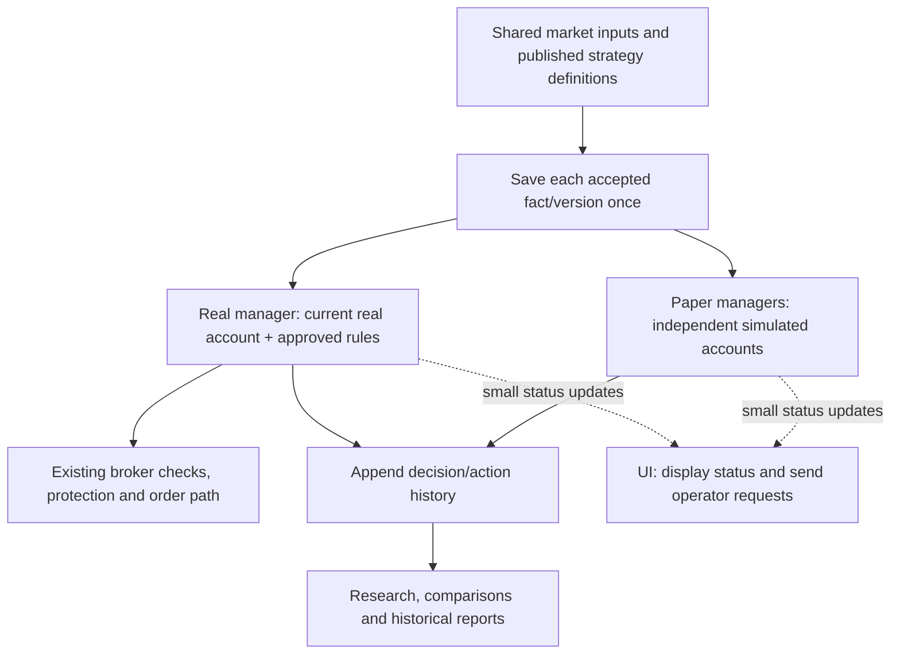

# Independent real processing — architecture draft

**October 21, 2026.** Accepted: real trading is independent of optional paper research (ADR-0103).
Everything below describing how to achieve it is proposed for review, not implementation authority.
This is a design outline, not yet an implementation-ready specification.

The immediate problem is delayed real decisions and an apparently blocked UI. The parent problem
is live work sharing history-heavy processing and broad locks. The root goal is dependable real
execution with responsive supervision, reconstructible history and unchanged financial safeguards.

## Simple structure

History in this diagram is a storage category with separate account/authority ownership, not a merged
real/paper ledger. Research may read both with explicit attribution; it cannot write either account.
UI commands return through the appropriate manager's existing authority checks. The UI does not own
collection, trading loops or full-history reconstruction.

Proposed runtime layout: a supervised operational host owns separate schedules for collection and
real management; paper management/research runs separately from that host, with paper protection
scheduled independently of expensive research. WPF displays saved/current status and submits requests.
All reuse Core strategy logic. This extends ADR-0083's independent-host direction; startup, shutdown,
disconnect and closing-the-UI behavior remain to be agreed. No automatic startup or permission renewal.

Use the existing SQL Server initially with distinct evidence/account ownership and short transactions.
Resource budgets and bounded batches keep research from overwhelming shared CPU, memory, provider
capacity or SQL. This reduces logical coupling but is not physical failure isolation; database/provider
failure still affects consumers. No new queue product, database server or microservice platform is needed
for this proposed first design.

## Work on current state and new changes

Each account keeps a compact current-state record: cash, open positions, pending/original order IDs,
protection floors, risk references/holds, approved strategy/permission, necessary rolling signal state
and the last consumed input/event sequence. Closed trades and old quotes live in immutable history.
Necessary accumulated facts remain in current state even when their originating event is old.

For one new five-minute bar:

1. The collector persists its accepted observation once with original source/receipt times, identity,
   validity and provenance. It publishes committed availability; notifications are hints, not sole storage.
2. Each manager reads inputs after its own saved progress marker. It advances the strategy's required
   rolling windows/confirmation and its own account state, rather than loading lifetime account history.
3. One short account-scoped transaction checks ownership/prior revision and durably saves the new
   events, current state and consumed-input marker together. Duplicate delivery uses stable identities;
   it cannot apply a fill or spend cash twice. Different accounts do not share a writer or balances.
4. Required intents and protection changes still become durable before the corresponding external
   action/quote. The existing order journal/transport remains the sole order path. Ambiguous submissions
   recover by original ID; they are not blindly retried. A provider call does not hold a broad SQL lock.
5. UI summaries update asynchronously. Research reads committed evidence in bounded batches later.

A checkpoint is a verified saved current state at a known event sequence. Restart would verify a
checkpoint, process only the later events and reconcile broker orders/account evidence. Checkpoint
frequency and maximum recovery-tail size need capacity tests. Never skip unseen input gaps, reuse stale
observations as fresh, inherit paper confirmation, reset financial holds or renew dated permission.
History remains reconstructible, including original settings and evidence, across any later conversion.

## Store facts once and refer to them

| Information | Proposed storage | What a new decision retains |
|---|---|---|
| Market bars and benchmark observations | Immutable accepted versions, shared across consumers | Exact observation/version IDs or a stable referenced range ending at the decision boundary |
| Daily publication, policy/model definition, large report | One immutable record per exact version/content | Version/content IDs and original attribution |
| Account changes | New events in that account's history | New event IDs; no copy of previous events |
| Decision result | One result per account/strategy/input identity where state matters | Exact input references, state/version linkage, output and reasons |
| Current status | Compact account projection, periodically checkpointed | Current revision and last processed sequence |

For example, one benchmark bar used by 37 symbols under three policies is one shared market fact,
referenced by those evaluations. Each genuinely different decision remains distinct. We share the
recipe and evidence; each account retains its own confirmation, cash, positions and risk memory.
Account-neutral calculations may be reused only when all inputs and definition versions match.

References must never mean 'whichever record is latest now'. Corrections/conflicts retain explicit
versions and original knowledge times. Poll receipts and order/protection quotes retain their own causal
identities; sharing content does not authorize reusing an earlier bid to trigger a later protection floor.
Evidence referenced by retained financial/research records cannot be pruned. Common data is saved once,
but different accounts' legitimate events and outcomes are not deduplicated away.

## Coordination, freshness and protection

Real execution subscribes to approved strategy definitions and direct shared inputs, not a paper
portfolio's UpdatedUtc. The current two-minute source-progress check therefore needs a reviewed
replacement demonstrating exact definition identity, required producer progress and the real manager's
consumption progress. Existing market freshness limits, on-time evidence rules and continuity checks
remain; a heartbeat alone cannot make prices fresh. No guard is removed during this design stage.

Settings changes use versioned assignments and short coordinated commits with revision rechecks.
The complete lock ordering and stale-command/recovery rules still require design and tests. Do not
replace a whole-cycle lock with unguarded actions using obsolete settings. Paper protection remains
timely even if historical research pauses; real protection never waits for paper or AI.

## Integrity trade-off to decide next

Recommended proposal: immediately verify the current state/checkpoint, the new event sequence and
the exact evidence used for the decision. Run full historical reconstruction/integrity audits separately
and use them for migration/recovery qualification. This makes recurring work proportional to current
state, required rolling windows and new changes rather than lifetime history.

This changes when corruption in unrelated old history is detected compared with ADR-0082/0098's
full-history reads. Hashes alone do not solve trust, rollback or coordinated state/history tampering.
Checkpoint trust, immutable storage permissions, missing events, stale head detection, background audit
frequency and response to a failed audit all need explicit review. No silent downgrade of integrity is
accepted by the independence decision. This is the next bounded design choice for the user.

## Storage retention and delivery

Historical evidence stays available. Separately, propose retention for reproducible build binaries and
platform-specific packaging; preserve source manifests, models, active outputs and recovery evidence.
Special backup retention is another choice. Counts/ages and deletion authority are not yet agreed.

After design agreement: (1) define direct input/freshness and ownership contracts; (2) implement an
independent producer/real consumer with safe coordination; (3) add event/current-state/checkpoint and
shared-evidence formats with an equivalence reader; (4) validate synthetic long histories, corruption,
duplicates, crashes and concurrent settings changes; (5) separately review migrations/cutover/retention;
(6) observe authorized native capacity. Sequence may change where compatibility requires a transitional
adapter. Legacy history is never silently rewritten; reads remain version-aware during transition.

Acceptance must include a deliberately slow/stopped research worker while collection, real management,
paper protection and UI remain timely; equal decisions and preserved account/risk/order history;
bounded real admission and long-history scaling; reconstructible exact evidence; no duplicate orders;
freshness/continuity blocks on genuinely late or missing data. Numeric latency/resource budgets and
shutdown behavior are still open. No code, tests, migrations, cleanup or operational actions are performed
by this draft.
