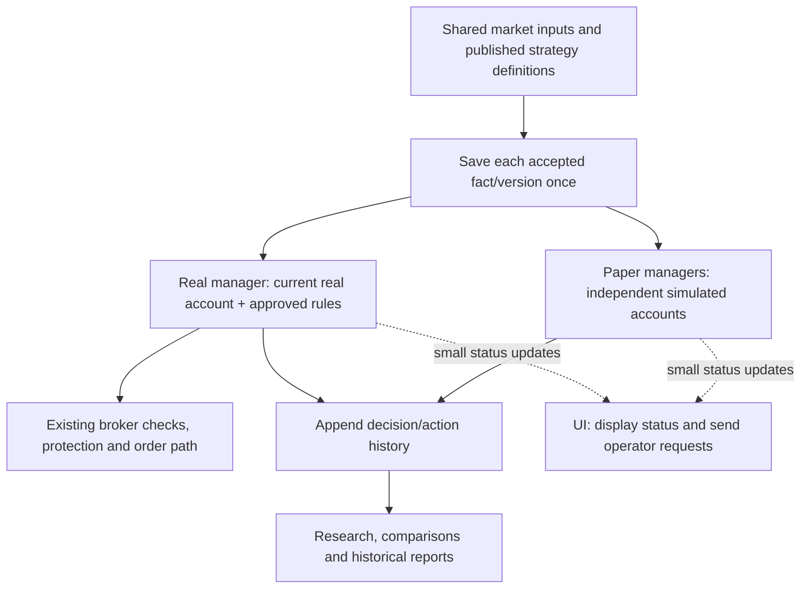

# Independent real processing — architecture draft

**October 21, 2026.** Accepted under ADR-0103: real trading independence, immediate/historical
verification separation, the nightly/weekly audit policy, and continued engine operation after dashboard
closure with an explicit stop control. Staged delivery is accepted with a requested tonight target;
feasibility is unverified. Exact cutover, retention and implementation mechanics remain proposals.
The operator has now explicitly requested implementation. This remains the architecture/acceptance
record; each concrete runtime/storage contract must be completed and tested before its use.

The immediate problem is delayed real decisions and an apparently blocked UI. The parent problem
is live work sharing history-heavy processing and broad locks. The root goal is dependable real
execution with responsive supervision, reconstructible history and unchanged financial safeguards.

## Simple structure

History in this diagram is a storage category with separate account/authority ownership, not a merged
real/paper ledger. Research may read both with explicit attribution; it cannot write either account.
UI commands return through the appropriate manager's existing authority checks. The UI does not own
collection, trading loops or full-history reconstruction.

Proposed runtime layout: a supervised operational host owns separate schedules for collection and
real management; paper management/research runs separately from that host, with paper protection
scheduled independently of expensive research. WPF displays saved/current status and submits requests.
All reuse Core strategy logic. This extends ADR-0083's independent-host direction. Dashboard closure
now explicitly leaves the engine running; a separate stop control requests orderly shutdown. Manual
start is the initial proposal; automatic Windows startup remains later work. Neither renews permission.

Use the existing SQL Server initially with distinct evidence/account ownership and short transactions.
Resource budgets and bounded batches keep research from overwhelming shared CPU, memory, provider
capacity or SQL. This reduces logical coupling but is not physical failure isolation; database/provider
failure still affects consumers. No new queue product, database server or microservice platform is needed
for this proposed first design.

## Work on current state and new changes

Each account keeps a compact current-state record: cash, open positions, pending/original order IDs,
protection floors, risk references/holds, approved strategy/permission, necessary rolling signal state
and the last consumed input/event sequence. Closed trades and old quotes live in immutable history.
Necessary accumulated facts remain in current state even when their originating event is old.

For one new five-minute bar:

1. The collector persists its accepted observation once with original source/receipt times, identity,
   validity and provenance. It publishes committed availability; notifications are hints, not sole storage.
2. Each manager reads inputs after its own saved progress marker. It advances the strategy's required
   rolling windows/confirmation and its own account state, rather than loading lifetime account history.
3. One short account-scoped transaction checks ownership/prior revision and durably saves the new
   events, current state and consumed-input marker together. Duplicate delivery uses stable identities;
   it cannot apply a fill or spend cash twice. Different accounts do not share a writer or balances.
4. Required intents and protection changes still become durable before the corresponding external
   action/quote. The existing order journal/transport remains the sole order path. Ambiguous submissions
   recover by original ID; they are not blindly retried. A provider call does not hold a broad SQL lock.
5. UI summaries update asynchronously. Research reads committed evidence in bounded batches later.

A checkpoint is a verified saved current state at a known event sequence. Restart would verify a
checkpoint, process only the later events and reconcile broker orders/account evidence. Checkpoint
frequency and maximum recovery-tail size need capacity tests. Never skip unseen input gaps, reuse stale
observations as fresh, inherit paper confirmation, reset financial holds or renew dated permission.
History remains reconstructible, including original settings and evidence, across any later conversion.

## Store facts once and refer to them

| Information | Proposed storage | What a new decision retains |
|---|---|---|
| Market bars and benchmark observations | Immutable accepted versions, shared across consumers | Exact observation/version IDs or a stable referenced range ending at the decision boundary |
| Daily publication, policy/model definition, large report | One immutable record per exact version/content | Version/content IDs and original attribution |
| Account changes | New events in that account's history | New event IDs; no copy of previous events |
| Decision result | One result per account/strategy/input identity where state matters | Exact input references, state/version linkage, output and reasons |
| Current status | Compact account projection, periodically checkpointed | Current revision and last processed sequence |

For example, one benchmark bar used by 37 symbols under three policies is one shared market fact,
referenced by those evaluations. Each genuinely different decision remains distinct. We share the
recipe and evidence; each account retains its own confirmation, cash, positions and risk memory.
Account-neutral calculations may be reused only when all inputs and definition versions match.

References must never mean 'whichever record is latest now'. Corrections/conflicts retain explicit
versions and original knowledge times. Poll receipts and order/protection quotes retain their own causal
identities; sharing content does not authorize reusing an earlier bid to trigger a later protection floor.
Evidence referenced by retained financial/research records cannot be pruned. Common data is saved once,
but different accounts' legitimate events and outcomes are not deduplicated away.

## Coordination, freshness and protection

Real execution subscribes to approved strategy definitions and direct shared inputs, not a paper
portfolio's UpdatedUtc. The current two-minute source-progress check therefore needs a reviewed
replacement demonstrating exact definition identity, required producer progress and the real manager's
consumption progress. Existing market freshness limits, on-time evidence rules and continuity checks
remain; a heartbeat alone cannot make prices fresh. No guard is removed during this design stage.

Settings changes use versioned assignments and short coordinated commits with revision rechecks.
The complete lock ordering and stale-command/recovery rules still require design and tests. Do not
replace a whole-cycle lock with unguarded actions using obsolete settings. Paper protection remains
timely even if historical research pauses; real protection never waits for paper or AI.

## Accepted verification separation

The operator accepts: immediately verify the current state/checkpoint, the new event sequence and
the exact evidence used for the decision. Run full historical reconstruction/integrity audits separately
and use them for migration/recovery qualification. This makes recurring work proportional to current
state, required rolling windows and new changes rather than lifetime history.

This changes when corruption in unrelated old history is detected compared with ADR-0082/0098's
full-history reads. Hashes alone do not solve trust, rollback or coordinated state/history tampering.
Checkpoint trust, immutable storage permissions, missing events and stale head detection still need
engineering design and validation. Audit frequency and scoped failure/recovery policy are now accepted.
The accepted separation does not authorize ignoring a known failure or implementing an incomplete
trust/recovery contract.

## Accepted historical audit schedule and failure handling

Accepted: audit new history after every trading session, and sweep the complete older archive
once per week. Auditing is independent maintenance, not part of optional research. Pausing research
must not disable either immediate trading checks or the audit scheduler. The operator accepts this
policy; no jobs are implemented or installed, and full-archive capacity has not been measured.

| When | Scope | Scheduling behavior |
|---|---|---|
| Every state update/decision | Current checkpoint/state, new event sequence, exact input references and active account/order/protection checks | Mandatory operational checks; no lifetime replay |
| After each trading session | Everything since the last successfully audited sequence, including missed prior days; reconstruct from a trusted checkpoint and compare saved account state at the same revision | Bounded batches outside market hours; original event/receipt times retained |
| Weekly | Every retained older history/evidence segment, hashes/references, continuity and reconstruction boundaries | Complete coverage target over small resumable overnight batches, with a fixed audit boundary; capacity must be measured before promising it |
| After abnormal recovery, restore or migration | Affected checkpoint/event chain, source versions and recovery boundary; wider historical audit when that boundary cannot be trusted | Verify affected state before its use; normal fresh broker reconciliation still applies separately |

The nightly audit checks the financial state derived from events as well as bytes and references; a
hash match is not proof that accounting/protection transitions were correct. Audit against a committed,
identified revision, never compare a reconstructed old account to a newer live state. Verify original
decision evidence and rule versions without silently recomputing history under today's code/settings.
Checkpoint trust and initial archive qualification remain required before incremental audits can rely
on a previously audited boundary. No read-only audit makes operational broker calls or repairs records.

Each audit records its actual covered sequence/segments, end boundary, outcome and completion time.
Only successful coverage advances its saved audit marker. Small resumable batches and resource limits
avoid lifetime-sized transactions or market-hour resource competition. If a weekly pass cannot cover
the archive within its budget, report overdue/incomplete coverage; never relabel a sample as a full pass.

| Finding | Accepted response |
|---|---|
| Proven isolated historical research problem | Flag affected evidence/results as invalid; exclude dependent research/recommendation outputs; notify the operator. Real trading may continue only when its current state and dependencies are verified unaffected. |
| Problem affects, or might affect, real cash, holdings, orders, stops, risk references, checkpoint lineage or decision inputs | Save a durable integrity hold and stop new buys/increased exposure for every affected account/input dependency. Unknown scope is not presumed research-only. |
| Protection remains independently trustworthy | Continue only protective operations whose required holdings, original order identity, authorization, state and fresh price evidence can all be verified. |
| Those protective prerequisites cannot be trusted | Do not invent a position/stop or issue an unsafe order; prominently report that automatic protection is not assured and require operator/broker reconciliation. Existing broker orders retain their original identities and recovery path. |
| Audit was interrupted, timed out or never ran | Mark incomplete/overdue and resume from successful coverage; distinguish this from proven corruption. A missed archive audit alone is not a blanket trading stop; failed/unknown required current-state checks and existing holds still block dependent actions. Escalation thresholds remain open. |

Every integrity incident retains the affected records/versions, failed check and dependency scope.
Notify on detection or meaningful status change, not every poll. A real integrity hold must be visible
to the operational manager even when discovered by background maintenance. Recovery is explicit: diagnose
the cause, propose a reviewed repair/reconstruction using original evidence, verify the affected chain
and current account/order state, then explicitly clear the hold. Restart or a later successful routine
audit cannot clear it silently. No automatic deletion, financial reset, database restore, liquidation,
order resubmission or renewed trading permission follows from an audit failure.

Audit resource budgets, overdue notification timing, exact incident persistence/release rules and
trusted-checkpoint design remain engineering details. Bring back any discovered change to user-visible
failure behavior or authority, rather than reopening the accepted policy for routine implementation choices.

## Remaining decisions before implementation

The main principles, audit policy and dashboard-close behavior are settled. The operator accepts the
staged method with a requested tonight deadline; completion feasibility remains unverified. Retention
is a separate decision before cleanup and need not block the architecture work.

| Choice | Recommended initial behavior | Status |
|---|---|---|
| Engine lifecycle | Run the engine separately from the dashboard, with manual start proposed for the first delivery. Closing the dashboard leaves an already-running engine operating within existing authority; display that clearly. Keep Stop new buys distinct from a deliberate full engine stop. After a computer restart, reopen/reconcile saved state; buying requires still-valid permission and fresh checks. Automatic Windows startup is a later installation step under ADR-0083. | Dashboard-close continuation and separate stop accepted; detailed lifecycle mechanics to implement/test |
| Delivery and cutover | Deliver in compact stages within the same implementation effort. First extract shared inputs and real processing through compatible readers; introduce current-state/event/evidence storage behind verified adapters. Compare the replacement against identical saved inputs/state without order authority, then switch a single execution owner after validation. Preserve old history and a reviewed recovery route. | Staged method accepted conditional on tonight; target feasibility unverified, exact installation/migration/switch still requires concrete review |
| Build retention | Retain the deployed build plus two known-good rollback builds and explicitly pinned investigation copies. Preserve source/manifests, models and financial/research history. Special recovery backups remain separate from regular full-backup retention. | Proposed; decide before cleanup, not a prerequisite for core implementation |

The lifecycle choice includes explicit stop/disconnect presentation and orderly shutdown; a closed UI
must not mislead the operator about continued trading or protection. Permission expiry, stopped-buy mode,
saved holds and original order recovery stay unchanged. Closing the UI, restarting Windows or enabling
an eventual startup task cannot create or renew financial authority. Manual broker actions and the
background manager must share the existing single order owner/coordination path.

Engineering work that does not require the operator to choose an algorithm: checkpoint trust and event
sequence integrity; exact evidence/version references; account-scoped transactions and lock ordering;
resource limits; direct producer/consumer progress to replace paper-ledger freshness; numeric latency,
restart and capacity budgets derived from existing deadlines; tests and migration/compatibility design.
Write these contracts and test acceptance criteria before changing behavior. Preserve existing freshness,
signal/risk rules and audit responses; ask only if a technical finding creates a new product trade-off.

No additional decision is needed to preserve the current strategy, original history, freshness limits,
buying permission/expiry or independent protection. These are existing requirements, not new options.
The latest request authorizes implementation, starting with the independent engine and continuing
through history/storage tonight. No operational switch or database migration has been performed.

Implementation checkpoint: broker-session code/account interface now live in Core; `IndependentEngine`
owns separate non-overlapping schedules and drains admitted work before close. An OS-held exclusive
lease prevents duplicate engine owners. The separate Windows executable and dashboard client now
share a bounded current-user-only pipe; the engine owns authentication, order workflows/journal and
one admission path. Dashboard detach is not engine stop; admitted commands drain even if the client
disappears. 826 related checks pass/one native skip and isolated engine/WPF builds pass. Shared-input,
incremental storage and audit integration remain; the new host deliberately refuses real execution
until their readiness contract is complete. No native host is installed or launched. Reuse the one
`artifacts/independent-engine` build tree throughout this work instead of accumulating output copies.

Shared-input storage foundation: immutable `EngineEvidenceContent` stores exact bar, policy, ruler
and daily-setup fragments once. `EngineInputPublication` stores checkpoint manifests referencing
those exact fragments. Reads verify fragment checksums and the complete restored input fingerprint;
no reference resolves to a later or corrected value. Original event/receipt/evaluation times remain.
Additive migration 047 leaves existing history untouched and requires a reviewed backup/installation.
The legacy collector still selects its existing table until independent producer/consumer integration;
this checkpoint is not a disk-growth or runtime-independence acceptance result.

## Proposed first implementation increment: independent operational host

First extract the UI-owned execution coordinator and broker-session lifetime into a UI-independent
service in shared code. Give it explicit start, status, command and orderly-stop boundaries, with one
order owner shared by manual and automatic actions. Wire that service into a separate local executable;
the dashboard becomes a client that can disconnect/reconnect without cancelling the engine. Initially
prove it with synthetic feeds and broker substitutes, not a second live order-capable process.

Host extraction alone does not remove paper dependence. Current `PollExecutionHostAsync` waits on
`BrokerSetupCycleBarrier`, while `TradingRecommendationRepository.BuildInput` reconstructs Live inputs
from `DelphiLiveEvaluation.InputJson`. The source review also checks paper progress. Therefore the
first useful operating increment must extract shared collection/input publication from paper evaluation,
preserve exact approved definitions and original observation/receipt/continuity information, and let real
management consume it directly with its own progress and confirmation. Short coordinated writes replace
whole-paper-cycle admission only after their revision/ownership guarantees are implemented and tested.

Concrete source references: `TraderVI.WPF/Services/ManualBuyCoordinator.ExecutionHost.cs`,
`TraderVI.WPF/Viewmodels/WealthsimpleConnection.cs`, `TraderVI.WPF/PaperDashboardWindow.xaml.cs`,
`Core/Trader/Promotion/BrokerManagedSessionComposition.cs`, `Core/Db/TradingRecommendationRepository.cs`
and `Core/Trader/DelphiLive/DelphiLiveMonitorWorkflow.cs`. Reuse existing Core workflows and protected
sign-in/session storage; do not introduce an unreviewed credential transfer or second submission path.

Acceptance for this increment:

- Closing/reopening the client leaves the same engine owner and broker-session lifetime intact;
  reconnect reports current status, while stale/disconnected status is plainly marked.
- An intentionally stalled/disabled paper research worker cannot stop shared publication or real
  evaluation of a new input. Test direct input identity/continuity and freshness without paper rows.
- Duplicate starts/commands cannot create two order owners or duplicate submissions; pending actions
  recover by original identity, and explicit stop reports its real completion state.
- Expired permission, absent/stale/conflicting evidence and saved holds still block the same actions;
  existing protection and manual operations use the one coordinated path.
- Settings changes and real/paper writes remain coherent under concurrency; removing a UI wait alone
  is not acceptance. Resource and lock contention must be measured before operational claims.

This increment proves independent ownership and input flow. It does not by itself remove all lifetime
history reads or shrink existing storage. Compact current state, shared evidence, historical audit jobs
and any reviewed data conversion follow as separate validated increments in the same requested effort.
Use short offline equivalence checks and builds as development checkpoints, not an invented multi-day
waiting period. Tonight is the requested target for delivery; there is no measured basis yet to promise
the complete redesign and validated native switch tonight, or to claim next-session trading behavior
has already been observed. Report any remaining scope and failed acceptance honestly.

## Storage retention and delivery

Historical evidence stays available. Separately, propose retention for reproducible build binaries and
platform-specific packaging; preserve source manifests, models, active outputs and recovery evidence.
Special backup retention is another choice. Counts/ages and deletion authority are not yet agreed.

After design agreement: (1) define direct input/freshness and ownership contracts; (2) implement an
independent producer/real consumer with safe coordination; (3) add event/current-state/checkpoint and
shared-evidence formats with an equivalence reader; (4) validate synthetic long histories, corruption,
duplicates, crashes and concurrent settings changes; (5) separately review migrations/cutover/retention;
(6) observe authorized native capacity. Sequence may change where compatibility requires a transitional
adapter. Legacy history is never silently rewritten; reads remain version-aware during transition.

Acceptance must include a deliberately slow/stopped research worker while collection, real management,
paper protection and UI remain timely; equal decisions and preserved account/risk/order history;
bounded real admission and long-history scaling; reconstructible exact evidence; no duplicate orders;
freshness/continuity blocks on genuinely late or missing data. Numeric latency/resource budgets and
shutdown mechanics are still to be specified and tested; dashboard-close continuation is accepted. No code, tests, migrations, cleanup or operational actions are performed
by this draft.
