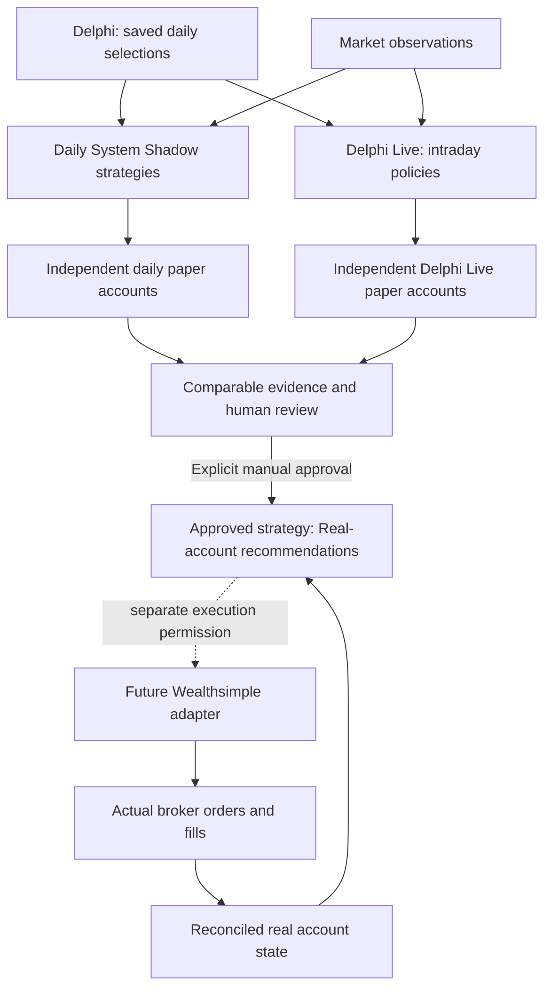

# From independent paper strategies to live execution

- **Domains:** architecture, decision-engine, risk-management, market-microstructure
- **Related ADRs:** ADR-0022, ADR-0039, ADR-0051, ADR-0053, ADR-0055, ADR-0062, ADR-0072, ADR-0073

## Summary

We want several strategies to prove themselves in separate paper accounts. We then review their evidence,
choose a strategy for real-account recommendations, and eventually allow a broker client to carry out its
approved decisions. [ADR-0055](../adr/0055-independent-strategies-to-approved-live-execution.md) records
this direction. Manual recommendation promotion is now implemented in source under
[ADR-0062](../adr/0062-complete-strategy-recommendation-promotion.md); its migration and actual activation
remain separate. Wealthsimple execution is future work. You may approve despite incomplete performance
evidence: the review explains the limitations, and enforced evidence gates are deferred to automated
live trading. Existing account consistency and risk controls still apply.

## How the pieces relate

Delphi supplies daily candidates. Each lens can publish 25; overlapping symbols are combined when Delphi
Live builds its observation list. Entry eligibility and a live policy still decide whether a candidate can
be bought. A published pick is not an unconditional order.

Daily System Shadow follows the daily portfolio policy. Delphi Live observes intraday conditions and
manages its own paper accounts. These engines share some inputs but follow different accepted rules.
Each account's cash, holdings, decisions and fills stay separate. The Portfolios tab brings those accounts
into one view; it does not merge their balances or make one engine control all accounts.

## What winning means

A **strategy** includes how stocks are selected, when to enter and exit, how much to buy, and which risk
rules apply. Its models, policy versions and data/fill assumptions must be identifiable. A **champion** is
the strategy selected for a defined role; a **challenger** is an alternative under evaluation.

The highest balance today does not establish the best strategy. Accounts may start on different days,
use different capital, or have different costs and incomplete marks. Compare their results on an explicit,
fair basis and retain downside and data-quality evidence. A Friday replay helps explain behavior, but
estimated historical fills do not establish live execution quality.

Delphi Live already has a controlled process for comparing variants of its own policy. Its “Operational
Champion” means the main Delphi Live paper policy. Selecting a winner across daily and intraday strategy
families and routing that winner to real-account recommendations still needs a common contract.

## Following the winning strategy with real money

Promotion should select the rules that produce recommendations. The real account uses its actual cash and
holdings when applying those rules. It does not inherit simulated shares or assume that a paper fill
happened at the broker. Any difference in sizing or execution constraints must be explicit and reviewed.

Initially, the operator reviews recommendations and trades manually. Later, with separate permission,
the Wealthsimple adapter can submit approved orders and report what actually happened. TraderVI still
owns the strategy and risk checks. Broker integration needs reliable account reconciliation and execution
controls in addition to an API call.

## TFSA integration draft — September 10, 2026

**Draft status:** continuing design, not implementation-ready. The accepted subset is recorded in
[ADR-0073](../adr/0073-permanent-tfsa-and-whole-share-execution.md). Proposed behavior below is not an
accepted ADR or authorization to implement, deploy, train, migrate data, liquidate or place trades.

The immediate decision is how primary promotion transfers trading responsibility to the permanent
TFSA. This belongs to the broker integration and serves the root goal of real trading under a selected
paper-tested strategy, with independent paper evidence and continuous real-account history.

### Current implementation

Native sign-in and read-only self-directed TFSA balances/holdings are live-verified under ADR-0072.
The current promotion implementation under ADR-0062 produces recommendations and requires paused,
empty state and reported financial facts. It does not submit orders. The broker snapshot is currently
separate from the operator-reported SQL account and strategy evaluation inputs.

### Decision record

| State | Contract or question |
|---|---|
| Accepted | TFSA is the permanent real account; paper accounts continue independently. |
| Accepted | Primary promotion selects an exact strategy version and, in the future execution workflow, grants authority to trade the real TFSA using those rules after activation requirements hold. |
| Accepted | Use reconciled broker holdings, cash, orders and completed trades as account facts. |
| Accepted | No TraderVI-originated fractional-share orders in the initial execution version. |
| Accepted preference | Prefer whole-share buys in multiples of ten, subject to sizing/risk constraints; exact rounding and fallback remain open. |
| User preference, not finalized | Generally use limit orders for buys and sells. |
| Accepted, September 10 clarification | Retain overlapping TFSA holdings so promotion does not sell stocks merely to buy them back; the incoming strategy manages the actual inherited position. |
| Superseded proposal | Require every TFSA holding to be sold before promotion. The operator explicitly chose an overlap exception. |
| Open | Confirm which non-overlapping holdings must exit before activation, whether promotion initiates those exits, and the ownership/timing of protection for retained holdings. |
| Open | Limit pricing, expiry, partial fills, protective-exit urgency, cancellation/replace semantics, uncertain submissions and transition cancellation. |
| Open | Reconciliation identity mapping, fill/activity history, cash/valuation baselines, polling cadence and fractional residual exceptions. |
| Open detail within accepted retention | Define intended holdings at review/activation, quantity adjustments and protection initialization. Do not require equality with paper quantities or a fresh buy signal merely to retain a wanted position. |

### Proposed promotion transition

1. Review the exact incoming strategy and current TFSA facts. Show existing holdings to **retain**,
   non-overlapping holdings to **exit**, and possible **new entries**. Record the operator's approval
   and intended strategy version; do not silently follow future paper edits.
2. Stop new entries under the outgoing assignment and reconcile existing orders. Cancellation
   requests alone do not remove exposure. An outstanding sell on a retained security must be resolved
   before assuming its shares will remain available for handover.
3. Preserve overlapping holdings and their actual quantities, cost basis and purchase history.
   A transition executor closes non-overlapping holdings using the agreed order policy. Every holding
   retains an explicit protection owner; incoming-buy timing remains to be finalized.
4. Wait for required broker-confirmed fills and cancellation/expiry outcomes. A required exit that
   remains unfilled leaves transition work outstanding. Do not invent a market-order fallback or
   reprice without bounds. Whether this delays all activation or only new entries remains open.
5. Reconcile the agreed retained holdings, resolved outstanding/uncertain orders and usable broker
   buying power. Activate the reviewed strategy at a recorded boundary and transfer management of
   retained positions after rechecking inputs, account holds and incoming protection state.
6. Evaluate new entries and any subsequent sizing changes against actual TFSA capital under the
   incoming strategy. Do not copy the paper account's quantities or create simulated fills. Retained
   holdings do not need to repeat a historical entry signal just to avoid a sell/rebuy.

Proposed visible states: **Pending transition → Closing positions → Reconciling → Active**, with
**Needs attention** when an order outcome or account fact is unknown. State names and cancellation
semantics remain draft. Account lifetime history, loss holds and risk baselines do not reset when the
primary strategy changes. Attribute transition trades separately rather than rewriting paper results.

Overlap retention is now part of the initial design. It avoids unnecessary promotion turnover while
preserving actual TFSA positions. Real and paper results can differ because quantities, entry history,
capital and execution differ. Record an observed value and timestamp at handover for future strategy
attribution without rewriting real cost basis, entry dates or account-level loss history.

Recommended overlap definition: the same broker security in the TFSA and the incoming strategy's
current intended holdings; the source paper holdings provide review evidence. A broad candidate list
is insufficient. Current intent must be explained at the chosen review/activation time; stale holdings
or a strategy that already wants to exit need explicit handling. The exact predicate remains open.

Example: TFSA owns A and B; incoming intended holdings are B and C. Retain the actual TFSA holding B,
exit A under the transition policy, then consider C under the incoming entry/sizing rules and available
buying power. A paper holding of 100 B shares does not turn an actual TFSA holding of 30 B shares into
100, and differing quantities do not by themselves require selling and buying back the retained lot.

### Proposed sizing interpretation

Calculate the affordable risk-limited whole-share quantity first. A possible preference rounds a
37-share allowance down to 30; if only seven shares fit, allow seven rather than increasing to ten.
This sizing helper is now implemented and tested, but is not yet connected to broker submission.
Exits permit any positive whole quantity, including residuals from
partial fills. Persist actual observed fractional positions and flag them; never hide them through
rounding, and do not silently submit a fractional market order to work around the invariant.

### Acceptance criteria for enabling real execution

- One active primary strategy version per real TFSA, with a durable approval and effective boundary.
- Paper records and real account history remain independent across transitions.
- Approved overlap transfers without a promotion sell/rebuy or a fabricated purchase. Preserve actual
  quantity, cost basis and entry history; record management transfer and attribution time separately.
- Required exits and retained holdings are identified by broker security, with a defined protection
  owner throughout transition. A pending sell cannot be ignored when transferring a retained holding.
- A reviewed broker-mode activation check replaces unconditional emptiness with consistency against
  the accepted retained set; existing recommendation-only checks remain unchanged until implemented.
- Verified account/security identities, full order/fill coverage and duplicate-safe reconciliation.
- Whole-share order validation before submission; sizing cannot exceed available cash or risk bounds.
- Pending orders reserve the relevant cash/shares; only actual fills change realized holdings.
- Timeout or cancellation ambiguity triggers reconciliation before any replacement submission.
- No incoming buy before the agreed transition boundary; failures retain accountable remaining exposure.
- Entry/exit limits, transition cancellation and residual handling have explicit testable rules.

Implemented September 10: pending-order reads and a main-page transition preview; exact broker
instrument matching for overlaps; whole-share intent validation and conservative buy rounding. The
preview is separate from actual promotion approval and sends no orders. Completed fills and local
records remain unreconciled. A purchase ceiling is user-entered and defaults to zero.

Remaining order of work: finish the transition/execution design, extend completed-fill discovery, implement
reconciliation, implement and verify the order lifecycle, then connect reviewed primary promotion.
The user can manually demonstrate order workflows when protocol capture is needed; this draft itself
authorizes no order demonstration or live order execution.

### Decision history

The assistant initially recommended a reviewed takeover of existing TFSA holdings. The operator raised
strategy contamination and implementation complexity, prompting a proposed cash-start transition.
The operator then explicitly clarified that overlapping holdings should remain in the TFSA and pass
to the new strategy's management. That accepted clarification supersedes unconditional liquidation;
transition execution and protection initialization remain open.

## Review questions

1. Why can accounts share market observations while retaining separate cash and positions?
2. Why is Delphi Live's Operational Champion not automatically the real-account strategy?
3. What is the difference between a recommendation, an approved order and an actual fill?
