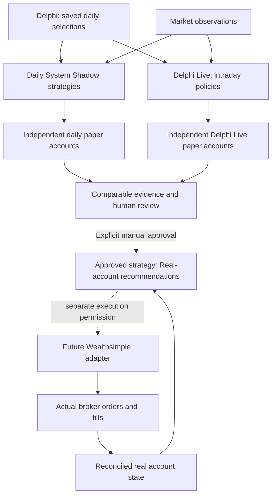

# From independent paper strategies to live execution

## Portfolio-wide ongoing management — September 22

**Continuing draft:** the accepted scope/duration and September 23 manual-handover subset is recorded in
[ADR-0085](../adr/0085-portfolio-wide-ongoing-tfsa-management.md). The remaining workflow below is not
an accepted ADR or operational authorization. On September 23 the operator ended the edge-case design
pass and asked to refocus; the agreed common path is ready for bounded implementation under the original
request. The operator resumed guided dialogue for the next priorities and accepted the stop-control
and checked restart behavior below. Remaining consequential transitions still need acceptance criteria. The operator
separately authorized necessary database migrations; 035/039/040 were installed and verified at
23:34 Toronto. That installation creates no real-account baseline or trading authority.

The immediate problem is one promotion flow for any portfolio. The parent problem is handing over
real-account management between exact strategies. The root goal is continuous TFSA management with
independent paper evidence and preserved real-account history and protection.

| State | Decision or question |
|---|---|
| Accepted | Any portfolio is in scope, including current Daily Shadow and Delphi Live variants. Breakout Top 3 is an initial candidate, not the only supported portfolio. |
| Accepted | After promotion, keep managing on future trading days until the operator pauses or switches; account and risk checks still apply each day. |
| Accepted, existing contracts | Pin the reviewed rules, gate profile, policy/model/build identities. Use actual TFSA cash/holdings; paper financial history stays separate. |
| Accepted, existing contracts | One active owner, retain overlaps/protection, reconcile required exits before buys, preserve references/holds and original uncertain order IDs. |
| Open — refined September 23 | Distinguish manual orders placed through TraderVI from orders placed directly in Wealthsimple; the operator wants both cases addressed. Recommend automatic reconciliation and continuation for known in-app orders when ownership and risk checks pass; reserve human review for unresolved facts/authority, rather than every manual fill. |
| Accepted September 23 | Manual purchases through TraderVI stay outside the active strategy by default. Provide a later holding action to hand over management and an optional purchase-dialog choice targeting the active strategy. |
| Accepted request; first implementation | Shared broker-account/history synchronization every five minutes while connected, plus immediate manual/post-trade refresh. Fresh order checks remain separate; rollout is pending. |
| Accepted direction, September 23 | Explicit manual handover can add an extra managed holding: Breakout 3 may manage four. Apply existing sell/protection rules; do not force an exit solely to restore the count. Record the manual exception separately from strategy-generated selection. |
| Accepted clarification, September 23 | Keep three normal strategy positions plus manual extras managed for exits only. Extras do not consume automatic position slots or block normal rotation by their count; they receive applicable sell/protection rules without automatic additions or replacement. Actual cash and account risk still constrain all trades. |
| Accepted September 23 | Stop further automatic purchases while existing managed holdings continue under normal sell/protection rules. Retain Market sell all on each real holding row using the existing manual sell workflow. |
| Proposed presentation | Stop new buys / Resume buying, with New buys stopped · exits active as the status. Resume removes only the operator buy restriction; existing account/risk checks still apply. |
| Accepted September 23 | Restore the same approved strategy and saved buying mode after app restart once fresh account/order checks pass. Stopped buying stays stopped; restarting cannot reset risk history or unresolved orders. |
| Open | Detailed ongoing replacement/cancellation transitions and resolving an invalidated review without resetting history. |
| Deferred | Limit orders, new strategy/risk rules and unsupported future policy types; current accepted market-order and risk rules remain. |
| Deferred September 23 | Same-stock manual additions/split ownership. The operator will not manually add to a strategy holding and asked to return to the main goal; preserve existing conflict checks if it occurs unexpectedly. |

**Implementation boundary:** Core supports explicitly approved ongoing assignments with checked daily
continuation; existing one-session approvals still expire. Replacement is unsupported and protection
transfers only into Daily Shadow. Its exact comparison-profile handling is reusable; this does not
implement every portfolio family. Shared synchronization, purchase controls and saved selection
restoration in WPF are source/tested; execution-host startup, native qualification and rollout remain.

**September 23 manual-trade clarification:** choosing who places
an order and choosing who subsequently manages the holding are separate decisions. A manually chosen
stock under strategy management can later be sold by that strategy. Under manual management, the
operator owns exit decisions; no automatic strategy protection is implied. The operator accepted manual
management by default, with a later holding action and an optional purchase-dialog handover choice.
Compatibility and ownership-transfer details remain draft. The operator then explicitly requested
allowing a manual handover above the normal position count; do not treat that manual entry as a
strategy-generated pick or silently increase the automatic buying target.

For an identified in-app order, reserve cash/shares before submission, recover its original ID,
reconcile confirmed fills and cash, then recheck existing limits before continuing. Pending/uncertain
orders still block conflicting actions. A second operator approval is proposed only when an unresolved
ownership decision, conflicting facts or an existing risk rule requires it. This replaces the assistant's
overbroad recommendation to require review after every manual fill; the operator has not accepted the
replacement yet. An order found directly at the broker still needs attribution and reconciliation.

Source inspection on September 23 confirms `BrokerManagedSessionWorkflow` classifies a changed fill
outside its own saved order list as an outside change, including a manual order sent through TraderVI.
It invalidates the review and blocks all further managed orders; it does not implement the proposed
automatic continuation or separate protection behavior. No execution code changed in this dialogue.

With manual holdings accepted, define their treatment during promotion/switching explicitly: the
existing non-overlap exit contract does not yet exempt them. Also settle shared cash/sizing and position
limits, protection responsibility and whether manually selling a managed stock allows later strategy
re-entry. Keep one owner per security for the first version; do not add a split-ownership mechanism for
the deferred same-stock case. The remaining details cannot waive
existing account-wide risk rules.

### Stop control and row exits — September 23 accepted behavior

The control stops automatic purchases, including additions and replacements, while the active strategy
continues its ordinary exits for the holdings it manages. A stop is not a liquidation request. Keep the
existing owner, risk references and protection; outstanding orders still require original-ID recovery.
The manual row action remains independent of this buying mode. Reuse **Market sell all** from the
current broker holdings panel, retaining exact displayed quantity, fresh checks, one-click intent and
the existing whole-share CAD-equity scope. Unsupported/pending/stale cases explain why the action is
unavailable; do not add a second confirmation or a new broker implementation.

Acceptance cases for the ongoing workflow: no Buy/Add submission after the stop takes effect; normal
sell rules still run; a confirmed sale while stopped causes no replacement buy; a manual row sale uses
the same order fence and reconciles before further action; resume cannot clear account risk holds.
Pending submissions are recovered, never assumed cancelled or sent again. Current `Paused` in the
first-session engine also blocks automatic exits and remains a distinct full execution pause.

**Restart accepted:** restore the exact approved strategy and saved buying mode after fresh account/order
checks. Failed checks retain the selection/mode without permitting orders. Restore original uncertain
order IDs, reservations, references, holds and protection; stopping buys cannot be undone by reopening.

**Source/tested September 23:** Core now persists a separate purchase mode through the existing session
revision store. Stop/resume serializes with transmission; a sent order retains normal recovery. Each
execution tick synchronizes first, suppresses Buy/Add when stopped and still evaluates ordinary exits.
Sixteen added cases cover mode recovery, failed checks, partial required exits, protective sells, lost
save replies, concurrent stop, uncertain orders and legacy snapshots. No schema change is needed.
The next increment connects the controls to the TFSA panel and restores saved strategy/mode after a
successful linked-account refresh, including startup. No approval or execution tick runs from these
controls. Core now retains explicitly approved ongoing assignments across verified risk days and
replays missed prior-day protection bars. Existing one-session approvals keep their expiry, and the
approved purchase ceiling never refills automatically. Native qualification, execution-host startup,
family adapters and switching remain unfinished. See ADR-0085 for the accepted scope and exact limits.

### Handover controls and account synchronization — September 23 draft

Place **Assign to active strategy…** beside a manual holding in the TFSA holdings view. In the buy
dialog, add an unchecked **Let [active strategy name] manage this holding** option. The selected exact
strategy/version is part of the reviewed intent. If it changes before submission or handover, explain
the change and require a fresh choice; do not silently redirect to whichever strategy exists at fill
time. When no strategy is active, explain why handover is unavailable; a manual buy remains a separate
operation under its existing controls. Preserve pending fills/intent if a post-fill handover cannot finish.

The handover preview should show actual quantity/cost, incoming owner, carried protection, count exception
and compatibility blocks, and any immediate exit the incoming rules would require. Keep the existing
owner responsible until a durable transfer succeeds. Handover itself creates no broker fill. Partial-fill
transfer timing and manual exclusions on a later
portfolio switch remain open; the presence of a button does not waive these checks.

Synchronization acceptance criteria (first source increment implemented/tested; not installed):

- Poll every five minutes while the app is open and the account is connected, independently of the
  visible tab; refresh on connection/reconnection and retain **Refresh now**.
- Use one coordinated account view for balances, buying power, holdings, pending/completed order
  changes and linked history. Refreshing display balances alone is not reconciliation or proof of
  complete cash-event history. Reuse the current native clients, importer and original-order journal.
- Refresh after an in-app trade and recover outstanding orders using their existing workflow rather
  than waiting five minutes. Keep final order preflight fresh under the existing rules. A broker order
  placed elsewhere between polls remains possible; polling does not make broker reads atomic.
- Share completed observations across screens and strategy inputs. Serialize/coalesce overlapping
  refresh requests, preserve order fences, discard results from a replaced login/account, and back off
  after rate limits. A failed read keeps the last valid snapshot visibly stale; it cannot clear holdings,
  orders or risk holds or qualify new risk. Show the last successful synchronization time and failures.

The shared `BrokerAccountSynchronizationWorkflow` now appends only already-linked, freshly rechecked
history and returns the same final broker read to the display. Both desktop and managed-account source
reuse it. The app's separate clock checks five-minute refresh eligibility independent of the visible tab;
overlapping explicit requests schedule one follow-up read and failure retries back off at 5/10/20/30
minutes. Logout/shutdown cancels reads. Conflicting or uncertain orders preserve saved history and show
blocks. Original-order recovery remains in its existing workflows; polling cannot clear those reservations.
Manual/external attribution and automatic continuation after in-app fills remain unfinished. No app
restart, native poll or SQL history write ran during this source increment.

**Accepted role separation:** the strategy's own positions follow its normal entry/addition/rotation
rules and occupy its automatic slots. Manually added extras receive its applicable sell/protection
rules only; no automatic purchase/addition or replacement is authorized by that role. Unassigned manual
holdings remain under operator management. Keep origin separate from current management role.

Example: A/B/C are the three strategy positions; D is a manually added extra. Selling A and buying
qualifying E after confirmed/reconciled funds are available leaves B/C/E plus D. Selling D leaves
B/C/E and creates no automatic vacancy. A later independent entry into D must satisfy normal entry,
re-entry and capacity rules; the manual handover itself creates no future buy authority.

**Superseded recommendations:** neither waiting for a free slot before handover nor counting extras
against the three automatic positions matches the operator's intent. Both suggestions are rejected.
All holdings still share actual cash and account risk. Do not fabricate available funds or remove
manual/unassigned holdings from valuation to make automatic buying continue.

**Implementation boundary:** `TradingRecommendationEngine` currently uses one holdings collection
for account valuation, protective evaluation, candidate ownership and automatic capacity. Implement
separate role-aware decisions over one reconciled account book: value every actual holding, protect
strategy positions plus enrolled extras, and count only normal strategy positions toward automatic
capacity. Merely filtering extras out of the engine input would lose their value and protection.
Automatic sizing with capital tied up in extras, transfer timing and role
behavior during a strategy switch still require coherent acceptance criteria.

The operator asked to end the edge-case design pass and resume the main implementation. Do not gate the
agreed common path on a split-ownership design. Next qualify native risk inputs and installed storage
runtime, then complete ongoing assignment and both family adapters. Express acceptance cases for
multi-day continuation, cross-family switching, overlap protection, partial/unknown fills, outside
changes and restart as each consequential transition is implemented. Reuse existing broker,
reconciliation, risk and durable-order components. Qualification and a concrete activation review precede
any explicitly approved live session; the September 23 target cannot bypass missing evidence.

**September 22 risk/hosting checkpoint:** use shared Core code for the current app and the eventual
standalone engine started before market by Windows Task Scheduler. Dated reads, boundary valuation,
daily references/holds and confirmed cash-flow adjustment are tested offline.

The user accepted keeping an account down 2% at the same 2% immediately after adding or removing money.
The new calculation scales both reference values using the confirmed cash movement and matching account
books, preserving existing holds. It processes individual events and prevents duplicate application after
restart. An unchanged net-deposit total cannot prove no cash moved. The broker source still needs complete
event coverage and verified effective timing; native morning qualification and operational wiring remain.
No WPF-specific recovery system or new late-start pause was added.
See [ADR-0083](../adr/0083-opening-account-values-and-shared-engine-hosting.md).

- **Domains:** architecture, decision-engine, risk-management, market-microstructure
- **Related ADRs:** ADR-0022, ADR-0039, ADR-0051, ADR-0053, ADR-0055, ADR-0062, ADR-0072, ADR-0073

## Summary

We want several strategies to prove themselves in separate paper accounts. We then review their evidence,
choose a strategy for real-account recommendations, and eventually allow a broker client to carry out its
approved decisions. [ADR-0055](../adr/0055-independent-strategies-to-approved-live-execution.md) records
this direction. Manual recommendation promotion is now implemented in source under
[ADR-0062](../adr/0062-complete-strategy-recommendation-promotion.md); its migration and actual activation
remain separate. Wealthsimple execution is future work. You may approve despite incomplete performance
evidence: the review explains the limitations, and enforced evidence gates are deferred to automated
live trading. Existing account consistency and risk controls still apply.

## How the pieces relate

Delphi supplies daily candidates. Each lens can publish 25; overlapping symbols are combined when Delphi
Live builds its observation list. Entry eligibility and a live policy still decide whether a candidate can
be bought. A published pick is not an unconditional order.

Daily System Shadow follows the daily portfolio policy. Delphi Live observes intraday conditions and
manages its own paper accounts. These engines share some inputs but follow different accepted rules.
Each account's cash, holdings, decisions and fills stay separate. The Portfolios tab brings those accounts
into one view; it does not merge their balances or make one engine control all accounts.

## What winning means

A **strategy** includes how stocks are selected, when to enter and exit, how much to buy, and which risk
rules apply. Its models, policy versions and data/fill assumptions must be identifiable. A **champion** is
the strategy selected for a defined role; a **challenger** is an alternative under evaluation.

The highest balance today does not establish the best strategy. Accounts may start on different days,
use different capital, or have different costs and incomplete marks. Compare their results on an explicit,
fair basis and retain downside and data-quality evidence. A Friday replay helps explain behavior, but
estimated historical fills do not establish live execution quality.

Delphi Live already has a controlled process for comparing variants of its own policy. Its “Operational
Champion” means the main Delphi Live paper policy. Selecting a winner across daily and intraday strategy
families and routing that winner to real-account recommendations still needs a common contract.

## Following the winning strategy with real money

Promotion should select the rules that produce recommendations. The real account uses its actual cash and
holdings when applying those rules. It does not inherit simulated shares or assume that a paper fill
happened at the broker. Any difference in sizing or execution constraints must be explicit and reviewed.

Initially, the operator reviews recommendations and trades manually. Later, with separate permission,
the Wealthsimple adapter can submit approved orders and report what actually happened. TraderVI still
owns the strategy and risk checks. Broker integration needs reliable account reconciliation and execution
controls in addition to an API call.

## TFSA integration draft — September 10, 2026

**September 14 update:** [ADR-0079](../adr/0079-broker-reconciliation-and-market-handover.md) records the
accepted first version: regular-session market orders, automatic non-overlap exits on promotion, then
confirmed fills and reconciliation before new buys. Retain overlaps. The account-history reconstruction
and protected observation journal now run from the account screen and transition preview. SQL binding,
cash/risk baselines, protection ownership and actual automatic execution are unfinished. The remaining
proposal below is a continuing draft, not authorization to trade or deploy a migration.

**Draft status:** continuing design, not implementation-ready. The accepted subset is recorded in
[ADR-0073](../adr/0073-permanent-tfsa-and-whole-share-execution.md). Proposed behavior below is not an
accepted ADR or authorization to implement, deploy, train, migrate data, liquidate or place trades.

The immediate decision is how primary promotion transfers trading responsibility to the permanent
TFSA. This belongs to the broker integration and serves the root goal of real trading under a selected
paper-tested strategy, with independent paper evidence and continuous real-account history.

### Current implementation

Native sign-in and read-only self-directed TFSA balances/holdings are live-verified under ADR-0072.
The current promotion implementation under ADR-0062 produces recommendations and requires paused,
empty state and reported financial facts. It does not submit orders. The broker snapshot is currently
separate from the operator-reported SQL account and strategy evaluation inputs.

### Decision record

| State | Contract or question |
|---|---|
| Accepted | TFSA is the permanent real account; paper accounts continue independently. |
| Accepted | Primary promotion selects an exact strategy version and, in the future execution workflow, grants authority to trade the real TFSA using those rules after activation requirements hold. |
| Accepted | Use reconciled broker holdings, cash, orders and completed trades as account facts. |
| Accepted | No TraderVI-originated fractional-share orders in the initial execution version. |
| Accepted preference | Prefer whole-share buys in multiples of ten, subject to sizing/risk constraints; exact rounding and fallback remain open. |
| Accepted, September 14 first version | Use market orders during regular hours. Limit execution is deferred. |
| Accepted, September 10 clarification | Retain overlapping TFSA holdings so promotion does not sell stocks merely to buy them back; the incoming strategy manages the actual inherited position. |
| Superseded proposal | Require every TFSA holding to be sold before promotion. The operator explicitly chose an overlap exception. |
| Accepted, September 14 | Promotion initiates required non-overlap sells; confirmed exits and reconciliation precede new buys. |
| Accepted, ADR-0081 | Current protection owner remains responsible through required exits/reconciliation; ownership transfers at activation with established protective levels. Missing protection starts from actual cost and fresh observed evidence. |
| Open | Exact intended-holdings evidence, position-cycle identity mapping and causal protection-state handover across strategy families. |
| Open | Limit pricing, expiry, partial fills, protective-exit urgency, cancellation/replace semantics, uncertain submissions and transition cancellation. |
| Open | Reconciliation identity mapping, fill/activity history, cash/valuation baselines, polling cadence and fractional residual exceptions. |
| Open detail within accepted retention | Define intended holdings at review/activation, quantity adjustments and protection initialization. Do not require equality with paper quantities or a fresh buy signal merely to retain a wanted position. |

### Broker history integration — September 14 design dialogue

**September 16 implementation update:** [ADR-0080](../adr/0080-reviewed-broker-history-import.md)
implements the preview and repeatable SQL history repository. The first link requires explicit review
in this provisional version; subsequent explicit import refreshes update supported observations.
Migration 034 is installed; the account link, 32-order save and subsequent native WPF refresh are
operator-confirmed as of September 16 at 22:06 Toronto. This establishes a separate broker history, preserving legacy trades
and position identities. The strategy engine is not switched to it until baseline/protection work is
complete. No individual execution timestamps are invented from cumulative order totals.

**September 16 proposed simplification:** the operator questioned whether all old orders are necessary.
Recommend initializing from verified current holdings/costs, cash/buying power and resolved pending
orders, then synchronizing activity from an explicit starting boundary. Older history import would
be optional. This is a proposal, not an implemented mode or a reset of account history/risk controls.
The retained holdings' protection, existing loss holds, valuation baseline and handling of unknown
entry dates still require definition. Current manual buy/sell controls do not depend on full-history
import; durable automatic promotion and execution still need these account inputs.

The next milestone connects reconciled Wealthsimple observations to the saved real-account history
used by strategy evaluation. Today those sources remain separate. The immediate problem is identifying
existing manually recorded trades that describe the same broker transactions, without duplicating
exposure, rewriting prior evidence or resetting position protection and account risk holds.

- **Accepted operating constraint, updated September 15–16:** the operator is starting WPF for collection
  and authorizes background implementation. Preserve running outputs and use isolated build/test paths.
  Coordinate a restart when tested changes are useful; live database changes still need separate authority.
- **Provisional first-link behavior implemented September 16:** present one initial account-link/import
  review showing matched existing records, proposed additions and unresolved conflicts. Following an
  approved link, subsequent explicit import refreshes save supported broker updates automatically. Ambiguous
  matches remain explicit and prevent new-buy eligibility; no uncertain match silently merges history.
- **Open:** whether to relax the initial review after testing the concrete preview. ADR-0080 defines the
  initial identity/match and transaction checks; corrections, polling cadence, individual-fill history,
  strategy-input projection and risk/protection baselines remain unfinished.
- **Boundary:** connecting account facts does not activate a strategy or submit an order. This remains
  a draft proposal, not an accepted ADR or authorization to implement, migrate data or trade.

The Delphi Live monitor has persisted-state recovery, but an interruption records a coverage gap,
expires pending buys and rebuilds entry confirmation using fresh observations. It does not replay
missed actions. This is a code/documentation finding, not a test of today's running instance.

### Account baselines and protection ownership — September 16 continuation

**Draft completeness:** the five bounded decisions below are accepted in
[ADR-0081](../adr/0081-broker-account-baselines-and-protection-ownership.md). The initial risk-reference
preparation and reviewed SQL save/recovery workflow are implemented and tested offline, with migration
035 prepared but uninstalled and no operator UI yet. The complete account-input and protection
handover design is still a draft, not implementation-ready for activation, and grants no authority
to mutate the database, change account history, restart the application or trade.

The immediate problem is defining the account facts and protective obligations that survive setup
and promotion. This supports broker-backed strategy evaluation and the root goal of one reviewed
strategy managing the permanent real TFSA without contaminating independent paper evidence.

| State | Decision |
|---|---|
| Accepted | If an applicable risk reference does not exist, establish the first reference from verified current account value during setup. No arbitrary waiting period; record the actual measurement boundary. |
| Accepted | Preserve known account references and effective holds. A failed history read is not evidence of absence. Repeated setup and promotion cannot reset established baselines. |
| Accepted | Purchase availability starts at the lower of fresh CAD cash and buying power, subject to strategy sizing and reservations. Unfinished sales and pending funding supply no assumed funds. |
| Accepted | Keep the current protection owner through transition; transfer retained holdings' protection once at activation, carrying established protective exit levels. |
| Accepted | Initialize previously missing protection from actual cost and fresh evidence at activation. Never copy paper highs/protection or invent unseen historical highs. |
| Accepted | Confirmed deposits/withdrawals adjust loss references; unexplained cash movements pause new buys. Cash movement alone does not release holds. |
| Open | Daily opening/closing reference continuation, cash-event evidence/timing and coverage gaps. The setup boundary does not manufacture these observations. |
| Open | Exact real position-cycle mapping, protection timestamps and translation across strategy families, intended-holdings freshness and behavior after manual/external changes. |
| Deferred to execution increment | Durable transition/reservations, partial fills, uncertain submissions, restart recovery and automation qualification. |

The earlier proposal to make older-history import optional is still separate. These accepted baseline
rules do not bypass the existing import checks or delete/relink the saved account/history.

Source ownership recovered from the implementation:

| Fact or state | Authority and current gap |
|---|---|
| Current shares, costs, cash, buying power and account value | Saved, reconciled observations for the fixed broker binding. Legacy SQL remains historical evidence; it is still the engine's active input until explicit cutover. |
| Risk references and account holds | Effective `TradingAccountReport` and `TradingRecommendationBatch` memory, plus future persisted broker baselines. An explicit prior capital review remains valid; setup cannot itself release a hold. |
| Tracked-position protection | Existing tracked monitor evidence/highs and recommendation symbol memory. These are separate owners/state formats; identify the current owner per real position before transfer. |
| Pending and uncertain orders | Fresh broker order reads plus the durable local manual-order journal. Neither a timeout nor a cancellation request proves zero remaining exposure. |
| Paper positions and protection | Independent evidence only. Paper quantities, entry dates, highs and simulated fills are never real-account facts. |

`BrokerAccountRiskBaselinePolicy.Prepare` now preserves existing applicable session/high references
and labels new initial references as `SetupObservation`, with import/binding IDs and evidence times.
It requires a complete risk-history read and fresh valid saved broker evidence. It carries account
holds and existing recommendation symbol memory without transferring position ownership. It rejects
initialization when a baseline already exists. The reviewed workflow and repository now recheck source
and risk state under account fences and save one immutable baseline with request recovery. Migration
035 is uninstalled. The later September 22 source increment adds a setup UI and broker execution
composition under [ADR-0084](../adr/0084-supervised-broker-strategy-session.md); no operational baseline
or enabled host has been created. The [launch review](../reviews/supervised-session-20260923.md) is NO-GO.

The current repository clears recommendation symbol memory on strategy changes because its accepted
recommendation-only path requires an empty account. Keep that path intact. Broker promotion must use
an explicit handover that preserves retained positions; it cannot reuse the empty-account assumption.

Next acceptance criteria and implementation order (September 20 sequencing clarification):

1. Percentage-preserving cash adjustments were accepted September 22 and implemented/tested alongside
   no-flow session continuation. Native effective event timing and matching books remain unqualified. A dedicated
   baseline review screen is not a development dependency. Define real position identities; preserve
   legacy references only for the same cycle, not a fully closed/reopened holding.
2. Before operational use, present a concise reference/hold summary within account setup and wire its
   explicit apply to the implemented consistent-read/setup repository, then separately
   verify/install migration 035 and exercise native setup. A missing/failed read cannot initialize a
   replacement; a fresh observation cannot lower a known reference. The source save and repeat-request
   recovery contracts are covered offline, not yet by a SQL transaction rehearsal.
3. Project broker account facts and implement ongoing synchronization with visible stale/conflict states.
   Deduct each order reservation once. Retain unknown entry timing instead of creating a new purchase date.
4. Implement activation-time protection handover, carrying protective levels and causal timestamps.
   New protection cannot trigger against a pre-activation low. Then implement the durable transition
   and execution coordinator, and separately qualify/verify real execution.

### Proposed promotion transition

1. Review the exact incoming strategy and current TFSA facts. Show existing holdings to **retain**,
   non-overlapping holdings to **exit**, and possible **new entries**. Record the operator's approval
   and intended strategy version; do not silently follow future paper edits.
2. Stop new entries under the outgoing assignment and reconcile existing orders. Cancellation
   requests alone do not remove exposure. An outstanding sell on a retained security must be resolved
   before assuming its shares will remain available for handover.
3. Preserve overlapping holdings and their actual quantities, cost basis and purchase history.
   A transition executor closes non-overlapping holdings using the agreed order policy. Every holding
   retains its current protection owner until activation, as accepted in ADR-0081.
4. Wait for required broker-confirmed fills and cancellation/expiry outcomes. A required exit that
   remains unfilled leaves transition work outstanding. The first version deliberately uses market
   orders; any future limit version requires a separate bounded fallback policy. New entries wait for
   required exits to reconcile; existing protection remains with its current owner until activation.
5. Reconcile the agreed retained holdings, resolved outstanding/uncertain orders and usable broker
   buying power. Activate the reviewed strategy at a recorded boundary and transfer management of
   retained positions after rechecking inputs, account holds and incoming protection state.
6. Evaluate new entries and any subsequent sizing changes against actual TFSA capital under the
   incoming strategy. Do not copy the paper account's quantities or create simulated fills. Retained
   holdings do not need to repeat a historical entry signal just to avoid a sell/rebuy.

Proposed visible states: **Pending transition → Closing positions → Reconciling → Active**, with
**Needs attention** when an order outcome or account fact is unknown. State names and cancellation
semantics remain draft. Account lifetime history, loss holds and risk baselines do not reset when the
primary strategy changes. Attribute transition trades separately rather than rewriting paper results.

Overlap retention is now part of the initial design. It avoids unnecessary promotion turnover while
preserving actual TFSA positions. Real and paper results can differ because quantities, entry history,
capital and execution differ. Record an observed value and timestamp at handover for future strategy
attribution without rewriting real cost basis, entry dates or account-level loss history.

Recommended overlap definition: the same broker security in the TFSA and the incoming strategy's
current intended holdings; the source paper holdings provide review evidence. A broad candidate list
is insufficient. Current intent must be explained at the chosen review/activation time; stale holdings
or a strategy that already wants to exit need explicit handling. The exact predicate remains open.

Example: TFSA owns A and B; incoming intended holdings are B and C. Retain the actual TFSA holding B,
exit A under the transition policy, then consider C under the incoming entry/sizing rules and available
buying power. A paper holding of 100 B shares does not turn an actual TFSA holding of 30 B shares into
100, and differing quantities do not by themselves require selling and buying back the retained lot.

### Proposed sizing interpretation

Calculate the affordable risk-limited whole-share quantity first. A possible preference rounds a
37-share allowance down to 30; if only seven shares fit, allow seven rather than increasing to ten.
This sizing helper is now implemented and tested, but is not yet connected to broker submission.
Exits permit any positive whole quantity, including residuals from
partial fills. Persist actual observed fractional positions and flag them; never hide them through
rounding, and do not silently submit a fractional market order to work around the invariant.

### Acceptance criteria for enabling real execution

- One active primary strategy version per real TFSA, with a durable approval and effective boundary.
- Paper records and real account history remain independent across transitions.
- Approved overlap transfers without a promotion sell/rebuy or a fabricated purchase. Preserve actual
  quantity, cost basis and entry history; record management transfer and attribution time separately.
- Required exits and retained holdings are identified by broker security, with a defined protection
  owner throughout transition. A pending sell cannot be ignored when transferring a retained holding.
- A reviewed broker-mode activation check replaces unconditional emptiness with consistency against
  the accepted retained set; existing recommendation-only checks remain unchanged until implemented.
- Verified account/security identities, full order/fill coverage and duplicate-safe reconciliation.
- Whole-share order validation before submission; sizing cannot exceed available cash or risk bounds.
- Pending orders reserve the relevant cash/shares; only actual fills change realized holdings.
- Timeout or cancellation ambiguity triggers reconciliation before any replacement submission.
- No incoming buy before the agreed transition boundary; failures retain accountable remaining exposure.
- Entry/exit limits, transition cancellation and residual handling have explicit testable rules.

Implemented September 10: pending-order reads and a main-page transition preview; exact broker
instrument matching for overlaps; whole-share intent validation and conservative buy rounding. The
preview is separate from actual promotion approval and sends no orders. Completed fills and local
records remain unreconciled. A purchase ceiling is user-entered and defaults to zero.

Remaining order of work: finish the transition/execution design, extend completed-fill discovery, implement
reconciliation, implement and verify the order lifecycle, then connect reviewed primary promotion.
The user can manually demonstrate order workflows when protocol capture is needed; this draft itself
authorizes no order demonstration or live order execution.

### Decision history

The assistant initially recommended a reviewed takeover of existing TFSA holdings. The operator raised
strategy contamination and implementation complexity, prompting a proposed cash-start transition.
The operator then explicitly clarified that overlapping holdings should remain in the TFSA and pass
to the new strategy's management. That accepted clarification supersedes unconditional liquidation;
transition execution and protection initialization remain open.

## Review questions

1. Why can accounts share market observations while retaining separate cash and positions?
2. Why is Delphi Live's Operational Champion not automatically the real-account strategy?
3. What is the difference between a recommendation, an approved order and an actual fill?
