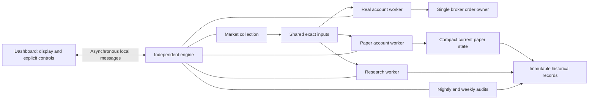

# Independent engine implementation and cutover review — October 22, 2026

## October 28 collector and execution recovery

Consolidated from the day's status checkpoints on October 28. The last verified in-session execution
checkpoint is 15:45 Toronto; earlier pending/blocked statements below describe their original times and are superseded
by the successful recovery and resume. No historical evidence or uncertainty is discarded. The
[status summary](../project-status.md) owns current state and the
[collector checklist](../strategy-alignment-implementation-checklist.md#independent-collector-and-recovered-confirmation--october-27-overnight)
owns remaining acceptance. Broader documentation/learning consolidation remains in its existing chat.

### October 28 late-evening Paper recovery

Joseph explicitly asks to investigate and resolve the nine Paper/research integrity holds so the
system is ready for October 29 morning. This authorizes the supported Paper verification and verified
hold-clearance path, not changes to Real permissions or deletion/reset of financial or historical state.

The original set comprises one Paper archive failure at revision 6044, one original recovery-pending
hold, and seven inherited Paper restrictions from earlier scoped recoveries. The old Paper recovery
`2581cceb-d128-4170-a97e-3b42625f440d` completed its October 22 boundary, but does not qualify later
incident discovery boundaries. Fresh proof is required; no old completion date or receipt is rewritten.

At October 28 22:31:32 Toronto, native `VerifyPaperRecovery` started
`e73db89e-fa4b-4da4-a503-f8405a7a7377` in the existing normal engine. Its immutable plan covers three
portfolios (37,790 revisions total) and 167,268 frozen legacy research inputs. At 22:51:57 it remains
Running with 12,918 verified units, TargetIndex 1 / NextRevision 5981: the first portfolio and old 6044
failure boundary passed, and the second is advancing. No new failure is observed. Ten incidents are
expected while it runs: the original nine plus its own verification-pending incident. Later records
vary in size; this checkpoint supplies no complete-run ETA or morning-readiness guarantee.

Private receipts and the reviewed, parse-checked `Complete-VerifiedPaperRecovery.ps1` are under
`artifacts/paper-recovery-20261028/`. The script has **not run**. It requires this exact pass Complete,
matches the original nine incident IDs/scope/code/evidence keys, admits only the associated pending
hold, and rejects any unexpected incident set. It calls native `ClearIntegrityHolds` with Paper scope;
the native transaction rechecks proof, exact current heads, database identity and immutable guards.
Existing/uncertain receipts must be inspected before retry. No ad hoc SQL clearance is permitted.

Same-chat heartbeat `finish-verified-paper-recovery` is Active every ten minutes. It must continue this
pass, inspect any failure without bypasses, perform authorized clearance only after the conditions above,
and verify two subsequent engine status samples at least 30 seconds apart for resumed Paper/research/
protection workers. Check Real status and engine/collector continuity without changing them. Report a
remaining morning-readiness risk if incomplete at 08:30 Toronto, and pause the heartbeat on completion
or when a new user decision is required. Record actual completion/clearance/worker results here and in
the status owner; none is claimed yet. No engine/collector restart, binary change, portfolio reset,
database schema change, model training or broker action occurred during this checkpoint.

### October 28 monitoring closeout — saved evidence through 15:45 Toronto

The engine independently bought ASTL after its five-minute signal reached two consecutive qualifying
observations at 14:40. By 14:43 its holding was recorded and all three owned orders were reconciled.
The read-only broker capture at 14:46:48 independently reports one holding, zero pending orders and
matching history/holdings. Together with the earlier reconciled CAE protective exit, these are actual
account outcomes, not merely shared signals or submitted orders.

The last saved in-session diagnostic evaluates at 15:45:05: `NoRecommendation`, no new-risk, quote-read
or account-risk blocks, new buys not stopped, and three of three orders reconciled. ASTL's saved
protection matches, its last usable bid is 15:43:53 and its next check was due 15:48:53; no exit was
latched. This verifies protection at that checkpoint, not uninterrupted protection through the close.

The 15:45 monitoring tool call returned about 134 minutes later. The planned 16:05 closing check was
missed. Its execution-status result is timestamped 17:59:32 and reports waiting for regular trading
hours; it is not a 15:45 status or proof of closing holdings. No further market/broker requests were
made for closeout. The staged SQL query was not invoked; the mailbox was restored only after its hash
still matched the monitor's query, and the restored hash matches its saved predecessor. The day-only
activity heartbeat was deleted at closeout after 18:02 Toronto. No engine/collector restart or financial
action was performed by this monitor.

Source qualification remains **unproven**. The latest successful routine SQL capture was at 15:27:28,
covering the 15:25 publication: BTE had one strong observation, not a confirmed entry. Intermittent SQL
deadlocks limited later detailed captures; those monitoring failures do not establish execution failure.
The collector had 32 candidate subscriptions plus XIU, including held ASTL; RY was unsampled. BTE's
140 conflicts, sparse/missing intervals, first-arrival versus backfill timing, and unreceipted attempts
remain explicit limitations. The investigation below isolates one anomalous response but does not
prove venue/currency identity, full coverage, sustained capacity or safe automatic recovery. One-minute
adoption remains unapproved; the cross-path quarantine/recovery design is still a proposal.

Private evidence: `artifacts/minute-source-check-20261028/watch-checkpoint.json`,
`watch-result-1526.json`, `execution-status-1545.json`, and
`artifacts/minute-source-check-20261027/execution-diagnostics-20261028T194528346Z.json`.

### BTE saved-source investigation — October 28, 15:35 Toronto

Read-only comparison, with the engine left running, isolates the minute conflict to a saved TMX
response fetched at **12:15:36 Toronto**. It changed all OHLCV fields (open/high/low/close/volume)
for 140 previously accepted completed minutes between 09:30 and 11:59. Those changed values are in
the raw response: comparison against normalized storage finds no parser differences. The 12:14
response, the next four responses starting 12:16, and the saved 15:31 response agree with all 153
previously accepted minute observations. An opening-bar anchor scan across 343 stored BTE responses
finds 342 matching responses and this one anomaly; it is not a full comparison of every response row.

The conflicting response's historical price scale and different volumes, together with its latest
timestamp of 12:00 despite a 12:15 fetch, suggest a different venue/currency feed or upstream routing
problem. **That underlying provider cause is not proven:** the saved response has timestamps/OHLCV,
but no authoritative exchange/currency/security identity. No provider contact or new market request
was performed. The conflict is not explained by an unfinished target bar: it changed completed history.

All **56 saved five-minute receipts** through the 15:25 endpoint match exactly, across all OHLCV fields,
when compared with the available minute rows in the saved 15:31 response. Forty windows contain five
minute rows; sixteen are sparse. Matching sparse aggregates does not prove that missing minutes had
no trades or qualify the minute source. All 56 content-addressed BTE stock bars actually referenced by
the approved policy's 15:25 input match those original five-minute receipts. Stored receipt/observation
hashes (217) and all 56 input-fragment hashes verify. Thus there is **no observed contamination of that
five-minute signal by the anomalous response**, not independent proof of market/venue correctness.
At 15:25 the saved result has three supportive families (persistence, price movement, volume), one
consecutive strong observation, and no confirmed entry. Price structure is positive-leaning but not
supportive; session VWAP remains unavailable with `MissingExactEndpoint`. No indicator or rule was changed.

The installed legacy path requests separate five-minute TMX bars through the collector relay; it does
not aggregate the quarantined minute book. Its repository also rejects changed canonical five-minute
bars, in addition to the adapter's within-response duplicate check. The minute book latches any completed
revision and stops admitting further observations even after responses normalize, explaining the frozen
12:14 accepted endpoint. Do not clear those conflicts or treat later agreement as automatic requalification.
Remaining source work: prove instrument/venue/currency identity, define reviewed anomaly recovery, and
decide whether cross-path source incidents should block legacy entries. These are unresolved source-safety
choices, not authorized changes to today's approved strategy.

Private evidence/reproduction: `artifacts/minute-source-check-20261028/bte-investigation-result.json`,
`bte-followup-result.json`, `Compare-BteSavedEvidence.ps1`, `bte-comparison-summary.json`.
Reviewed query SHA256 values: `EDCE482C39EDBF053B509933E6B92175919F122F1E32CACDCF80D9BC255117D9`
and `E34B577497D1F33D2DE6685ADBB2C3307F934CBEDBF2DA0651DAFD3ED811EF1B`.
Both installed-helper receipts match; mailboxes restored only while still matching the submitted query.
No runtime, strategy, database records, collector conflict state or broker orders were changed.

### Earlier execution and collection checkpoints

At 13:43 Joseph completed the repaired build review and resumed the existing five-minute strategy.
Native diagnostics show a successful Real evaluation, matching saved CAE protection and a usable
`BrokerProtectionBidV1` bid received at 13:43:46. The engine independently submitted the protective sell
and received acknowledgement. By 13:45 both owned orders are reconciled and no holdings remain in its
account projection. The installed read-only broker helper independently reports zero holdings, zero
pending orders and matching broker history/holdings at 13:44:55. Acknowledgement alone was not treated
as a fill. The fresh 13:45 decision evaluates 33 symbols with 33 fresh inputs, no decision-level or account
risk blocks and `NoRecommendation`; new buys are not stopped. This proves resumed evaluation and an
actual protective exit, not a new qualifying buy or one-minute strategy activation. Private diagnostics:
`artifacts/minute-source-check-20261027/execution-diagnostics-20261028T174408250Z.json`,
`execution-diagnostics-20261028T174510649Z.json`; broker capture `6c8bd452f9f841ee8057e8edc18c2fa0`.

Recovery checkpoint at 13:43 Toronto: execution repair `7430d875` was installed at 12:21:31 with 128
runtime files verified (seven changed). The exact Real recovery run started at 13:07 and completed at
13:35:54, verifying 75,897 records. Native clearance removed both matching Real holds; no Global holds
remain, and all nine Paper incident identities are unchanged. The guarded restoration restarted the
engine in normal mode and reopened the dashboard at 13:36:12, with financial execution Off. Joseph
must still perform the final changed-build review and resume; automatic holding protection and buy
readiness are not yet verified. The independent collector remained running throughout. Private
receipts: `artifacts/execution-repair-20261028/maintenance-cutover/`, `maintenance-postclear-integrity.json`
and `normal-restoration/completed.json`.

At 13:43 the read-only approved-policy input check finds the 13:40 five-minute endpoint published:
28 valid observations, five invalid, none mature or confirmed eligible. Publication has resumed;
this is not an actual Real evaluation or proof of working protection. Receipt:
`artifacts/execution-repair-20261028/readiness-result.json`, query SHA256
`275C76A6D6A09CB01D1F68FC980900C58688E7F2518F2420114530B11B960F25`.

The 13:19 bounded read-only source capture covers 34 symbols with a current collector lease. BTE has 140
conflicting completed bars; its latest accepted completed endpoint is 12:14 despite recent responses.
Other symbols have differing missing/late intervals, which do not establish no trades. This is not a
qualified one-minute source. First-arrival timing remains separate from recovered context, and the
existing five-minute strategy is retained. Private receipt: `artifacts/minute-source-check-20261028/collector-summary-1319.json`
(query SHA256 `855A33D24FDAEF2FE2915DF8CE56D2A6BCAEA87816DDD288F039E21EBB5FE9F1`).

The following morning entries preserve the earlier diagnosis and validation checkpoints.

Joseph approved migration052 and the collector cutover. At 09:19 Toronto the guarded installation
started the independent collector, bounded supervisor and runtime built from `6c1e8f13`, with legacy
five-minute requests routed through the collector. A fresh checksum/RESTORE VERIFYONLY backup and
hash-matched backup copy preceded the manually applied additive migration; six tables and five guards
were verified through the read-only helper. Remote backup synchronization is not proven. Two earlier
installation attempts rolled the binaries back safely (SQLCMD argument failure before migration,
then an insufficient supervisor startup wait after migration); the successful attempt reused the
verified backup/schema without replaying migration. Private receipts: `artifacts/collector-install-20261028/`.

Validation before installation: 3,346 Core tests passed, ten native/opt-in skips; isolated WPF/engine
and collector Release builds succeeded with 260/258 compiler warnings. SSDT schema build passed without
warnings/errors. Dependency audit was disabled; this is not a complete solution/security assessment.
The approved isolated storage rehearsal passed earlier at 08:50. The supervisor is running for this
login; no reboot/login startup task was installed.

The dashboard was relaunched visibly without restarting engine/collector. Financial execution is
not approved for this build. A pre-existing Real `ArchiveVerificationFailed` hold discovered October27
16:18 also remains: initial "build review only" readiness was incorrect. The operator's review reports
that risk history cannot change. At 09:52, offline reconstruction of the failing adjacent broker
revisions verifies original root/full checksums and unchanged preserved values, but cannot reproduce
the original build-review previous-session fingerprint. This is not yet proven to be only a harmless
representation difference; the pre-cutover binary also rejects it. Correction and fresh scoped
recovery/clearance remain pending; automatic holding protection and buy readiness are not verified.

At 09:52 the collector has 32 candidates plus XIU and the held symbol subscribed, with a current writer
lease and persisted minute observations. Some reserved requests lack receipts and transient
`CollectorAttention` was observed; live storage/source health remains under investigation. Timely
first arrivals, late recovery and conflicts are separate evidence. The five-minute same-chat monitor
uses `Operations/TmxQualification/CollectorSourceSummary.sql`; the separate three-symbol sampler is
not launched alongside the collector. One-minute financial adoption remains blocked pending live
source/capacity/venue qualification and Joseph's explicit updated-strategy review.

October28 10:06: the isolated native SQL rehearsal reproduces a collector append failure when Dapper
rounds a valid sub-millisecond fetch timestamp to SQL `datetime` before comparing it with the exact
`datetime2` request intent. Explicit `datetime2` fetch/validation parameters preserve the strict fence;
the same native regression now passes. Ten focused offline tests pass with one native opt-in skip;
collector Release passes with 258 compiler warnings, no errors (dependency audit disabled).
Correction `74438d6e` was installed at 10:09:45 through a normal collector-only stop/start; trading
binaries and financial approval were unchanged. At 10:13 the bounded read-only check finds 68/68
saved receipts across 34 symbols for the first two completed post-install rounds, zero missing or
failed receipts. Earlier missing evidence remains missing; this is bounded recovery evidence, not
full-day source qualification. The active supervisor manifest is now
`artifacts/collector-precision-20261028/supervisor.json`, using the original control/config paths.
The broker archive fingerprint failure is separate and still unresolved; preserved state equality
alone does not establish the missing original approval fingerprint.

The operator's specific build-review error is separately explained by original saved evidence:
the managed session still carries October27 risk state, while the risk journal has advanced to
October28. Revision, trading date, session reference, last completed session and through-time differ.
Build review correctly refuses that mismatch. An independently verified risk-state synchronization
is needed before review; do not weaken the equality check or clear the archive hold. Neither native
recovery/clearance nor financial approval/enable was performed during this diagnosis. Private
hash-verified archive reconstruction and comparison: `artifacts/archive-review-20261028/`.

October28 late-morning execution repair: separate stopped-session risk synchronization is implemented
and tested, **not installed**. It replays existing closing/opening receipts, appends their exact resulting
risk projection and preserves the original approval, orders, protection, memory and controls. Build
review's risk equality check remains. The bounded read-only production query returned nine original
risk receipts; offline replay of the two relevant receipts exactly reproduces today's saved risk state.
Query SHA256 `78FFFCDC0C4D81753B5F728D94C144598AC6653191753BCEBF298F46B0372EF3`;
private evidence `artifacts/execution-repair-20261028/`. No production synchronization was invoked.
Sixty-one focused tests pass, including invested protection preservation and lost-acknowledgement
recovery. WPF/engine Release builds pass with260 compiler warnings and no errors; dependency audit
was disabled. Parallel full-suite runs encountered timing-sensitive failures that pass in isolation;
the final full Core run with test collections serialized passes3,361 tests with ten native/opt-in skips.
The separate legacy approval
fingerprint has now been reproduced exactly: protection retained additional evaluation dictionaries
outside Memory. Audit-only recovery now reconstructs their order while retaining typed scalar
serialization and requiring the original UTF-8 SHA256. The original3034→3035 transition passes the
complete validator offline, and92 focused history/risk tests pass. Earlier exploratory hash comparisons
incorrectly used the database UTF-16 helper; corrected diagnostic evidence is saved with the repair.
Collector-only recovery is still the last installed correction. Fresh native recovery, clearance and
financial build approval remain pending; Real buying/protection remain unverified.

## October 27 follow-up design discussion — historical context and opening entries

**Accepted October 27 evening; overnight implementation authorized, financial activation reserved.** Joseph accepts
validated stored history/backfill for indicators, a separate collection/recovery process as the direction,
unchanged VWAP and three-of-four support, and deferral of the buy-at-open alternative. He wants continuous
operation across trading-engine restarts and rejects an automatic two-new-observation wait after validated
gap recovery. He explicitly confirms that two consecutive qualifying observations remain required and
validated backfill may establish both without an additional wait. [ADR-0111](../adr/0111-independent-collector-and-recovered-confirmation.md)
owns the accepted prospective contract; the collector section of the strategy checklist owns the nightly
implementation plan. None of these choices changes the installed ADR-0053 rulebook yet.

- Separate persistent indicator history from fresh entry confirmation. The current database retains
  evidence; recovery creates a new continuity epoch and resets operational rolling buffers/ordinary
  confirmation under ADR-0053. This is a deliberate eligibility rule, not simply deletion of all prices.
  Accepted direction: restore verified earlier observations, obtain validated gap history if available,
  and use it only for decisions made after receipt. Keep original event time, first receipt, source,
  revisions and gaps. Accepted: uninterrupted qualified collector evidence can preserve/reconstruct
  confirmation across a trading-engine restart without two additional observations. The initial blanket
  reset-on-restart proposal is superseded. Timely immutable collector records
  may support rebuilding the sequence while the trader was stopped, but an order is considered only now,
  with a still-current qualifying signal, fresh executable quote and recovered account/order/risk state.
  Never replay missed orders, renew an old signal's expiry or treat delayed backfill as on-time confirmation.
  Joseph also rejects the later proposal that a genuine collection gap must always be followed by two
  new qualifying observations: after validated context recovery, he wants a still-current qualifying
  signal to be actionable. Accepted final interpretation: retain two consecutive
  qualifying observations, allow validated recovered bars to reconstruct those states, and require the
  latest signal to pass current freshness and execution checks. This expands backfill beyond indicator
  context; it does not erase actual receipt times or retrospectively classify recovered signals as timely.
  A recovery-only single-observation override is not part of this direction. Exact source scheduling,
  freshness and coverage qualification remain required before adoption; ADR-0111 defines the boundaries.
- Design a separately supervised market-data collector with one durable writer/lease and no order
  authority, feeding existing durable evidence for independent Real/Paper consumers. It could survive an
  execution-engine restart; it cannot survive laptop sleep/power loss on the same laptop, and cannot
  execute app-managed protective sales while the execution engine is stopped. Extraction must account
  for current coupled collection/session/lease/publication ownership; it is not just a second polling loop.
  Persistent context recovery is useful with or without process separation. Backfill remains necessary
  when the collector itself or the network is unavailable.
- Accepted ownership boundary: the collector alone polls and persists shared intraday stock/benchmark
  bars and performs their backfill; the trading engine computes indicators and confirmation from local
  evidence. Broker account/order reconciliation, fresh executable quotes and protective bids remain
  trading-engine responsibilities. The separate nightly Hermes daily-data workflow is outside this
  extraction unless explicitly brought into scope. Local bars never replace required broker checks.
- Accepted: retain VWAP as a valid historical reference when its full path can be established. Current missing
  VWAP is not a universal buy veto: other references can still qualify structure, and three other
  families can qualify strength. A rolling/partial-session average or softer vote would be a distinct
  proposed policy change. Do not fabricate VWAP or silently lower the required votes when data is absent.
- Deferred at Joseph's request: an opening-entry strategy buying the top two or three overnight picks promptly
  after valid opening quotes, with defined sizing, initial loss protection and trailing-profit behavior.
  This would use the daily ranking for entry instead of the accepted intraday confirmation gate; it must
  be a separately identified strategy, not a hidden exception to three-of-four. Overnight ranking alone
  does not establish profitable immediate opening execution. Define which rank/lens, opening gaps/spread,
  existing holdings, position count, exit/re-entry and protection timing before comparing it prospectively.
  No stop percentage, top-two/top-three choice or opening financial authority is accepted here.

Recommended discussion order: settle observation continuity versus trading-process restart; define
collector ownership/recovery and source qualification for October 28; then prepare the minute successor.
The opening-entry comparison is deferred and is not part of tonight's proposed implementation scope.
Do not weaken VWAP or spend on another source simply to compensate for restart-induced loss of context.
Minute integration remains subsequent work after its contracts and source qualification are settled.
[Wealthsimple's official real-time charting description](https://www.wealthsimple.com/en-ca/learn/real-time-charting-performance-insights)
includes Canadian live quotes; blanket claims of
15-minute delay are inappropriate. That product capability does not qualify the app's specific adapter
for complete historical minute bars, volume/venue consistency or sustained delivery.

## October 27 closing signal review — selectivity, missing evidence and minute successor

Joseph requests an explanation of today's unqualified signals and whether entry rules are too restrictive.
The immediate problem is attributing missed entries correctly; the parent problem is prompt execution of
qualified momentum; the root goal is ongoing approved management with preserved capital/order controls.
This is a read-only analysis, not approval to change thresholds, entry hours or the installed strategy.

The latest approved Real policy's shared input publications contain 952 symbol/checkpoint observations:
28 symbols at 34 five-minute endpoints from 10:25 through 16:00 Toronto. These are repeated observations,
not 952 independent opportunities, and shared eligibility is not actual Real account execution.
There are 91 invalid current observations, 393 valid observations without mature families, and 468
valid/mature observations. Of the latter, 300 have zero supportive votes, 133 have one, 28 have two,
six have three and one has four. Thus only seven mature observations meet the three-of-four strength
test. Six symbols start a sequence; only one completes it, consistent with the reconciled first purchase.
No entry safety veto is saved in these observations. This does not establish that account/execution
checks were continuously clear; the installed incident and later native diagnostics remain separate.

The six sequences comprise one successful pair at 11:30/11:35; failed pairs starting at 10:45 and 11:00
whose votes fall from three to one and four to one; an 11:35 start with no next published checkpoint;
and two late starts at 15:50/15:55 whose next votes fall from three to zero and three to two respectively.
The latter are different symbols, not consecutive observations of one stock. Individual symbol/reason
details remain in ignored evidence. No publication exists for the 34 endpoints from 11:40 through 14:25;
fresh publication resumes at 14:30. This missing interval cannot establish rejected opportunities.
Late source recovery, collection failure and deliberate repair/restarts make this an interrupted
engineering session, not a clean test of strategy profitability or optimal thresholds.

The saved approved policy has a 09:50 entry start and **15:45 entry cutoff**. The actual recommendation
engine checks the received quote against that cutoff. The late 15:50/15:55 first-strong observations
never confirmed, and even hypothetical confirmation would not authorize an opening order after 15:45.
Earlier monitoring descriptions of waiting for a signal after that time were incomplete: regular-session
protection/evaluation continuing until close does not mean the entry window remains open. No cutoff
change is approved here. This fact must be included in future buy-readiness explanations.

Among 468 mature observations, full supportive votes occur 21 times for Persistence, 23 for Price
Movement, 159 for Volume Support and eight for Price Structure. Positive-leaning states do not vote.
The price-movement rule uses volatility-scaled raw and benchmark-relative agreement; its 0.25 raw-move
setting is not the separately approved 0.25% execution-price tolerance. A rising stock can therefore lack
a price-movement vote. Session VWAP is unavailable in all 468 mature observations; the implementation
requires the complete accepted path from the open. With that reference missing, full structural support
requires the other two references to be bullish without conflict. The one-hour price reason is NotMature
in 411/468 observations. These constraints explain why ordinary warming and missing continuity affect
selection, but do not prove that weakening thresholds would improve returns.

Recommendation: first establish uninterrupted collection and evaluate the separately versioned minute
successor with unchanged three-of-four votes and longer horizons. Treat later entry hours, counting
leaning states, reducing required votes, or restoring qualified historical context after a restart as
separate prospective hypotheses, not a combined relaxation or replay of missed live authority. Compare
missed moves and false starts, achievable execution costs, turnover and downside across clean sessions;
retain original policies and evidence. Today's counts alone cannot select a profitable threshold.

**Minute successor readiness:** two offline components exist (first-arrival/deadline/conflict evidence
and duration-preserving windows), with 60 focused tests reported. Collection/publication/runtime use is
not implemented or installed. Qualification must settle missing-minute/no-trade semantics, venue coverage,
corrections, first-arrival latency, capacity and usable source terms. The October 27 final bounded sample
at 15:32 shows completed-bar response ages of 72.2, 12.7 and 13.1 seconds, with two, one and three missing
slots in the respective latest ten-minute windows. No overlapping previously completed row changed in
that comparison. Fresh rows exist; full source qualification does not. Long-gap backfill is not timely
confirmation, and broker bid/ask snapshots cannot replace minute OHLCV history.

Remaining implementation: reviewed minute storage/slot migration contracts; one-minute collection and
publication with a deadline before the next minute; duplicate/gap/conflict and restart handling; an
explicit successor evaluator/lifecycle using distinct consecutive completed minutes; unchanged elapsed
20/60/120/180-minute indicator horizons; independent Real confirmation, protection/order safeguards and
complete diagnostic/report output. Validate live delivery and offline fault cases before controlled
installation and Joseph's explicit updated-strategy review. No timer-only conversion, synthetic missing
prices or automatic upgrade of the current assignment is permitted. Source purchase is not authorized.

Private evidence: `artifacts/minute-source-check-20261027/day-review.sql`, SHA256
`9EB2CC33613A48E35A2493A2F762DF180F68177B185E073529CF982DF3F1738B`, receipt
`result-20261027T200850125Z-f05c970ba3a94c18b12f8b6083c73d3b.json`; `day-context-review.sql`, SHA256
`1EA7F3D21C0FAB6D6C3F7E7C8C31018154532085599DC722DAFBD9CABA629E62`, receipt
`result-20261027T201016955Z-b4c949c856694125985e08ef828b568a.json`. Both helper hashes were verified and
mailboxes conditionally restored. No external market calls, financial control, SQL writes or runtime
changes were performed for this review. The day-only heartbeat was deleted at its closing checkpoint;
its delayed tool return missed live notices for the two late starts, which are identified retrospectively.

## October 27 — first holding exposes mapping and final-evaluation failures

The 13:50 read-only investigation found a broker-managed holding whose broker symbol has no
reviewed canonical alias. Collection stopped after the 11:35 publication; the 11:40 cycle is cancelled.
The resolver also recognizes only the older `Real` owner label, omitting `BrokerManaged` and
`BrokerPending`. Qualified execution diagnostics show `FinalEvaluationFailed / ArgumentException`;
fresh valuation is unavailable. Saved protection preparation is not proof of working protective exits.
Private receipts and the incident checkpoint are in `artifacts/minute-source-check-20261027`.

Joseph authorizes repair, tests, installation and native protection/buy-readiness verification.
The first offline repair pairs an absent/unusable bid with an absent receipt timestamp instead of
throwing from the safety-input validator. Thirty recommendation tests pass, including missing/zero
bids with and without progressive protection and a subsequent valid protective exit. Existing saved
protection and cost/position identity survive. Installation and native verification are still pending;
symbol resolution, valuation and owned-order reconciliation must be checked consistently first.

The mapping increment now derives the managed market name from the original reconciled purchase
and matching saved TSX listing/security identity. It supplies canonical collection, valuation, quotes
and risk-boundary reads while retaining broker names/IDs in recommendations and saved financial
records. Legacy subscriptions are adapted from the verified current head without rewriting history.
512 focused tests pass, including invested alias rollover, duplicate-buy prevention, protection across
serialization, six listing-identity cases and the existing managed-session/order guards. No migration,
installation or financial approval has been performed by this increment. Build review for an ongoing
invested assignment is the next dependency; the legacy review requires a cash-only dated scope.

The invested ongoing build-review extension is now tested: it retains the exact agreement, holding,
orders, protection, pause, cumulative spending and risk history, while requiring fresh matching source
and account evidence. Approval remains an explicit app action and does not enable the host. Read-only
execution diagnostics now expose saved protection matching and latest usable bid-check timestamps.
The full Core suite passes 3,207 tests with nine skipped; isolated WPF/Engine Release build succeeds
with 260 compiler warnings and no errors. No new dependency-security audit or SSDT solution build
was performed. Logs are under `artifacts/held-symbol-repair-20261027`.

Controlled installation of 351a2a8a completed 14:29: 128 candidate files and 122 retained files hash-verified;
previous runtime backed up, clean drain/restart, saved host grant unchanged, connected normal engine.
No migration or financial approval. Integrity retains nine Paper restrictions and zero Broker/Global
holds. Broker capture e4a9c54c confirms one holding, zero pending orders and matching history. Qualified
diagnostics confirm saved protection matches; no last usable bid timestamp yet. Execution correctly
requires explicit updated-build review. At 14:34 the approved policy has a fresh 14:30 publication with
25 valid observations and three rejected inputs; none mature/confirmed after the gap. Native protection
and buy-readiness verification remain pending Joseph app approval/resume. Private cutover, SQL and
diagnostic receipts are retained in the repair/minute-source evidence folders.

Joseph completed app build approval/resume by 14:43. The repaired engine evaluates fresh inputs with
one reconciled owned order, unchanged holding protection and zero account-reconciliation blocks.
Native evaluation exposed two further issues: valuation/protection-history readers filtered `TMX`
although actual persisted evidence uses the canonical `TMXMoney` provider; a bounded 14:47 quote
read also proves CAE has a last price but no bid/ask from TMX. Running status alone is insufficient:
`NetAssetValueUnavailable` remains in the decision and no usable protective bid is saved.
The provider fix binds all three affected readers to the existing schema/provider/source-contract
constants. A hash-verified read using the corrected predicate finds four accepted saved bars through
14:45. No prices are fabricated or rewritten. Joseph separately approves fresh Wealthsimple bids for
Real holding protection, with exact account/security/quantity and regular-session/time checks; that
source adapter and another reviewed installation remain pending.

Provider correction89ac8294 passes527 focused tests plus the native read-only predicate check.
The approved broker-held bid adapter is implemented and disclosed in build review: exact owned
security/quantity/account, fresh quote and account reads, broker quote age at most60seconds, regular
session and positive bid. It supplies no entry ask/last-price substitute and never submits an order.
515 focused tests pass; the final full suite passes3,218 with nine skipped and the isolated Release
build succeeds with260 existing compiler warnings/no errors. Installed verification of this combined
follow-up remains pending. The watch now checks decision-level risk blocks and saved bid due times
through qualified read-only execution diagnostics; Running status alone is not treated as readiness.

The combined follow-up 81dd33f3 installed at 15:05:44 with clean drain/restart, unchanged saved host grant,
128 candidate/122 retained files verified and the previous runtime backed up. Connection is healthy;
zero Broker/Global holds and nine unchanged Paper restrictions. Joseph completed the second app build
review and resumed the ongoing host. At 15:14:12, qualified diagnostics show StrategyEvaluated revision 3044,
one owned/reconciled order, unchanged matching holding protection, no account risk blocks and no
entry/quote-read risk blocks. A usable BrokerProtectionBidV1 bid was saved at 15:12:59.532. The repeat
check accepted another bid at 15:18:29.195, next due 15:23:29.195. Diagnostics at 15:20:19 (revision 3074)
still show no account, decision or quote-read blocks; completed-bar protection advances through 15:15
and no exit is latched. Host status at 15:14:49 is Running.
It evaluated 28 fresh symbols with no confirmed recommendation. Protection checks and valuation are
operationally verified; an actual protective sale/fill, sustained cadence and native multi-day continuity
are not claimed. The 15:10 shared publication has 26 valid and two invalid observations, none mature or
confirmed after the restart/gaps. No thresholds were relaxed or artificial signal/trade created.

Receipts: cutover-broker-bid/completed.json under the repair artifact folder, qualified diagnostics
execution-diagnostics-20261027T191440549Z.json and execution-diagnostics-20261027T192055760Z.json
under minute-source evidence, and SQL receipt
result-20261027T191251218Z-0c352e5930cc48a29ef518fca3483661.json (watch query SHA256 verified).
Local code commits: 677b8100 (missing bid), 16b2cb60 (managed market symbols), 351a2a8a (invested build
review), 89ac8294 (provider contract), 81dd33f3 (approved broker protection bids). a0660cdc preserves the
intermediate installed checkpoint. No database migration, nightly rerun or financial activation by agent.

Historical morning status: **ADR-0109 runtime ae427a46 installed October27 01:26 Toronto, normal engine/connection
verified initially with financial execution Off. Joseph's ongoing approval is now saved (confirmed09:58);
host Running evaluated fresh recovered inputs at10:27:40 with no confirmed entry signal.
ADR-0110 corrected recovery completed10:19:36 despite
five ticker warnings; one Valid current publication and prospective Real source adoption are verified.
Restart recovery is complete with zero Broker/Global holds at10:20. One-minute confirmation is
unqualified and not installed. See [nightly recovery evidence](../adr/0110-nightly-isolated-symbol-warnings.md#authorized-recovery--october-27) and the
October27 installation section below.**

Historical October26 status: **October26 watch complete: no new trades; broker-history repair/Real hold clearance
completed14:16, Joseph approved/enabled14:28, last Real evaluation15:59:32. Permission expired16:00;
execution waits outside regular hours. Eight Paper restrictions and incomplete market-data/first-fill
qualification remain. The21:27 evening check below prepares October27; it does not renew permission.**

Historical closing status: **October23 watch completes16:05 Toronto without a first fill or new diagnostic price pair;
its heartbeat is deleted. Diagnostic43424435 remains installed with exact Core hash unchanged;
Joseph's approval1379 and original risk3 are retained. Connected/Running owner, execution Waiting
outside regular hours. Final real1865 evaluates40 fresh symbols through15:55 with NoRecommendation,
no failure/empty orders. Final16:00 publication completes16:02 with40 valid/on-time inputs,29 mature;
account consumption of that post-close bar is not claimed. Original15:45 cutoff/16:00 expiry pass
without renewal. Price comparison and complete native preflight/submission/protection remain open.**
The original overnight target was missed. Paper recovery now completes its saved plan; retained Paper
restrictions and remaining native acceptance are separate unfinished work.

## October 27 minute-source qualification — live samples and follow-up

Joseph requests a fresh TMX check, an alternative-source assessment if needed, and a watch for emerging
signals. This authorizes bounded read-only source checks; it does not approve a new strategy or provider
purchase. The immediate question is timely distinct minute evidence, within the larger need for faster
confirmation, serving the goal of promptly buying qualifying signals under unchanged financial controls.
No buy signal is needed to test source freshness.

**Current pipeline:** `TmxDelphiLiveMarketDataSource` requests interval5; durable collection/slots,
publication and `DelphiLiveFiveMinuteSeries` carry five-minute evidence. The lifecycle requires exact
five-minute separation between strong observations. Real evaluates its own confirmation against shared
inputs. The current two-minute collection offset cannot serve a one-minute confirmation deadline.
The 20-minute persistence/volume/range and 20/60/120/180-minute price windows remain separate from
confirmation cadence. A timer change or replacing four five-minute samples with four minute samples
would not implement the requested behavior. [Successor requirements](../adr/0109-explicit-ongoing-delphi-live-management.md#faster-confirmation-qualification-pending).

**Bounded native evidence, 10:42–10:47 Toronto:** four captures, three single-attempt HTTP reads each,
using the production TMX `getTimeSeriesData` query with interval1 and today's open-to-now context.
Targets are XIU, liquid diagnostic stock RY, and one current approved-policy candidate selected through
the fixed read-only SQL helper. No SQL writes, model changes, production publication or runtime restart.

| Receipt time | XIU/RY latest completed minute ends | Age at receipt | Candidate result |
|---|---|---|---|
| 10:42:20 | 10:42 | 20.6/20.8 seconds | 10:42; latest two present, six of ten recent minute slots absent |
| 10:43:55 | 10:43 | 55.4/55.6 seconds | Still 10:42; no new candidate timestamp |
| 10:44:10 | 10:44 | 10.4/10.7 seconds | Still 10:42; repeated reads supply no confirmation |
| 10:47:08–09 | 10:47 | 8.8/9.1 seconds | 10:47, age9.3seconds; latest two present, five of ten recent slots absent |

XIU/RY have all ten recent minute slots in each capture. Across all twelve responses, no incomplete,
invalid or duplicate rows were detected by the diagnostic checks. No previously completed overlapping
OHLCV row changed. One previously forming row changed for each of XIU/RY between the first two
captures; both are excluded from their earlier completed-bar set. The third capture has no new raw
XIU/RY timestamp, although the previously forming minute has elapsed and is returned by a fresh HTTP
response. Do not claim every poll brings a new bar or count that minute twice. The fourth capture adds
four/three/two raw timestamps respectively. Response Date follows capture time; Age is absent. Those
headers do not prove exchange latency or a provider finalization guarantee. Reported bar age is an
observation at our poll, not a measured worst-case delivery latency.

**Conclusion:** the old sparse/delayed sample does not establish that TMX is always delayed. Fresh minute
bars are demonstrably available in this sample. Full source qualification remains open: candidate gaps
may reflect no trades, venue coverage or missing source data; these reads cannot distinguish them.
Do not fabricate zero-volume minutes or forward-fill prices. We have not proved full-session coverage,
all-candidate capacity, opening/closing behavior, correction semantics or sustained sub-minute publication.
Keep the installed five-minute strategy running unchanged while measuring.

**Source decision:** first continue qualifying existing TMX rather than committing to a paid switch.
If it fails, require licensed real-time Canadian trade OHLCV (or a timestamped trade stream from which
completed minute bars can be constructed), XIU and candidate coverage, explicit venue/volume definitions,
late-trade/correction and no-trade semantics, supported programmatic/automated use, and sufficient request
or subscription capacity. TSX-only versus consolidated Canadian trading must be explicit; changing venue
coverage can change volume/VWAP and needs strategy review. Broker ask snapshots remain execution checks,
not a replacement for minute signal history.

QuoteMedia is a conditional first supplier to assess: its official [feed overview](https://support.quotemedia.com/support/solutions/articles/13000022972-quotemedia-data-feed-overview)
documents real-time/delayed North American streams including TSX/TSXV; its
[Canadian packages](https://support.quotemedia.com/support/solutions/articles/5000629901-real-time-data-packages-canadian-data)
distinguish TSX-only and consolidated quotes. Confirm actual API entitlement, minute finalization,
automated-use terms, capacity and price before any purchase; a retail display package alone proves none
of these. IBKR is another technical option, but its [API documentation](https://www.interactivebrokers.com/docs/tws-api/doc/md/introduction)
requires suitable paid data permissions and warns of pacing and historical filtering differences.
No provider account, entitlement, subscription cost or tested replacement is established here.

**Follow-up:** heartbeat `tradervi-minute-source-and-signal-watch` checks saved signals/execution every
minute through October27 16:05 Toronto (tightened after Joseph requests immediate signal/blocker updates).
At most once per fifteen minutes, or on a new emerging
signal, it may make the bounded three-symbol source capture, using the strongest current candidate
when available. It reports meaningful changes and the closing qualification outcome, then removes
itself. This is diagnostic supervision; the engine operates independently and the watch cannot enable,
pause, submit, restart or change strategy. Local scheduling depends on the laptop/app remaining available.

Private evidence: `artifacts/minute-source-check-20261027`, four `capture-*` directories and
`advancement-summary.json`. Four offline measurement checks cover completed/forming bars, missing slots,
duplicates and stale age. SQL target query SHA256
`AE55EA0B871F1E9CA1BD39377C47838466AB1DFA93757F7F72285D8FA52167BD` matches the fixed-helper receipt;
the original mailbox is restored. This is source diagnosis, not an installed minute collector or
qualification of the complete strategy. Updated-strategy review is still required.

**Next source samples, 11:06/11:09:** both use three requests. Fresh benchmark/liquid-stock bars remain
available within roughly6–9seconds, but each now has one absent slot in the latest ten-minute window.
The strongest candidate sampled at11:06 has ten of ten slots. The candidate with the first strong
11:00 observation is sampled at11:09: its latest completed end is11:08 (age69.2seconds), and starts
11:00,11:05,11:08 are absent. Those are raw missing rows, not adapter exclusions. This strengthens the
need to qualify missing-minute semantics: finer sampling can introduce more gaps, not merely faster
confirmation. These retrospective reads cannot establish what an uninstalled minute strategy knew then.

**First implementation increment:** `DelphiLiveMinuteEvidence` is an offline source-independent input
boundary, with nine passing synthetic tests covering distinct arrivals, unfinished reads, gaps, late
processing/backfill, duplicate identities, invalid times/prices, unchanged deadlines and conflict
preservation across serialization/reload. No production source/deadline is selected. It neither collects
nor publishes nor evaluates momentum; no installation, migration or financial control occurs. The
existing cached dependencies restore successfully in the normal user environment; the separate sandbox
cache lacked test packages. No network package restore/security audit or full SSDT build is claimed.
The focused suite passes37tests (including existing five-minute lifecycle and AI minute-price adapter
checks), zero skips. The isolated test build reports264 existing compiler warnings, none in the new files.

**Gap comparison at11:19:** six read-only requests (minute bars, five-minute bars and25 recent trades
for XIU and the earlier strong candidate). Across the three windows starting10:55,11:00,11:05 for each
target, observed minute OHLCV exactly matches each returned five-minute aggregate. Four windows have
absent minute rows. This is consistent with omitted no-trade intervals within the same provider's
coverage; agreement between two products of that provider does not prove a complete exchange tape.
The25-trade lists start11:15/11:17 and do not cover the earlier gaps. Within their actual completed-minute
overlap, every trade's minute exists, but this bounded list cannot establish absence of other trades.
No missing minute is fabricated. Private evidence: `gap-comparison-20261027T151941552Z` under the
minute-source artifact directory, including raw request/response/receipt files and timestamp comparisons.

**Second implementation increment:** the pure minute-window builder explicitly preserves elapsed
20/60/120/180-minute horizons and can form four rolling five-minute measurement legs at a minute
endpoint. Missing beginning/middle/end, opening immaturity, late/future/conflicting evidence and volume
overflow cannot produce a usable aggregate. Historical context does not extend current price authority.
It does not reinterpret V1 bars or integrate a new indicator/exit policy. Twelve new window cases plus
the prior evidence/lifecycle/measurement/price-adapter cases pass60tests, zero skips; the isolated build
retains264 existing warnings. No runtime installation, database migration or strategy approval.

## October 27 ongoing runtime installation and review

Joseph authorized implementation, local commits, validation and controlled installation/restart;
financial activation remains his app action. He explicitly accepted the bounded no-transfer agreement
and 0.25% upward broker-ask movement / 0.50% spread. [ADR-0109](../adr/0109-explicit-ongoing-delphi-live-management.md)
defines the scope and evidence limitations. Existing one-day authority was not extended.

**Implemented/tested:** ongoing approval linked to the original risk/session, automatic calendar-ordered
close/open recovery, unchanged cumulative spending ceiling, full-fill/original-order safeguards,
checked restart, persistent pause-new-buys and combined initial approval/start UI. The execution policy
saves a fixed fresh broker ask per independent confirmation episode, reserves at its 0.25% upper bound,
checks spread/freshness/account/risk/size and never ratchets a rejected reference. Market orders still
cannot guarantee a fill or its price. Six old rejected-price events have no saved prices/timestamps;
their cause cannot be attributed. The selected longer indicator windows remain unchanged.

**Not ready:** the requested two consecutive minute observations. Saved TMX minute data was sparse and
23 minutes behind at capture. A new source contract needs qualification before consistent minute
collection/storage/publication/evaluation and explicit updated-strategy review. No timer-only substitute,
repeated-bar confirmation, source purchase or migration was performed.

**Validation:** 3,159 offline tests passed, nine native/integration skips. Two unrelated AI-host timing
tests timed out under parallel suite load, passed individually, and passed in the complete final suite
with test-collection parallelism disabled. WPF/engine Release passes (260 existing compiler warnings,
zero errors); no fresh NuGet security audit/full SSDT solution claim. Local commits: `9aea1c40`,
`edff9c51`, `386163fa`, `ae427a46`. Private reproducible evidence: `artifacts/ongoing-live-20261026`.

**Installed 01:26 Toronto:** guarded installer replaced seven files; all 128 candidate hashes match,
121 remaining runtime files unchanged, previous runtime copied/hash-verified. Normal stop/restart
disables the legacy grant; final engine1436/dashboard6864 are responsive, Running/Connected and
Execution Off. Financial records/head hash match pre-install counts at 01:26: one baseline, four risk
continuations, 5,530 imports, 2,315 managed revisions, last2314. No approval/order/schema mutation.
Private cutover receipt: `artifacts/ongoing-live-20261026/cutover/completed.json`; database query hash
970C5473F702CFD366C98F80CE51493179E99FD6601A54565BD85F4715B7B6D2. Read results at04:52/05:26 UTC
are hash matched. A broker-helper check at23:38 could not verify login; installed connection is
Connected at09:24. This is not a fresh independent holdings/pending verification.

**Restart recovery completed:** requested at09:26, verified at09:49:33 (56,979 units; all three Real
targets complete). The two eligible incidents were selected from the current receipt and resolved
through the installed ClearIntegrityHolds command in Real scope. The repository rechecked current
heads, database identity, immutable guards and Real observation before committing resolution. At09:52,
zero Broker/Global holds remain; all eight old Paper restrictions remain plus the retained Paper portion
of the restart finding (nine total). Normal engine is Running/Connected; execution remains Off.
Private evidence: `recovery-status-0950.json`, `clear-verified-real-restart*.json`, `post-recovery-*.json`.
The UI read attempt later also timed out capturing the window; no screen review is claimed.
Nightly publication and native ongoing multi-day/first-fill/protection qualification remain separate checks.

The fixed broker helper succeeded at09:45: history/holdings agree, zero holdings/pending orders,
46 bounded reads, zero orders/refreshes/credential changes. It does not qualify local order journals,
cash effective timing or automatic execution. Encrypted snapshot SHA256:
50C59813F35FB0E8340931223602ED99B839FBDE40FA1FA3D4BCDF99F15E916C.

**Nightly blocker, checked 09:40:** the scheduled 00:30 run completed daily-price collection and a
checksum-verified backup/copy, but its WM sector-metadata request returned no TMX results. The runner
correctly classified Hermes as failed and stopped before Delphi/Athena. Joseph authorized one bounded
WM check and a conditional normal rerun only on success. The exact production GraphQL query again
returned HTTP 200 with the same missing-symbol error and no quote. No rerun occurred; no symbol was
excluded, gate weakened or publication fabricated. Resolve the metadata-source failure before a
reviewed publication recovery. Private evidence: nightly status/log and `wm-request.json`/`wm-response.json`
under `artifacts/ongoing-live-20261026` (request SHA256
65D31BED000D91D93916FF1A5174331145DAB051CDBA467C163775C7DE38B963).

The existing 09:29 read-only monitor receipt independently confirms zero October27 official runs,
latest official date October26, unchanged managed revision2314/hash and no ongoing approval. Its
query hash matches the current mailbox (2960EEF2224B46C46889101BC9124496880CE9E3512D6B6A6E3D4CDFEDAEA74F).
Saved model binding/input/configuration match that latest official run; all current-checkpoint hashes
verify. Normal account synchronization added imports after installation, not new trading revisions.
The mailbox was left untouched because another check had replaced this session's earlier request.

**Operator procedure once checks pass:** Trading > Execution setup, truthfully confirm the bounded
no-transfer agreement, Review ongoing management, inspect selected strategy/build, original financial
references/remaining allowance and price policy, then Approve and start ongoing management within two
minutes. That is the single financial activation action. No daily approval/separate enable is required
after it for an unchanged agreement. Pause new buys retains protection; full host stop is distinct.
An existing deliberate pause remains saved. Do not reset the baseline or repeat old liquidation trades.

The October27 08:30/09:15 readiness heartbeat was updated in place to verify actual installed workflow,
ongoing authority and pause state. Updating it does not prove either scheduled run executed.
It was deleted after its 09:30 expiry; it will not repeat obsolete approval reminders on another day.

## October 26 evening readiness for October 27

**Historical procedure:** the daily-review instructions in this section describe the pre-ADR-0109
runtime. The installed October27 procedure above supersedes them only after explicit ongoing approval.

Joseph requests a plain-language recap, pre-open blocker checks and removal of repeated daily
review/approval/enable downtime. The accepted ongoing-management direction is already recorded in
ADR-0085; this is an unfinished Delphi Live implementation dependency, not a new decision about
permission duration. The installed ADR-0105 path remains an explicit dated cash-only trial.

At21:27 Toronto the installed Status/Connection/ExecutionStatus controls return normal Running,
Connected and Waiting outside regular hours. Real, collection, market-input, connection and continuity
workers have no current failure; known Paper/research restrictions remain separate. The bounded
hash-verified SQL read finds zero Broker/Global holds, eight Paper holds, valid current checkpoint and
decision hashes, and the October26 NewHistory audit Complete at16:28:53.954 (boundary16:10:30).
Retained failed audits are historical. Head2314/last Real evaluation15:59:32 are still today's closing
state, not evidence of a future evaluation. No fresh broker balance/history read is claimed tonight;
the last broker v2 close check remains16:08.

The reviewed calendar lists October27 as a regular09:30–16:00 session with October26 as its previous
session. Scheduled task TraderVI Nightly is Ready, next runOctober27 00:30:30, previous result0;
WakeToRun and StartWhenAvailable are true. This proves scheduling, not tomorrow's successful output.
At21:27 there are zero October27 OfficialPaper publications and no October27 permission. Check the
actual nightly result and Valid publication using October26 sources and the exact saved strategy's
configuration/models before calling preparation ready. Current-day permission expired16:00.

For the installed flow, Joseph should complete the October27 review before09:30, preferably08:45–09:00:
open Trading > Execution setup; Stop execution host for review while leaving the independent engine
and collection running; truthfully confirm no outside account changes since the original cash-only
baseline; Review next session; inspect account/risk references, remaining allowance, exact strategy/build,
October27 date and16:00 expiry; approve the dated continuation within two minutes; then Enable reviewed
host separately. Pre-open review/enable is supported. Do not resave the original baseline or switch
strategy. A matching broker balance cannot supply the personal outside-change attestation.

A separate same-chat October27 readiness heartbeat is created for08:30 and09:15, with a final report
and deletion at09:15 (late/date guards prevent later diagnostics). It must explicitly report the initial
pending approval/enable and any other blockers, even when previously known; it remains read-only and
cannot supply financial approval, enable, recovery, hold clearance or a host restart. Its identifier is
`tradervi-october-27-pre-open-readiness`. No October26 monitor is extended. Local scheduling and host
availability are prerequisites; the report is not an unconditional guarantee of pre-open readiness.

The permanent direction remains one explicitly approved, pinned strategy operating until paused,
with automatic daily source/account/risk checks and checked restart restoration. Preserve original
loss references, cumulative purchase allowance, holds, pending-order identities and protection;
never silently upgrade a one-day approval or adopt a changed paper policy. Complete the Delphi Live
family adapter, qualified evidence/startup and native multi-day recovery under checklist6a/7 before
claiming that workflow installed. First-fill/protection and rejected-price comparison qualification
remain open; ongoing permission does not waive those requirements. No execution behavior changes here.

Private evidence: `tomorrow-readiness.sql`, query SHA256
`EEE57866B152F6774606A2CFEB234491CC0A288CEAC41150636C344D086F1205`;
`result-20261027T012719646Z-ce2add9c146f47268a22193de3b84d1c.json`, result SHA256
`4437E4F187017482FEB7DB5FFFCF5DFCF2511C3C64CC61FDD16084E0F120370B`;
`tomorrow-prep-Status.json`, `tomorrow-prep-Connection.json`, `tomorrow-prep-ExecutionStatus.json`.
Mailbox restored. This checkpoint changes documentation and the readiness schedule only.

## October 26 closing report

The final check completes after the scheduled16:05 reporting boundary. ExecutionStatus at16:07:30
reports Waiting outside regular hours, explicitly withholding opening orders. Status/Connection at
16:22 confirm normal engine operation and connection, with zero current failures in Real, market-input,
collection, connection and continuity workers. Normal owner64532/dashboard9288 remain responsive;
observed working sets remain bounded relative to afternoon samples. No fresh database-size claim is made.

At16:08 the fixed broker v2 check confirms zero holdings, zero pending orders and unchanged37-order
history (32POSTED, threeEXPIRED, twoCANCELLED), with broker-history/holdings agreement. No new trade
is evidenced today. The helper neither qualifies the local journal nor cash-effective timing or
automation. No first attributable Delphi fill/protection lifecycle has been demonstrated.

The hash-verified SQL closing read at16:08 retains head2314, evaluated15:59:32, with44 supplied/evaluated/
fresh symbols through15:55, NoRecommendation, no decision failure and empty entry/risk/quote blocks,
orders and protection. Head/projection, current checkpoints, decision/market trace and nested dated
permission hashes pass. The15:45 entry cutoff and16:00 purchase expiry have passed; no renewal or
next-session financial authority is created. No16:00-bar Real consumption is claimed after close.

Collection separately completes the16:00 cycle45/45 at16:02:22 and publishes44 valid/on-time inputs,
35 mature, zero conflicts. The session closes Incomplete/Blocked with HostGapObserved retained:
75 cycles complete, one cancelled and two deadline-exceeded cycles carry HostCoverageGap. The
14:00/14:05/14:10 maintenance gaps and other historical timeliness/rolling-evidence gaps are preserved.
Full-day shared publications total3,256 across44 symbols;30 confirmed observations in17 symbols all
occur10:15–12:35 before Real activation. The earlier whole-day investigation documents the later
three broken Real confirmation sequences. Shared confirmations are not broker recommendations/fills.

The16:08 integrity snapshot retains zero Broker/Global holds and eight Paper restrictions; Paper/
research worker restrictions remain separate. No new rejected-price pair is captured by this watch;
receipt/provider quote-time comparison, first native fill and full protection/reconciliation remain
qualification gaps. Existing safeguards, permission, policy, sources and historical records are unchanged.

Private evidence: `close-watch.sql` query hash
`BBB730ABF362BC413BD4E1FA5122D4E4271A384AB231F795D0233CE92B53989F`; result
`result-20261026T200812991Z-8bf677de69a84eca8ffbe19077628700.json`, SHA256
`23D833591B21938A29FB8E0790EF0B55EDE70B213EF13771BD71D3594F36BB84`; broker capture
`50db277c-fac0-4449-94ba-5dc19feb85bd`; `watch-1600-ExecutionStatus.json`, `close-Status.json` and
`close-Connection.json`. Mailbox restored. Closing work is read-only apart from private watch-state
and reviewed documentation updates. This October26-only monitor is finished; separate monitors remain separate.

## October 26 broker history correction — operator-requested recovery

At11:30 Joseph requests repair of the broker-history blocker and asks to enable trading. The agent
clarifies that final financial approval and execution enable must be performed by Joseph in the app;
technical recovery proceeds with execution Off. The original morning report had explicitly raised the
Broker hold and requested Real-only recovery authority. Read-only supervision did not authorize repair.

Fresh Real-only recovery starts11:32:04 and fails11:36:05 after675 verified units, again at broker
revision675. Its fixed plan upper bound is39,877 units; this is not completed coverage. The failed
run and original incident remain intact. Two adjacent saved records674/675 are fetched through the
fixed read-only helper, with query/content hashes verified, and reconstructed offline from their
exact referenced archive fragments. Both complete archive fingerprints pass. No broker/SQL requests
are made by the offline comparison.

The installed validator fails the build-review prior-state hash while its preserved-financial-state
comparison passes. The exact original approval hash is reproduced using the typed prior serialization
plus the unchanged Memory representation from the adjacent immutable record. Archive JSON-node
escaping and process-dependent dictionary ordering had combined to defeat the existing audit-only
representation recovery. The correction adds that proven representation; exact SHA256, typed-value,
adjacent-identity and all financial/transition checks remain. No saved record or current approval rule
changes. The synthetic regression fails before the fix;458 focused tests pass afterward. The corrected
assembly also passes the actual saved674→675 transition offline. Release builds with260 existing
compiler warnings. Full-suite serial validation passes3,124 tests with nine native SQL skips;
installation is still pending at this checkpoint.

The first full Core run has3,122 passes, nine native SQL skips and two timing-test failures while
Release compilation ran concurrently. Both timing tests pass alone. A second parallel suite retains
one host-loop timing failure; the full suite passes with test-collection parallelism disabled only
in the ignored test-output runner configuration. No unrelated timing/host implementation is changed.
NuGet audit and the full SSDT solution are not requalified.
At11:43 the fixed broker v2 helper confirms zero holdings/pending and unchanged37-order history with
matching holdings/history. It does not verify the local order journal or grant trading permission.
Private evidence remains in `artifacts/monday-watch-20261026/`.

**13:03 installation:** fb9cd0ad is installed through a normal stop/restart, with128 candidate and122
retained runtime file hashes verified. Engine50136/dashboard58296 respond; execution is Off and the
saved grant hash is unchanged. The actual cutover is13:03:38–13:03:52, after the installation command
waited for approval; earlier preparation timestamps are not installation evidence. Fresh Real recovery
starts13:04:39 and passes the formerly failing675 boundary, then completes13:20:40 with41,428 verified
units. Its saved plan/progress hashes pass. This proof predates later shared inputs and cannot clear them.
Collection resumes and records HostGapObserved=true; the13:05 window publishes38 valid/on-time stocks
with zero mature. Original missing/late observations are not repaired.

**Stable-boundary maintenance:** shared-input publication continues during this Real pass, so its
captured heads no longer satisfy clearance's exact-current-head rule. That rule is preserved. The
repair prepares explicit `--recover-real` maintenance, with only continuity/Real-audit workers and
verification-mode broker denial. No Paper recovery or research work is started. An existing pass is
allowed to finish, then a fresh explicit Real pass checks the stationary heads before normal verified
clearance and return to normal mode. Maintenance validation passes459 focused tests and3,126 final
serial Core tests (nine SQL skips); Release succeeds with260 existing warnings and zero errors. Native
maintenance qualification and the final recovery/clearance remain pending at this validation checkpoint.

**13:57 maintenance installation:** fe295d68 is installed13:57:37–13:57:51, after the command's
approval wait. All128 candidate and122 retained hashes verify; engine57932 reports Running,
VerificationOnly=true/RecoveryMaintenance=true, execution Off and exactly continuity/Real-audit
workers. The saved grant hash is unchanged. Dashboard is closed during maintenance. A new Real pass
starts13:58:15 against the paused boundary; final proof/clearance and normal restoration are pending.
The collection interruption is deliberate and remains part of today's incomplete coverage.

**14:12–14:18 verified recovery and restoration:** the stable Real pass completes14:12:53 with42,333
verified units (plan upper bound42,344), valid plan/progress hashes
and no bad current-checkpoint hashes. The guarded clearance invokes the unchanged native current-head,
identity, immutable-guard and current Real-subscription checks. It resolves exactly the original Broker
ArchiveVerificationFailed and three Broker RecoveryVerificationPending incidents; all eight original
Paper incidents are retained. The three incomplete latest audit records are historical, not three
running recoveries. Original failed passes and append-only resolution evidence remain intact.

At14:16 normal stop/restart restores engine64532 and dashboard9288 with fe295d68. Both respond, the
engine is normal/Running, broker connection is Connected and execution is Off. At14:17 continuity,
connection, collection ownership, market-input, Real and audit workers have zero consecutive failures.
The five blocked Paper/research workers remain separate retained restrictions. Broker v2 at14:17
confirms zero holdings/pending and unchanged37-order history, matching holdings/history; no order,
credential change or token refresh is performed. This helper still does not verify the local journal
or qualify native order submission/protection. Managed head1865 remains Friday's last evaluation.

Collection explicitly records the14:00/14:05/14:10 maintenance gaps. The resumed14:15 cycle completes
45/45 slots at14:17:24 and publishes44 stock inputs at14:17:26:36 valid/on-time, zero mature and zero
conflicts. Session coverage remains Blocked/HostGapObserved=true. Original arrival times and missing
bars are preserved; historical completeness and immediate entry eligibility are not claimed. Final
dated financial review/approval and separate Enable reviewed host remain Joseph's actions; no Monday
permission or automated trading enable was performed by the agent. Original15:45 entry cutoff and
16:00 permission expiry remain. The one-day read-only watch continues through16:05.

**14:33 operator approval and first current-session consumption:** Joseph personally confirms review,
approval and enable. Saved SessionContinuationApproved1866 is timestamped14:28:45; the hash-verified
continuation/approval/review/scope identifies October26 and purchase expiry16:00 Toronto. One target-date
risk event is saved. Engine execution reports Running14:29. Initial evaluations have no supplied inputs;
by14:32:41 verified decision1890 consumes44 supplied/evaluated/fresh symbols through14:30, with
NoRecommendation, inline empty orders, empty entries/risk/quote blocks and no failure. Head storage,
projection and current checkpoint hashes pass; the exact referenced decision/market trace hashes pass.
This proves native Real input consumption, not first-fill, quote-price or protection qualification.
All eight Paper holds remain; zero Broker/Global holds. The15:45 cutoff/16:00 expiry are unchanged.
The agent observed these actions read-only; Joseph performed the approval and enable in the app.
Private evidence: `enabled-watch.sql`, `watch-1428-ExecutionStatus.json` and the18:32:43 fixed-helper receipt.

**14:40 stock-entry explanation (read14:42:56):** bounded inspection resolves the current Real
Memory/Symbols/LastLiveResult and exact referenced diagnostic branches, verifying every referenced
content hash. All44 current-session results are present. The earlier14:35 result had34 mature/10
not ready; the14:40 result has35 mature/9 not ready. Of the nine, seven lack a valid current exact
stock/benchmark pair (two Degraded, five MonitoringLost); two have a valid current pair but missing
rolling endpoints. All nine report MissingExactEndpoint and unavailable families. All44 have a daily
candidate and no entry-safety veto; none has ConfirmedLiveEligible or MayCreateBuyDecision.

Of the35 mature/Normal-confidence results: two are PositiveNudge (two supportive votes),27 Neutral
(zero or one supportive vote), and six NegativeNudge (zero supportive/two weakening votes). All have
zero consecutive strong observations. Price movement is Neutral for all35, using20mOnly while the
one-hour reading is NotMature:22 RelativeMoveWithoutRawAgreement,12 RawMoveBelowThreshold,one MixedOrFlat.
RelativeMoveWithoutRawAgreement means the benchmark-relative threshold is reached but neither raw
up/down threshold is reached; it does not by itself prove opposite price directions. The20m fallback
is allowed, so one-hour immaturity alone is not a hard veto for these35.

Price structure also supplies zero supportive votes:20 PositiveLeaning,10 NegativeLeaning,three
Neutral and two NeutralConflict. Persistence supplies two supportive votes; directional volume eight
(and24 weakening). These are overlapping family counts, not additional disjoint stock groups. The
unchanged combiner requires at least three Supportive family votes, and the lifecycle requires two
consecutive eligible five-minute observations with mature/valid data, Normal confidence and no safety
veto. No mature stock reaches the first strong observation. Current failure is before broker quote,
price comparison or sizing checks; no such check is established as a cause by this evidence.
Private per-stock breakdown and hash-verified receipt remain under `artifacts/monday-watch-20261026/`.
No policy/threshold/feed/history changes are made. The diagnostic query's first collation mismatch and
one bounded timeout publish no result; the corrected indexed, single-worker query succeeds.

### October 26 whole-day qualification distinction — 15:54 review

The14:40 explanation above is a snapshot, not a whole-day no-signal conclusion. A bounded read at15:52
finds3,168 saved shared publications for44 symbols and one policy, covering09:40–15:50. Seventeen
distinct symbols have30 confirmed publication observations between10:15 and12:35, while Real was Off
and its Broker history restriction remained unresolved. These are shared signal confirmations, not
Real recommendations, orders or hypothetical guaranteed fills. Earlier signals cannot be carried
forward as fresh post-approval confirmation.

The separate15:54 Real read covers140 StrategyEvaluated revisions from14:28:55 through15:54:00;
all head hashes pass. Its748 distinct symbol/bar states cover44 symbols across17 bars14:30–15:50;
all referenced diagnostic branches verify and none is ConfirmedLiveEligible. Three symbols reach
one strong observation: one with four supportive families and two with three. Their immediately
following observations fall to two, one and zero supportive families respectively, each recording
StrongConfirmationBroken. All six observations have valid/mature data and Normal confidence. The
closest four-family case loses persistence support (score4 to2) and range-breakout structure support;
the other cases lose price/persistence or price/volume/structure support. These failures precede
order preflight. The15:45 cutoff additionally applies to later entry attempts; its rejection is not
claimed as exercised by these unconfirmed candidates.

Private symbol/time/family detail remains in ignored `day-candidates-private.json`,
`day-real-candidates-private.json` and the six-row `closest-detail.sql` receipt. Fixed-helper query
hashes: shared `8DED7F52C09C31AFE4D5BB5BE34E660745D5F449F9A316C32A66F27FB90FA01B`, Real
`20E5C905C0D918DAF32E568D73230B9B151C23CE11956D2379529A6A52B07B3C`. Result hashes respectively
`5B3930ECC7F24C74F4BA6D600E32EA99FD1806F144D96541D5CF77DB51E6F30B` and
`0B5FC1EEB139B07315A868E4F691E1F6BB5906F24BDFC2DAA9D42FD0D62DD9EE`. An initial Real query assumed
reference-only memory and returned no symbol rows; the successful query handles inline and referenced
memory explicitly. Mailbox restored; no policy, permission, order or operational-host changes.

## October 26 morning readiness and one-day watch

The requested read-only morning assessment begins before09:15 Toronto and reports a blocking verdict
while the independent checks continue through09:23. The reviewed calendar's exact SHA256 remains
4D9682D396D9E6B313711F5ED0CF37B8FC145364C5899AA9BDDCAAC1CD2E0976: October26 is a regular
09:30–16:00 session and October23 is its immediately preceding session. No weekday inference is used.

**What passes:** one engine23544 and dashboard38508 retain their October24 start and standard Release
paths. All three hashes in `artifacts/portfolio-workspace-restart-20261024/release-hashes.json` match:
WPF11180E20, CoreE46E98D9 and EngineB55B5782 (full hashes retained privately). This is the three-file
installation manifest check, not a new all-dependency manifest. Fresh engine Status responds in normal
mode, with current continuity, connection, collection-ownership, market-input and Real-worker completions
and no consecutive failures in those workers. Connection says Connected; ExecutionStatus explicitly
says Off/no enabled execution-host permission. The dashboard process responds; interactive navigation
and today's native reconciliation are not newly qualified by that process flag. Sandbox pipe reads
created empty receipts; those remain failed observations. Fresh, uniquely named read-only controls
outside the sandbox succeed. No second operational engine owner is launched.

The existing nightly runner succeeds00:30–00:34:34, including Hermes, Delphi and Athena. Today's one
Valid OfficialPaper run is published00:34:23 using October23 market data. Saved daily version, model
binding hash/input contract, policy, four exact model identities and configuration match the current
Real subscription. These checks do not retrain/select models or make Real wait for Paper progress.

At09:09 the exact fixed broker v2 helper succeeds: one eligible account, zero holdings/pending orders,
unchanged37 historical orders (32 posted, three expired, two cancelled), and matching history/holdings.
Daily-performance provider time is still Friday16:00; it is not a Monday valuation. The helper does
not check the local journal, qualify cash-effective timing or grant automation authority. Saved managed
orders/protection are empty, but the latest native AccountSynchronized record is Friday15:59:44;
current local-journal reconciliation remains required. No first attributable Delphi fill is established.
Joseph personally confirms in this chat no outside trades/transfers/deposits/withdrawals/other changes
since the original October19 cash-only baseline, including the weekend; no inference from balances.

**Exact blocker:** nine unresolved incidents comprise one Broker ArchiveVerificationFailed and eight
Paper restrictions. The Broker incident was discovered October23 at16:13:43, after the16:05 closing
report, and targets broker revision675. The NewHistory run started16:10:16, verified415 units and
failed at that boundary. It is not a currently advancing recovery. Revision675 is ImplementationReviewed
at11:17:43; its storage checksum and adjacent674/676 checksums pass. This does not prove historical
transition/reconstruction validity or diagnose the failure's cause. The current head1865, matching
projection/subscription identity, all current-state checksums, referenced decision/build/market-trace
hashes and the checked immutable guards pass. The engine's three-incomplete-latest-audit notice
includes historical failed receipts; original Real260 and Paper205058 recoveries remain Complete for
their saved boundaries. Neither covers this later failure. Do not replay, erase or relabel old receipts.

Saved risk sequence3 remains dated October23, with no daily-loss/capital-review hold and exact original
session/drawdown references. The saved positive purchase ceiling is unused, with no managed orders.
There is no October26 risk event or dated approval; Friday's permission expired. The installed dated
flow still requires exact current-build review, approval within two minutes and separate enable by
Joseph after readiness passes. Preserve15:45 entry cutoff and16:00 expiry. The09:11 connection display
states session expiry09:30; check the app's normal connection at open and use normal sign-in if needed.
The agent performs no token refresh or credential write.

At09:11 no October26 collection session/stock/benchmark rows or published inputs exist yet; this is
pre-open evidence, not a passed live-coverage check. Last Real evaluation remains Friday15:59:45
through15:55 with NoRecommendation. Execution Off explains absent Monday consumption; do not call
that a new stalled enabled engine. Market-open qualification must distinguish raw receipts, normalized
bars, publications, on-time/mature stock and benchmark evidence, and actual Real consumption. Missing
coverage and TMX-reference/broker-ask qualification remain open. No new price pair or quote probe.

Bounded resource observations show about561GB decimal free on C:, engine working set about119MB,
dashboard about576–582MB, SQL working set about1.45GB. Across roughly14 minutes, engine CPU grows
about1.6s and dashboard about27.1s. Database allocation is unchanged between09:11 and09:23:
23,219,666,944 data bytes and1,082,130,432 log bytes. These are allocation/sampling observations,
not a full growth/latency qualification; SQL CPU was unavailable. Paper/research/protection workers
continue reporting restrictions while Real/market/continuity worker wakes complete promptly.

**Next decision:** authorize only installed `--control VerifyRealRecovery` with execution Off, saving
a new private receipt, then inspect its actual progress/result. This writes durable audit/hold records
and may rediscover the same failure; it is not a read-only check or a promised fix. If it fails, inspect
that exact boundary before proposing a tested correction. Successful current recovery would permit
preparing a separate, explicit Broker-only hold-clearance proposal; Paper restrictions remain intact.
Neither recovery nor clearance grants financial approval or enables trading. No such operation has
been run during this assessment. Current local-journal reconciliation and dated review still follow.

**Watch:** `tradervi-october-26-trading-day-watch` is active in this chat on five-minute boundaries,
with instructions to do no diagnostics before09:30, report at16:05 and delete itself afterward.
The schedule ends20:05UTC October26. Existing recovery/nightly monitors were inspected and remain
separate; alerts must be deduplicated against their latest evidence and this chat's observation state.
Unchanged blockers/no-signal checks stay quiet. New exits, applicable incidents, enabled-Real stalls,
order/fill/protection changes and material resource issues require notification. No next-day extension.

Private evidence is in ignored `artifacts/monday-watch-20261026/`. Baseline SQL SHA256
CA2ABC03F95E0CB9D0FE8980C2784916EF7A6ECD084A8C01A588E67D2672D403 matches receipt
`result-20261026T131154180Z-486a3f7125d846558ce082c914caa507.json`; risk/boundary SQL SHA256
B5E014C47AFDB2E3063C588402C1B659376BBBED7CF183F256BBDC4AE01AF87D matches receipt
`result-20261026T132332989Z-63c297e027384926a863035563863874.json`. The latter corrects an ambiguous
column query rejected with SQL209 and no published result. The concurrent recovery monitor's09:09
receipt matches the reviewed716E6334 recovery-status query. Mailbox restoration is conditional on
still matching this chat's submitted hash. No history-wide decoding, new historical audit, database
mutation, restart, installation, training, order, permission renewal or enable occurs. Validation is
receipt/hash/source review and documentation checks; no new build/test/security/SSDT qualification.

### October 26 first stock collection — 09:46 observation

The09:30:19 comparison-source adoption takes effect09:35; its44 stock memberships begin at the
09:40 bar, while XIU begins09:35. The benchmark-only09:35 collection is therefore consistent with
the saved prospective scope, not evidence that44 required stock requests were omitted. The first
stock cycle completes09:42:24 with all45 slots settled:36 stocks plus XIU have durable on-time bars,
seven stocks report StaleNoNewBar and one NoCompletedBar. All44 stock evaluations are published;
36 are valid/on-time and none yet mature. Publication is not Real consumption: execution remains Off
and managed head1865 is unchanged. Coverage becomes Blocked with no recorded host gap or conflicts.
The eight unavailable normalized receipts pass their hashes. Seven retain latest provider-aligned
time09:30; the other retains09:40, which does not establish the required completed09:35–09:40 bar.
No raw-response replay has demonstrated an upstream omission or adapter defect; cause remains unknown.
Keep original arrival times and incomplete opening coverage. No source probe, repair or guard change.
Single ownership, connection and critical worker wakes remain healthy; the known Broker/Paper holds
are unchanged. Private watch receipt `result-20261026T134603766Z-0939856875b44e89abe0bbfd0b492c01.json`
matches70657751; bounded coverage receipt `result-20261026T134656816Z-26719cf063f24aa7ad7d5de6bd738d79.json`
matches16E6A8D7 (full query hashes retained with the scripts). This is the first observed Monday
stock-coverage shortfall, separate from the already reported Real history-integrity blocker.

## October 26 readiness assessment — October 23

Joseph asks what must be fixed before Monday, focusing on missing data and the price mismatch
without weakening safeguards. This is a source/evidence assessment and proposed work, not authority
to implement, install, probe external services, enable execution or schedule a new watch. The goal
is to let a naturally qualified signal reach safe execution; neither repairing data nor qualifying
quotes guarantees a signal or a fill. The final16:05 evidence below remains the operational baseline.

**Missing data:** separate process-continuity gaps from missing raw source bars. Intraday cutovers
reset ordinary rolling evidence; full-session VWAP requires every exact five-minute interval from
open. The authorized13:24 single-symbol comparison preserved all15 aligned raw bars exactly and
found insufficient one-minute components for all nine examined intervals. That sample establishes
upstream absence, not its cause, a universe-wide adapter defect or permission to reconstruct bars.
At close,40 current valid/on-time inputs coexist with only29 mature symbols. A current clean pair
does not repair its earlier rolling window. Missing VWAP alone is not a universal entry blocker:
the existing two-reference structure rule can use previous close and the complete prior range.

Recommended preparation is an offline coverage audit of available saved receipts for all subscribed
stocks and XIU: identify each required endpoint, original arrival deadline, raw presence, normalized
presence, publication and actual Real consumption. Mark unavailable receipts as unknown. Fix only
demonstrated request/alignment/transport/publication defects, replaying the original receipts in tests.
If upstream coverage cannot satisfy the existing contract, separately qualify a suitable source and
review that source change. Keep the installed owner available before Monday's open and avoid planned
intraday cutovers. Acceptance requires exact consecutive on-time stock/benchmark inputs and successful
Real consumption, preserving gaps, conflicts and original timing. No fill-forward, invented zero-volume
bars, shortened windows or retrospective promotion to on-time evidence is proposed.

**Price mismatch:** the recommendation uses positive TMX Ask, otherwise Price; native preflight
separately reads the broker ask and rejects it when greater than that unchanged reference. A last-trade
fallback, old quote, feed timing difference or genuine price move could explain the mismatch. None is
established as the cause of old rejection1267: its prices were not retained. The1.581s receipt-to-failure
interval does not establish the underlying quote's age. Installed diagnostic43424435 has not yet been
exercised by another rejected buy. The existing bounded TMX timing diagnostic explicitly treats its
last-trade time as distinct from bid/ask time and its fields as non-atomic, unqualified observations.

Recommended next evidence is a bounded read-only comparison independent of buy eligibility, combining
that diagnostic with a reviewed extension of the fixed broker helper for quote reads. The present
helper does not authorize quote probes. Capture the same instrument/currency/venue identities, exact
Ask-or-Price provenance, both compared prices, request/receipt/comparison times and available provider
times. Preserve unknown TMX ask time; broker quotedAsOf is not automatically an exchange-update time.
Use the result to fix only proven mapping/fallback/source-timing defects, or qualify an appropriate
reference source through review. Never raise the reference to the broker ask, add a tolerance or
weaken the rejection merely to permit an order. A genuine rise above a trustworthy reference remains
a valid rejection. Source changes are proposals, not accepted behavior changes.

Offline replay and boundary tests can be prepared before Monday; market-hours freshness and complete
native preflight/submission/protection still need prospective qualification. Monday requires its own
current daily/models/account/source/build checks and Joseph's dated review/approval plus separate
enable under ADR-0105. Friday's permission expired; the15:45 entry cutoff,16:00 outer expiry, two
consecutive strong observations and all risk/cash/order/protection controls remain unchanged.

## October 23 final 16:05 watch report

The final authorized read-only check uses the unchanged reviewed watch-and-rejected-prices.sql,
SHA256437665204B0A496485D4DAF7F736075A7491A2F228DF0017F1189C6B9C3D9622. Receipt
result-20261023T200530587Z-68618233accb42bf9878f480d060cfef.json verifies that hash. Saved real1865
evaluates at15:59:45.076, consuming40 supplied/evaluated/fresh symbols through15:55. It records
NoRecommendation, no failure, empty entry/risk/quote blocks and inline empty orders. Exact head,
projection, checkpoints and decision/build/market-trace hashes pass; saved build approval1379 remains
bound to the dated permission, with one October23 risk event, zero Broker/Global holds and eight
Paper-only restrictions. The installed Core hash remains
E9CF43F61E6BBABC60BA7BF521B194B4B61D7897AC77B7E233746556657CFB0B.

Collection completes the16:00 bar at16:02:05 with41 settled slots and publishes40 matching-policy,
valid/on-time inputs,29 mature and zero producer confirmations. Eleven symbols still lack required
rolling evidence. Full-session VWAP remains MissingExactEndpoint; coverage is Incomplete/Blocked
with the known host gap and zero evidence conflicts. These preserved source gaps are not a new Real
hold. The real account's last consumed bar remains15:55 because execution is outside the session;
the final publication is not proof of post-close account consumption or a persistent runtime failure.

Fixed broker capture141ddc34-a481-4d5b-9bd6-a2b639da2fcb at16:05:35.905 confirms zero holdings/pending,
unchanged37 historical orders (32 POSTED, three EXPIRED, two CANCELLED) and matching holdings/history.
The saved managed orders are empty; no first attributable Delphi fill is confirmed. Controls at16:05:38
show the owner Running/Connected, execution Waiting for regular hours, and zero consecutive Real,
market, collection, connection or continuity worker failures. The15:45 entry cutoff and original16:00
financial expiry have passed; no approval, grant renewal, host enable, restart or order action occurs.

Latest preflight failure remains old1267 at13:40:54, AskAboveDecisionReference. Its price evidence is
absent as expected for the old build. No later rejected buy exercises the new diagnostic, so the exact
historical price gap remains unavailable. Corrected native account-risk lock progression was verified
earlier13:27, but complete preflight/submission/populated protection and the first fill remain unqualified.
Normal no-signal evaluations do not establish price-guard recovery. The failed broker read15:47:44
was a SavedSessionChanged guard rejection; one inspected exact-helper retry passed15:48:57. Final
broker reading succeeds directly. No agent token refresh or saved-credential write is performed.

The normal SQL mailbox is restored. The requested first-fill/new-price/material-blocker watch is
complete and its one-date heartbeat is deleted; the separate Paper monitor is unchanged. Diagnostic
receipts and deduplication state remain ignored. Tracking is reconciled without runtime/code changes;
validation is receipt/hash review and documentation diff checks, not a new build/test qualification.
Future financial review/enable remains Joseph's own action; this completion grants no future-session
monitor, repair, strategy/limit/guard change or operational authority.

## October 23 rejected-buy price diagnostic

After the13:48 investigation established missing comparison amounts, Joseph explicitly asks to capture
both prices and available timestamps on the next rejected buy, test/install, preserve the guard and
continue watching. The [ADR-0100 amendment](../adr/0100-live-entry-and-order-decision-traces.md#october-23-amendment-rejected-buy-price-comparison)
supersedes its price exclusion only for this private AskAboveDecisionReference trace. The transport
adds exact reference/broker ask, broker quotedAsOf/receipt and comparison-observation time to the
existing tagged rejection. The workflow enriches it from the same selected in-memory TMX quote with
Ask/Price provenance and request/receipt times; unknown TMX source time stays null. No new broker/TMX
read, decision rule, order identity, reservation, source, grant or financial permission is introduced.
Ordinary summaries/exception messages omit prices; old traces omit the optional field and retain
serialization compatibility. Failed diagnostic persistence cannot replace the original error or retry.

Validation completes14:04 Toronto:491 focused tests and3,112 full Core tests pass; nine native SQL
tests are skipped. Full Core runs with collection parallelism disabled, matching the established
timing-test qualification. Seven new cases cover strict above/equal/below comparison, ask/last-price
fallback, available timestamps, archive/restart preservation, absent legacy fields, unrelated rejection
and failed evidence-save behavior. Initial archive assertions compared equivalent raw JSON escaping;
the corrected tests compare deserialized/reserialized saved contracts. Isolated WPF/engine Release
passes with260 existing compiler warnings and no errors. SDK10.0.401. Initial test restore was blocked
by sandbox socket access; the approved rerun succeeds. NuGet audit is disabled for these runs and
dependency-security qualification is not renewed. Full SSDT solution and native SQL tests are not run.

Pre-cutover14:04 fixed broker capture2a356d35-cd5e-42c8-9211-91b784c5fb00 has zero holdings/pending,
unchanged37-order history and matching holdings/history. Fixed SQL receipt
result-20261023T180410415Z-d2e96cbd424b4db3967cfbd08db9bb31.json matches the existing combined watch
query31595C58F8C592A8E7B5675E5F4CE2BC060EB569EACBAF3D586695ECC2D8C2BE. Private evidence/builds
stay under artifacts/buy-price-diagnostic-20261023. Installation, Joseph's own ADR-0107 build review/
approval and separate enable, fresh new-build consumption and a native rejected-price receipt remain
pending at that pre-cutover checkpoint; subsequent installation evidence follows.

Normal cutover completes14:08:39 from committed43424435. The prior dashboard closes normally and
engine drains/stops before replacement.129 original runtime files are backed up; all128 candidate and
122 retained hashes pass after seven files are replaced. Engine44052/dashboard46816 use the standard
Release path; normal Running/execution Off is verified and stopped execution-grant bytes remain
unchanged through replacement/restart. Installed Core SHA256
E9CF43F61E6BBABC60BA7BF521B194B4B61D7897AC77B7E233746556657CFB0B. No migration, hold clearance,
financial renewal, model/nightly run, agent approval/enable or test order is performed.

The14:12:48 controls are Connected/execution Off. At14:13:39 the fixed SQL receipt
result-20261023T181339167Z-3dcfcfbef53d4ed880701362ab1430af.json verifies the preserved managed1378
head/projection/checkpoints, original dated authority/build review898, one target-date risk event,
zero Broker/Global holds and eight Paper restrictions. Collection publishes40 matching-policy inputs
through14:10 at14:12:15,30 valid/on-time, all warming with explicit14:10 continuity after restart.
Original source gaps remain; new-build real consumption is not claimed while Off. The current stored
1378 evaluation predates the replacement. Old rejection1267 correctly has no newly captured prices.

The reviewed combined private query artifacts/buy-price-diagnostic-20261023/watch-and-rejected-prices.sql
has SHA256437665204B0A496485D4DAF7F736075A7491A2F228DF0017F1189C6B9C3D9622. Set22 restores and
hash-checks both the price comparison and nested reference quote when present. Its first fixed-helper
receipts pass; absence on old failures remains unavailable evidence. The normal mailbox is restored.
The existing heartbeat is updated ACTIVE through16:05 with this build, expected review-pending Off
state, exact query/hash and one-time new-price-evidence reporting; no duplicate or Paper-watch change.
Joseph is asked to perform Review updated build, Approve reviewed build and Enable reviewed host just
after14:17, respecting the existing two-minute publication review window. Limits/16:00 expiry remain.
Joseph subsequently confirms all three actions succeeded.14:20:58 controls independently show
Connected/Running. Fixed receipt result-20261023T182114641Z-244cb4fbc1dc457bb5f4b4e0376e8f75.json
matches the normal diagnostic query hash and verifies real1397 consumption. The bounded follow-up
verify-approved-build.sql, SHA256BE0A49EC04A2A2A17FAB25F14F8E4A46D71F63DD9AFF6D765E0A96E5D0DA65D7,
adds only exact installed-Core equality and latest approval revision. Its14:22:23 receipt
result-20261023T182223566Z-db8290ec18b648e3b61689f4aa587272.json confirms ImplementationReviewed1379
at14:17:52, hash-verified review bound to the dated permission, and exact installed-Core match.
Real1400 evaluates14:21:49 with40 supplied/evaluated/fresh symbols through14:15, NoRecommendation,
empty entry/risk/quote blocks, no failure and inline empty orders. Publication14:17:22 supplies40
inputs,34 valid/on-time, zero mature/confirmations; all40 are WarmingUp after14:10 continuity.
Head/projection/checkpoint hashes pass, one target-date risk event, zero Broker/Global holds and
eight Paper restrictions remain.14:18:07 fixed broker capturef3f38fe0-755b-4f83-96cb-a0400a30ad37
has zero holdings/pending, unchanged37-order history and matching holdings/history. The latest
rejection remains old1267 without price fields; no new-build price capture or full preflight pass
is claimed. The normal mailbox is restored and watch state/prompt are updated to avoid obsolete
approval-pending alerts. No further operational action or agent financial approval/enable occurs.

## October 23 requested 14:37 confirmation checkpoint

Joseph explicitly asks to follow the unique14:30 first-strong symbol through14:35 publication around
14:37, report confirmation/buy-check progression, and show both prices/timestamps if rejected.
At14:32 the14:30 publication supplies40 inputs,34 valid/on-time,30 mature:29 Watching and one
StrongConfirmationStarted. The earlier14:31 answer identifies14:37 only as the earliest conditional
confirmation, not a promised signal, and distinguishes the15:45 entry cutoff from16:00 permission expiry.

The reviewed bounded watch1437.sql adds identity-matched14:30/14:35 lifecycle/family facts without
exporting the symbol; SHA256026A9BF89BAD864C00A85FDE11B1745A8AD26CC67D4C78205960457DF163F67D.
Fixed receipt result-20261023T183732326Z-f020703013234c76ae30a896fc107097.json matches that hash.
It finds exactly one original symbol. Both observations are valid, mature, on-time, Normal confidence
and without a safety veto. Supportive votes fall3 to1; StrongConfirmationStarted becomes
StrongConfirmationBroken and its consecutive-strong count resets1 to0. Persistence changes from
Supportive to PositiveLeaning, volume remains Supportive, and structure moves from NeutralConflict
to NegativeLeaning. The symbol does not confirm a buy.

The14:35 publication completes14:37:15 with40 inputs,34 valid/on-time,29 mature and zero producer
confirmations. Real1475 evaluates14:37:27, consuming80 supplied observations across40 evaluated/fresh
symbols through14:35, NoRecommendation, empty entry/risk/quote blocks, no failure and inline empty
orders. Exact decision/build/market trace and head/projection/checkpoint hashes pass; one target-date
risk event, zero Broker/Global holds and eight Paper restrictions remain. Controls are Connected/Running.
Broker capturec0c03af9-20f5-446a-9eb6-3c3ab5d19b65 at14:37:29 has zero holdings/pending, unchanged37
historical orders and matching holdings/history. Latest price failure remains old1267 at13:40:54,
with no new diagnostic fields. No new-build buy preflight, price comparison or fill is claimed.
The requested milestone is reported once; the existing session first-fill/price/blocker watch continues
through16:05, with no control change or extra source request. Normal SQL mailbox is restored.

At Joseph's subsequent closest-candidate question, the14:43 read compares the14:40 publication and
separately verifies actual consumption. Reviewed candidates1442.sql has SHA256
24B654C984490987157C472B696823FD59864180E61CD51272F6F65F256925DE; receipt
result-20261023T184317375Z-30e7c22ee75641c68d5698d910bb24e7.json matches. Real1502 evaluates40
supplied/evaluated/fresh symbols through14:40 at14:43:00, NoRecommendation/no failure/empty orders.
Publication has40 inputs,33 valid/on-time,29 mature and zero confirmations. All strong counters are0.
One other usable candidate has two supportive families: persistence and volume. Its benchmark-relative
movement condition passes but own-price movement remains below threshold; structure is PositiveLeaning,
above the previous close but inside the prior20-minute range. It needs either movement or structure
to supply a third supportive family while the existing two hold, then two consecutive strong valid
observations and the normal buy checks. The original symbol retains volume alone. The11 unavailable/
warming symbols cannot be treated as fresh near-buys. No policy or operational change is made; current
price capture remains pending. This question-only read does not refresh the14:37 broker evidence.

Joseph's follow-up is checked at15:13 using the exact unique usable two-group candidate from14:40,
excluding the earlier14:30 first-strong symbol. Both identity-match counts are one; no symbol or account
identity is exported. Reviewed candidate-followup1502.sql has SHA256
341BE98092D139BE73B58132F0C691A2CDD65E188FE74CA8BE80C4F1BB6BF515. Receipt
result-20261023T191349162Z-16dd9446db74482d904d794821a1ca53.json matches. At14:45 its movement improves
but remains below the own-price threshold, so support stays at two groups. It loses both at14:50;
volume is weakening at14:55/15:05 and neutral at15:00. At15:10 volume support returns, while persistence
is neutral (score1 rather than the required3), movement is rising but lagging the benchmark and below
the own-price threshold, and structure remains positive-leaning above the previous close but inside
the prior20-minute range. All seven compared observations are valid/mature/Normal without a veto;
this loss of support is not missing input. The full-session VWAP gap remains preserved. The candidate
has one supportive group and zero consecutive strong observations; it needs at least three supportive
groups on two consecutive valid observations before the ordinary buy checks.

Real1646 evaluates at15:13:18 with40 supplied/evaluated/fresh symbols through15:10, NoRecommendation,
empty entry/risk/quote blocks and no failure or inline orders. Publication has40 inputs,33 valid/on-time,
26 mature;25 Watching plus one different symbol starting strong confirmation,14 warming/unavailable,
zero confirmed buys. Execution is Running at15:13. Head/projection/checkpoint and decision/build/trace
hashes pass; one target-date risk event, zero Broker/Global holds and eight Paper restrictions remain.
Latest preflight failure is still old1267 with no new price evidence. The first15:02 read caught the
normal publication boundary: real1592 still consumed14:55 before15:00 publication, with zero fresh
symbols; the later15:13 receipt proves fresh consumption of15:10, not a persistent source failure.
No broker call is made for this question; the14:58 full-watch capture174f4a68-2afc-475f-89ca-4f1bfcfc0a5c
remains the latest broker evidence, with zero holdings/pending and unchanged37 orders. No rules,
runtime, authority or history are changed. The existing first-fill/price-evidence watch continues.

## October 23 requested 15:17 confirmation checkpoint

Joseph asks to follow the unique15:10 first-strong candidate through the15:17 publication and report
confirmation, buy checks and any rejected-price comparison. The reviewed watch1517.sql changes only
the prior checkpoint query's tracked bar dates to15:10/15:15; SHA256
94A9E84620EB33C35E6BFFE645E7F1F6777D8E4C77D27E15F4548286B8AFEF10 matches receipt
result-20261023T191817524Z-31ce266334854767b5e08902f5447b6f.json. Exactly one tracked symbol matches.
Publication15:17:05 supplies40 inputs through15:15,36 valid/on-time,26 mature and zero confirmations.
The tracked symbol falls from three supportive groups to two: PersistenceSupportive becomes
PersistencePositiveLeaning, while movement and volume retain support and structure remains
NegativeLeaning. StrongConfirmationStarted becomes StrongConfirmationBroken; consecutive strong
observations reset from1 to0. Both observations are valid/mature/Normal with no safety veto.

Real1667 evaluates at15:17:44, consuming40 supplied/evaluated/fresh symbols through15:15 with
NoRecommendation, empty entry/risk/quote blocks, no failure and inline empty orders. The candidate
does not reach buy preflight; old1267 remains the latest price rejection and has no new diagnostic
fields. No price pair or passed complete preflight is claimed.15:18 controls are Connected/Running;
market/Real/continuity workers have zero consecutive failures. Installed Core hash, saved head,
projection, checkpoints and exact decision/build/market-trace hashes pass. Original dated permission,
one target-date risk event, zero Broker/Global holds and eight Paper restrictions remain unchanged.
Broker capture6b3bbca7-c18f-4b94-b88a-d817f6ece6d8 at15:17:47 has zero holdings/pending and unchanged
37-order history with matching holdings/history. Requested milestone is complete and reported once;
the first-fill/material-blocker/new-price watch continues through16:05. No operational change.

At Joseph's next comparison question, reviewed candidates1523.sql tracks the same unique15:10 symbol
and compares only other valid/mature/Normal/no-veto usable candidates. SHA256
91C6BB1F1C7B18515731D8848C8A3452CA359F94C8BBB233DEDC25D6C902FC1A matches receipt
result-20261023T192337285Z-ccc262a36aaf4f859f11d051d733429d.json. The15:20 tracked candidate has
neutral persistence (score0), nondirectional volume, negative-leaning structure and movement support
carried by its one-hour window; one supportive group and zero consecutive strong observations.
Its current observation is valid/mature/Normal/no veto. Exactly one other usable candidate is closer
by confirmation progress: persistence, volume and structure are supportive, movement remains neutral,
three supportive groups and consecutive strong1. It is above the previous close and breaks the prior
20-minute range. It still needs the next consecutive valid strong observation before buy checks.

Real1694 evaluates at15:23:20 with40 supplied/evaluated/fresh symbols through15:20, NoRecommendation,
empty entry/risk/quote blocks, no failure and inline empty orders. Publication has40 matching-policy
inputs,34 valid/on-time,26 mature and zero confirmations. Head/projection/checkpoint and exact decision/
build/market-trace hashes pass; one target-date risk event, zero Broker/Global holds, eight Paper
restrictions. Old1267 remains the latest preflight rejection with no new price evidence. No broker
call is made for this question;15:17:47 remains the latest broker evidence. A strong15:25 observation
could confirm around scheduled15:27 publication, leaving about18 minutes before the15:45 entry cutoff;
this is conditional, not a signal or trade promise. The existing watch and all controls are unchanged.

## October 23 requested 15:27 confirmation checkpoint

Joseph requests the next checkpoint on the unique15:20 first-strong candidate. Reviewed watch1527.sql
changes only the preceding checkpoint query's tracked dates to15:20/15:25. SHA256
E6AF97E068F04CA6C9E112E35CB296425B3069F887687EC475330F4EC19244C7 matches receipt
result-20261023T192746616Z-227fe7a8f50c483bb24f27bce173713c.json. Exactly one tracked symbol matches.
Publication15:27:19 supplies40 inputs through15:25,36 valid/on-time,26 mature and zero confirmations.
The candidate loses two supportive groups: persistence becomes Neutral and structure PositiveLeaning;
volume remains Supportive, while movement remains without a meaningful voting window. Supportive
groups fall3 to1 and consecutive strong observations1 to0, StrongConfirmationBroken. Both bars are
valid/mature/Normal with no veto. Real1712 evaluates at15:27:41, consuming80 supplied observations
across40 evaluated/fresh symbols through15:25, NoRecommendation, empty entry/risk/quote blocks,
no failure and inline empty orders. No buy preflight occurs; old1267 remains the latest rejection
with no new diagnostic prices. No passed complete preflight or first fill is claimed.

15:27 controls are Connected/Running. Their retained15:27:03 stale-input message predates the new
publication;15:28:18 execution explicitly reports fresh inputs evaluated/no confirmed entry. Current
Core/head/projection/checkpoint and exact decision/build/market-trace hashes pass. Original dated
authority, one target-date risk event, zero Broker/Global holds and eight Paper restrictions remain.
The first fixed broker read rejects SavedSessionChanged at15:27:36 and publishes no successful report.
After inspecting its guard (saved-session ciphertext changed during the read), one exact-helper retry
succeeds at15:28:31: capture61e0d72d-9058-483f-9319-7e02a88d0748 has zero holdings/pending, unchanged
37-order history and matching holdings/history. No agent token refresh or credential write occurs;
the failed read is not treated as healthy evidence. The checkpoint is complete and reported once.
The existing first-fill/new-price/material-blocker watch continues through16:05, with all controls
unchanged and no operational repair authority added.

At Joseph's next question, reviewed candidates1533.sql compares other usable candidates against the
same unique15:20 first-strong symbol. SHA256
6DEBC3450E000ECBB411B745637ECF327B9379747B25A1A645617200E45B8111 matches receipt
result-20261023T193256402Z-14a6662186c0401e84ce4d3eed81bceb.json. At15:32:56 the latest15:30 bar has
zero first-strong observations or producer confirmations. The tracked candidate retains volume alone,
neutral persistence and positive-leaning structure. Exactly one other usable valid/mature/Normal/no-veto
candidate has two supportive groups: movement and volume. Persistence is neutral (score0), structure
neutral (at previous-close level and inside the prior20-minute range), consecutive strong0. It needs
persistence or structure to provide a third supportive group while the existing support holds, then
two consecutive valid strong observations. None of the unavailable/warming retained states is counted
as a current qualifying candidate.

Real1736 evaluates at15:32:39 with80 supplied observations across40 evaluated/fresh symbols through
15:30, NoRecommendation, no failure, empty entry/risk/quote blocks and inline empty orders. Publication
has40 inputs,39 valid/on-time,26 mature;25 Watching, one dismissed after confirmed weakening,14 warming/
unavailable. Head/projection/checkpoint and exact decision/build/trace hashes pass; original risk event,
zero Broker/Global holds and eight Paper restrictions remain. Old1267 is still the latest preflight
rejection; no new price pair. This question does not refresh the15:28 broker observation. With no first
strong reading at15:30, the remaining scheduled route is strong15:35 then15:40, publication around15:42
and normal buy checks before15:45. The roughly three-minute window is conditional on timely valid data
and completed checks; neither confirmation nor execution is promised. The watch continues unchanged.

## October 23 buy-preflight account-lock correction

The11:47 publication contains40 inputs through11:45,31 valid/on-time pairs,28 mature symbols and one
StrongConfirmationCompleted. Actual account evaluation at11:47:40 consumes that bar (40 evaluated/
fresh symbols); revision823 at11:48:12 records PreflightFailed/SqlException51501. Referenced decision,
head/projection/checkpoint hashes pass. Orders are explicitly inline empty; no reserved intent or
submission is recorded.11:50 controls report Blocked/backoff. The11:49 fixed broker read confirms
zero holdings/pending orders and unchanged37-order history. One target-date risk event and original
risk sequence3 remain; zero Broker/Global holds and eight Paper restrictions.

The managed buy transport acquires ManualBuySafetyRepository's transaction-owned exclusive TFSA
account lock, then calls the standalone risk repository, which starts another transaction and requests
the same lock. TradingRecommendationStorage.Fence raises51501 after that wait. The correction reads
the identical validated risk state using the safety lease's connection/transaction. The public standalone
risk read keeps its original lock. The managed transport requires the typed fenced-read lease and has
no independent risk-store dependency. The lease remains held through fresh broker checks, durable
intent and one submission attempt, exactly as ADR-0086 requires; no policy, schema, risk history,
expiry or retry rule changes. Failed reads release ownership without reserving/submitting an order.

Joseph explicitly approves fixing, testing and installing this correction with a normal restart.
This is separate from the read-only heartbeat. Any changed-build financial review/approval and host
enable remain his own actions.524 focused tests pass, including held-lock writer exclusion,
single-attempt behavior, risk drift, blocked/failed/cancelled reads, unchanged cutoff and manual-buy
tests. All3,105 full Core tests pass (nine native SQL skips) with test-collection concurrency disabled.
Release succeeds with260 existing compiler warnings/zero errors. NuGet access initially fails inside
the sandbox; the approved dependency restore succeeds outside it. Audit is disabled; no new dependency
security assessment or complete SSDT solution qualification is claimed. No native lock rehearsal or
agent order submission was issued; native progression remains to be observed after operator enable.

The guarded installation completes12:09:37 from committed ba3ece6a. Normal dashboard closure and
engine drain finish before seven runtime files are replaced. All128 candidate/122 retained files
match;129 prior files remain backed up. Normal EngineBrokerService.CloseAsync disables the host;
the stopped grant bytes are retained unchanged through replacement/restart. Engine32308/dashboard22000
start in standard Release, normal mode, execution Off. No old enabled grant is restored.

At12:13:26 broker capture32b41b27-fa3d-4843-85ce-f822d79f7248 verifies zero holdings/pending orders,
unchanged37-order history and matching holdings/history.12:13 controls show Connected/Off, no market
worker failure; existing Paper failures stay separate.12:14:13 hash-checked SQL retains managed897
from12:09:01, inline empty orders, one target-date risk event, valid head/projection/current-checkpoint
hashes and unchanged eight Paper restrictions with no Broker/Global hold. The new engine collects
the12:10 bar and publishes40 matching-policy inputs at12:12:11–12 (33 valid/on-time, seven missing/
stale). All are WarmingUp after continuity starts12:10. Actual real consumption remains the pre-stop
12:05 bar because execution is Off. Do not claim new-build account evaluation or lock recovery yet.
Joseph is asked to use the next scheduled12:17 publication for his own review/approval/enable within
the existing two-minute freshness window; original limits/16:00 expiry remain unchanged.

Installation evidence: ignored account-fence-fix-20261023/cutover/completed.json, stopped-grant.json,
cutover-manifest.json, release.log and full.log. Post-install query receipt
result-20261023T161413850Z-0a1cc3631cdd454eb2667bbd2834cc48.json uses the same watch hash below.

Joseph confirms all three UI steps succeed. The12:18:10 SQL receipt verifies ImplementationReviewed
revision898 at12:17:33 and the exact referenced build-review content hash, linked to the original
dated permission. Controls confirm Connected/Running. Real revision904 evaluates at12:17:53 with
40 supplied/evaluated/fresh symbols through12:15, NoRecommendation, empty entry/risk/quote-block
arrays and no failure. Publication12:17:16 contains40 matching-policy inputs,34 valid/on-time and
six missing/stale; all are WarmingUp with continuity start12:10. No old missing endpoint is invented.
128 installed candidate hashes still match. Head/projection/checkpoint hashes pass, inline orders
remain empty, one target-date risk event, zero Broker/Global holds and eight Paper restrictions.
Receipt result-20261023T161810309Z-ba7a7f0424a44e078d8ef5bb22d68c5f.json uses the same watch hash.
The correction is tested/installed and actual new-build evaluation is verified; the next qualified
entry must exercise native preflight before claiming the SQL51501 blocker operationally resolved.
The existing watch continues for that evidence and the first attributable broker-confirmed fill.

At12:33, the12:30 publication is confirmed at12:32:32:40 inputs,34 valid/on-time,29 mature and11
warming/unavailable. Real revision976 evaluates40 fresh symbols through12:30, NoRecommendation,
empty entry/risk/quote blocks, no failure and inline empty orders; current hashes/holds remain valid.
The bounded signal query confirms zero consecutive strong observations for every symbol:28 Watching
and one WeakeningConfirmationStarted among the29 mature. None reaches three supportive families
(17 have zero supportive votes,10 have one,one has two; the weakening symbol has zero).
Thus warm-up progresses, but the corrected native preflight remains unexercised. The earlier12:37
earliest confirmation was conditional on strong12:30/12:35 readings; the first condition does not occur.
This establishes the pre-checkpoint state; the completed12:37 checkpoint follows below.
Read-only receipts: result-20261023T163307349Z-ab7b6f53a27a43c6ac7d7b23efe48912.json (normal watch hash)
and result-20261023T163328327Z-6bf209d45ec04e38892786cfe48af4de.json (signal query hash
D5CD22848538F84CB0FC8C8E2BB64DD66C4A82ADAB8CC8FC9346CB35BC0E124E). Normal mailbox restored.

The requested12:37 checkpoint completes: collection settles all41 slots at12:37:07; publication writes40
matching-policy inputs through12:35 (30 valid/on-time,28 mature,zero producer confirmations).
Real revision1000 evaluates at12:37:26 with80 supplied observations,40 evaluated/fresh symbols and
the12:35 consumed bar. It records NoRecommendation,empty entry/risk/quote blocks,no failure and inline
empty orders.27 symbols are Watching,one is dismissed after weakening confirmation and12 remain
warming/unavailable. The corrected buy preflight is not reached. Head/projection/checkpoint and exact
decision/build/market-trace hashes pass; one target-date risk event,zero Broker/Global holds and eight
Paper restrictions remain.12:38 controls are Connected/Running; broker capture7461077a-f83d-4738-84a8-b66e319e34bc
has zero holdings/pending orders,unchanged37-order history and matching holdings/history. Receipt
result-20261023T163755258Z-4c22c0f7206e4db1b1a66008b7356909.json matches the normal watch hash.
This completes Joseph's explicit12:37 report; the first-fill/material-blocker watch continues through16:05.

Joseph asks which Watching symbols are closest and what is missing. The12:45 read verifies revision1039
consuming/evaluating40 fresh symbols through12:40,NoRecommendation,no failure or order; hashes/holds
remain unchanged. At12:35 the27 Watching symbols include three with two supportive families,six with
one and18 with none. At12:40 that same cohort has25 Watching (two with two,eight with one,15 with zero)
and two warming/unavailable. All have zero consecutive strong observations. The separate previously
dismissed symbol remains lifecycle state7 despite reason Watching; reason text alone is not its state.
Of the two closest Watching candidates,one has supportive persistence (score4) and volume but only
positive-leaning structure (above previous close,inside the prior range). The other has supportive
volume and structure but neutral persistence (score0). Both lack raw price-movement agreement;
either needs a third fully supportive family,then two consecutive valid Normal five-minute strong
observations before entry. PositiveLeaning does not count as a supportive vote. No safety veto is
active for either. All25 Watching symbols lack supportive price movement; seven have a sub-threshold
raw move,11 relative movement without sufficient raw agreement,three fall while outperforming and
four are mixed/flat. This is rule proximity,not a probability or time-to-trade estimate.
The scoped aggregate query watching-gaps-1240.sql has SHA256
9C8C2AC2BD47BD331BC6F364BB26BF9204024D016048EF8AE4CBCF56B7C1BE3F; receipt
result-20261023T164648218Z-c28032ea8c934b25bdae092eded0beb5.json matches. Normal watch receipt
result-20261023T164525936Z-7576e826499c4d3bbac177f8ae937149.json matches its existing hash; mailbox restored.
At12:49 controls remain Connected/Running with no Real/market worker failure; broker capture
8a3e9962-7c61-4780-a595-8762703152da retains zero holdings/pending orders and unchanged37-order history.
No policy change or operational repair is requested; corrected native preflight remains unexercised.

The next bounded comparison follows the unique symbol whose12:50 reading starts strong confirmation.
It has four fully supportive families at12:50,then only volume at12:55: persistence score falls4 to2,
the raw20-minute price move drops below its policy threshold despite retained relative agreement,
and prior-range Breakout becomes InsideOrAtRange,leaving only previous-close structure support.
All observations remain valid/on-time,mature and Normal,with no safety veto; the counter resets from1
to0 because momentum no longer qualifies. The13:00 publication retains volume alone,persistence score1,
sub-threshold raw movement and positive-leaning structure. This symbol is farther from confirmation,
requiring two more supportive families and two consecutive strong readings. No guaranteed timing follows.
The temporary stale status at13:02:30 precedes13:00 publication at13:02:33; the13:03:39 read verifies
revision1126 actually consuming80 supplied observations across40 evaluated/fresh symbols through13:00,
NoRecommendation,no failure,empty entry/risk/quote blocks and inline empty orders. Hashes/holds and
the original permission remain unchanged. Connection is current at13:03; no restart or repair is indicated.
The same-symbol query omits its identity and matches exactly one source row. SHA256
9DEDFFEA46E50EDAFBBEEBCB2444F7462C3F8F504FE709D43C97F01CA52BF5D9 matches receipts
result-20261023T170223655Z-3b7812a24fd74b839a63eaaf2e061f72.json and
result-20261023T170325558Z-299e60e59ebe436b99c11b3dde792b89.json. Normal watch receipt
result-20261023T170339145Z-bd564e299ad944f5a07a7ce9045d4dda.json matches its existing hash; mailbox restored.

At Joseph's request,the13:09 comparison examines all40 candidates on the13:05 bar and identifies
the original12:50 strong symbol without emitting its identity. It remains Watching with one fully
supportive family (volume),neutral persistence and positive-leaning structure. Two other usable
Watching candidates also have volume alone supportive: one has neutral persistence/structure;
the other has positive-leaning persistence but negative-leaning structure. None has more than one
supportive family among valid,mature,Normal candidates; all strong-confirmation counters are zero.
One warming/unavailable symbol retains two supportive judgments but is MonitoringLost and cannot
qualify. Counts:22 lifecycle Watching (including one starting weakening confirmation),one Dismissed,
17 warming/unavailable. This is a comparison of rule support,not a formal execution ranking or a
probability estimate. Original candidate is tied on supportive count,not a uniquely strongest choice.
Revision1153 evaluates40 fresh symbols through13:05 at13:08:38,NoRecommendation,no failure,empty
entry/risk/quote blocks and inline empty orders. Publication has40 matching-policy inputs,30 valid/
on-time and23 mature; hashes/scoped holds remain unchanged. Normal watch plus bounded comparison
query SHA256 9CA52A10A3F4B81247DC7EF2A4A50A114E5C59FC11850D00B3B737B27C6DF53B matches receipt
result-20261023T170901729Z-03578f061ee642e9b130b8a2fd700e7e.json; normal mailbox restored.
No new operational blocker or native preflight progression is observed; existing watch remains active.

Joseph's follow-up isolates that unavailable two-vote candidate at13:12–14. Its last valid/mature/
Normal reading ends12:35; seven exact stock endpoints ending12:40–13:10 are missing from their
on-time collections. Each request completes promptly before its deadline with StaleNoNewBar, rather
than a transport error or missed schedule. Benchmark endpoints continue arriving normally. Three
misses put the candidate in MonitoringLost; seven are now recorded. Fresh measured persistence,
movement and volume report MissingExactEndpoint, while structure is unavailable. The evaluator
deliberately retains prior clean momentum/family state on missing pairs: the two votes therefore
describe12:35 memory, not two fresh supportive groups or current proximity to a buy.

All eight normalized receipt hashes pass. Provider windows start09:30 and end at each actual fetch
minute, confirming the existing ADR-0089 boundary handling. Latest aligned source starts remain12:30
through the12:57 fetch, then advance only to12:40 in the13:02–13:12 fetches (bar ending12:45).
Supplementary off-grid timestamps advance12:32 to12:44 to13:01, but cannot substitute for a complete
requested five-minute bar. This proves stale/sparse normalized source coverage, not why TMX lacks
timely exact bars, a trading halt, or a specific adapter defect. No new provider probe is run. A bounded
provider comparison would need separate authorization; no policy relaxation, synthetic fill, history
rewrite or operational repair is proposed. Recovery needs fresh exact pairs and complete rolling
windows before new consecutive strong confirmation can qualify.

Real1171 evaluates at13:12:20, consuming80 observations across40 evaluated/fresh symbols through13:10,
NoRecommendation, no failure, empty entry/risk/quote blocks and inline empty orders. Head/projection/
checkpoint hashes and scoped holds pass; native preflight remains unexercised. No broker read is
repeated in this follow-up; the12:59:39 broker evidence retains its original date. The combined watch/
candidate query hash37603E4FC92F998B83A0F3E3AAA091C77E88EB22F85C0A2CE3FF5AE3E3D5556A matches
result-20261023T171246402Z-b805f7516d3e4a73821fd3514bc9d6a3.json. Metadata query hash
C416B4A206FF747A1752BA9F81C3AF2C1EEB29AA0E09736051CF6903BDA204CB matches
result-20261023T171402435Z-7cbe2d6dfb734da684656cd67424b4e9.json; the normal mailbox is restored.
The candidate-specific coverage blocker is recorded for watch deduplication without claiming a
whole-host failure, new financial authority or first fill.

Joseph explicitly authorizes the read-only TMX comparison and continued first-fill/blocker watch.
At13:24:22–23, exactly three HTTP reads compare the single candidate's current five-minute context
through13:24, the earlier context through13:12, and one-minute context through13:24. The isolated
ignored harness references the installed Core binary, with matching SHA256
7989914A4AEAE476A5C5250D6D5A38F6FFF9DA2632C41F1A43F9B2666E48877D. Its build has zero warnings/errors;
four offline replay/transport-boundary checks pass before the online run. Each mode permits only one
transmission; no transport retry, other stock, SQL write, production collector, runtime restart or
operational change is part of the probe. Raw bodies and request metadata remain private and ignored.

Both five-minute responses contain16 complete source records:15 aligned bars and one trailing13:01
supplement. Their15 shared aligned bars have identical values. Replaying the same captured response
through the installed client preserves every aligned bar exactly, drops/changes none and invents none.
The actual exact-bar adapter reports StaleNoNewBar for the bar ending13:20, consistently with its
absence from the raw response; the newest aligned source bar still starts12:40/ends12:45. This older
bar appears in both retrospective reads but was absent at its original deadline; it does not repair
on-time evidence. One-minute data contains22 complete rows through13:01, all retained exactly.
Across nine intervals ending12:40–13:20, seven have zero minute components and two have one; none has
all five. A wider end context reveals no additional five-minute bars. Thus this bounded sample locates
the gap in raw TMX coverage, not adapter filtering; it does not establish why source coverage is sparse,
a halt/no-trading claim, or feed-wide correctness. No software correction is warranted by this evidence.

Private evidence: tmx-candidate-comparison-20261023/capture-20261023T172422498Z/summary.json and
three captured response/request pairs; probe assembly hash
AA8BA134493511EAC3FEAACD8ECD96435ED8A0AD9C7FA3AB39061CAD3E6B62E3. The isolated read-only diagnostic
has no installation, permission, policy or historical-evidence side effects. Native preflight remains
a separate acceptance item; a source comparison cannot qualify a buy or confirm a fill.

While the comparison is completed, the watch observes a new first strong reading at13:20 and a
confirmed entry at13:25. Publication13:27:31 has40 inputs,29 valid/on-time,21 mature and one confirmed
entry. Real1247 records PreflightFailed/InvalidOperationException at13:27:40, with fixed check
AskAboveDecisionReference and no SQL error. Both head and exact referenced decision hashes pass;
orders are inline empty. Installed BrokerManagedOrderTransport's order of checks establishes that
the corrected held-transaction risk read, risk equality, fresh broker/manual validation and account
matching finish before this guard. This is native evidence of progression beyond the former SQL51501
self-lock, not a complete preflight pass or broker submission. Existing current-ask-versus-decision
reference protection is preserved. No operational repair or policy change is authorized by this read.

The13:33:54 combined receipt verifies latest failure1259/13:31:36 with the same guard/no SQL error,
valid head/projection/checkpoint/decision/build hashes, one dated risk event, zero Broker/Global holds
and eight Paper restrictions. Latest account evaluation13:31:35 consumes40 fresh symbols through13:25;
collection separately publishes40 through13:30 (32 valid/on-time,20 mature,one confirmation) at13:32:06.
The13:34 owner read reports Blocked with retry backoff until13:35:37. Its13:25 connection check was
Connected; the13:33:16 fixed broker capture1406b193-67a5-41c3-b3d2-649758f34701 independently verifies
zero holdings/pending and unchanged37-order history with matching holdings/history. No first fill.
Do not label the later publication consumed before the next real evaluation actually records it.

Failure1247 receipt result-20261023T172922542Z-dfa25a2647cb4b048c50c7bd5ad918c4.json matches query
ED419CBA81023A030C677B900252DE910F0E864F62C9FF9E8E8D87974ABF46B9. Latest watch/failure receipt
result-20261023T173353419Z-d471db3561834e7da1fec5ce0a3555a7.json matches query
31595C58F8C592A8E7B5675E5F4CE2BC060EB569EACBAF3D586695ECC2D8C2BE. The normal mailbox is restored.
The unchanged cause is recorded once for watch deduplication. Further live actions remain outside
the diagnostic scope; the existing first-fill/material-blocker watch remains active through16:05.
Updating the existing heartbeat's saved evidence initially rejects its hour-filtered schedule as having
no future runs. Removing only the hour filter while retaining five-minute boundaries and the same
October23 20:05 UTC end succeeds with status ACTIVE. The same heartbeat now includes these latest
findings/dedup boundaries; no duplicate watch or Paper-monitor change is made.

### October 23 reference-price freshness and missing comparison amounts

The13:48 read-only follow-up answers Joseph's question about the ask/reference gap. Receipt
result-20261023T174816953Z-234f81a33fbc49e59d1571d8772b9ee4.json matches query
27912D8F85D00EF82EB1BB5976082E52254980D50102B00E63FE0D9851CB1E1C. Exact head, decision and
quote-attempt hashes pass for original failure1247 and latest failure1267. The first selected TMX
quote is requested13:27:39.311, received13:27:39.435 and the rejection saved13:27:40.978 (1.543s later).
The latest is requested13:40:53.163, received13:40:53.305 and rejected/saved13:40:54.886 (1.581s later).
Both record AskAboveDecisionReference and inline empty orders. This proves recent retrieval for each
attempt, not upstream market freshness or the exact instant of the comparison.

TradingRecommendationEngine uses the returned positive TMX ask, falling back to TMX's price when
the ask is unavailable. It does not use the signal bar's close as this entry reference. The query
GetQuotesBySymbolsAsync and TradingQuote contract contain no upstream quote timestamp; the60-second
quote window constrains request/receipt timing only. BrokerManagedOrderTransport subsequently reads
Wealthsimple's ask. Before comparing prices it validates broker quotedAsOf within two minutes and
quote/account/pending receipts within30seconds. The existing parser comment and earlier source review
explicitly do not equate quotedAsOf with an exchange update. Therefore neither stale TMX nor a fresh
underlying price is established. Cross-feed timing, movement or ask-versus-last-price spread are
possibilities, not findings about this attempt; which TMX field supplied the reference is not retained.

ADR-0100 deliberately excludes quote prices from diagnostics. The transient recommendation/order and
broker context are not saved before this failed preflight, so these receipts cannot recover either
price or a cents/percentage gap. The fixed broker-read helper does not expose quote comparison. A
private same-attempt price-pair diagnostic is a possible follow-up requiring a separately reviewed
scope; no logging/source/policy change, additional provider probe, helper extension or installation is
authorized or performed here. The current SQL head1279 evaluates40 fresh symbols through13:45 at
13:47:52 with NoRecommendation and inline empty orders; hashes/dated build linkage pass and only the
eight Paper restrictions remain. This does not prove the price guard passed. The earlier two versions
of the diagnostic SELECT failed SQL468 without a result; resolving text through scalar variables
avoids the collation conflict. This diagnostic query error is not an engine error. Mailbox restored;
the first-fill/material-blocker watch and unchanged price guard remain in place.

Evidence stays ignored: account-fence-fix-20261023/focused.log; watch query hash
72682778518FBDFD52FB8B2EF89A587BFDEECAA44A80D995084E8F28BA43A8C0;
result-20261023T154828324Z-1d45145e4ff94527a262fd430b615f4b.json and broker capture
e71539fe-c67d-452a-b0fa-9f2a4e0f5c71. The watch records this blocker once and preserves first-fill status.

## October 23 market-input publication blocker

### Installed publication correction and remaining review wiring

The authorized normal stop completes10:54:31. Core/runtime replacement verifies, but the installer's
unchanged-grant guard stops because EngineBrokerService.CloseAsync intentionally disables the enabled
host. Source inspection and the stopped receipt explain that change; no old grant is restored.
Resume verifies all installed/retained/backup files and starts normal engine30820/dashboard23260
at10:58 under1a790e60. All128 candidate/122 retained hashes pass; the stopped grant remains unchanged
through restart.11:00 controls confirm Connected/Running, execution Off, no market-worker failure.
No financial approval, SQL mutation, hold clearance or agent order is performed.

The11:01 fixed SQL read retains managed674, one October23 risk event, valid head/projection/checkpoint
hashes and eight Paper-only restrictions; no Broker/Global hold.11:02:27 verifies40 matching-policy
published/evaluated inputs for the11:00 bar, with31 valid/on-time observations and nine missing/stale
pairs. All are WarmingUp and no producer confirmation exists.32 of41 collected instruments are usable
(including XIU), seven stale/two missing. No evidence conflicts. Earlier gaps remain honestly recorded.
Current query hash8F625D3A5C89F6073BBBA2A4F44A5CF2CD2EE85B03F062587588D06C9833A1CB;
receipt result-20261023T150227666Z-270a0409d0e04a8aa3f4b64b1f7e1b14.json.

Joseph initially reports approval/enable, then corrects that report with the rejected-review screenshot.
11:03 SQL and11:04 controls confirm no build approval and execution Off. The dialog still calls the
legacy Paper portfolio review/timestamp, so it rejects while direct Real publication works. The follow-up
uses the existing qualified ReviewExistingBrokerAsync at both preparation and approval, validating the
saved real subscription, immutable policy/daily/model records and direct shared publication; approval
uses shared account storage. The two-minute source/review checks are retained and the stale-source
message now tells the operator to wait for the next scheduled checkpoint.136 focused tests and
Release pass.5144535c installs11:10:57 after a normal stop, with128 candidate/122 retained hashes,
previous binaries preserved and stopped grant bytes unchanged. Engine41312/dashboard38844 run
normally with execution Off.11:14 fixed SQL still verifies managed674 and no build approval, valid
head/projection/checkpoints, one risk event and unchanged scoped holds. Three successive checkpoints
publish40 inputs each; latest11:10 is saved11:12:31, with31 valid/on-time observations and all40
warming up. This corrects the missed UI wiring; no fresh grant is inferred. Operator retry is requested
after the11:17 publication so both source and prepared-review freshness pass. The existing heartbeat
remains Active with installed-build/PID/source-diagnostic instructions and the same first-fill rules.

### Operator approval and fresh real consumption verified

Joseph confirms all three steps and supplies review, saved-approval and enabled-host screenshots.
The saved ImplementationReviewed revision675 at11:17:43 retains the original dated permission;
the exact referenced build-review content hash passes.11:22 and11:28 controls show Connected/Running;
the latter reports fresh inputs evaluated with no confirmed entry. Market/real workers have no
recorded failures in this process. Paper-only failures and all eight restrictions remain separate.

The fixed SQL query now follows only the exact decision/build/market-trace content references and
validates their UTF-8 hashes before selecting aggregate fields. This is bounded field verification,
not a new claim of complete historical archive reconstruction. At11:26:08, revision717's11:25:47
decision records40 supplied observations,40 evaluated symbols,40 fresh symbols and latest consumed
bar11:20. Outcome NoRecommendation, empty entry/risk/quote-block arrays, no failure. The five published
checkpoints11:00–11:20 contain40 matching-policy inputs each; latest has35 valid/on-time and five
missing/stale pairs. Current head/projection/checkpoint hashes pass, no Broker/Global holds, one
October23 risk event. Receipt result-20261023T152608047Z-34b4385dad1d4ddcb997f5a0bc3e22ed.json,
query72682778518FBDFD52FB8B2EF89A587BFDEECAA44A80D995084E8F28BA43A8C0.

All latest producer results report WarmingUp. Their explicit continuity boundary is11:10 after the
authorized restart; persistence, price movement and directional volume are NotMature. Full-session
VWAP is MissingExactEndpoint because the original gap remains; prior-range measurements are still
NotMature. Previous-close references and October22 volatility rulers are available for the35 current
valid pairs. These facts explain the present wait, without promising when a valid entry will occur
or relaxing continuity/reference rules. Monitor advancing rolling windows and any persistent missing
evidence. A brief stale message immediately before the next scheduled publication is not by itself
a renewed publication failure; confirm the subsequent receipt and consumed bar.

The11:33:17 follow-up verifies the next stage rather than assuming recovery: revision753 evaluates
at11:33:08 with40 supplied/evaluated/fresh symbols through11:30, no entry/risk/quote blocks or failure.
Seven checkpoints now publish40 inputs each. Latest has33 valid/on-time pairs, seven missing/stale;
24 mature/Normal symbols advance to Watching,16 still lack required rolling observations. No producer
confirmation. Previous-close and prior-range references allow the24 to mature despite full-session
VWAP remaining unavailable; no rule or gap is changed. Head/projection/checkpoint/hold checks remain
unchanged. Receipt result-20261023T153317591Z-10d4ccb2120f4a61b2fac9cc2f1e34ca.json, same query hash.

The11:24:26 fixed broker capture0fc4f394-2c7c-409a-ad77-69612690b11d confirms zero holdings/pending
orders, unchanged37 historical orders and matching history/holdings. No first trade, order sent,
credential write or token refresh. No agent approval/enable, SQL mutation, hold clearance, manual
collector/nightly/model run or push. The existing watch retains its original first-fill attribution,
quiet-unchanged and final16:05 cleanup rules; the separate Paper monitor is unchanged.

### Authorized correction and validation

Joseph explicitly requests fixing, testing and installing the correction, verifying fresh input
consumption and continuing the first-fill/blocker watch. The adapter now projects the validated
successor policy only into transient admission; the saved strategy, comparison, fingerprint and
financial history remain unchanged. A regression first reproduces the exact admission exception.
The corrected offline replay admits all40 captured candidates and reaches evaluation with the
unchanged saved definitions. This is an empty-bar boundary test, not live signal qualification.

Optional decision diagnostics count supplied observations, current-session evaluated symbols,
fresh symbols and latest consumed bar. Incremental empty reads retain fresh evaluated memory;
missing/stale memory no longer masquerades as no signal. Legacy absent fields retain JSON bytes.
The engine retains failure time/type after idle success without exposing provider exception text.
No gate, freshness threshold, order behavior or financial permission changes.

All3,096 Core tests pass with nine native SQL skips using serialized test collections. Earlier
parallel runs time out in unrelated AI scheduling tests; the focused host-loop repeat passes7/7.
The initial correction-focused run has456 passes and one overly strict exception-type assertion;
that test now changes a valid policy field and proves the successor contract rejects it. The final
full run includes all corrected cases. Existing nullable compiler warnings remain; NuGet audit and
the full SSDT solution are not requalified. Ignored evidence: real-input-successor-20261023.

Installation also exposes an existing resumption defect: updated-build review is hard-coded to
October21 and the effective-review getter ignores later build reviews after a dated continuation.
ADR-0107 corrects this by binding a build review to the exact existing dated permission request.
Legacy hashes remain unchanged; earlier build reviews cannot override later permissions. All107
focused build/continuation tests pass, followed by3,101 full Core passes/nine native SQL skips.
Release WPF/engine builds pass with260 existing compiler warnings; no schema change or SSDT claim.
Joseph's own updated-build approval and separate enable were required after installation. Runtime
d8364eff was still running with the publication blocker while the guarded installation was prepared;
the later installed and operator-approved state is verified above.

Pre-installation fixed reads:10:44 SQL verifies query hash, managed623 with empty orders and valid
head/projection/checkpoints, one October23 risk event and the same eight Paper-only restrictions.
No shared evaluations have appeared. At10:50 the broker helper confirms no holdings/pending orders,
unchanged37-order history and matching holdings/history. No financial permission or order was changed.

Joseph asks whether Delphi is receiving fresh data and evaluating it properly. Earlier09:39–09:56
watch checks observe advancing account revisions, Connected/Running, empty order lists, valid current
hashes and no Broker/Global hold. They do not establish source freshness. The account's compact
decision trace omits source warnings, so its empty entries/"No confirmed entry signal" message misses
the underlying publication failure. That monitoring conclusion was incomplete and is corrected here.

The hash-verified10:03 read finds a frozen Valid daily session and41 subscribed instruments, but
CoverageState Blocked/HostGapObserved. Collection completes on schedule after each five-minute bar.
At10:02:10–10:02:13 the10:00 checkpoint has30 usable instruments, five NoCompletedBar and six
StaleNoNewBar. At10:12:18–10:12:22 the10:10 checkpoint has35 usable and six stale instruments.
These are original on-time receipts, not merely fresh polling timestamps. No evidence conflicts
are recorded. Both shared and legacy evaluation counts are zero for this session. The only shared
market cycle is09:35, published09:37:22 with zero inputs. Thus fresh collection is not reaching
signal evaluation; this is not an ordinary absence of qualifying momentum.

The10:07 read shows repeated continuity epochs ending after each collection, with HostStopped/
StoppedEarly markers, then HostRestart recovery. These are workflow recovery markers, not evidence
that the operating-system engine process restarted. Engine27724 remains the same owner. Private
timings put the10:07 collection at3.43s and the following evaluation stage at0.19ms. The scheduler
retains only current/consecutive failure status, which a later successful idle tick resets; the
native exception itself is not retained in these diagnostics.

Offline reproduction uses the installed Core assembly and the exact hash-verified saved comparison
source and managed strategy. Strategy.Validate passes, including its explicit progressive-successor
proof. Batch and daily identities match. The approved policy matches the read policy definition;
the original Comparison.LivePolicyVersionId differs, as the preserved successor contract permits.
EngineRealObservation.IncludeDefinitions validates the strategy but places that original comparison
unchanged into the successor's policy context. AdmissionFor then calls PaperGateComparison.Admission,
which rejects the unequal policy identity before evaluation persistence. Replaying that exact domain
call fails with ArgumentException, "Comparison source and account assignments differ." This matches
the observed boundary; it is an offline reproduction, not a captured native exception stack.
The diagnostic executable performs only file reads/pure domain calls and builds with zero warnings
or errors. Its deliberate rejection is the reproduced defect, not a passing runtime qualification.

Required follow-up: adapt only the already-validated successor's collection admission while retaining
the immutable original comparison/approval/history; add a regression covering an original comparison
plus approved successor in real-only collection. Also expose missing shared inputs in real status and
retain meaningful worker failure evidence across idle ticks. No production source change or install
is performed by this read-only diagnosis. An installation must retain normal operational approval and
current-build financial-authority checks. Do not clear historical gaps or infer repaired publication
from a successful unit test. Observe new matching-policy inputs and actual real consumption afterward.

At10:13:57 the strengthened watch query confirms managed476/StrategyEvaluated, selected permission,
valid head/projection and all current checkpoint hashes, zero managed orders, zero Broker/Global holds
and eight retained Paper restrictions. It still finds zero shared evaluations. At10:14:46 the fixed
broker helper confirms zero holdings/pending orders and unchanged37-order history with matching
holdings/history. No order, credential change, restart, grant change, SQL mutation or collector run
is performed by this task. Current account checks do not compensate for absent strategy inputs.

The existing first-fill/blocker heartbeat now checks market collection/publication rather than relying
on the compact account summary. This blocker is reported once and deduplicated in its ignored state;
recovery requires fresh matching-policy publication plus consumption. The original Paper monitor is
unchanged. Private evidence is in artifacts/oct23-live-watch/freshness-1002; market query hash
7E15330C2D65EB6266BFD303C33EB602902F8E8D3264768E9D0C171600414951 and failure-boundary hash
F158C37FE095CACAF55BA7FC9DD80B148AA5B316B398728441E03CC10FABA89B. The combined recurring query
status-and-market.sql passes the fixed helper with SHA256
A7AB93DF3EA1AD3915379386A07F23CB7E2120E8DD2316C4180E54BA584D1DDE; receipt
result-20261023T141356995Z-f899e16a6d23434193ea33313d53ae5b.json.

## October 23 overnight readiness

### Morning completion — operator-approved and armed

During the requested08:30 follow-up, Joseph reports enabling the host and supplies screenshots showing
dated continuation saved/read back, Active Portfolio rules only,16:00 expiry and then Armed for09:30
Toronto. The no-outside-changes attestation is checked. No automatic renewal follows.

The08:46:14 controls independently confirm the same normal owner27724, Connected and execution Waiting
for regular hours, NextCheckAt09:30. Dashboard22276 remains open. All128 installed hashes match d8364eff.
The08:46:18 fixed broker check succeeds with zero holdings/pending orders and matching history; the
helper sends no order, refreshes no token and changes no credentials. This read does not independently
qualify local-journal timing or the native order lifecycle.

The08:47:34 hash-verified SQL read confirms `SessionContinuationApproved` revision260 saved08:45:49,
selected permission in shared storage, valid head hash and matching current Real projection. Its
revision identity links to original risk sequence3, whose content hash is unchanged; one October23 risk
event remains. Original revision259 is preserved. The interrupted pair is recovered without a duplicate.
Valid October23 OfficialPaper uses October22 and matches the saved configuration, four models, input
contract, policy and binding checksum. Real260/260 and Paper205,058 recovery receipts remain Complete
with valid hashes; current checkpoint hashes pass. Only eight existing Paper restrictions remain.
The historical Real proof covers its original boundary, not a new audit of revision260.

Private evidence: `artifacts/oct23-preopen-0830`; broker capture
`649429bc-3ef2-48db-8433-53c68db3cdaa`; SQL receipt
`result-20261023T124734594Z-efe8b10179724de0b176781beab66a61.json`, query SHA256
`CCD9A1579A7C856A1BE8F74411D61665C121B1628AF8FB01510DEBED4AC0655E`.
No agent approval/enable/order, restart, migration, hold clearance or nightly rerun. Joseph's own
approval/enable is the new authority. Fresh09:30 account/risk/source checks still govern execution;
arming does not promise trades or qualify live latency/populated protection. The one-date morning
readiness task is complete and its heartbeat is removed; the separate Paper monitor is unchanged.

Joseph subsequently requests monitoring after09:30 for Delphi's first actual trade or an execution
blocker. The new same-chat heartbeat `delphi-october-23-first-trade-and-blockers` is Active, with
five-minute checks during today's09:30–16:05 window. It alerts once on a confirmed, attributable fill
and on meaningful blockers/recovery, stays quiet on unchanged/no-signal waits, and continues blocker
supervision after the first fill. A final check reports the outcome and removes the heartbeat.
Its ignored deduplication state is `artifacts/oct23-live-watch/latest.json`; the08:47 observation remains
the baseline, not a new market-hours verification. This authorizes read-only supervision only, with no
orders, permission changes, restarts, hold clearance or collector runs. The original Paper monitor is
unchanged. The first attempt to create an anchored schedule was rejected before creation; the accepted
schedule uses local wall-clock slots and suppresses polling before09:30. No duplicate watch was created.

### Permission archive rejection — risk saved, permission not saved

Joseph's next installed review succeeds, but his approval reports SQL547 while saving/recovering the
dated continuation. The hash-verified 03:24:33 Toronto read finds one October23 risk event, sequence3,
saved at03:19:17 and 139,685 UTF-8 bytes. Managed revision259 is unchanged. Thus ADR-0106 passes its
native risk-save step; the permission append remains incomplete. Preserve that event and the original
request. No replacement risk event, automatic approval, host enable or order is authorized by recovery.

Offline reconstruction of the unchanged saved managed checkpoint reproduces the archive defect:
`EngineArchiveCodec.Pack` emits two standalone JSON string fragments (287 and1,628,153 characters).
The latter contains retained source-review evidence. `EngineEvidenceContent` requires object/array JSON
through its existing `ISJSON(ContentJson)=1` constraint. A 03:31:26 read-only SQL expression over that
actual retained text confirms the old scalar shape returns0 and its enclosing object returns1.
The installed constraint is enabled/trusted; its definition is not visible to the restricted reader,
so the canonical table/migration supplies the expression. No constraint is disabled or rewritten.

The correction packs only objects and arrays; long scalars stay within their enclosing records.
All original text, fingerprints, legacy readers, size limits and transaction boundaries remain.
The actual saved checkpoint now packs into847 valid object/array fragments, with zero standalone
scalars and exact full reconstruction. Four new boundary/large-text cases fail before the fix and pass
after it. A separate test rejects the permission append after the risk save, then uses a fresh review
to recover the original request: one risk append, one permission revision, host Off and zero orders.
All57 focused and3,092 full Core tests pass (nine native SQL skips, serial collections); isolated
WPF/engine Release succeeds with260 existing compiler warnings, including the committed-source rebuild.
NuGet audit is disabled and full SSDT solution health is not requalified.

Joseph authorizes the prepared guarded installation of d8364eff. Normal dashboard closure/engine drain
complete; all129 old runtime files are preserved and seven changed files install in standard Release.
All128 candidate/122 retained hashes verify. Engine27724 starts03:51:08; dashboard22276 opens03:51:10.
Running/non-verification/execution Off and unchanged protected grant bytes pass. The03:52:17 fixed-helper
read proves original risk sequence3 and managed259 content hashes unchanged, one October23 risk event,
matching daily/four models, unchanged complete Real/Paper recovery plans and valid hashes, zero
Broker/Global holds and eight Paper restrictions. The04:05:07 controls confirm Connected/execution Off.
The first sandboxed connection control leaves an empty reserved output and exits unsuccessfully;
the explicitly permitted outside-sandbox read uses fresh output paths and succeeds. No replayed write.

Private installation/backup receipts are under `artifacts/selected-session-archive-20261023/cutover`.
Post-install receipt `result-20261023T075216926Z-f79077f45f6a471b9725f720746b880e.json` matches query
`3D663866C0D7C4D21A66F8184A87A8BE2426B4AA4D8C840B3F059BBEEDA69C28`.
No migration, constraint change, financial approval/enable/order, new hold clearance or nightly rerun.
The08:30 follow-up is updated to preserve the partial-save boundary and recognize any later operator
approval/enable. Next Joseph uses a fresh dated review and approval to recover the original risk request;
successful native permission recovery and separate host enable remain unobserved.

Private evidence is under `artifacts/selected-session-archive-20261023`. Fixed-helper receipts:
`result-20261023T072432940Z-e008f04177ad4a139e02a7477d0cb5c9.json` matches query
`9A8F0B165E941305439F3900F0C86986AC46880B926EF3A8C2B8B451534535DA`; private risk/checkpoint
reads match `388E28DECE9B79ED1D244C349334035E68FF6B9EABE659AE15455E89C599F2FF` and
`68924532B24AFE5A89B2B328FB55CC468DB47148E5EAB7C9F67BA978CAA60C61`. The native JSON expression
receipt `result-20261023T073126451Z-e1dede3ea7784f07a1c1686f7da97fd4.json` matches
`2F836CF9791E77F335FEB4FB076021B386BA9DC7BAAF41344BF62B2A9130C9E4`. Payloads stay private.

### Risk receipt correction — installed, operator retry pending

[ADR-0106](../adr/0106-exact-selected-session-risk-receipt-storage.md) limits the correction to the new
selected-session receipt's stored representation. The complete request remains once; duplicated state
evidence is reconstructed from it and checked against the original full-state hash before save/read.
The 256 KiB storage ceiling, request/domain hashes, older inline bytes and financial rules are unchanged.
Repository decoding verifies the immutable row content hash and the existing identity/timestamp guards.
No schema migration or historical rewrite is required.

The fixed helper reads the latest original risk receipt privately; its query hash and original content
hash are verified before an offline serialization-only check. Using that saved history and synthetic
session/head metadata, the prospective selected-session receipt is 389,240 bytes inline and 139,668
bytes stored. Full receipt JSON, request hash and risk hash reconstruct exactly. This is size/integrity
evidence, not a saved financial continuation or native approval.

Validation: 82 focused checks pass; all 3,087 Core tests pass with nine native SQL skips and collection
concurrency disabled. The initial full run overlapped the Release build and had two existing AI timing
timeouts; both pass in their separate 18-test group and the full rerun. Isolated WPF/engine Release succeeds
with 260 existing compiler warnings. NuGet audit was disabled; dependency-security and complete SSDT
solution health are not requalified. SDK 10.0.401 is installed. No code model/market/order workflow runs.

Private evidence lives under `artifacts/selected-session-risk-storage-20261023` and the adjacent focused,
full, timing-recheck, full-serial and Release logs. The original risk receipt read is
`result-20261023T050050510Z-8a1c79ffc611488baf20ac154f9f3313.json`, query SHA256
`27DB97D332E8E75902A4A9A9FEB5585BF8B6B415BD6B2B7EA0517BCD0B4066EC`; no private payload is committed.

The committed-source Release build from a090757f also passes. Joseph authorizes the prepared guarded
cutover: normal dashboard closure and engine drain complete, all 129 old runtime files are preserved,
and the seven changed files install into the standard Release directory. All 128 candidate files and
122 retained original files match their captured hashes. Engine 26564 starts 02:51:44 Toronto with
`--run`; dashboard 13308 opens 02:51:46. Running/non-verification/execution Off and unchanged protected
grant bytes pass. No migration, financial approval, hold clearance, nightly rerun or order is issued.

The 03:10:32 controls confirm Connected and Off. The hash-verified 03:11:07 database read confirms Real
260/260 and Paper Complete 205,058 with unchanged plans/hashes, zero Broker/Global holds, eight retained
Paper restrictions and valid checkpoint hashes. October 23 Valid daily evidence still uses October 22
with exact saved configuration/four models/input contract. Managed revision stays 259; latest risk event
stays sequence 2/October 21, with zero October 23 risk events. Fresh 03:11:25 broker reads pass with zero
holdings/pending orders and matching history. Native UI shows account/history refreshed 03:09:05 and
broker/local-journal synchronization 03:09:06. Its setup click again fails with unavailable coordinate
geometry; no review, approval or enable input is sent by the agent.

Private cutover receipts/manifests and the previous runtime are under
`artifacts/selected-session-risk-storage-20261023/cutover`. Post-install SQL receipt
`result-20261023T071107043Z-a4cddf7aefa240a8b5635e054a089714.json` matches query SHA256
`B504125457A870BB58E430F8E38938D9DBE0130C7CD58581BE734A8FBD22B5BB`; fresh broker capture is
`4616977a-7b25-470e-9028-51e76a34a9ec`. These prove installed state/readiness checks, not a successful
new financial save. Joseph must reopen setup, run a fresh dated review and approve/enable himself.
The 08:30 follow-up remains and must recognize any later operator-saved permission before acting.

### Overnight operational evidence

The fixed-helper 00:02:24 Toronto read confirms original Paper recovery
`2581cceb-d128-4170-a97e-3b42625f440d` saved **Complete** at October 22 23:43:48.3447306 Toronto,
revision 2186, with 205,058 verified units, TargetIndex 4 and NextRevision 0. Its original plan hash
`9AC139920635ED19F17D5A3A39649F7F1EB58A74AED93FD2110DF5F64879F7CB` is unchanged. All recovery receipt
and current-checkpoint hash checks pass. This confirms coverage of that fixed plan, not a claim about
physical row counts, later writes or measured sustained capacity. Zero Broker/Global holds and all eight
Paper restrictions remain; no clearance or financial approval follows automatically. The original Paper
monitor remains responsible for its own completion report and cleanup.

Joseph requests readiness overnight for the upcoming Friday October 23 session and asks whether the
nightly can start early. The manual scheduled-task start is rejected at the tool permission prompt; no
manual run is issued. The unchanged scheduled task starts normally at 00:30:01 Toronto, run
`c5fcb858-8994-4cd9-9c13-4fa40f6155d8`. Its isolated source capture/locked restore/Release build succeeds
at 00:32:43; Hermes succeeds at 00:39:22, Delphi at 00:39:47 and Athena at 00:40:12. Overall status is
Succeeded. No schedule, strategy, model, gate or threshold is changed to force trades.

The 00:41:01 hash-verified database read confirms exactly one October 23 OfficialPaper run, Valid and
using October 22 data, created 00:39:46 from captured commit 2f922af3. Exact saved configuration, all four
model identities/hashes, active daily version, binding checksum, input contract and retained policy match.
The 00:40:34 fixed broker read succeeds: zero holdings/pending orders and matching broker history, with no
credential changes or orders. The 00:41:27 controls confirm the same engine instance, normal Running,
Connected and execution Off. Broker/Global holds remain zero; eight Paper restrictions remain.

Joseph reconfirms no outside changes since his earlier attestation, opens Execution setup, reviews and
attempts approval himself. His screenshot reports `Account risk event exceeds the supported size; no
event was saved.` Approval and enable remain disabled. Source locates this rejection before INSERT in
`BrokerAccountRiskContinuationRepository.AppendAsync`, after serialization exceeds the existing 256 KiB
guard. The 00:45:31 fixed-helper read confirms no October 23 risk event, latest risk sequence 2 dated
October 21, and unchanged managed revision 259. A focused preservation-compatible fix is pending.
No agent financial approval, enable or order is performed. The 08:30 same-chat follow-up remains;
the redundant 00:45 follow-up is deleted after nightly completion. Live source/latency and actual order/
protection qualification remain distinct from this successful pre-open evidence.

Private evidence: `oct23-midnight-*` under `artifacts/independent-engine/native`, and fixed-helper receipt
`result-20261023T040223919Z-9f0afe8a2ee04c5b82ecd58f98b274f7.json`, checked against query SHA256
`6614C8741939CA572EF8E82CEA7A7F7134250BDA071BAFC840D5F40BDFACC990`. Post-nightly receipt
`result-20261023T044100982Z-ad25db30d78040c6be9ed9fa418983f1.json` matches the same reviewed hash;
broker capture is `c7a708cf-05a7-4e6a-82a7-2758dd53425b` and controls are `oct23-post-nightly-*`.
The no-partial-save receipt is `result-20261023T044531220Z-55f311473ec643e28c0703910ea542b4.json`,
verified against query SHA256 `9A8F0B165E941305439F3900F0C86986AC46880B926EF3A8C2B8B451534535DA`.
Its optional current-state risk-path size fields are unavailable; the authoritative continuation and
managed-revision rows establish the unchanged saved outcome. An earlier diagnostic used the wrong
managed-row timestamp column and was rejected without publishing results.
The scheduled run's status/log
live under `%LOCALAPPDATA%/TraderVI/Nightly`; no manual start-request receipt exists.

## October 23 preparation — October 22 evening recovery

The follow-on chat independently confirms both processes absent and all 129 captured runtime files
unchanged. Joseph explicitly authorizes normal-mode restart with trading disabled and attests no outside
changes since the original cash-only baseline. Engine 28744 starts 23:12:01 Toronto with `--run` from
the installed standard Release; dashboard 19808 opens 23:17:41 and reconnects. Exactly one engine owner
and one dashboard are observed. No rebuild, installation, migration, backup or manual nightly launch.

Startup detects the interrupted continuity witness and creates Global `EngineRecoveryRequired`.
The old real proof predates that incident and cannot release it. Joseph separately authorizes a fresh
Real-only verification, then explicitly approves the concrete two-incident clearance after its results:
run `658adedf-4605-4a2d-a83d-7b6e615ff594` completes 260/260 at 23:21:31.788 Toronto. Current broker 259,
shared-input 0/content 0 boundaries remain identical to the proof, the real projection matches its head,
and all required immutable guards and audit/checkpoint hashes pass. The guarded clearance succeeds;
the 23:31:42 fixed-helper read confirms zero Broker/Global holds and **eight Paper restrictions**. These
retain the previous seven plus a linked restriction for the new interruption. Original incidents,
failed receipts and prior successful proof are preserved. Paper resumes its original plan/cursor:
30,521 before restart,31,788 verified at 23:31:37; 205,058 remains only the planned upper bound.
This observed interruption/recovery does not qualify arbitrary crash, restore or concurrent-write cases.

The initial fixed broker read cannot verify the saved login. Normal engine startup subsequently reports
Connected; the 23:15:24 installed v2 read succeeds with 46 requests, zero holdings/pending orders and matching
broker history. It sends no order, refreshes no token and changes no saved credentials. Native dashboard
readback shows successful account/local-journal history synchronization at 23:18:44 and restored strategy/
buying mode. Normal engine controls at 23:31:24–25 confirm Running, non-verification, Connected and Off;
the saved execution-grant ciphertext is unchanged from before restart. Broker revision259 and its
October 21 16:00permission expiry remain unchanged. No financial approval or new host authority is saved.

The reviewed calendar hash matches its review manifest: October 23 is a regular 09:30–16:00 Toronto
session and requires October 22 as its immediately preceding session. The 23:32:49 read confirms one
active daily version, matching saved model binding/checksum/input contract, retained policy, and exact
agreement of all four model identities/hashes and daily configuration with the latest Valid OfficialPaper
run. That run is for October 22 using October 21 data; **no October 23 run exists yet**. Early diagnostic
queries used incorrect JSON property casing; their null/zero comparisons were diagnostic errors, not
failed strategy checks. The corrected query/receipt below owns this comparison. The existing nightly
task is enabled/Ready, last result 0, next run 00:30:30 Toronto October 23. October 22's run succeeded through
Hermes/Delphi/Athena. Do not rerun it or infer tomorrow's preparation from yesterday's success.

The desktop helper can read account state but cannot open Execution setup (`coordinate input geometry
is unavailable` after one refreshed retry); a screenshot capture also times out. No review/approval/
enable input was sent. October 23's installed dated review, exact current account/risk/allowance/build/
daily checks and refreshed no-outside-changes confirmation remain pre-open work. The October 22
attestation is recorded, not a claim about later changes or tomorrow's financial permission.

The one-date heartbeat `tradervi-october-23-pre-open-readiness` is attached to
[the current readiness chat](codex://threads/01a166b7-be01-7c91-b770-7299158e789a) for 08:30 Toronto,
with a report target before 09:15 and removal after that report. The original 15-minute Paper monitor
remains in its original chat. Its next observation should follow the current launch/proof above;
do not replace its state file or duplicate its supervision. Keep the computer/app available for the wake.

**Morning sequence:** inspect fresh process/control/hold evidence and the completed nightly run; verify
October 23 Valid OfficialPaper evidence uses October 22 and the exact saved definition/models; refresh
broker and native account/order/risk checks; use the installed dated Review only with Joseph's attestation.
Report readiness or the precise blocker before 09:15. This chat may not approve a financial continuation,
renew a grant, enable trading or send an order. Joseph's later financial approval would save only the
selected session continuation with original references/history/unused allowance; enabling remains separate.
Fresh direct inputs, seven-minute signal age, concurrent live latency and populated order/protection
behavior cannot be established by evening/pre-open reads. Paper completion is not a prerequisite.

Private evidence: `oct23-evening-*`, `oct23-fresh-recovery-proof.sql`, `oct23-real-clearance-*`,
`oct23-cleared-*` and `oct23-daily-source-check.sql` under `artifacts/independent-engine/native`.
The final recovery SQL receipt is `result-20261023T033142742Z-965658bac3ac4731931d8143a4ae96a1.json`
with query SHA256 `716E63345CB62D89434710E2EA0D7C3817EF92C1805531EE6E1CF88679B65B2C`.
The corrected daily comparison receipt is `result-20261023T033249468Z-0d1996d00cdf4f1c89372d729d6c341b.json`
with SHA256 `FE8182D21079A339727CDD2FFD81CB2F729C764BACD978D4651CB00B5BEA7438`.
Every interpreted SQL receipt was checked against its submitted query hash. This session changes no
application source and reruns no builds/tests; prior compiler/dependency/full-solution limits remain.

## Windows restart interrupts recovery — October 22, 19:22 Toronto

Read-only supervision finds neither engine 49716 nor any TraderVI process running. Windows records a
shutdown request at 18:55:54, event-log shutdown at 18:56:11 and startup at 18:56:59 Toronto; the missing
process follows a host restart, with no new documented application cutover. The installed seven-file
manifest still matches c86f375d. This does not establish why Windows restarted or prove engine auto-start.

The 19:22:06 fixed-helper receipt has the reviewed query hash and valid audit/checkpoint hash flags.
Paper's original run/plan remains saved as Running at 30,521 verified units, last updated 18:55:52;
that database status is a retained cursor, not evidence of a running worker. Coverage is incomplete.
Real remains Complete 260/260; unresolved Broker/Global=0 and Paper=7, with no new integrity incidents.
Private evidence: `monitor-host-restart-20261022.json`, `monitor-process-observation.json`,
`monitor-state.json` and SQL receipt `result-20261022T232206655Z-37af980347c34d0baa2837ef4d68fafa.json`.

Next, use the operator/main session to start the installed engine with trading disabled, verify current
mode/ownership/continuity and resume the original paper cursor. Do not rerun failed audits or wait for
paper before the separate real-account readiness review. The monitor did not restart any process,
change permissions or clear holds. Its last live execution-Off proof remains 18:21:59; no current
running-mode proof exists after the restart. Supervision retains this alert to avoid repeat notifications.

## Normal-mode installation and dashboard transport correction

The reviewed next-session increment is committed as444026c7. After Joseph closed the dashboard,
old engine57400 stopped gracefully at16:51:45Toronto; zero owners were verified before the normal
Release build. Installed/source/output hashes and source commit identity match. New engine58696
started16:54:14 with `--run`; native Status/ExecutionStatus/Connection prove Running, non-verification,
Off and Connected. Dashboard49056 opens16:57:48 and responds. Paper resumes its original run/plan,
reaching21,714 at16:56:14. Receipts: ignored `selected-session-*` files in the native evidence directory.
Earlier empty sandbox control outputs are failed attempts, not mode evidence; the unique `*-verified`
receipts obtained via the installed control tool are the successful observations.

The16:57:19 fixed broker-read receipt verifies cash-only history/holdings and no pending orders;
46reads, zero orders/token refreshes and unchanged credentials. It does not check the protected local
journal or qualify cash-flow timing. Dashboard refresh itself fails: private account constructors/IDs
cannot round-trip through default RPC JSON, and reconstructed account objects cannot satisfy native
selection/reference checks. That initial setup block is resolved by the installed correction below.

The corrective source uses RPC-only wire contracts, opaque engine-issued account handles and a
current-session catalogue. The server resolves handles back to its actual authenticated account;
arbitrary/copied IDs and stale-login handles fail. Replies preserve the exact selected dashboard account
through nested reconciliation/review data. Security IDs, holdings/pending identity and broker daily
performance round-trip, while native order-submission provenance is never exported. Saved financial
JSON/hashes are unchanged. Protocol2 requires matching engine/dashboard versions. Fourteen focused
checks use real named-pipe messages and the actual broker dispatch; isolated WPF Release passes with
260existing compiler warnings. All3,074Core tests pass/nine native SQL skips with collection concurrency
disabled. No new dependency-security/full-solution qualification.

Correction c86f375d is installed after normal dashboard closure, graceful engine58696 stop at18:10:20
Toronto and verified zero owners. Standard Release rebuild has zero errors/260existing warnings;
Core product version matches the commit, all seven engine/dashboard runtime files and source copies
match, and the complete output manifest is saved. Engine49716 starts18:12:24 from normal WPF Release
with `--run`; installed controls/process identity prove Running/non-verification, Connected and Off.
Dashboard113392 opens18:21:33. At18:21:51 it reports successful account/history synchronization;
zero pending orders and saved strategy/buying mode restoration are observed. The ordinary engine
reconciliation checks its protected local journal; this does not qualify external cash-flow timing.
Joseph opens Execution setup after the mouse helper cannot target it reliably. At18:30 the screen
shows installed baseline/continuation/session storage, Review2026-10-23 and disabled continuation
approval/enable, retaining original risk/history/allowance and requiring fresh checks on that date.
No review/approval/enable or order button was activated by the agent.

The18:22:29 fixed SQL receipt has the expected query SHA256 and all receipt/checkpoint hash flags valid.
Real260 remains Complete; unresolved Broker/Global=0, Paper=7. Paper28,299/205,058planned upper-bound
units resume the same run/plan/cursor (27,611 before stop); incomplete coverage is not a pass.
Private `account-transport-*` launch/manifest/control/cutover/UI receipts and `monitor-state.json` own
this evidence. The15-minute monitor follows the new PID and reports only meaningful changes.

Preparation is complete, not financial activation. On October23 (including pre-open), refresh account,
daily/direct-source, exact strategy/build and immutable storage, review the no-outside-change interval,
explicitly approve the dated continuation after Joseph reviews results, then separately enable only
if authorized. Paper completion is not a prerequisite. Market-hours freshness/latency, actual populated
order/protection, remaining concurrency/abnormal restore and weekly paper capacity remain unqualified.

## Authorized next-session flow and normal-mode cutover — October 22

Joseph explicitly requests fixing next-session approval, clearing only verified real-account holds
and normal mode, retaining disabled trading until checks are reviewed. [ADR-0105](../adr/0105-reviewed-selected-session-continuation.md)
adds a dated cash-only review with fixed anchor/previous-permission links and canonical prior-state
identity. It preserves financial history, gaps, modes and unused allowance. Real readiness reviews the
saved definition/current subscription directly; no paper lifetime history is read. Current account,
exact build/storage and daily/direct-source evidence remain required. No permission is approved now.

Full Core 3,070 pass/nine native SQL skips with test concurrency disabled; final broker-focused
847 pass/two native skips; isolated WPF Release
succeeds with 260 existing compiler warnings/zero errors. The subsequent normal-mode and dashboard correction milestones are recorded above. Dependency-security and full solution are not requalified. The 16:30:37 Toronto fixed-helper receipt rechecks unchanged relevant heads
(broker259/shared0/content0), exact real projection and the same eight covered candidates. This is
read-only evidence, not actual clearance. Receipts/build logs remain in the ignored native directory.
The authorized installed guarded clear command succeeds (`real-only-clearance-receipt.json=true`).
The 16:47:02 Toronto hash-verified read confirms zero unresolved Broker/Global incidents and seven
Paper restrictions: two prior paper holds plus five linked retained restrictions. Real260 remains
Complete; Paper21080/205058 advances on its original plan/cursor; all receipt/checkpoint hashes pass.
No financial permission or grant is renewed. Expected main-session dashboard/engine stop and normal-
mode restart follow the validated source commit; the monitor must follow the new launch evidence.
No new schema migration or backup, training, historical conversion, cleanup or test order is required.

## Sequential audit and scoped recovery correction — October 22

The operator explicitly authorizes fixing repeated history work and separating real recovery from
paper research, with availability prioritized and real trading disabled until results review.
[ADR-0104](../adr/0104-scoped-recovery-and-sequential-history-audits.md) records the concrete contract.
Source now reads each portfolio's immutable membership changes once, fetches/hashes/decodes unique
content once per fresh pass, carries adjacent paper/broker state and pages legacy inputs. Active
batches admit4,096steps/five seconds and yield one second; idle checks remain30seconds. Original v2
full-state checksum bytes still require hashing per revision, and current-checkpoint reconstruction
remains an explicit final check. No history bytes, saved cursor or original audit plan are rewritten.

Real recovery has priority and an independent broker/shared-input/content boundary. Clear controls
verify exact relevant heads, database recovery identity, guards, saved receipts and real subscription;
known global recovery findings atomically retain linked paper holds. Unknown/shared findings stay
global. Original failed runs/incidents remain. Held paper assignments, holdings, experimental settings
and auxiliary work no longer gate real collection. No new schema is needed.

Full Core3,028passed/nine native skips with concurrency disabled;49 SQL batches parse after expanding
Dapper list placeholders for syntax checking. Focused tests cover original fingerprint equivalence,
one decode per unique item, reused immutable records, missing/corrupt/reordered content, v3 roots,
scope isolation, unknown/newer findings and retained discovery boundaries. Native install and measured
throughput were pending at that source checkpoint. The14:28 hash-verified read finds29,699paper item versions across three owners
(largest22,436) and40,708,962bytes of shared snapshot content, within the reader's configured bounds.
This is audit working-set evidence, not disk reclamation or a financial performance result.

### Installed scoped audit and original representation correction

Standard Release fc5f6e45 installed14:51Toronto after graceful stop and zero-owner verification;
the matching engine/dashboard build has260existing compiler warnings/zero errors. PID99168 and
native Status prove Running/VerificationOnly. Original full recovery resumes its same plan/cursor,
then fails at paper revision6,044; separately requested Real recovery fails at broker revision50.
The14:52 hash-verified observation retains6,044/50verified units and eight unresolved incidents,
with every prepared checkpoint hash valid. No hold is cleared or execution enabled.

Private fixed-helper receipts diagnose exact representation defects, not permission to bypass checks:
the paper settings-assignment time is the legacy SQL datetime1/300-second projection of its exact
snapshot timestamp. Original hashes and authorized state transition pass. Broker approvals at50,
144 and190 hash the prior typed state using process-dependent immutable dictionary ordering. The
audit now preserves raw immutable JSON and reconstructs original Memory representation, requiring
the exact originally stored SHA256 plus unchanged values/identity and every existing transition rule.
Current approval/write validation keeps its original contract; historical evidence is audit-only.

The source switch at144 clears nested signal dictionaries. A bounded lookahead of at most32broker
records inside the fixed audit boundary can supply property names/order only. The saved157witness
reproduces the exact143prior hash; its values are never copied. Each witness row's own stored checksum
is validated, and normal sequential verification still checks its transition before completion.
This exceptional legacy compatibility path rereads a small bounded broker interval; the main paper
reader still fetches/hashes/decodes distinct content once per pass. No disk cache or history rewrite.
Unrecoverable representations remain failures; no hash is substituted or waived.

All three original broker approval boundaries and the paper settings boundary pass the offline
reproduction.395focused tests pass, including unknown/changed state, identity, original-hash,
current-approval separation, witness value preservation and exact timestamp projection. Isolated
WPF Release succeeds/260existing warnings/zero errors. Full Core3,032passed/nine native skips with
concurrency disabled; native retry remains pending.
Evidence: ignored `artifacts/independent-engine/native/historical-*` and
`offline-audit-diagnosis.json`; private read-helper receipt hashes are checked before use.
Failed receipts remain immutable; corrected explicit recovery must create a new pass, so the already
checked portion will be checked again once. This is not a silent reset or incomplete-coverage pass.

### Corrected native recovery — October22,15:38Toronto

Correction0082a88a installed after normal stop/zero-owner proof. The normal Release build succeeds
with260existing compiler warnings/zero errors; Core source identity and runtime hashes are recorded.
PID57400 starts15:30in`--verify`; native mode/path/instance proof and three later Status samples agree.
Real run`4407bcbb-bb73-4d2b-b970-110c1f6b6f5e` completes260/260at15:32:46.810Toronto,39.78seconds
after its fixed boundary. This covers original broker revisions0–259, exact current real subscription,
database identity/guards and the plan's shared families (both empty at this boundary). It does not
qualify fresh market data, current broker authentication/reconciliation or dated execution permission.

Separate Paper run`2581cceb-d128-4170-a97e-3b42625f440d` has205,058planned units:37,790paper revisions
and167,268legacy input records. At15:38:44it has8,657verified units, including all6,937revisions and the
working checkpoint of its first portfolio, then1,720revisions of the second. The earlier6,044failure
boundary passes. The15:33/15:36/15:38hash-verified reads show4,115/6,139/8,657units. Later records differ
in size; these samples establish progress, not a whole-run ETA or weekly capacity.

All saved audit receipt hashes and eight prepared checkpoint hashes pass. Ten unresolved incidents
are retained: the prior eight plus the two explicit new recovery-request holds; no new failure after
the correction. No hold resolution, grant renewal, financial approval, broker access or order occurs.
Real proof remains complete while paper proceeds. The original failed receipts/cursors remain intact.

Dashboard15432is opened against the existing engine; Computer Use returns its TraderVI window and
the process responds. Accessibility text is unavailable, so tab/reconnect usability is not claimed.
Three installed Status controls during paper work return in347/216/198ms including process startup.
The engine working-set samples are about583–585MiB; this is process memory, not the384MiBcontent-cache
allowance or a sustained capacity bound. Private evidence: `historical-{installed-manifest,output-hashes,
engine-launch,mode-proof,dashboard-launch,control-latency}.json` and fixed-helper receipts.

Real trading remains disabled pending Joseph's review. Verified real-only hold resolution and fresh
broker/source/dated authorization checks are still required before live operation; no need to wait for
paper coverage merely to review this real result. Read-only supervision now follows the remaining
Paper run, retains the already reported Real completion, and reports new failures/progress/completion.

## Real-account results review — October 22, 15:59 Toronto

The operator requests a review of what is needed to resume real operation without paper completion.
This is review authority, not hold clearance, broker sign-in, renewed buying permission or enable.
The 15:57 fixed-helper observation confirms Real Complete260/260, Paper Running14,376, ten unchanged
incidents, and valid audit/checkpoint hashes. Engine57400 retains its installed path/start identity.
The separate 15:59 metadata read confirms the exact relevant recovery heads remain unchanged:
broker259, shared inputs0 and shared content0. The real observation matches its current head/hash.

Read-only classification against the installed policy finds three broker resolution candidates and
five global findings eligible to become linked paper-only restrictions, all inside the real proof's
boundary. The two existing paper findings remain. These are candidates, not completed clearance:
the installed serializable clear transaction must still recheck the database identity, guards,
all saved receipts, exact current heads and the typed current real subscription. Unknown findings
must remain blocked. A private eight-incident proposal is prepared but has not been submitted.

The installed broker-read v2 helper returns `SignInRequiredOrVerificationUnavailable` at15:57:03;
no fresh broker reconciliation was obtained, no token refresh or credential change occurred, and
no order was sent. Normal reconnect/sign-in and fresh holdings/pending-order/local-journal checks
remain required. This does not diagnose whether the saved login expired or verification was unavailable.

The latest broker revision is still259 from October21. Its saved reviewed session is October21,
permission expired October21 at16:00Toronto, and its approved implementation differs from installed
0082a88a. The installed continuation contract explicitly supports October22 only and requires its
confirmation on that date; it cannot authorize October23. A reviewed next-session continuation path
is therefore a remaining software dependency, not an automatic renewal or an audit wait. Preserve
the original account/risk history and explicit dated/exact-build approval; the implementation approach
is unresolved. Today's existing15:45new-buy cutoff is already past.

Recommended operational sequence, still pending authority: controlled real-only hold resolution and
normal-mode engine cutover with saved execution off; normal broker reconnect/reconciliation; verify
new real-source publications, freshness and responsive operation while paper continues; prepare and
review valid next-session/current-build permission; then separately enable execution only after the
remaining real-path checks pass. Clearing the global findings can itself resume market collection
even under `--verify`; this is an operational transition, not a read-only administrative change.
Normal mode is necessary for broker access. A graceful restart preserves the paper cursor; if real/
shared heads changed before clearance, obtain a fresh Real proof, never wait for or reset Paper.
Installed concurrency, direct-input latency, order-recovery/protection and reconnect acceptance must
remain explicit qualification limits; this review does not waive them or declare the host trade-ready.

Evidence: ignored `real-readiness-review.sql/json`, `real-hold-resolution-proposal.json`, and fixed
helper receipts at19:57/19:59UTC. Review-query SHA256 is
`91F4182ECD327BDA1989F9E871766397B5B789709B98CDB7F3DCF0B1C838CCD1`.
No hold, grant, engine mode, market workflow or financial record was changed by this review.

## Authorized native preparation — October 22

The operator explicitly authorizes the backup, migrations047–051, checkpoint preparation and native
verification, with real trading disabled until the results are reviewed. No execution grant renewal,
financial approval, order transmission, cleanup or historical deletion is authorized.

Preflight11:27Toronto verifies zero operational processes/active collection leases and none of the
nine new engine tables installed. Original paper roots/revisions and financial archive counts are
preserved in hash-verified private read-only receipts. The idle nightly task was temporarily disabled;
its exact prior definition/enabled state is retained for restoration after maintenance.

The fresh compressed full backup completed SQL checksum verification; its second copy matches SHA256
(3,579,413,532 compressed bytes). Windows Cloud Files reports the exact copy in sync11:41Toronto
(state9); the synchronization blocker is cleared. Evidence is under ignored
`artifacts/independent-engine/native/`; no private data is committed.
The bounded maintenance script applies each exact committed migration separately, requires the fresh
verified/synchronized backup and refuses to overwrite successful receipts. Native `--verify` startup
disables the saved real-execution grant and rejects broker access/order/enable commands. `--control`
supports only status, stop and explicit history recovery controls, reserving a private receipt before
dispatch to avoid replay. Final21focused tests and matching engine/WPF build pass (two existing WPF
compiler warnings). Subsequent native work and blockers follow; offline tests alone were insufficient.
The first047 invocation was rejected by SQLCMD's native argument parser before SQL execution.
A hash-verified12:29Toronto read confirms all new objects absent and original roots/counts unchanged.
The wrapper now supplies the backup path through a scoped process environment variable; approved
migration scripts are unchanged. The failure is not treated as a partially applied migration.

Migrations047–051 then applied successfully. The hash-verified12:35Toronto post-read confirms all nine
tables/fifteen required guards and unchanged paper current roots/revisions plus paper/broker/legacy-input
counts. Matching engine/dashboard outputs fromc34e1a22 built with260 existing compiler warnings and
zero errors; five shared runtime hashes match. Paper working-state qualification completed12:36:59
in4.55seconds; real-observation qualification completed12:37:00 in1.16seconds, both exit0.

Verification engine PID72336 started12:37:54; native status confirms Running/VerificationOnly and a
first-install recovery hold. Duplicate engine startup returned1 while the original survived. Explicit
recovery was admitted12:42; dashboard PID40788 launched. Native testing then found two defects:
the SQL datetime binding rounded the audit's projected boundary by0.4226ms relative to its exact JSON
plan, causing receipt rejection; an unhandled rejected Remember command crashed the connection window/
dashboard. The independent engine survived and retained all holds. The source correction binds new
audit timestamps asdatetime2 and reads only the exact known legacy1/300-second projection while
retaining/verifying the original JSON/hash boundary. No audit/history row is rewritten. Connection
window commands now present failures rather than terminating the dashboard.28focused integrity/
continuity/audit/verification tests pass, including the observed timestamp and actual SQL parameter
binding without a database connection. Two initial test-harness attempts failed because Dapper needs
a command identity; corrected provider-binding test passes. WPF build passes with two existing
warnings. Native stop/drain returned Stopped12:55:48 before rebuild. Repeat native qualification is
pending; real execution remains disabled, and nightly remains temporarily disabled for maintenance.

Corrected engine3280d802 starts13:01:33. Native integrity status now reads the original audit receipt;
the initial audit correctly retains Failed/zero verified units when its first paper-state comparison
rejects decimal formatting. Hash-verified original revision/authorization inspection confirms scale0
versus scale6 for equal initial capital. Typed-state comparison now uses exact JSON numeric equality
after the original archive hash verification.19focused checks pass, including rejection of one-millionth
value changes even above double-precision range, and one-tick timestamp changes. No historical byte,
capital, receipt or incident is changed. A new explicit recovery run remains required.

Native dashboard controls expose Running/VerificationOnly/Automatic trading off. Normal dashboard
closure leaves the same engine instance alive; reopening preserves that instance. Reopened-window
accessibility was unavailable despite one activation retry, so its full visual/interactive acceptance
is not claimed. Engine stop/drain again reports Stopped13:08:38. Native evidence remains private under
the same directory; the next step is corrected recovery verification and throughput measurement.

The corrected recovery starts17:10UTC and verifies1,354original revisions by17:14. Its new timestamp
projection matches the exact plan (zero difference); both receipt hashes verify. All original paper
roots/revisions and paper/broker/legacy-input counts still match preflight. Three PaperWorking rows
contain92,220bytes of JSON; three paper projections and one real projection also verify. This is current
checkpoint payload size, not total database storage or measured savings.21,959immutable record identities
are prepared. Full Core **3,016pass/nine skips**, concurrency disabled; standard Release build passes
with260existing compiler warnings. Dependency-security audit remains unqualified.

The switch from isolated verification output to standard Release exposed missing engine dependencies:
the dashboard relies on the installed Windows desktop shared runtime, but the headless engine had
declared only the base runtime. Normal verification startup therefore failed after the old owner
stopped cleanly13:15:47. No order or financial record was changed. The engine now explicitly declares
the same installed shared runtime, avoiding another copied library set. Restore/build succeeds with
zero incremental warnings/errors; the engine runtime configuration now lists both required shared
frameworks. At that checkpoint, installed native resume and nightly restoration awaited the corrected launch.

**Installed verification checkpoint13:27Toronto:** standard Releasea94c474a starts successfully from
the normal WPF output directory, PID80744, with`--verify`; the process/path/argument check confirms the
mode. Five engine/dashboard runtime files match and the complete output manifest is retained. The
same recovery run resumes from1,662verified units without resetting its cursor. The original enabled
nightly task state is restored13:21:39 (Ready); no scheduled stage was launched. The 13:34 hash-verified
read reports 3,409 verified units, 205,318 planned upper bound, five unresolved incidents, and zero bad
current-checkpoint hashes. Recovery remains Running, not accepted or complete. Earlier failed receipts
and all holds are retained. Source checkpoints this turn:c34e1a22,3280d802,3805cef1,a94c474a.

Read-only heartbeat`tradervi-native-recovery-progress` checks every15minutes in this chat, reporting
new failures, stalled progress, each further5,000verified records or completion. Its baseline is in
`native/monitor-state.json`; the bounded helper query is
`Operations/ReadOnlyChecks/IndependentEngineRecoveryStatus.sql`. It is instructed not to clear holds, change SQL,
restart the host or enable trading. Keep this computer and the app running for local progress checks.
The monitor ends after reporting completion; remaining qualification is still owned by the checklist.
No order, grant renewal, historical conversion/deletion, database restore or cleanup was performed.

## Audit cost and actual app availability — October 22, 13:58 Toronto

The operator asks why the audit still repeats history, what that history contains, how long it will
take and whether the app can run before the market closes. Read-only inspection confirms a remaining
implementation problem: `EngineHistoryVerifier.VerifyPaperAsync` reopens the entire current and prior
saved portfolio version for each transition. `DelphiLiveSnapshotStorage.ReadPartsAsync` fetches the
accumulated collections and referenced reports for each compact version before reconstruction. Thus
overlapping fills, quotes, marks and other records are repeatedly read/processed as revisions advance.
The broker audit also opens adjacent complete logical states. Stored-content sharing and an independent
process have not made this audit incremental. It is not rerunning today's stock strategy or training models.

The hash-verified 13:57:42 read shows 4,597 verified units, still in the first paper target (revisions
0–6,936). The fixed plan contains 37,790 paper versions across three targets, 260 broker versions,
167,268 legacy input/result records, and zero new shared-input/content records at its boundary. Total
planned units are 205,318; records have very different costs, so count percentage is not elapsed-work
percentage. Recent paper rates were 50.3/minute over 23.64 minutes and 31.9/minute over 2.54 minutes.
At those unchanged rates, the remaining 33,193 paper versions alone would take about 11–18 hours.
This is a conditional extrapolation, not a full completion ETA: later states may cost more, other
families are unmeasured, and the audit uses five-second batches separated by thirty-second waits.
The five existing incidents and zero bad checkpoint hashes are unchanged. Private receipt:
`artifacts/read-only-db/result-20261022T175741806Z-70dd390ec25941d2bc0246ae6b7c957a.json`.

The installed engine remains PID80744 with `--verify` at 13:57:27. The dashboard may reconnect for
viewing, but broker access/orders are disabled. More broadly, the global recovery hold also blocks
shared market-input collection, Live paper and tracked/Shadow paper workers. An engine process marked
Running does not establish that trading or collection is operational. The current recovery boundary
still couples unrelated paper/archive completion to real availability; the accepted independence goal
is not fully qualified. No real-trading readiness today is established, and no hold or permission changed.

Recommended follow-up, not a newly accepted relaxation: verify archive records once per audit pass,
carry verified state forward and check changes between versions, preserving exact identities, original
financial values and corruption detection. Establish a separately verified real-account/current-input
recovery boundary before allowing unrelated paper archives to finish independently. Isolation must be
proved before changing the present conservative holds; merely increasing the audit duty cycle would
not remove repeated work. The user requested explanation/discussion; this check changes no engine code.

## What changed

The dashboard connects to a separate Windows engine through asynchronous, current-user-only local
messages. Closing the dashboard leaves that engine running. Stop engine drains admitted work and
reports completion separately from Stop new buys. Original uncertain orders remain recoverable.
The engine owns authentication and the broker/order gate; reconnecting the dashboard creates no
second order owner. Separate schedules run collection, real management, paper protection, paper
consumption, research, existing opt-in AI work and audits. A slow paper/research cycle does not acquire
the real worker's admission gate.

Real collection subscriptions come from the verified broker assignment and current/pending holdings.
They survive absent or reassigned paper accounts. Exact policy, source, timestamps, conflicts and
seven-minute freshness remain required. Delayed paper work cannot refresh an old signal's authority.
Shared source publication is separate from when a paper account actually adopts it.

Paper cycles read a qualified current working window. New appends verify changed records and their
archive paths, then atomically save the new root, checkpoint, replay identities and current membership.
They preserve original capital and verified accumulated cash/profit. Original history remains fully
reconstructible. Shared inputs, unchanged report content and candidate state are stored by content
hash rather than duplicated across each revision. Full-history administrative readers remain explicit.

Both portfolio overview and Live dashboard use compact current state. Full portfolio history is
requested explicitly, loaded/transformed on a background worker and displayed in 100-row pages.
Broker cycles reuse only the exact verified current revision after fresh continuity/guard/hold checks.
Last saved decision and recovery diagnostics read fresh storage and understand both storage formats.

Audits check new history/backlog after trading, and older history in resumable fixed-boundary batches
with a weekly coverage target. Batches admit at most 256 steps/five seconds; one large revision may
take longer. Explicit recovery may run during the day under its hold. Completed batches do not clear
incidents. Clearing requires complete explicit recovery, unchanged captured heads, intact guards and
an operator reason. Research-only failures invalidate dependent research; trading or unknown failures
hold affected new risk, with protection allowed only where independently trustworthy.

Protected local and SQL continuity witnesses detect interrupted or changed state. A new/missing or
mismatched pair creates a global hold; startup never silently accepts it. Recovery freshly reconstructs
current checkpoints, archive paths, replay IDs and observation projections. Native restore/fork
coverage still requires qualification; the witness is not a claim that every restore scenario is proven.

The temporary unconditional real-host block is now conditional: installed independent storage and
immutable guards, verified continuity, applicable holds and an exact current account subscription.
The existing exact-build/account/strategy/dated permission and separate enable remain mandatory.
Normal cycles do not require a paper completion receipt or a completed routine archive audit.

## Offline evidence

Local source checkpoints:

| Area | Commits |
|---|---|
| Independent host/client and worker ownership | `58f32587`, `d0eea62c`, `d70eefe3`, `79138cc7` |
| Shared inputs, projections, short appends and handoff | `9b39b470`, `6055daf0`, `7c004312`, `319ca370` |
| Shared broker storage and reader compatibility | `92c3987f`, `5071a6a3`, `7891e5d7` |
| Incremental paper archive/current state and dashboard | `81160fea`, `f0463d27`, `054f867e`, `2fcd5909`, `517c8bcd` |
| Conflicts, independent subscriptions, audits and continuity | `8c500511`, `c237a5a7`, `b2380616`, `38bd0029`, `a33ce1b1` |

Conditional readiness and this consolidated review are committed together after the above checkpoints.

- Full Core suite: **3,003 passed; nine native tests skipped**. Test concurrency explicitly disabled
  with the generated xUnit runner configuration. Log: `artifacts/independent-engine-final-core-tests.log`.
- The first earlier parallel run failed two timing-sensitive AI cancellation/stop tests; a serial run
  passed them. The final count includes broker-cache and current-subscription regression coverage.
- Independent engine build passes; final incremental WPF build passes. Core/full WPF report 258/260
  existing compiler warnings; the incremental WPF build reports two. No new warning cleanup claimed.
- SSDT database-project build passes. Nineteen final changed runtime SQL batches parse without SQL
  access; earlier migration/schema parsing and focused checks are preserved below. These are not
  proof of SQL execution, permissions, locking or production latency.
- All 15 required immutable/progress trigger names match their canonical SQL definitions. Final
  WPF rebuild after this guard check passes with260 existing compiler warnings;17 final focused tests pass.
- Dependency-security audit was disabled for these builds; advisories were not requalified.

All outputs reuse `artifacts/independent-engine` (1.02GiB/707 files at the final source checkpoint).
No SQL read/write, migration, qualification command,
application/engine launch, market/broker call, training, order, cleanup, push or installation was performed
by this implementation effort. Earlier aggregate investigation reads are separately dated in its report.

## Remaining limits and acceptance

1. Native single-owner startup, dashboard close/reconnect, admitted-command draining and interruption
   behavior remain untested. Shared CPU, memory and SQL resources can still affect latency even with
   independent logical schedules. Configuration assignment fences can briefly delay shared collection.
2. Qualify current-state SQL concurrency, immutable/replay guards, exact-root conflicts, missing content,
   restore/abnormal recovery and witness metadata permissions. A failed check must preserve a durable
   hold and original account/order identities; no automatic reinitialization or clearing.
3. Measure audit progress against actual archive volume. Recovery and each historical paper-revision
   audit still reconstruct full historical state; large/repeated revisions can be expensive. The weekly
   target is not operationally proven, and the five-second admission budget is not a hard runtime cap.
4. Changed broker appends still serialize the full logical session under the existing 8MiB cap.
   Sharing removes repeated stored fragments and current reuse avoids unchanged reloads, but a fully
   incremental broker-order archive is not implemented. Qualify worst-case append latency/capacity.
5. Old history is preserved, not converted or deleted. Existing disk space has not been reclaimed and
   installed storage savings have not been measured. Build/backup/evidence retention needs a separate
   concrete decision; no deletion policy is inferred from this redesign.

## Concrete native preparation and cutover sequence

The operator has now authorized this database-writing/application sequence under `AGENTS.md` and
`TraderDB/AGENTS.md`, with real trading disabled pending results review. Track actual execution above;
passing offline checks alone does not establish native acceptance.

1. Review the exact source commit, matching engine/dashboard outputs and manual migrations below.
   Identify all writer processes/schedules and the protected account/order journals. Confirm capacity
   for a unique checksum full backup; never overwrite an existing backup. Obtain backup verification
   before schema changes. Retain a compatible reader and exact build manifest for recovery.
2. Stop/drain existing engine, dashboard-owned workers and scheduled writers; verify zero owners.
   Preserve saved grants, orders, original risk references and evidence. No process kill, liquidation,
   grant renewal or protected-file deletion is an implicit part of stopping.
3. Apply individually reviewed migrations in order using error-stopping manual SQL execution:

   | Script | Purpose |
   |---|---|
   | `20261022_047_AddIndependentEngineInputs.sql` | Shared exact input/content storage |
   | `20261022_048_AddEngineCurrentObservationState.sql` | Current observation state |
   | `20261022_049_AddEngineConsumerHandoff.sql` | Shared cycles and separate consumer receipts |
   | `20261022_050_AddIndependentIntegrityAudits.sql` | Audit/incident receipts; retire legacy evaluation writes |
   | `20261022_051_AddPaperWorkingState.sql` | Incremental paper archive/current checkpoints and replay IDs |

   No DACPAC publish. Do not modify these committed migration scripts to bypass preconditions.
4. While writers remain stopped, run the reviewed engine maintenance commands from the matching
   output: `--prepare-working-state` (all saved paper accounts, including observation state) and
   `--prepare-real-observations` (current broker subscriptions). The separate `--prepare-observations`
   command is available for a specifically reviewed membership-only operation; it is not a substitute
   for working-state qualification. These write derived state and do not grant trading authority.
5. Start the matching engine/dashboard in the agreed qualification scope. First continuity pairing
   intentionally holds work. Use History checks to request explicit recovery and examine completed
   coverage/current-state reconstruction; explicitly clear only verified incidents with a reason.
   Launching the normal engine can contact external services and write SQL, so this step needs that
   precise authority. Do not use the installed normal engine as an unapproved test harness.
6. Qualify the cases above, including slow paper/research, fresh-input handling, full-history equivalence,
   resource/audit capacity and dual-format reports. Any isolated SQL rehearsal must use an explicitly
   named disposable/synthetic database and a reviewed connection seam, never a production fallback.
   Retain results without automatic deletion. Existing skipped native tests do not cover every new path.
7. Only after acceptance, review the current exact real-account/build permission in the UI and enable
   deliberately. Existing approval dates/expiry remain unchanged; no test, migration or restart grants
   another session. Native financial actions require their own explicit authority.

After migration050 the old evaluation writer is retired; after new version-3 appends old readers may
also be incompatible. Do not restart the old binary as a generic rollback. Use a reviewed compatible
forward repair or an explicitly authorized recovery that reconciles original journal/broker outcomes;
restoring SQL alone cannot undo orders or authorize replay.

## Historical implementation checkpoints

The following retained checkpoint notes describe intermediate source states. References to unfinished
readers or an unconditional readiness block are superseded by the current state above. They are not
new installed verification dates.

**October22 Live display checkpoint:** the engine-connected Live tab now reads compact working
checkpoints, labels retained fills/quotes accurately and directs complete older records to explicit
portfolio History. The legacy administrative service keeps full reads. WPF builds with260 existing
compiler warnings; native display/SQL qualification and installation remain outstanding.

**October22 reader checkpoint:** engine broker leases reuse only an exact verified current revision,
after fresh continuity/guard/hold checks; explicit diagnostics bypass that cache and support inline
and shared storage. The dashboard has a Last saved decision command. Changed broker appends still
serialize lifetime logical state under the existing 8MiB limit. No history was deleted or converted.
386 focused tests and incremental WPF build pass (two existing warnings); native diagnostics remain
unqualified. Full Core before this reader increment: 3,000 passed, nine native skips with explicit
xUnit concurrency disabled; the first parallel run hit two existing AI timing tests. SSDT build passes.

## October 21 post-open execution watch

**October22 architecture delivery target missed:** implementation continues; no replacement installation
or operational change. Real collection subscriptions now derive from hash-bound broker revision heads,
including approved policy/admission definitions and current/pending holdings. Collection supports no
paper champion, preserves a real policy when paper is reassigned, and isolates invalid paper membership
under a paper hold. Shared source publication no longer updates Shadow accounts; the paper lane adopts
it at its actual processing boundary.423 related tests pass/one native skip;16 runtime SQL batches parse.
Isolated engine/WPF builds pass (258/260 existing compiler warnings); dependency audit not requalified.
Explicit --prepare-real-observations is prepared only. Restart/restore trust, broker current-state
processing, native concurrency/capacity and final acceptance remain; real-host readiness stays blocked.
Restart/restore witnesses are now in source: protected local/SQL pairing, dirty startup, drained clean
shutdown, periodic/admission checks and durable holds on mismatch. Recovery also reconstructs current
paper checkpoints/archive paths/replay IDs and collection projections.431 related tests pass/one native
skip; engine builds with258 existing compiler warnings. Actual restart/restore/concurrency remains
unqualified. Current recovery still scans the full archive; throughput needs further work.
Audits now verify up to256 steps per wake with a five-second admission budget, saving one verified
cursor per batch instead of one row per30 seconds.21 audit/integrity/continuity checks pass; failure
preserves the last good cursor. An admitted large revision may exceed the budget. Explicit recovery can
run during trading hours under its existing hold; ordinary audits remain off-hours. Capacity unmeasured.

October22 paper current-state integration now reads qualified compact checkpoints and atomically saves
changed archive records, current/observation state and immutable replay IDs. Full-history administrative
writers refresh the checkpoint; initial qualification is explicit. Original capital/cash/profit and latest-exit
context remain. 83 related checks pass, including full-archive validation of working-state buy/protection/
overnight/retry flows and stable ordinals after pruning. A 100,000-leaf mutable update reads at most 36 nodes; appending to a 10,000-mark
archive needs one new record and no tree reads, with exact reconstruction across day rollover.
SSDT, engine and isolated WPF builds pass (WPF two existing warnings); 32 SQL batches parse. Migration051
and --prepare-working-state are prepared only. Native concurrency/qualification remain; no installation.
Unchanged candidate state now uses one shared content record across archive revisions. 84 related
checks pass, including exact 200-symbol reconstruction and damaged-reference rejection; the synthetic
root is under one fifth of its previous size. Installed storage savings remain unmeasured.
Dashboard refresh now uses qualified current checkpoints; explicit full history loads on a worker
and displays 100-row pages. Lifetime estimated-fill totals and latest exit reasons survive pruning.
Current checkpoints also reference shared candidate content. 86 related tests and incremental WPF
build pass (two existing compiler warnings); no native UI or SQL qualification. Initial qualification
now covers all saved accounts, including ended accounts needed by the dashboard.

**Architecture implementation underway:** operator explicitly requests the independent engine followed
by history/storage work tonight. Core scheduling/session extraction is committed `58f32587`; `d0eea62c`
adds a separate Windows engine, current-user-only asynchronous control channel, engine-owned
broker/order workflows, reconnecting dashboard and explicit engine start/stop. 826 related
checks pass/one native skip; isolated engine/WPF build passes with 260 existing compiler warnings.
Storage checkpoint `9b39b470` supplies immutable, deduplicated shared-input storage: exact bar, policy,
baseline and daily-setup references preserve original evidence. 40 input/evaluation checks pass;
SSDT database project builds. Additive migration 047 is prepared, not applied.
The next increment wires independent market collection and real-input consumption, with a small
revision-checked paper membership projection (migration 048) and an explicit offline qualification
command. 430 related checks pass/one native skip, including collection with all paper-history access
rejected and a 10,000-closed-position projection fixture. Paper consumers, short write transactions,
historical audit/holds and cutover qualification remain; source wiring is not operational evidence.
New-host execution is deliberately blocked pending direct inputs and state-storage qualification.
Current source also prepares/validates paper appends outside the host/portfolio write locks, fences
the exact unchanged source root, and writes/verifies only changed items inside the transaction.
47 history/ledger/action/projection checks pass, including one appended item after 10,000 old marks.
Full pre-transaction history reads remain; native SQL concurrency/latency is not yet qualified.
October22 source adds durable shared-cycle/consumer receipts and separate engine schedules for
paper protection, paper inputs and research. Exact context/identities and original timestamps are
retained; delayed paper buys are rechecked before fills. Unprepared experiment changes remain pending
without delaying collection. 82 focused consumer/action/research/scheduler tests pass; isolated WPF
incremental build passes with two existing warnings, SSDT build and six SQL parse checks pass.
Migration049 is prepared only. Delphi Live dashboard ticks now read snapshots and its operator
commands go to the engine; dashboard closure sends no Live stop. Engine stop drains admitted Live
commands before releasing collection ownership. 43 focused command/transport/scheduler/monitor
checks pass and WPF builds (260 existing compiler warnings, zero errors). Shadow, tracked-position
monitoring and the existing opt-in AI reviewer now also use engine lifetime; manual paper polls route
through the same owners. Existing saved settings/schedules remain. Off-hours research recovery handles
one changed session per wake using durable review receipts; missing freezes cannot count as complete.
33 focused research/AI-host/transport/scheduler tests pass; incremental WPF build passes with two
existing warnings. Checkpointed reads and audits/holds remain; native close/reconnect is not qualified.
Broker revisions now support shared immutable nested records with lossless typed recovery and bounded
expansion. 407 relevant checks pass/one native skip; engine build passes with zero warnings/errors.
A repeated-record fixture uses under one twentieth of expanded storage; this is synthetic, not a
measurement of installed savings. Current eight-MiB logical-state limit remains. Direct-JSON diagnostics
now disclose shared storage; their qualified reader/cutover remains. No historical rows were converted.
Direct-input/history/storage/audit integration remains unfinished; installed app is unchanged.
The real reader now treats an earlier same-session stock/benchmark conflict as affecting its later
inputs, and invalidates an already-consumed cached confirmation before the progress check. A regression
proves that repeated reads cannot revive that confirmation. 399 focused recommendation/broker tests pass.
October22 source now includes resumable fixed-boundary Live/broker/shared-input audit receipts,
immutable scoped incidents, buy/protection guards and explicit verified recovery/clear controls in a
History checks window.379 focused integrity/broker/manual-buy tests pass; WPF builds with260 existing
warnings, SSDT builds, and16 runtime/migration SQL batches parse. Migration050 is prepared only and
retires the old Live input writer at cutover. Current-history read optimization, dependent readers,
native recovery/coverage/capacity and readiness remain unfinished; new-host execution stays blocked.
AI saved-context and champion diagnostic readers now include legacy and shared input history. AI
reads verify complete referenced inputs; lean diagnostics verify their referenced ruler without
expanding bar histories. Duplicate checkpoint identities fail, and the new publisher rejects legacy
identity collisions.79 focused reader/input/evaluation tests and combined diagnostic SQL parsing pass.
Dependency-security audit was disabled, not requalified. No database or external action.

**Accepted design — dashboard-independent operation:** closing the dashboard leaves
the engine running, with a separate stop control, under
[ADR-0103](../adr/0103-real-execution-independent-of-paper-research.md). The operator accepts staged delivery
conditional on completion tonight; target feasibility is unverified. The
[draft](../concepts/independent-real-processing-design.md#proposed-first-implementation-increment-independent-operational-host)
defines the proposed first increment: extract UI-owned execution/broker lifetime into a separate host
and give real management direct shared inputs. Current input reads still depend on paper evaluation
records; moving the host alone would not remove that dependency. Accepted independence, audit policy
and verification separation remain. Source progress is recorded above; no installation or native acceptance.

**Earlier architecture and storage investigation:** current source confirms
background paper execution plus whole-cycle settings/admission coupling; adding async alone cannot
remove real-host waits. Hash-verified read-only SQL and filesystem inspection distinguish repeated
history processing from evaluation storage and accumulated build outputs. The pinned architecture's
logical boundaries still apply; its execution-status labels are historical. Accepted redesign decisions
are recorded above; cleanup remains undecided. [Findings](../reviews/paper-workload-architecture-20261021.md).
