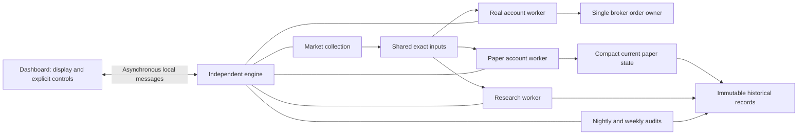

# Independent engine implementation and cutover review — October 22, 2026

Status: **October23 operator approval recovery and separate host enable succeed. Managed revision260
saves at08:45:49 Toronto, linked to original risk sequence3. The08:46 controls report Connected and
Waiting for09:30. Fresh opening inputs/checks and actual trading remain unobserved.**
The original overnight target was missed. Paper recovery now completes its saved plan; retained Paper
restrictions and remaining native acceptance are separate unfinished work.

## October 23 overnight readiness

### Morning completion — operator-approved and armed

During the requested08:30 follow-up, Joseph reports enabling the host and supplies screenshots showing
dated continuation saved/read back, Active Portfolio rules only,16:00 expiry and then Armed for09:30
Toronto. The no-outside-changes attestation is checked. No automatic renewal follows.

The08:46:14 controls independently confirm the same normal owner27724, Connected and execution Waiting
for regular hours, NextCheckAt09:30. Dashboard22276 remains open. All128 installed hashes match d8364eff.
The08:46:18 fixed broker check succeeds with zero holdings/pending orders and matching history; the
helper sends no order, refreshes no token and changes no credentials. This read does not independently
qualify local-journal timing or the native order lifecycle.

The08:47:34 hash-verified SQL read confirms `SessionContinuationApproved` revision260 saved08:45:49,
selected permission in shared storage, valid head hash and matching current Real projection. Its
revision identity links to original risk sequence3, whose content hash is unchanged; one October23 risk
event remains. Original revision259 is preserved. The interrupted pair is recovered without a duplicate.
Valid October23 OfficialPaper uses October22 and matches the saved configuration, four models, input
contract, policy and binding checksum. Real260/260 and Paper205,058 recovery receipts remain Complete
with valid hashes; current checkpoint hashes pass. Only eight existing Paper restrictions remain.
The historical Real proof covers its original boundary, not a new audit of revision260.

Private evidence: `artifacts/oct23-preopen-0830`; broker capture
`649429bc-3ef2-48db-8433-53c68db3cdaa`; SQL receipt
`result-20261023T124734594Z-efe8b10179724de0b176781beab66a61.json`, query SHA256
`CCD9A1579A7C856A1BE8F74411D61665C121B1628AF8FB01510DEBED4AC0655E`.
No agent approval/enable/order, restart, migration, hold clearance or nightly rerun. Joseph's own
approval/enable is the new authority. Fresh09:30 account/risk/source checks still govern execution;
arming does not promise trades or qualify live latency/populated protection. The one-date morning
readiness task is complete and its heartbeat is removed; the separate Paper monitor is unchanged.

Joseph subsequently requests monitoring after09:30 for Delphi's first actual trade or an execution
blocker. The new same-chat heartbeat `delphi-october-23-first-trade-and-blockers` is Active, with
five-minute checks during today's09:30–16:05 window. It alerts once on a confirmed, attributable fill
and on meaningful blockers/recovery, stays quiet on unchanged/no-signal waits, and continues blocker
supervision after the first fill. A final check reports the outcome and removes the heartbeat.
Its ignored deduplication state is `artifacts/oct23-live-watch/latest.json`; the08:47 observation remains
the baseline, not a new market-hours verification. This authorizes read-only supervision only, with no
orders, permission changes, restarts, hold clearance or collector runs. The original Paper monitor is
unchanged. The first attempt to create an anchored schedule was rejected before creation; the accepted
schedule uses local wall-clock slots and suppresses polling before09:30. No duplicate watch was created.

### Permission archive rejection — risk saved, permission not saved

Joseph's next installed review succeeds, but his approval reports SQL547 while saving/recovering the
dated continuation. The hash-verified 03:24:33 Toronto read finds one October23 risk event, sequence3,
saved at03:19:17 and 139,685 UTF-8 bytes. Managed revision259 is unchanged. Thus ADR-0106 passes its
native risk-save step; the permission append remains incomplete. Preserve that event and the original
request. No replacement risk event, automatic approval, host enable or order is authorized by recovery.

Offline reconstruction of the unchanged saved managed checkpoint reproduces the archive defect:
`EngineArchiveCodec.Pack` emits two standalone JSON string fragments (287 and1,628,153 characters).
The latter contains retained source-review evidence. `EngineEvidenceContent` requires object/array JSON
through its existing `ISJSON(ContentJson)=1` constraint. A 03:31:26 read-only SQL expression over that
actual retained text confirms the old scalar shape returns0 and its enclosing object returns1.
The installed constraint is enabled/trusted; its definition is not visible to the restricted reader,
so the canonical table/migration supplies the expression. No constraint is disabled or rewritten.

The correction packs only objects and arrays; long scalars stay within their enclosing records.
All original text, fingerprints, legacy readers, size limits and transaction boundaries remain.
The actual saved checkpoint now packs into847 valid object/array fragments, with zero standalone
scalars and exact full reconstruction. Four new boundary/large-text cases fail before the fix and pass
after it. A separate test rejects the permission append after the risk save, then uses a fresh review
to recover the original request: one risk append, one permission revision, host Off and zero orders.
All57 focused and3,092 full Core tests pass (nine native SQL skips, serial collections); isolated
WPF/engine Release succeeds with260 existing compiler warnings, including the committed-source rebuild.
NuGet audit is disabled and full SSDT solution health is not requalified.

Joseph authorizes the prepared guarded installation of d8364eff. Normal dashboard closure/engine drain
complete; all129 old runtime files are preserved and seven changed files install in standard Release.
All128 candidate/122 retained hashes verify. Engine27724 starts03:51:08; dashboard22276 opens03:51:10.
Running/non-verification/execution Off and unchanged protected grant bytes pass. The03:52:17 fixed-helper
read proves original risk sequence3 and managed259 content hashes unchanged, one October23 risk event,
matching daily/four models, unchanged complete Real/Paper recovery plans and valid hashes, zero
Broker/Global holds and eight Paper restrictions. The04:05:07 controls confirm Connected/execution Off.
The first sandboxed connection control leaves an empty reserved output and exits unsuccessfully;
the explicitly permitted outside-sandbox read uses fresh output paths and succeeds. No replayed write.

Private installation/backup receipts are under `artifacts/selected-session-archive-20261023/cutover`.
Post-install receipt `result-20261023T075216926Z-f79077f45f6a471b9725f720746b880e.json` matches query
`3D663866C0D7C4D21A66F8184A87A8BE2426B4AA4D8C840B3F059BBEEDA69C28`.
No migration, constraint change, financial approval/enable/order, new hold clearance or nightly rerun.
The08:30 follow-up is updated to preserve the partial-save boundary and recognize any later operator
approval/enable. Next Joseph uses a fresh dated review and approval to recover the original risk request;
successful native permission recovery and separate host enable remain unobserved.

Private evidence is under `artifacts/selected-session-archive-20261023`. Fixed-helper receipts:
`result-20261023T072432940Z-e008f04177ad4a139e02a7477d0cb5c9.json` matches query
`9A8F0B165E941305439F3900F0C86986AC46880B926EF3A8C2B8B451534535DA`; private risk/checkpoint
reads match `388E28DECE9B79ED1D244C349334035E68FF6B9EABE659AE15455E89C599F2FF` and
`68924532B24AFE5A89B2B328FB55CC468DB47148E5EAB7C9F67BA978CAA60C61`. The native JSON expression
receipt `result-20261023T073126451Z-e1dede3ea7784f07a1c1686f7da97fd4.json` matches
`2F836CF9791E77F335FEB4FB076021B386BA9DC7BAAF41344BF62B2A9130C9E4`. Payloads stay private.

### Risk receipt correction — installed, operator retry pending

[ADR-0106](../adr/0106-exact-selected-session-risk-receipt-storage.md) limits the correction to the new
selected-session receipt's stored representation. The complete request remains once; duplicated state
evidence is reconstructed from it and checked against the original full-state hash before save/read.
The 256 KiB storage ceiling, request/domain hashes, older inline bytes and financial rules are unchanged.
Repository decoding verifies the immutable row content hash and the existing identity/timestamp guards.
No schema migration or historical rewrite is required.

The fixed helper reads the latest original risk receipt privately; its query hash and original content
hash are verified before an offline serialization-only check. Using that saved history and synthetic
session/head metadata, the prospective selected-session receipt is 389,240 bytes inline and 139,668
bytes stored. Full receipt JSON, request hash and risk hash reconstruct exactly. This is size/integrity
evidence, not a saved financial continuation or native approval.

Validation: 82 focused checks pass; all 3,087 Core tests pass with nine native SQL skips and collection
concurrency disabled. The initial full run overlapped the Release build and had two existing AI timing
timeouts; both pass in their separate 18-test group and the full rerun. Isolated WPF/engine Release succeeds
with 260 existing compiler warnings. NuGet audit was disabled; dependency-security and complete SSDT
solution health are not requalified. SDK 10.0.401 is installed. No code model/market/order workflow runs.

Private evidence lives under `artifacts/selected-session-risk-storage-20261023` and the adjacent focused,
full, timing-recheck, full-serial and Release logs. The original risk receipt read is
`result-20261023T050050510Z-8a1c79ffc611488baf20ac154f9f3313.json`, query SHA256
`27DB97D332E8E75902A4A9A9FEB5585BF8B6B415BD6B2B7EA0517BCD0B4066EC`; no private payload is committed.

The committed-source Release build from a090757f also passes. Joseph authorizes the prepared guarded
cutover: normal dashboard closure and engine drain complete, all 129 old runtime files are preserved,
and the seven changed files install into the standard Release directory. All 128 candidate files and
122 retained original files match their captured hashes. Engine 26564 starts 02:51:44 Toronto with
`--run`; dashboard 13308 opens 02:51:46. Running/non-verification/execution Off and unchanged protected
grant bytes pass. No migration, financial approval, hold clearance, nightly rerun or order is issued.

The 03:10:32 controls confirm Connected and Off. The hash-verified 03:11:07 database read confirms Real
260/260 and Paper Complete 205,058 with unchanged plans/hashes, zero Broker/Global holds, eight retained
Paper restrictions and valid checkpoint hashes. October 23 Valid daily evidence still uses October 22
with exact saved configuration/four models/input contract. Managed revision stays 259; latest risk event
stays sequence 2/October 21, with zero October 23 risk events. Fresh 03:11:25 broker reads pass with zero
holdings/pending orders and matching history. Native UI shows account/history refreshed 03:09:05 and
broker/local-journal synchronization 03:09:06. Its setup click again fails with unavailable coordinate
geometry; no review, approval or enable input is sent by the agent.

Private cutover receipts/manifests and the previous runtime are under
`artifacts/selected-session-risk-storage-20261023/cutover`. Post-install SQL receipt
`result-20261023T071107043Z-a4cddf7aefa240a8b5635e054a089714.json` matches query SHA256
`B504125457A870BB58E430F8E38938D9DBE0130C7CD58581BE734A8FBD22B5BB`; fresh broker capture is
`4616977a-7b25-470e-9028-51e76a34a9ec`. These prove installed state/readiness checks, not a successful
new financial save. Joseph must reopen setup, run a fresh dated review and approve/enable himself.
The 08:30 follow-up remains and must recognize any later operator-saved permission before acting.

### Overnight operational evidence

The fixed-helper 00:02:24 Toronto read confirms original Paper recovery
`2581cceb-d128-4170-a97e-3b42625f440d` saved **Complete** at October 22 23:43:48.3447306 Toronto,
revision 2186, with 205,058 verified units, TargetIndex 4 and NextRevision 0. Its original plan hash
`9AC139920635ED19F17D5A3A39649F7F1EB58A74AED93FD2110DF5F64879F7CB` is unchanged. All recovery receipt
and current-checkpoint hash checks pass. This confirms coverage of that fixed plan, not a claim about
physical row counts, later writes or measured sustained capacity. Zero Broker/Global holds and all eight
Paper restrictions remain; no clearance or financial approval follows automatically. The original Paper
monitor remains responsible for its own completion report and cleanup.

Joseph requests readiness overnight for the upcoming Friday October 23 session and asks whether the
nightly can start early. The manual scheduled-task start is rejected at the tool permission prompt; no
manual run is issued. The unchanged scheduled task starts normally at 00:30:01 Toronto, run
`c5fcb858-8994-4cd9-9c13-4fa40f6155d8`. Its isolated source capture/locked restore/Release build succeeds
at 00:32:43; Hermes succeeds at 00:39:22, Delphi at 00:39:47 and Athena at 00:40:12. Overall status is
Succeeded. No schedule, strategy, model, gate or threshold is changed to force trades.

The 00:41:01 hash-verified database read confirms exactly one October 23 OfficialPaper run, Valid and
using October 22 data, created 00:39:46 from captured commit 2f922af3. Exact saved configuration, all four
model identities/hashes, active daily version, binding checksum, input contract and retained policy match.
The 00:40:34 fixed broker read succeeds: zero holdings/pending orders and matching broker history, with no
credential changes or orders. The 00:41:27 controls confirm the same engine instance, normal Running,
Connected and execution Off. Broker/Global holds remain zero; eight Paper restrictions remain.

Joseph reconfirms no outside changes since his earlier attestation, opens Execution setup, reviews and
attempts approval himself. His screenshot reports `Account risk event exceeds the supported size; no
event was saved.` Approval and enable remain disabled. Source locates this rejection before INSERT in
`BrokerAccountRiskContinuationRepository.AppendAsync`, after serialization exceeds the existing 256 KiB
guard. The 00:45:31 fixed-helper read confirms no October 23 risk event, latest risk sequence 2 dated
October 21, and unchanged managed revision 259. A focused preservation-compatible fix is pending.
No agent financial approval, enable or order is performed. The 08:30 same-chat follow-up remains;
the redundant 00:45 follow-up is deleted after nightly completion. Live source/latency and actual order/
protection qualification remain distinct from this successful pre-open evidence.

Private evidence: `oct23-midnight-*` under `artifacts/independent-engine/native`, and fixed-helper receipt
`result-20261023T040223919Z-9f0afe8a2ee04c5b82ecd58f98b274f7.json`, checked against query SHA256
`6614C8741939CA572EF8E82CEA7A7F7134250BDA071BAFC840D5F40BDFACC990`. Post-nightly receipt
`result-20261023T044100982Z-ad25db30d78040c6be9ed9fa418983f1.json` matches the same reviewed hash;
broker capture is `c7a708cf-05a7-4e6a-82a7-2758dd53425b` and controls are `oct23-post-nightly-*`.
The no-partial-save receipt is `result-20261023T044531220Z-55f311473ec643e28c0703910ea542b4.json`,
verified against query SHA256 `9A8F0B165E941305439F3900F0C86986AC46880B926EF3A8C2B8B451534535DA`.
Its optional current-state risk-path size fields are unavailable; the authoritative continuation and
managed-revision rows establish the unchanged saved outcome. An earlier diagnostic used the wrong
managed-row timestamp column and was rejected without publishing results.
The scheduled run's status/log
live under `%LOCALAPPDATA%/TraderVI/Nightly`; no manual start-request receipt exists.

## October 23 preparation — October 22 evening recovery

The follow-on chat independently confirms both processes absent and all 129 captured runtime files
unchanged. Joseph explicitly authorizes normal-mode restart with trading disabled and attests no outside
changes since the original cash-only baseline. Engine 28744 starts 23:12:01 Toronto with `--run` from
the installed standard Release; dashboard 19808 opens 23:17:41 and reconnects. Exactly one engine owner
and one dashboard are observed. No rebuild, installation, migration, backup or manual nightly launch.

Startup detects the interrupted continuity witness and creates Global `EngineRecoveryRequired`.
The old real proof predates that incident and cannot release it. Joseph separately authorizes a fresh
Real-only verification, then explicitly approves the concrete two-incident clearance after its results:
run `658adedf-4605-4a2d-a83d-7b6e615ff594` completes 260/260 at 23:21:31.788 Toronto. Current broker 259,
shared-input 0/content 0 boundaries remain identical to the proof, the real projection matches its head,
and all required immutable guards and audit/checkpoint hashes pass. The guarded clearance succeeds;
the 23:31:42 fixed-helper read confirms zero Broker/Global holds and **eight Paper restrictions**. These
retain the previous seven plus a linked restriction for the new interruption. Original incidents,
failed receipts and prior successful proof are preserved. Paper resumes its original plan/cursor:
30,521 before restart,31,788 verified at 23:31:37; 205,058 remains only the planned upper bound.
This observed interruption/recovery does not qualify arbitrary crash, restore or concurrent-write cases.

The initial fixed broker read cannot verify the saved login. Normal engine startup subsequently reports
Connected; the 23:15:24 installed v2 read succeeds with 46 requests, zero holdings/pending orders and matching
broker history. It sends no order, refreshes no token and changes no saved credentials. Native dashboard
readback shows successful account/local-journal history synchronization at 23:18:44 and restored strategy/
buying mode. Normal engine controls at 23:31:24–25 confirm Running, non-verification, Connected and Off;
the saved execution-grant ciphertext is unchanged from before restart. Broker revision259 and its
October 21 16:00permission expiry remain unchanged. No financial approval or new host authority is saved.

The reviewed calendar hash matches its review manifest: October 23 is a regular 09:30–16:00 Toronto
session and requires October 22 as its immediately preceding session. The 23:32:49 read confirms one
active daily version, matching saved model binding/checksum/input contract, retained policy, and exact
agreement of all four model identities/hashes and daily configuration with the latest Valid OfficialPaper
run. That run is for October 22 using October 21 data; **no October 23 run exists yet**. Early diagnostic
queries used incorrect JSON property casing; their null/zero comparisons were diagnostic errors, not
failed strategy checks. The corrected query/receipt below owns this comparison. The existing nightly
task is enabled/Ready, last result 0, next run 00:30:30 Toronto October 23. October 22's run succeeded through
Hermes/Delphi/Athena. Do not rerun it or infer tomorrow's preparation from yesterday's success.

The desktop helper can read account state but cannot open Execution setup (`coordinate input geometry
is unavailable` after one refreshed retry); a screenshot capture also times out. No review/approval/
enable input was sent. October 23's installed dated review, exact current account/risk/allowance/build/
daily checks and refreshed no-outside-changes confirmation remain pre-open work. The October 22
attestation is recorded, not a claim about later changes or tomorrow's financial permission.

The one-date heartbeat `tradervi-october-23-pre-open-readiness` is attached to
[the current readiness chat](codex://threads/01a166b7-be01-7c91-b770-7299158e789a) for 08:30 Toronto,
with a report target before 09:15 and removal after that report. The original 15-minute Paper monitor
remains in its original chat. Its next observation should follow the current launch/proof above;
do not replace its state file or duplicate its supervision. Keep the computer/app available for the wake.

**Morning sequence:** inspect fresh process/control/hold evidence and the completed nightly run; verify
October 23 Valid OfficialPaper evidence uses October 22 and the exact saved definition/models; refresh
broker and native account/order/risk checks; use the installed dated Review only with Joseph's attestation.
Report readiness or the precise blocker before 09:15. This chat may not approve a financial continuation,
renew a grant, enable trading or send an order. Joseph's later financial approval would save only the
selected session continuation with original references/history/unused allowance; enabling remains separate.
Fresh direct inputs, seven-minute signal age, concurrent live latency and populated order/protection
behavior cannot be established by evening/pre-open reads. Paper completion is not a prerequisite.

Private evidence: `oct23-evening-*`, `oct23-fresh-recovery-proof.sql`, `oct23-real-clearance-*`,
`oct23-cleared-*` and `oct23-daily-source-check.sql` under `artifacts/independent-engine/native`.
The final recovery SQL receipt is `result-20261023T033142742Z-965658bac3ac4731931d8143a4ae96a1.json`
with query SHA256 `716E63345CB62D89434710E2EA0D7C3817EF92C1805531EE6E1CF88679B65B2C`.
The corrected daily comparison receipt is `result-20261023T033249468Z-0d1996d00cdf4f1c89372d729d6c341b.json`
with SHA256 `FE8182D21079A339727CDD2FFD81CB2F729C764BACD978D4651CB00B5BEA7438`.
Every interpreted SQL receipt was checked against its submitted query hash. This session changes no
application source and reruns no builds/tests; prior compiler/dependency/full-solution limits remain.

## Windows restart interrupts recovery — October 22, 19:22 Toronto

Read-only supervision finds neither engine 49716 nor any TraderVI process running. Windows records a
shutdown request at 18:55:54, event-log shutdown at 18:56:11 and startup at 18:56:59 Toronto; the missing
process follows a host restart, with no new documented application cutover. The installed seven-file
manifest still matches c86f375d. This does not establish why Windows restarted or prove engine auto-start.

The 19:22:06 fixed-helper receipt has the reviewed query hash and valid audit/checkpoint hash flags.
Paper's original run/plan remains saved as Running at 30,521 verified units, last updated 18:55:52;
that database status is a retained cursor, not evidence of a running worker. Coverage is incomplete.
Real remains Complete 260/260; unresolved Broker/Global=0 and Paper=7, with no new integrity incidents.
Private evidence: `monitor-host-restart-20261022.json`, `monitor-process-observation.json`,
`monitor-state.json` and SQL receipt `result-20261022T232206655Z-37af980347c34d0baa2837ef4d68fafa.json`.

Next, use the operator/main session to start the installed engine with trading disabled, verify current
mode/ownership/continuity and resume the original paper cursor. Do not rerun failed audits or wait for
paper before the separate real-account readiness review. The monitor did not restart any process,
change permissions or clear holds. Its last live execution-Off proof remains 18:21:59; no current
running-mode proof exists after the restart. Supervision retains this alert to avoid repeat notifications.

## Normal-mode installation and dashboard transport correction

The reviewed next-session increment is committed as444026c7. After Joseph closed the dashboard,
old engine57400 stopped gracefully at16:51:45Toronto; zero owners were verified before the normal
Release build. Installed/source/output hashes and source commit identity match. New engine58696
started16:54:14 with `--run`; native Status/ExecutionStatus/Connection prove Running, non-verification,
Off and Connected. Dashboard49056 opens16:57:48 and responds. Paper resumes its original run/plan,
reaching21,714 at16:56:14. Receipts: ignored `selected-session-*` files in the native evidence directory.
Earlier empty sandbox control outputs are failed attempts, not mode evidence; the unique `*-verified`
receipts obtained via the installed control tool are the successful observations.

The16:57:19 fixed broker-read receipt verifies cash-only history/holdings and no pending orders;
46reads, zero orders/token refreshes and unchanged credentials. It does not check the protected local
journal or qualify cash-flow timing. Dashboard refresh itself fails: private account constructors/IDs
cannot round-trip through default RPC JSON, and reconstructed account objects cannot satisfy native
selection/reference checks. That initial setup block is resolved by the installed correction below.

The corrective source uses RPC-only wire contracts, opaque engine-issued account handles and a
current-session catalogue. The server resolves handles back to its actual authenticated account;
arbitrary/copied IDs and stale-login handles fail. Replies preserve the exact selected dashboard account
through nested reconciliation/review data. Security IDs, holdings/pending identity and broker daily
performance round-trip, while native order-submission provenance is never exported. Saved financial
JSON/hashes are unchanged. Protocol2 requires matching engine/dashboard versions. Fourteen focused
checks use real named-pipe messages and the actual broker dispatch; isolated WPF Release passes with
260existing compiler warnings. All3,074Core tests pass/nine native SQL skips with collection concurrency
disabled. No new dependency-security/full-solution qualification.

Correction c86f375d is installed after normal dashboard closure, graceful engine58696 stop at18:10:20
Toronto and verified zero owners. Standard Release rebuild has zero errors/260existing warnings;
Core product version matches the commit, all seven engine/dashboard runtime files and source copies
match, and the complete output manifest is saved. Engine49716 starts18:12:24 from normal WPF Release
with `--run`; installed controls/process identity prove Running/non-verification, Connected and Off.
Dashboard113392 opens18:21:33. At18:21:51 it reports successful account/history synchronization;
zero pending orders and saved strategy/buying mode restoration are observed. The ordinary engine
reconciliation checks its protected local journal; this does not qualify external cash-flow timing.
Joseph opens Execution setup after the mouse helper cannot target it reliably. At18:30 the screen
shows installed baseline/continuation/session storage, Review2026-10-23 and disabled continuation
approval/enable, retaining original risk/history/allowance and requiring fresh checks on that date.
No review/approval/enable or order button was activated by the agent.

The18:22:29 fixed SQL receipt has the expected query SHA256 and all receipt/checkpoint hash flags valid.
Real260 remains Complete; unresolved Broker/Global=0, Paper=7. Paper28,299/205,058planned upper-bound
units resume the same run/plan/cursor (27,611 before stop); incomplete coverage is not a pass.
Private `account-transport-*` launch/manifest/control/cutover/UI receipts and `monitor-state.json` own
this evidence. The15-minute monitor follows the new PID and reports only meaningful changes.

Preparation is complete, not financial activation. On October23 (including pre-open), refresh account,
daily/direct-source, exact strategy/build and immutable storage, review the no-outside-change interval,
explicitly approve the dated continuation after Joseph reviews results, then separately enable only
if authorized. Paper completion is not a prerequisite. Market-hours freshness/latency, actual populated
order/protection, remaining concurrency/abnormal restore and weekly paper capacity remain unqualified.

## Authorized next-session flow and normal-mode cutover — October 22

Joseph explicitly requests fixing next-session approval, clearing only verified real-account holds
and normal mode, retaining disabled trading until checks are reviewed. [ADR-0105](../adr/0105-reviewed-selected-session-continuation.md)
adds a dated cash-only review with fixed anchor/previous-permission links and canonical prior-state
identity. It preserves financial history, gaps, modes and unused allowance. Real readiness reviews the
saved definition/current subscription directly; no paper lifetime history is read. Current account,
exact build/storage and daily/direct-source evidence remain required. No permission is approved now.

Full Core 3,070 pass/nine native SQL skips with test concurrency disabled; final broker-focused
847 pass/two native skips; isolated WPF Release
succeeds with 260 existing compiler warnings/zero errors. The subsequent normal-mode and dashboard correction milestones are recorded above. Dependency-security and full solution are not requalified. The 16:30:37 Toronto fixed-helper receipt rechecks unchanged relevant heads
(broker259/shared0/content0), exact real projection and the same eight covered candidates. This is
read-only evidence, not actual clearance. Receipts/build logs remain in the ignored native directory.
The authorized installed guarded clear command succeeds (`real-only-clearance-receipt.json=true`).
The 16:47:02 Toronto hash-verified read confirms zero unresolved Broker/Global incidents and seven
Paper restrictions: two prior paper holds plus five linked retained restrictions. Real260 remains
Complete; Paper21080/205058 advances on its original plan/cursor; all receipt/checkpoint hashes pass.
No financial permission or grant is renewed. Expected main-session dashboard/engine stop and normal-
mode restart follow the validated source commit; the monitor must follow the new launch evidence.
No new schema migration or backup, training, historical conversion, cleanup or test order is required.

## Sequential audit and scoped recovery correction — October 22

The operator explicitly authorizes fixing repeated history work and separating real recovery from
paper research, with availability prioritized and real trading disabled until results review.
[ADR-0104](../adr/0104-scoped-recovery-and-sequential-history-audits.md) records the concrete contract.
Source now reads each portfolio's immutable membership changes once, fetches/hashes/decodes unique
content once per fresh pass, carries adjacent paper/broker state and pages legacy inputs. Active
batches admit4,096steps/five seconds and yield one second; idle checks remain30seconds. Original v2
full-state checksum bytes still require hashing per revision, and current-checkpoint reconstruction
remains an explicit final check. No history bytes, saved cursor or original audit plan are rewritten.

Real recovery has priority and an independent broker/shared-input/content boundary. Clear controls
verify exact relevant heads, database recovery identity, guards, saved receipts and real subscription;
known global recovery findings atomically retain linked paper holds. Unknown/shared findings stay
global. Original failed runs/incidents remain. Held paper assignments, holdings, experimental settings
and auxiliary work no longer gate real collection. No new schema is needed.

Full Core3,028passed/nine native skips with concurrency disabled;49 SQL batches parse after expanding
Dapper list placeholders for syntax checking. Focused tests cover original fingerprint equivalence,
one decode per unique item, reused immutable records, missing/corrupt/reordered content, v3 roots,
scope isolation, unknown/newer findings and retained discovery boundaries. Native install and measured
throughput were pending at that source checkpoint. The14:28 hash-verified read finds29,699paper item versions across three owners
(largest22,436) and40,708,962bytes of shared snapshot content, within the reader's configured bounds.
This is audit working-set evidence, not disk reclamation or a financial performance result.

### Installed scoped audit and original representation correction

Standard Release fc5f6e45 installed14:51Toronto after graceful stop and zero-owner verification;
the matching engine/dashboard build has260existing compiler warnings/zero errors. PID99168 and
native Status prove Running/VerificationOnly. Original full recovery resumes its same plan/cursor,
then fails at paper revision6,044; separately requested Real recovery fails at broker revision50.
The14:52 hash-verified observation retains6,044/50verified units and eight unresolved incidents,
with every prepared checkpoint hash valid. No hold is cleared or execution enabled.

Private fixed-helper receipts diagnose exact representation defects, not permission to bypass checks:
the paper settings-assignment time is the legacy SQL datetime1/300-second projection of its exact
snapshot timestamp. Original hashes and authorized state transition pass. Broker approvals at50,
144 and190 hash the prior typed state using process-dependent immutable dictionary ordering. The
audit now preserves raw immutable JSON and reconstructs original Memory representation, requiring
the exact originally stored SHA256 plus unchanged values/identity and every existing transition rule.
Current approval/write validation keeps its original contract; historical evidence is audit-only.

The source switch at144 clears nested signal dictionaries. A bounded lookahead of at most32broker
records inside the fixed audit boundary can supply property names/order only. The saved157witness
reproduces the exact143prior hash; its values are never copied. Each witness row's own stored checksum
is validated, and normal sequential verification still checks its transition before completion.
This exceptional legacy compatibility path rereads a small bounded broker interval; the main paper
reader still fetches/hashes/decodes distinct content once per pass. No disk cache or history rewrite.
Unrecoverable representations remain failures; no hash is substituted or waived.

All three original broker approval boundaries and the paper settings boundary pass the offline
reproduction.395focused tests pass, including unknown/changed state, identity, original-hash,
current-approval separation, witness value preservation and exact timestamp projection. Isolated
WPF Release succeeds/260existing warnings/zero errors. Full Core3,032passed/nine native skips with
concurrency disabled; native retry remains pending.
Evidence: ignored `artifacts/independent-engine/native/historical-*` and
`offline-audit-diagnosis.json`; private read-helper receipt hashes are checked before use.
Failed receipts remain immutable; corrected explicit recovery must create a new pass, so the already
checked portion will be checked again once. This is not a silent reset or incomplete-coverage pass.

### Corrected native recovery — October22,15:38Toronto

Correction0082a88a installed after normal stop/zero-owner proof. The normal Release build succeeds
with260existing compiler warnings/zero errors; Core source identity and runtime hashes are recorded.
PID57400 starts15:30in`--verify`; native mode/path/instance proof and three later Status samples agree.
Real run`4407bcbb-bb73-4d2b-b970-110c1f6b6f5e` completes260/260at15:32:46.810Toronto,39.78seconds
after its fixed boundary. This covers original broker revisions0–259, exact current real subscription,
database identity/guards and the plan's shared families (both empty at this boundary). It does not
qualify fresh market data, current broker authentication/reconciliation or dated execution permission.

Separate Paper run`2581cceb-d128-4170-a97e-3b42625f440d` has205,058planned units:37,790paper revisions
and167,268legacy input records. At15:38:44it has8,657verified units, including all6,937revisions and the
working checkpoint of its first portfolio, then1,720revisions of the second. The earlier6,044failure
boundary passes. The15:33/15:36/15:38hash-verified reads show4,115/6,139/8,657units. Later records differ
in size; these samples establish progress, not a whole-run ETA or weekly capacity.

All saved audit receipt hashes and eight prepared checkpoint hashes pass. Ten unresolved incidents
are retained: the prior eight plus the two explicit new recovery-request holds; no new failure after
the correction. No hold resolution, grant renewal, financial approval, broker access or order occurs.
Real proof remains complete while paper proceeds. The original failed receipts/cursors remain intact.

Dashboard15432is opened against the existing engine; Computer Use returns its TraderVI window and
the process responds. Accessibility text is unavailable, so tab/reconnect usability is not claimed.
Three installed Status controls during paper work return in347/216/198ms including process startup.
The engine working-set samples are about583–585MiB; this is process memory, not the384MiBcontent-cache
allowance or a sustained capacity bound. Private evidence: `historical-{installed-manifest,output-hashes,
engine-launch,mode-proof,dashboard-launch,control-latency}.json` and fixed-helper receipts.

Real trading remains disabled pending Joseph's review. Verified real-only hold resolution and fresh
broker/source/dated authorization checks are still required before live operation; no need to wait for
paper coverage merely to review this real result. Read-only supervision now follows the remaining
Paper run, retains the already reported Real completion, and reports new failures/progress/completion.

## Real-account results review — October 22, 15:59 Toronto

The operator requests a review of what is needed to resume real operation without paper completion.
This is review authority, not hold clearance, broker sign-in, renewed buying permission or enable.
The 15:57 fixed-helper observation confirms Real Complete260/260, Paper Running14,376, ten unchanged
incidents, and valid audit/checkpoint hashes. Engine57400 retains its installed path/start identity.
The separate 15:59 metadata read confirms the exact relevant recovery heads remain unchanged:
broker259, shared inputs0 and shared content0. The real observation matches its current head/hash.

Read-only classification against the installed policy finds three broker resolution candidates and
five global findings eligible to become linked paper-only restrictions, all inside the real proof's
boundary. The two existing paper findings remain. These are candidates, not completed clearance:
the installed serializable clear transaction must still recheck the database identity, guards,
all saved receipts, exact current heads and the typed current real subscription. Unknown findings
must remain blocked. A private eight-incident proposal is prepared but has not been submitted.

The installed broker-read v2 helper returns `SignInRequiredOrVerificationUnavailable` at15:57:03;
no fresh broker reconciliation was obtained, no token refresh or credential change occurred, and
no order was sent. Normal reconnect/sign-in and fresh holdings/pending-order/local-journal checks
remain required. This does not diagnose whether the saved login expired or verification was unavailable.

The latest broker revision is still259 from October21. Its saved reviewed session is October21,
permission expired October21 at16:00Toronto, and its approved implementation differs from installed
0082a88a. The installed continuation contract explicitly supports October22 only and requires its
confirmation on that date; it cannot authorize October23. A reviewed next-session continuation path
is therefore a remaining software dependency, not an automatic renewal or an audit wait. Preserve
the original account/risk history and explicit dated/exact-build approval; the implementation approach
is unresolved. Today's existing15:45new-buy cutoff is already past.

Recommended operational sequence, still pending authority: controlled real-only hold resolution and
normal-mode engine cutover with saved execution off; normal broker reconnect/reconciliation; verify
new real-source publications, freshness and responsive operation while paper continues; prepare and
review valid next-session/current-build permission; then separately enable execution only after the
remaining real-path checks pass. Clearing the global findings can itself resume market collection
even under `--verify`; this is an operational transition, not a read-only administrative change.
Normal mode is necessary for broker access. A graceful restart preserves the paper cursor; if real/
shared heads changed before clearance, obtain a fresh Real proof, never wait for or reset Paper.
Installed concurrency, direct-input latency, order-recovery/protection and reconnect acceptance must
remain explicit qualification limits; this review does not waive them or declare the host trade-ready.

Evidence: ignored `real-readiness-review.sql/json`, `real-hold-resolution-proposal.json`, and fixed
helper receipts at19:57/19:59UTC. Review-query SHA256 is
`91F4182ECD327BDA1989F9E871766397B5B789709B98CDB7F3DCF0B1C838CCD1`.
No hold, grant, engine mode, market workflow or financial record was changed by this review.

## Authorized native preparation — October 22

The operator explicitly authorizes the backup, migrations047–051, checkpoint preparation and native
verification, with real trading disabled until the results are reviewed. No execution grant renewal,
financial approval, order transmission, cleanup or historical deletion is authorized.

Preflight11:27Toronto verifies zero operational processes/active collection leases and none of the
nine new engine tables installed. Original paper roots/revisions and financial archive counts are
preserved in hash-verified private read-only receipts. The idle nightly task was temporarily disabled;
its exact prior definition/enabled state is retained for restoration after maintenance.

The fresh compressed full backup completed SQL checksum verification; its second copy matches SHA256
(3,579,413,532 compressed bytes). Windows Cloud Files reports the exact copy in sync11:41Toronto
(state9); the synchronization blocker is cleared. Evidence is under ignored
`artifacts/independent-engine/native/`; no private data is committed.
The bounded maintenance script applies each exact committed migration separately, requires the fresh
verified/synchronized backup and refuses to overwrite successful receipts. Native `--verify` startup
disables the saved real-execution grant and rejects broker access/order/enable commands. `--control`
supports only status, stop and explicit history recovery controls, reserving a private receipt before
dispatch to avoid replay. Final21focused tests and matching engine/WPF build pass (two existing WPF
compiler warnings). Subsequent native work and blockers follow; offline tests alone were insufficient.
The first047 invocation was rejected by SQLCMD's native argument parser before SQL execution.
A hash-verified12:29Toronto read confirms all new objects absent and original roots/counts unchanged.
The wrapper now supplies the backup path through a scoped process environment variable; approved
migration scripts are unchanged. The failure is not treated as a partially applied migration.

Migrations047–051 then applied successfully. The hash-verified12:35Toronto post-read confirms all nine
tables/fifteen required guards and unchanged paper current roots/revisions plus paper/broker/legacy-input
counts. Matching engine/dashboard outputs fromc34e1a22 built with260 existing compiler warnings and
zero errors; five shared runtime hashes match. Paper working-state qualification completed12:36:59
in4.55seconds; real-observation qualification completed12:37:00 in1.16seconds, both exit0.

Verification engine PID72336 started12:37:54; native status confirms Running/VerificationOnly and a
first-install recovery hold. Duplicate engine startup returned1 while the original survived. Explicit
recovery was admitted12:42; dashboard PID40788 launched. Native testing then found two defects:
the SQL datetime binding rounded the audit's projected boundary by0.4226ms relative to its exact JSON
plan, causing receipt rejection; an unhandled rejected Remember command crashed the connection window/
dashboard. The independent engine survived and retained all holds. The source correction binds new
audit timestamps asdatetime2 and reads only the exact known legacy1/300-second projection while
retaining/verifying the original JSON/hash boundary. No audit/history row is rewritten. Connection
window commands now present failures rather than terminating the dashboard.28focused integrity/
continuity/audit/verification tests pass, including the observed timestamp and actual SQL parameter
binding without a database connection. Two initial test-harness attempts failed because Dapper needs
a command identity; corrected provider-binding test passes. WPF build passes with two existing
warnings. Native stop/drain returned Stopped12:55:48 before rebuild. Repeat native qualification is
pending; real execution remains disabled, and nightly remains temporarily disabled for maintenance.

Corrected engine3280d802 starts13:01:33. Native integrity status now reads the original audit receipt;
the initial audit correctly retains Failed/zero verified units when its first paper-state comparison
rejects decimal formatting. Hash-verified original revision/authorization inspection confirms scale0
versus scale6 for equal initial capital. Typed-state comparison now uses exact JSON numeric equality
after the original archive hash verification.19focused checks pass, including rejection of one-millionth
value changes even above double-precision range, and one-tick timestamp changes. No historical byte,
capital, receipt or incident is changed. A new explicit recovery run remains required.

Native dashboard controls expose Running/VerificationOnly/Automatic trading off. Normal dashboard
closure leaves the same engine instance alive; reopening preserves that instance. Reopened-window
accessibility was unavailable despite one activation retry, so its full visual/interactive acceptance
is not claimed. Engine stop/drain again reports Stopped13:08:38. Native evidence remains private under
the same directory; the next step is corrected recovery verification and throughput measurement.

The corrected recovery starts17:10UTC and verifies1,354original revisions by17:14. Its new timestamp
projection matches the exact plan (zero difference); both receipt hashes verify. All original paper
roots/revisions and paper/broker/legacy-input counts still match preflight. Three PaperWorking rows
contain92,220bytes of JSON; three paper projections and one real projection also verify. This is current
checkpoint payload size, not total database storage or measured savings.21,959immutable record identities
are prepared. Full Core **3,016pass/nine skips**, concurrency disabled; standard Release build passes
with260existing compiler warnings. Dependency-security audit remains unqualified.

The switch from isolated verification output to standard Release exposed missing engine dependencies:
the dashboard relies on the installed Windows desktop shared runtime, but the headless engine had
declared only the base runtime. Normal verification startup therefore failed after the old owner
stopped cleanly13:15:47. No order or financial record was changed. The engine now explicitly declares
the same installed shared runtime, avoiding another copied library set. Restore/build succeeds with
zero incremental warnings/errors; the engine runtime configuration now lists both required shared
frameworks. At that checkpoint, installed native resume and nightly restoration awaited the corrected launch.

**Installed verification checkpoint13:27Toronto:** standard Releasea94c474a starts successfully from
the normal WPF output directory, PID80744, with`--verify`; the process/path/argument check confirms the
mode. Five engine/dashboard runtime files match and the complete output manifest is retained. The
same recovery run resumes from1,662verified units without resetting its cursor. The original enabled
nightly task state is restored13:21:39 (Ready); no scheduled stage was launched. The 13:34 hash-verified
read reports 3,409 verified units, 205,318 planned upper bound, five unresolved incidents, and zero bad
current-checkpoint hashes. Recovery remains Running, not accepted or complete. Earlier failed receipts
and all holds are retained. Source checkpoints this turn:c34e1a22,3280d802,3805cef1,a94c474a.

Read-only heartbeat`tradervi-native-recovery-progress` checks every15minutes in this chat, reporting
new failures, stalled progress, each further5,000verified records or completion. Its baseline is in
`native/monitor-state.json`; the bounded helper query is
`Operations/ReadOnlyChecks/IndependentEngineRecoveryStatus.sql`. It is instructed not to clear holds, change SQL,
restart the host or enable trading. Keep this computer and the app running for local progress checks.
The monitor ends after reporting completion; remaining qualification is still owned by the checklist.
No order, grant renewal, historical conversion/deletion, database restore or cleanup was performed.

## Audit cost and actual app availability — October 22, 13:58 Toronto

The operator asks why the audit still repeats history, what that history contains, how long it will
take and whether the app can run before the market closes. Read-only inspection confirms a remaining
implementation problem: `EngineHistoryVerifier.VerifyPaperAsync` reopens the entire current and prior
saved portfolio version for each transition. `DelphiLiveSnapshotStorage.ReadPartsAsync` fetches the
accumulated collections and referenced reports for each compact version before reconstruction. Thus
overlapping fills, quotes, marks and other records are repeatedly read/processed as revisions advance.
The broker audit also opens adjacent complete logical states. Stored-content sharing and an independent
process have not made this audit incremental. It is not rerunning today's stock strategy or training models.

The hash-verified 13:57:42 read shows 4,597 verified units, still in the first paper target (revisions
0–6,936). The fixed plan contains 37,790 paper versions across three targets, 260 broker versions,
167,268 legacy input/result records, and zero new shared-input/content records at its boundary. Total
planned units are 205,318; records have very different costs, so count percentage is not elapsed-work
percentage. Recent paper rates were 50.3/minute over 23.64 minutes and 31.9/minute over 2.54 minutes.
At those unchanged rates, the remaining 33,193 paper versions alone would take about 11–18 hours.
This is a conditional extrapolation, not a full completion ETA: later states may cost more, other
families are unmeasured, and the audit uses five-second batches separated by thirty-second waits.
The five existing incidents and zero bad checkpoint hashes are unchanged. Private receipt:
`artifacts/read-only-db/result-20261022T175741806Z-70dd390ec25941d2bc0246ae6b7c957a.json`.

The installed engine remains PID80744 with `--verify` at 13:57:27. The dashboard may reconnect for
viewing, but broker access/orders are disabled. More broadly, the global recovery hold also blocks
shared market-input collection, Live paper and tracked/Shadow paper workers. An engine process marked
Running does not establish that trading or collection is operational. The current recovery boundary
still couples unrelated paper/archive completion to real availability; the accepted independence goal
is not fully qualified. No real-trading readiness today is established, and no hold or permission changed.

Recommended follow-up, not a newly accepted relaxation: verify archive records once per audit pass,
carry verified state forward and check changes between versions, preserving exact identities, original
financial values and corruption detection. Establish a separately verified real-account/current-input
recovery boundary before allowing unrelated paper archives to finish independently. Isolation must be
proved before changing the present conservative holds; merely increasing the audit duty cycle would
not remove repeated work. The user requested explanation/discussion; this check changes no engine code.

## What changed

The dashboard connects to a separate Windows engine through asynchronous, current-user-only local
messages. Closing the dashboard leaves that engine running. Stop engine drains admitted work and
reports completion separately from Stop new buys. Original uncertain orders remain recoverable.
The engine owns authentication and the broker/order gate; reconnecting the dashboard creates no
second order owner. Separate schedules run collection, real management, paper protection, paper
consumption, research, existing opt-in AI work and audits. A slow paper/research cycle does not acquire
the real worker's admission gate.

Real collection subscriptions come from the verified broker assignment and current/pending holdings.
They survive absent or reassigned paper accounts. Exact policy, source, timestamps, conflicts and
seven-minute freshness remain required. Delayed paper work cannot refresh an old signal's authority.
Shared source publication is separate from when a paper account actually adopts it.

Paper cycles read a qualified current working window. New appends verify changed records and their
archive paths, then atomically save the new root, checkpoint, replay identities and current membership.
They preserve original capital and verified accumulated cash/profit. Original history remains fully
reconstructible. Shared inputs, unchanged report content and candidate state are stored by content
hash rather than duplicated across each revision. Full-history administrative readers remain explicit.

Both portfolio overview and Live dashboard use compact current state. Full portfolio history is
requested explicitly, loaded/transformed on a background worker and displayed in 100-row pages.
Broker cycles reuse only the exact verified current revision after fresh continuity/guard/hold checks.
Last saved decision and recovery diagnostics read fresh storage and understand both storage formats.

Audits check new history/backlog after trading, and older history in resumable fixed-boundary batches
with a weekly coverage target. Batches admit at most 256 steps/five seconds; one large revision may
take longer. Explicit recovery may run during the day under its hold. Completed batches do not clear
incidents. Clearing requires complete explicit recovery, unchanged captured heads, intact guards and
an operator reason. Research-only failures invalidate dependent research; trading or unknown failures
hold affected new risk, with protection allowed only where independently trustworthy.

Protected local and SQL continuity witnesses detect interrupted or changed state. A new/missing or
mismatched pair creates a global hold; startup never silently accepts it. Recovery freshly reconstructs
current checkpoints, archive paths, replay IDs and observation projections. Native restore/fork
coverage still requires qualification; the witness is not a claim that every restore scenario is proven.

The temporary unconditional real-host block is now conditional: installed independent storage and
immutable guards, verified continuity, applicable holds and an exact current account subscription.
The existing exact-build/account/strategy/dated permission and separate enable remain mandatory.
Normal cycles do not require a paper completion receipt or a completed routine archive audit.

## Offline evidence

Local source checkpoints:

| Area | Commits |
|---|---|
| Independent host/client and worker ownership | `58f32587`, `d0eea62c`, `d70eefe3`, `79138cc7` |
| Shared inputs, projections, short appends and handoff | `9b39b470`, `6055daf0`, `7c004312`, `319ca370` |
| Shared broker storage and reader compatibility | `92c3987f`, `5071a6a3`, `7891e5d7` |
| Incremental paper archive/current state and dashboard | `81160fea`, `f0463d27`, `054f867e`, `2fcd5909`, `517c8bcd` |
| Conflicts, independent subscriptions, audits and continuity | `8c500511`, `c237a5a7`, `b2380616`, `38bd0029`, `a33ce1b1` |

Conditional readiness and this consolidated review are committed together after the above checkpoints.

- Full Core suite: **3,003 passed; nine native tests skipped**. Test concurrency explicitly disabled
  with the generated xUnit runner configuration. Log: `artifacts/independent-engine-final-core-tests.log`.
- The first earlier parallel run failed two timing-sensitive AI cancellation/stop tests; a serial run
  passed them. The final count includes broker-cache and current-subscription regression coverage.
- Independent engine build passes; final incremental WPF build passes. Core/full WPF report 258/260
  existing compiler warnings; the incremental WPF build reports two. No new warning cleanup claimed.
- SSDT database-project build passes. Nineteen final changed runtime SQL batches parse without SQL
  access; earlier migration/schema parsing and focused checks are preserved below. These are not
  proof of SQL execution, permissions, locking or production latency.
- All 15 required immutable/progress trigger names match their canonical SQL definitions. Final
  WPF rebuild after this guard check passes with260 existing compiler warnings;17 final focused tests pass.
- Dependency-security audit was disabled for these builds; advisories were not requalified.

All outputs reuse `artifacts/independent-engine` (1.02GiB/707 files at the final source checkpoint).
No SQL read/write, migration, qualification command,
application/engine launch, market/broker call, training, order, cleanup, push or installation was performed
by this implementation effort. Earlier aggregate investigation reads are separately dated in its report.

## Remaining limits and acceptance

1. Native single-owner startup, dashboard close/reconnect, admitted-command draining and interruption
   behavior remain untested. Shared CPU, memory and SQL resources can still affect latency even with
   independent logical schedules. Configuration assignment fences can briefly delay shared collection.
2. Qualify current-state SQL concurrency, immutable/replay guards, exact-root conflicts, missing content,
   restore/abnormal recovery and witness metadata permissions. A failed check must preserve a durable
   hold and original account/order identities; no automatic reinitialization or clearing.
3. Measure audit progress against actual archive volume. Recovery and each historical paper-revision
   audit still reconstruct full historical state; large/repeated revisions can be expensive. The weekly
   target is not operationally proven, and the five-second admission budget is not a hard runtime cap.
4. Changed broker appends still serialize the full logical session under the existing 8MiB cap.
   Sharing removes repeated stored fragments and current reuse avoids unchanged reloads, but a fully
   incremental broker-order archive is not implemented. Qualify worst-case append latency/capacity.
5. Old history is preserved, not converted or deleted. Existing disk space has not been reclaimed and
   installed storage savings have not been measured. Build/backup/evidence retention needs a separate
   concrete decision; no deletion policy is inferred from this redesign.

## Concrete native preparation and cutover sequence

The operator has now authorized this database-writing/application sequence under `AGENTS.md` and
`TraderDB/AGENTS.md`, with real trading disabled pending results review. Track actual execution above;
passing offline checks alone does not establish native acceptance.

1. Review the exact source commit, matching engine/dashboard outputs and manual migrations below.
   Identify all writer processes/schedules and the protected account/order journals. Confirm capacity
   for a unique checksum full backup; never overwrite an existing backup. Obtain backup verification
   before schema changes. Retain a compatible reader and exact build manifest for recovery.
2. Stop/drain existing engine, dashboard-owned workers and scheduled writers; verify zero owners.
   Preserve saved grants, orders, original risk references and evidence. No process kill, liquidation,
   grant renewal or protected-file deletion is an implicit part of stopping.
3. Apply individually reviewed migrations in order using error-stopping manual SQL execution:

   | Script | Purpose |
   |---|---|
   | `20261022_047_AddIndependentEngineInputs.sql` | Shared exact input/content storage |
   | `20261022_048_AddEngineCurrentObservationState.sql` | Current observation state |
   | `20261022_049_AddEngineConsumerHandoff.sql` | Shared cycles and separate consumer receipts |
   | `20261022_050_AddIndependentIntegrityAudits.sql` | Audit/incident receipts; retire legacy evaluation writes |
   | `20261022_051_AddPaperWorkingState.sql` | Incremental paper archive/current checkpoints and replay IDs |

   No DACPAC publish. Do not modify these committed migration scripts to bypass preconditions.
4. While writers remain stopped, run the reviewed engine maintenance commands from the matching
   output: `--prepare-working-state` (all saved paper accounts, including observation state) and
   `--prepare-real-observations` (current broker subscriptions). The separate `--prepare-observations`
   command is available for a specifically reviewed membership-only operation; it is not a substitute
   for working-state qualification. These write derived state and do not grant trading authority.
5. Start the matching engine/dashboard in the agreed qualification scope. First continuity pairing
   intentionally holds work. Use History checks to request explicit recovery and examine completed
   coverage/current-state reconstruction; explicitly clear only verified incidents with a reason.
   Launching the normal engine can contact external services and write SQL, so this step needs that
   precise authority. Do not use the installed normal engine as an unapproved test harness.
6. Qualify the cases above, including slow paper/research, fresh-input handling, full-history equivalence,
   resource/audit capacity and dual-format reports. Any isolated SQL rehearsal must use an explicitly
   named disposable/synthetic database and a reviewed connection seam, never a production fallback.
   Retain results without automatic deletion. Existing skipped native tests do not cover every new path.
7. Only after acceptance, review the current exact real-account/build permission in the UI and enable
   deliberately. Existing approval dates/expiry remain unchanged; no test, migration or restart grants
   another session. Native financial actions require their own explicit authority.

After migration050 the old evaluation writer is retired; after new version-3 appends old readers may
also be incompatible. Do not restart the old binary as a generic rollback. Use a reviewed compatible
forward repair or an explicitly authorized recovery that reconciles original journal/broker outcomes;
restoring SQL alone cannot undo orders or authorize replay.

## Historical implementation checkpoints

The following retained checkpoint notes describe intermediate source states. References to unfinished
readers or an unconditional readiness block are superseded by the current state above. They are not
new installed verification dates.

**October22 Live display checkpoint:** the engine-connected Live tab now reads compact working
checkpoints, labels retained fills/quotes accurately and directs complete older records to explicit
portfolio History. The legacy administrative service keeps full reads. WPF builds with260 existing
compiler warnings; native display/SQL qualification and installation remain outstanding.

**October22 reader checkpoint:** engine broker leases reuse only an exact verified current revision,
after fresh continuity/guard/hold checks; explicit diagnostics bypass that cache and support inline
and shared storage. The dashboard has a Last saved decision command. Changed broker appends still
serialize lifetime logical state under the existing 8MiB limit. No history was deleted or converted.
386 focused tests and incremental WPF build pass (two existing warnings); native diagnostics remain
unqualified. Full Core before this reader increment: 3,000 passed, nine native skips with explicit
xUnit concurrency disabled; the first parallel run hit two existing AI timing tests. SSDT build passes.

## October 21 post-open execution watch

**October22 architecture delivery target missed:** implementation continues; no replacement installation
or operational change. Real collection subscriptions now derive from hash-bound broker revision heads,
including approved policy/admission definitions and current/pending holdings. Collection supports no
paper champion, preserves a real policy when paper is reassigned, and isolates invalid paper membership
under a paper hold. Shared source publication no longer updates Shadow accounts; the paper lane adopts
it at its actual processing boundary.423 related tests pass/one native skip;16 runtime SQL batches parse.
Isolated engine/WPF builds pass (258/260 existing compiler warnings); dependency audit not requalified.
Explicit --prepare-real-observations is prepared only. Restart/restore trust, broker current-state
processing, native concurrency/capacity and final acceptance remain; real-host readiness stays blocked.
Restart/restore witnesses are now in source: protected local/SQL pairing, dirty startup, drained clean
shutdown, periodic/admission checks and durable holds on mismatch. Recovery also reconstructs current
paper checkpoints/archive paths/replay IDs and collection projections.431 related tests pass/one native
skip; engine builds with258 existing compiler warnings. Actual restart/restore/concurrency remains
unqualified. Current recovery still scans the full archive; throughput needs further work.
Audits now verify up to256 steps per wake with a five-second admission budget, saving one verified
cursor per batch instead of one row per30 seconds.21 audit/integrity/continuity checks pass; failure
preserves the last good cursor. An admitted large revision may exceed the budget. Explicit recovery can
run during trading hours under its existing hold; ordinary audits remain off-hours. Capacity unmeasured.

October22 paper current-state integration now reads qualified compact checkpoints and atomically saves
changed archive records, current/observation state and immutable replay IDs. Full-history administrative
writers refresh the checkpoint; initial qualification is explicit. Original capital/cash/profit and latest-exit
context remain. 83 related checks pass, including full-archive validation of working-state buy/protection/
overnight/retry flows and stable ordinals after pruning. A 100,000-leaf mutable update reads at most 36 nodes; appending to a 10,000-mark
archive needs one new record and no tree reads, with exact reconstruction across day rollover.
SSDT, engine and isolated WPF builds pass (WPF two existing warnings); 32 SQL batches parse. Migration051
and --prepare-working-state are prepared only. Native concurrency/qualification remain; no installation.
Unchanged candidate state now uses one shared content record across archive revisions. 84 related
checks pass, including exact 200-symbol reconstruction and damaged-reference rejection; the synthetic
root is under one fifth of its previous size. Installed storage savings remain unmeasured.
Dashboard refresh now uses qualified current checkpoints; explicit full history loads on a worker
and displays 100-row pages. Lifetime estimated-fill totals and latest exit reasons survive pruning.
Current checkpoints also reference shared candidate content. 86 related tests and incremental WPF
build pass (two existing compiler warnings); no native UI or SQL qualification. Initial qualification
now covers all saved accounts, including ended accounts needed by the dashboard.

**Architecture implementation underway:** operator explicitly requests the independent engine followed
by history/storage work tonight. Core scheduling/session extraction is committed `58f32587`; `d0eea62c`
adds a separate Windows engine, current-user-only asynchronous control channel, engine-owned
broker/order workflows, reconnecting dashboard and explicit engine start/stop. 826 related
checks pass/one native skip; isolated engine/WPF build passes with 260 existing compiler warnings.
Storage checkpoint `9b39b470` supplies immutable, deduplicated shared-input storage: exact bar, policy,
baseline and daily-setup references preserve original evidence. 40 input/evaluation checks pass;
SSDT database project builds. Additive migration 047 is prepared, not applied.
The next increment wires independent market collection and real-input consumption, with a small
revision-checked paper membership projection (migration 048) and an explicit offline qualification
command. 430 related checks pass/one native skip, including collection with all paper-history access
rejected and a 10,000-closed-position projection fixture. Paper consumers, short write transactions,
historical audit/holds and cutover qualification remain; source wiring is not operational evidence.
New-host execution is deliberately blocked pending direct inputs and state-storage qualification.
Current source also prepares/validates paper appends outside the host/portfolio write locks, fences
the exact unchanged source root, and writes/verifies only changed items inside the transaction.
47 history/ledger/action/projection checks pass, including one appended item after 10,000 old marks.
Full pre-transaction history reads remain; native SQL concurrency/latency is not yet qualified.
October22 source adds durable shared-cycle/consumer receipts and separate engine schedules for
paper protection, paper inputs and research. Exact context/identities and original timestamps are
retained; delayed paper buys are rechecked before fills. Unprepared experiment changes remain pending
without delaying collection. 82 focused consumer/action/research/scheduler tests pass; isolated WPF
incremental build passes with two existing warnings, SSDT build and six SQL parse checks pass.
Migration049 is prepared only. Delphi Live dashboard ticks now read snapshots and its operator
commands go to the engine; dashboard closure sends no Live stop. Engine stop drains admitted Live
commands before releasing collection ownership. 43 focused command/transport/scheduler/monitor
checks pass and WPF builds (260 existing compiler warnings, zero errors). Shadow, tracked-position
monitoring and the existing opt-in AI reviewer now also use engine lifetime; manual paper polls route
through the same owners. Existing saved settings/schedules remain. Off-hours research recovery handles
one changed session per wake using durable review receipts; missing freezes cannot count as complete.
33 focused research/AI-host/transport/scheduler tests pass; incremental WPF build passes with two
existing warnings. Checkpointed reads and audits/holds remain; native close/reconnect is not qualified.
Broker revisions now support shared immutable nested records with lossless typed recovery and bounded
expansion. 407 relevant checks pass/one native skip; engine build passes with zero warnings/errors.
A repeated-record fixture uses under one twentieth of expanded storage; this is synthetic, not a
measurement of installed savings. Current eight-MiB logical-state limit remains. Direct-JSON diagnostics
now disclose shared storage; their qualified reader/cutover remains. No historical rows were converted.
Direct-input/history/storage/audit integration remains unfinished; installed app is unchanged.
The real reader now treats an earlier same-session stock/benchmark conflict as affecting its later
inputs, and invalidates an already-consumed cached confirmation before the progress check. A regression
proves that repeated reads cannot revive that confirmation. 399 focused recommendation/broker tests pass.
October22 source now includes resumable fixed-boundary Live/broker/shared-input audit receipts,
immutable scoped incidents, buy/protection guards and explicit verified recovery/clear controls in a
History checks window.379 focused integrity/broker/manual-buy tests pass; WPF builds with260 existing
warnings, SSDT builds, and16 runtime/migration SQL batches parse. Migration050 is prepared only and
retires the old Live input writer at cutover. Current-history read optimization, dependent readers,
native recovery/coverage/capacity and readiness remain unfinished; new-host execution stays blocked.
AI saved-context and champion diagnostic readers now include legacy and shared input history. AI
reads verify complete referenced inputs; lean diagnostics verify their referenced ruler without
expanding bar histories. Duplicate checkpoint identities fail, and the new publisher rejects legacy
identity collisions.79 focused reader/input/evaluation tests and combined diagnostic SQL parsing pass.
Dependency-security audit was disabled, not requalified. No database or external action.

**Accepted design — dashboard-independent operation:** closing the dashboard leaves
the engine running, with a separate stop control, under
[ADR-0103](../adr/0103-real-execution-independent-of-paper-research.md). The operator accepts staged delivery
conditional on completion tonight; target feasibility is unverified. The
[draft](../concepts/independent-real-processing-design.md#proposed-first-implementation-increment-independent-operational-host)
defines the proposed first increment: extract UI-owned execution/broker lifetime into a separate host
and give real management direct shared inputs. Current input reads still depend on paper evaluation
records; moving the host alone would not remove that dependency. Accepted independence, audit policy
and verification separation remain. Source progress is recorded above; no installation or native acceptance.

**Earlier architecture and storage investigation:** current source confirms
background paper execution plus whole-cycle settings/admission coupling; adding async alone cannot
remove real-host waits. Hash-verified read-only SQL and filesystem inspection distinguish repeated
history processing from evaluation storage and accumulated build outputs. The pinned architecture's
logical boundaries still apply; its execution-status labels are historical. Accepted redesign decisions
are recorded above; cleanup remains undecided. [Findings](../reviews/paper-workload-architecture-20261021.md).
