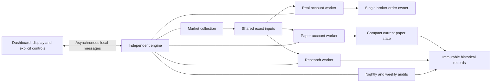

# Independent engine implementation and cutover review — October 22, 2026

Status: implemented in source and validated offline; **authorized native preparation in progress**.
The requested overnight delivery target was missed. The last recorded installed application remains
October 21 build `c4d094fd`; no later operational verification is implied by this document.

## Authorized native preparation — October 22

The operator explicitly authorizes the backup, migrations047–051, checkpoint preparation and native
verification, with real trading disabled until the results are reviewed. No execution grant renewal,
financial approval, order transmission, cleanup or historical deletion is authorized.

Preflight11:27Toronto verifies zero operational processes/active collection leases and none of the
nine new engine tables installed. Original paper roots/revisions and financial archive counts are
preserved in hash-verified private read-only receipts. The idle nightly task was temporarily disabled;
its exact prior definition/enabled state is retained for restoration after maintenance.

The fresh compressed full backup completed SQL checksum verification; its second copy matches SHA256
(3,579,413,532 compressed bytes). Windows Cloud Files reports the exact copy in sync11:41Toronto
(state9); the synchronization blocker is cleared. Evidence is under ignored
`artifacts/independent-engine/native/`; no private data is committed.
The bounded maintenance script applies each exact committed migration separately, requires the fresh
verified/synchronized backup and refuses to overwrite successful receipts. Native `--verify` startup
disables the saved real-execution grant and rejects broker access/order/enable commands. `--control`
supports only status, stop and explicit history recovery controls, reserving a private receipt before
dispatch to avoid replay. Final21focused tests and matching engine/WPF build pass (two existing WPF
compiler warnings). Subsequent native work and blockers follow; offline tests alone were insufficient.
The first047 invocation was rejected by SQLCMD's native argument parser before SQL execution.
A hash-verified12:29Toronto read confirms all new objects absent and original roots/counts unchanged.
The wrapper now supplies the backup path through a scoped process environment variable; approved
migration scripts are unchanged. The failure is not treated as a partially applied migration.

Migrations047–051 then applied successfully. The hash-verified12:35Toronto post-read confirms all nine
tables/fifteen required guards and unchanged paper current roots/revisions plus paper/broker/legacy-input
counts. Matching engine/dashboard outputs fromc34e1a22 built with260 existing compiler warnings and
zero errors; five shared runtime hashes match. Paper working-state qualification completed12:36:59
in4.55seconds; real-observation qualification completed12:37:00 in1.16seconds, both exit0.

Verification engine PID72336 started12:37:54; native status confirms Running/VerificationOnly and a
first-install recovery hold. Duplicate engine startup returned1 while the original survived. Explicit
recovery was admitted12:42; dashboard PID40788 launched. Native testing then found two defects:
the SQL datetime binding rounded the audit's projected boundary by0.4226ms relative to its exact JSON
plan, causing receipt rejection; an unhandled rejected Remember command crashed the connection window/
dashboard. The independent engine survived and retained all holds. The source correction binds new
audit timestamps asdatetime2 and reads only the exact known legacy1/300-second projection while
retaining/verifying the original JSON/hash boundary. No audit/history row is rewritten. Connection
window commands now present failures rather than terminating the dashboard.28focused integrity/
continuity/audit/verification tests pass, including the observed timestamp and actual SQL parameter
binding without a database connection. Two initial test-harness attempts failed because Dapper needs
a command identity; corrected provider-binding test passes. WPF build passes with two existing
warnings. Native stop/drain returned Stopped12:55:48 before rebuild. Repeat native qualification is
pending; real execution remains disabled, and nightly remains temporarily disabled for maintenance.

## What changed

The dashboard connects to a separate Windows engine through asynchronous, current-user-only local
messages. Closing the dashboard leaves that engine running. Stop engine drains admitted work and
reports completion separately from Stop new buys. Original uncertain orders remain recoverable.
The engine owns authentication and the broker/order gate; reconnecting the dashboard creates no
second order owner. Separate schedules run collection, real management, paper protection, paper
consumption, research, existing opt-in AI work and audits. A slow paper/research cycle does not acquire
the real worker's admission gate.

Real collection subscriptions come from the verified broker assignment and current/pending holdings.
They survive absent or reassigned paper accounts. Exact policy, source, timestamps, conflicts and
seven-minute freshness remain required. Delayed paper work cannot refresh an old signal's authority.
Shared source publication is separate from when a paper account actually adopts it.

Paper cycles read a qualified current working window. New appends verify changed records and their
archive paths, then atomically save the new root, checkpoint, replay identities and current membership.
They preserve original capital and verified accumulated cash/profit. Original history remains fully
reconstructible. Shared inputs, unchanged report content and candidate state are stored by content
hash rather than duplicated across each revision. Full-history administrative readers remain explicit.

Both portfolio overview and Live dashboard use compact current state. Full portfolio history is
requested explicitly, loaded/transformed on a background worker and displayed in 100-row pages.
Broker cycles reuse only the exact verified current revision after fresh continuity/guard/hold checks.
Last saved decision and recovery diagnostics read fresh storage and understand both storage formats.

Audits check new history/backlog after trading, and older history in resumable fixed-boundary batches
with a weekly coverage target. Batches admit at most 256 steps/five seconds; one large revision may
take longer. Explicit recovery may run during the day under its hold. Completed batches do not clear
incidents. Clearing requires complete explicit recovery, unchanged captured heads, intact guards and
an operator reason. Research-only failures invalidate dependent research; trading or unknown failures
hold affected new risk, with protection allowed only where independently trustworthy.

Protected local and SQL continuity witnesses detect interrupted or changed state. A new/missing or
mismatched pair creates a global hold; startup never silently accepts it. Recovery freshly reconstructs
current checkpoints, archive paths, replay IDs and observation projections. Native restore/fork
coverage still requires qualification; the witness is not a claim that every restore scenario is proven.

The temporary unconditional real-host block is now conditional: installed independent storage and
immutable guards, verified continuity, applicable holds and an exact current account subscription.
The existing exact-build/account/strategy/dated permission and separate enable remain mandatory.
Normal cycles do not require a paper completion receipt or a completed routine archive audit.

## Offline evidence

Local source checkpoints:

| Area | Commits |
|---|---|
| Independent host/client and worker ownership | `58f32587`, `d0eea62c`, `d70eefe3`, `79138cc7` |
| Shared inputs, projections, short appends and handoff | `9b39b470`, `6055daf0`, `7c004312`, `319ca370` |
| Shared broker storage and reader compatibility | `92c3987f`, `5071a6a3`, `7891e5d7` |
| Incremental paper archive/current state and dashboard | `81160fea`, `f0463d27`, `054f867e`, `2fcd5909`, `517c8bcd` |
| Conflicts, independent subscriptions, audits and continuity | `8c500511`, `c237a5a7`, `b2380616`, `38bd0029`, `a33ce1b1` |

Conditional readiness and this consolidated review are committed together after the above checkpoints.

- Full Core suite: **3,003 passed; nine native tests skipped**. Test concurrency explicitly disabled
  with the generated xUnit runner configuration. Log: `artifacts/independent-engine-final-core-tests.log`.
- The first earlier parallel run failed two timing-sensitive AI cancellation/stop tests; a serial run
  passed them. The final count includes broker-cache and current-subscription regression coverage.
- Independent engine build passes; final incremental WPF build passes. Core/full WPF report 258/260
  existing compiler warnings; the incremental WPF build reports two. No new warning cleanup claimed.
- SSDT database-project build passes. Nineteen final changed runtime SQL batches parse without SQL
  access; earlier migration/schema parsing and focused checks are preserved below. These are not
  proof of SQL execution, permissions, locking or production latency.
- All 15 required immutable/progress trigger names match their canonical SQL definitions. Final
  WPF rebuild after this guard check passes with260 existing compiler warnings;17 final focused tests pass.
- Dependency-security audit was disabled for these builds; advisories were not requalified.

All outputs reuse `artifacts/independent-engine` (1.02GiB/707 files at the final source checkpoint).
No SQL read/write, migration, qualification command,
application/engine launch, market/broker call, training, order, cleanup, push or installation was performed
by this implementation effort. Earlier aggregate investigation reads are separately dated in its report.

## Remaining limits and acceptance

1. Native single-owner startup, dashboard close/reconnect, admitted-command draining and interruption
   behavior remain untested. Shared CPU, memory and SQL resources can still affect latency even with
   independent logical schedules. Configuration assignment fences can briefly delay shared collection.
2. Qualify current-state SQL concurrency, immutable/replay guards, exact-root conflicts, missing content,
   restore/abnormal recovery and witness metadata permissions. A failed check must preserve a durable
   hold and original account/order identities; no automatic reinitialization or clearing.
3. Measure audit progress against actual archive volume. Recovery and each historical paper-revision
   audit still reconstruct full historical state; large/repeated revisions can be expensive. The weekly
   target is not operationally proven, and the five-second admission budget is not a hard runtime cap.
4. Changed broker appends still serialize the full logical session under the existing 8MiB cap.
   Sharing removes repeated stored fragments and current reuse avoids unchanged reloads, but a fully
   incremental broker-order archive is not implemented. Qualify worst-case append latency/capacity.
5. Old history is preserved, not converted or deleted. Existing disk space has not been reclaimed and
   installed storage savings have not been measured. Build/backup/evidence retention needs a separate
   concrete decision; no deletion policy is inferred from this redesign.

## Concrete native preparation and cutover sequence

The operator has now authorized this database-writing/application sequence under `AGENTS.md` and
`TraderDB/AGENTS.md`, with real trading disabled pending results review. Track actual execution above;
passing offline checks alone does not establish native acceptance.

1. Review the exact source commit, matching engine/dashboard outputs and manual migrations below.
   Identify all writer processes/schedules and the protected account/order journals. Confirm capacity
   for a unique checksum full backup; never overwrite an existing backup. Obtain backup verification
   before schema changes. Retain a compatible reader and exact build manifest for recovery.
2. Stop/drain existing engine, dashboard-owned workers and scheduled writers; verify zero owners.
   Preserve saved grants, orders, original risk references and evidence. No process kill, liquidation,
   grant renewal or protected-file deletion is an implicit part of stopping.
3. Apply individually reviewed migrations in order using error-stopping manual SQL execution:

   | Script | Purpose |
   |---|---|
   | `20261022_047_AddIndependentEngineInputs.sql` | Shared exact input/content storage |
   | `20261022_048_AddEngineCurrentObservationState.sql` | Current observation state |
   | `20261022_049_AddEngineConsumerHandoff.sql` | Shared cycles and separate consumer receipts |
   | `20261022_050_AddIndependentIntegrityAudits.sql` | Audit/incident receipts; retire legacy evaluation writes |
   | `20261022_051_AddPaperWorkingState.sql` | Incremental paper archive/current checkpoints and replay IDs |

   No DACPAC publish. Do not modify these committed migration scripts to bypass preconditions.
4. While writers remain stopped, run the reviewed engine maintenance commands from the matching
   output: `--prepare-working-state` (all saved paper accounts, including observation state) and
   `--prepare-real-observations` (current broker subscriptions). The separate `--prepare-observations`
   command is available for a specifically reviewed membership-only operation; it is not a substitute
   for working-state qualification. These write derived state and do not grant trading authority.
5. Start the matching engine/dashboard in the agreed qualification scope. First continuity pairing
   intentionally holds work. Use History checks to request explicit recovery and examine completed
   coverage/current-state reconstruction; explicitly clear only verified incidents with a reason.
   Launching the normal engine can contact external services and write SQL, so this step needs that
   precise authority. Do not use the installed normal engine as an unapproved test harness.
6. Qualify the cases above, including slow paper/research, fresh-input handling, full-history equivalence,
   resource/audit capacity and dual-format reports. Any isolated SQL rehearsal must use an explicitly
   named disposable/synthetic database and a reviewed connection seam, never a production fallback.
   Retain results without automatic deletion. Existing skipped native tests do not cover every new path.
7. Only after acceptance, review the current exact real-account/build permission in the UI and enable
   deliberately. Existing approval dates/expiry remain unchanged; no test, migration or restart grants
   another session. Native financial actions require their own explicit authority.

After migration050 the old evaluation writer is retired; after new version-3 appends old readers may
also be incompatible. Do not restart the old binary as a generic rollback. Use a reviewed compatible
forward repair or an explicitly authorized recovery that reconciles original journal/broker outcomes;
restoring SQL alone cannot undo orders or authorize replay.

## Historical implementation checkpoints

The following retained checkpoint notes describe intermediate source states. References to unfinished
readers or an unconditional readiness block are superseded by the current state above. They are not
new installed verification dates.

**October22 Live display checkpoint:** the engine-connected Live tab now reads compact working
checkpoints, labels retained fills/quotes accurately and directs complete older records to explicit
portfolio History. The legacy administrative service keeps full reads. WPF builds with260 existing
compiler warnings; native display/SQL qualification and installation remain outstanding.

**October22 reader checkpoint:** engine broker leases reuse only an exact verified current revision,
after fresh continuity/guard/hold checks; explicit diagnostics bypass that cache and support inline
and shared storage. The dashboard has a Last saved decision command. Changed broker appends still
serialize lifetime logical state under the existing 8MiB limit. No history was deleted or converted.
386 focused tests and incremental WPF build pass (two existing warnings); native diagnostics remain
unqualified. Full Core before this reader increment: 3,000 passed, nine native skips with explicit
xUnit concurrency disabled; the first parallel run hit two existing AI timing tests. SSDT build passes.

## October 21 post-open execution watch

**October22 architecture delivery target missed:** implementation continues; no replacement installation
or operational change. Real collection subscriptions now derive from hash-bound broker revision heads,
including approved policy/admission definitions and current/pending holdings. Collection supports no
paper champion, preserves a real policy when paper is reassigned, and isolates invalid paper membership
under a paper hold. Shared source publication no longer updates Shadow accounts; the paper lane adopts
it at its actual processing boundary.423 related tests pass/one native skip;16 runtime SQL batches parse.
Isolated engine/WPF builds pass (258/260 existing compiler warnings); dependency audit not requalified.
Explicit --prepare-real-observations is prepared only. Restart/restore trust, broker current-state
processing, native concurrency/capacity and final acceptance remain; real-host readiness stays blocked.
Restart/restore witnesses are now in source: protected local/SQL pairing, dirty startup, drained clean
shutdown, periodic/admission checks and durable holds on mismatch. Recovery also reconstructs current
paper checkpoints/archive paths/replay IDs and collection projections.431 related tests pass/one native
skip; engine builds with258 existing compiler warnings. Actual restart/restore/concurrency remains
unqualified. Current recovery still scans the full archive; throughput needs further work.
Audits now verify up to256 steps per wake with a five-second admission budget, saving one verified
cursor per batch instead of one row per30 seconds.21 audit/integrity/continuity checks pass; failure
preserves the last good cursor. An admitted large revision may exceed the budget. Explicit recovery can
run during trading hours under its existing hold; ordinary audits remain off-hours. Capacity unmeasured.

October22 paper current-state integration now reads qualified compact checkpoints and atomically saves
changed archive records, current/observation state and immutable replay IDs. Full-history administrative
writers refresh the checkpoint; initial qualification is explicit. Original capital/cash/profit and latest-exit
context remain. 83 related checks pass, including full-archive validation of working-state buy/protection/
overnight/retry flows and stable ordinals after pruning. A 100,000-leaf mutable update reads at most 36 nodes; appending to a 10,000-mark
archive needs one new record and no tree reads, with exact reconstruction across day rollover.
SSDT, engine and isolated WPF builds pass (WPF two existing warnings); 32 SQL batches parse. Migration051
and --prepare-working-state are prepared only. Native concurrency/qualification remain; no installation.
Unchanged candidate state now uses one shared content record across archive revisions. 84 related
checks pass, including exact 200-symbol reconstruction and damaged-reference rejection; the synthetic
root is under one fifth of its previous size. Installed storage savings remain unmeasured.
Dashboard refresh now uses qualified current checkpoints; explicit full history loads on a worker
and displays 100-row pages. Lifetime estimated-fill totals and latest exit reasons survive pruning.
Current checkpoints also reference shared candidate content. 86 related tests and incremental WPF
build pass (two existing compiler warnings); no native UI or SQL qualification. Initial qualification
now covers all saved accounts, including ended accounts needed by the dashboard.

**Architecture implementation underway:** operator explicitly requests the independent engine followed
by history/storage work tonight. Core scheduling/session extraction is committed `58f32587`; `d0eea62c`
adds a separate Windows engine, current-user-only asynchronous control channel, engine-owned
broker/order workflows, reconnecting dashboard and explicit engine start/stop. 826 related
checks pass/one native skip; isolated engine/WPF build passes with 260 existing compiler warnings.
Storage checkpoint `9b39b470` supplies immutable, deduplicated shared-input storage: exact bar, policy,
baseline and daily-setup references preserve original evidence. 40 input/evaluation checks pass;
SSDT database project builds. Additive migration 047 is prepared, not applied.
The next increment wires independent market collection and real-input consumption, with a small
revision-checked paper membership projection (migration 048) and an explicit offline qualification
command. 430 related checks pass/one native skip, including collection with all paper-history access
rejected and a 10,000-closed-position projection fixture. Paper consumers, short write transactions,
historical audit/holds and cutover qualification remain; source wiring is not operational evidence.
New-host execution is deliberately blocked pending direct inputs and state-storage qualification.
Current source also prepares/validates paper appends outside the host/portfolio write locks, fences
the exact unchanged source root, and writes/verifies only changed items inside the transaction.
47 history/ledger/action/projection checks pass, including one appended item after 10,000 old marks.
Full pre-transaction history reads remain; native SQL concurrency/latency is not yet qualified.
October22 source adds durable shared-cycle/consumer receipts and separate engine schedules for
paper protection, paper inputs and research. Exact context/identities and original timestamps are
retained; delayed paper buys are rechecked before fills. Unprepared experiment changes remain pending
without delaying collection. 82 focused consumer/action/research/scheduler tests pass; isolated WPF
incremental build passes with two existing warnings, SSDT build and six SQL parse checks pass.
Migration049 is prepared only. Delphi Live dashboard ticks now read snapshots and its operator
commands go to the engine; dashboard closure sends no Live stop. Engine stop drains admitted Live
commands before releasing collection ownership. 43 focused command/transport/scheduler/monitor
checks pass and WPF builds (260 existing compiler warnings, zero errors). Shadow, tracked-position
monitoring and the existing opt-in AI reviewer now also use engine lifetime; manual paper polls route
through the same owners. Existing saved settings/schedules remain. Off-hours research recovery handles
one changed session per wake using durable review receipts; missing freezes cannot count as complete.
33 focused research/AI-host/transport/scheduler tests pass; incremental WPF build passes with two
existing warnings. Checkpointed reads and audits/holds remain; native close/reconnect is not qualified.
Broker revisions now support shared immutable nested records with lossless typed recovery and bounded
expansion. 407 relevant checks pass/one native skip; engine build passes with zero warnings/errors.
A repeated-record fixture uses under one twentieth of expanded storage; this is synthetic, not a
measurement of installed savings. Current eight-MiB logical-state limit remains. Direct-JSON diagnostics
now disclose shared storage; their qualified reader/cutover remains. No historical rows were converted.
Direct-input/history/storage/audit integration remains unfinished; installed app is unchanged.
The real reader now treats an earlier same-session stock/benchmark conflict as affecting its later
inputs, and invalidates an already-consumed cached confirmation before the progress check. A regression
proves that repeated reads cannot revive that confirmation. 399 focused recommendation/broker tests pass.
October22 source now includes resumable fixed-boundary Live/broker/shared-input audit receipts,
immutable scoped incidents, buy/protection guards and explicit verified recovery/clear controls in a
History checks window.379 focused integrity/broker/manual-buy tests pass; WPF builds with260 existing
warnings, SSDT builds, and16 runtime/migration SQL batches parse. Migration050 is prepared only and
retires the old Live input writer at cutover. Current-history read optimization, dependent readers,
native recovery/coverage/capacity and readiness remain unfinished; new-host execution stays blocked.
AI saved-context and champion diagnostic readers now include legacy and shared input history. AI
reads verify complete referenced inputs; lean diagnostics verify their referenced ruler without
expanding bar histories. Duplicate checkpoint identities fail, and the new publisher rejects legacy
identity collisions.79 focused reader/input/evaluation tests and combined diagnostic SQL parsing pass.
Dependency-security audit was disabled, not requalified. No database or external action.

**Accepted design — dashboard-independent operation:** closing the dashboard leaves
the engine running, with a separate stop control, under
[ADR-0103](../adr/0103-real-execution-independent-of-paper-research.md). The operator accepts staged delivery
conditional on completion tonight; target feasibility is unverified. The
[draft](../concepts/independent-real-processing-design.md#proposed-first-implementation-increment-independent-operational-host)
defines the proposed first increment: extract UI-owned execution/broker lifetime into a separate host
and give real management direct shared inputs. Current input reads still depend on paper evaluation
records; moving the host alone would not remove that dependency. Accepted independence, audit policy
and verification separation remain. Source progress is recorded above; no installation or native acceptance.

**Earlier architecture and storage investigation:** current source confirms
background paper execution plus whole-cycle settings/admission coupling; adding async alone cannot
remove real-host waits. Hash-verified read-only SQL and filesystem inspection distinguish repeated
history processing from evaluation storage and accumulated build outputs. The pinned architecture's
logical boundaries still apply; its execution-status labels are historical. Accepted redesign decisions
are recorded above; cleanup remains undecided. [Findings](../reviews/paper-workload-architecture-20261021.md).
