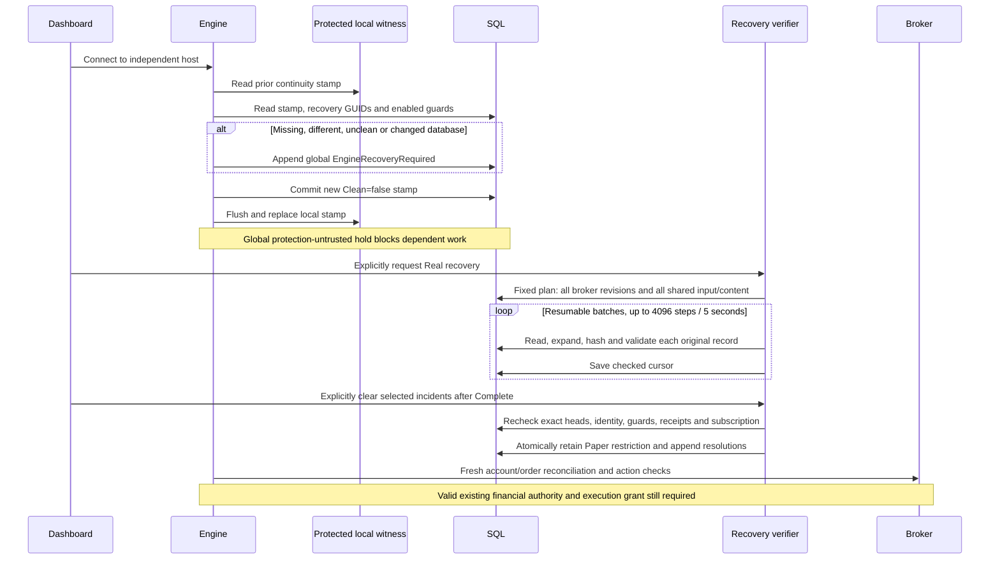

# Practical engine restart recovery — investigation and proposed design

October 30, 2026. **Draft recommendation, not an accepted replacement ADR.**
Owner: [GitHub #19](https://github.com/JosephMawer/TraderVI/issues/19).
This review develops the earlier [independence design](../concepts/independent-real-processing-design.md);
it does not supersede installed behavior or authorize implementation, migration, deployment or trading.

The immediate problem is a restart preventing Real trading while lifetime history is verified.
The parent problem is coupling operational readiness to historical reconstruction and broad holds.
The root goal is prompt recovery of the approved strategy with accurate orders, permissions and protection.
Time spent unavailable or without trustworthy protection is itself a safety cost.

The present scan exists because the application treats an unclean or mismatched continuity witness
as loss of trust in the whole saved history. A fresh Recovery plan then deliberately starts from the
beginning, rather than reusing a completed audit. This is an implementation choice, not a consequence
of SQL crash recovery or a requirement imposed by an ambiguous broker order. Those risks require
current-state validation and reconciliation of the uncertain operation. They do not ordinarily require
rereading unrelated old records. A full scan also cannot prove what the external broker accepted.

**Recommendation:** combine a compact, transactionally maintained operational checkpoint, an explicit
write-ahead record of uncertain operations, fresh broker reconciliation, and dependency-scoped holds.
Move full historical auditing out of ordinary startup. Preserve it as independently reported background
coverage and as a possible tool for exceptional disaster reconstruction. Prefer no ordinary event replay:
update the checkpoint with every authoritative state transaction, leaving only a small cross-store tail
to resolve. A checkpoint means a saved, validated current state; a tail is the changes after that state.

## Evidence and authority

| Category | Finding or limit |
|---|---|
| Confirmed source | Source examined at `130e3d9882c5410962dca1939d26c0f42e36b830`; initial staged/unstaged checkout clean. Source links below identify contracts, not installed-binary equivalence. |
| Process observation | Read-only inspection found engine 43628, collector 38312 and dashboard 24868 with the supplied engine/collector start times, 13:22:56/13:23:02 Toronto. Process existence is not readiness. |
| Dated saved receipts | Existing monitor captures show broker cursor 241 at 13:27:00, 520 at 13:29:24, 2,706 at 13:50:07; its 13:55 chat report records 3,149. These are observations, not a live completion claim. |
| Ownership | Existing `complete-authorized-real-recovery` monitor retains recovery/conditional-clearance authority. Its parent chat was inspected and notified of this design-only boundary. No competing run, clearance, SQL mailbox submission or automation change was made. |
| Measured offline | Synthetic codec stages and allocations, below; 40 focused existing recovery/integrity tests pass. These do not qualify the proposed protocol. |
| Unknown | Original shutdown cause, exact failed startup predicate, live SQL waits/round trips/bytes, dominant active recovery cost, full completion time, and proposed restart latency. No claim that the Codex update caused the stop. |
| Still on hold | LSPD bid investigation/repair. No protection-health claim. Mapping #24 and diagnostics #23 remain separate. |

#19's retrieved scope already includes restart/checkpoint design, interrupted-operation tests, capacity
and retention investigation. It still describes weekend deferral; the user's October 30 request and
roadmap now bring this **design investigation** forward. Implementation timing and financial authority
do not follow from that change. No duplicate issue is needed. On acceptance, update #19 with the agreed
contract and link the superseding ADR; do not silently close #13, #14, #15 or #16.

## What happens today



[EngineContinuity](../../Core/Runtime/EngineContinuity.cs) stores logical Version/Database/RunId/
Sequence/Clean in SQL and protected local `continuity.dat` under
`%LOCALAPPDATA%\TraderVI\Engine`. It does not store ordinary plaintext JSON there. No private witness
was decrypted for this review. Dashboard close does not write this stamp.

Start checks both witnesses, clean shutdown and database identity. A successful start writes SQL
first, then flushes a temporary protected file and replaces the local file. A ten-second heartbeat
advances the pair. Admission verifies it too. Controlled shutdown drains workers and closes the broker
before recording Clean=true. A crash after SQL commit but before file replacement produces disagreement
even when all financial data is correct. Failure during checks/writes faults in-memory admission and
attempts a global `EngineContinuityLost` incident; SQL unavailability can prevent that incident write.

The startup boolean collapses missing/unclean/different identities into `EngineRecoveryRequired`.
Local I/O/decryption/JSON/argument failures can become a missing stamp. SQL witness/guard validation
can instead throw before the new incident or stamp is written. A clean witness does not clear an old hold.

[StartAsync/CaptureTargetsAsync](../../Core/Db/EngineIntegrityRepository.cs) resumes an existing Running
audit of the same kind/scope. Only NewHistory inherits a completed prior boundary. **A new Recovery
does not.** Real excludes PaperRevisions/LegacyInputs, but includes all broker bindings and table-wide
SharedInputs/SharedContent. The present bound is 6,501 broker revisions + 19,409 shared input sequence
slots + 136,247 content sequence slots = **162,157 upper-bound units**, not an exact row count or ETA.
Gaps can follow rolled-back identity allocations.

The shared content table contains broker archive fragments, shared input fragments and market-cycle
context. Real recovery reads all of them, including historical policies/symbols or cycles Real never
consumed. Paper's separate snapshot fragments reside in `DelphiLiveSnapshotContent`; they are not all
implicitly in `EngineEvidenceContent`. Shared storage still includes data useful to Paper/research.
The exact fraction unrelated to today's Real dependencies was **not measured**; the current schema
does not provide an operational dependency closure that the recovery planner uses.

[EngineHistoryVerifier](../../Core/Db/EngineHistoryVerifier.cs) opens a logical SQL connection per
step. Pooling may reuse the physical connection. It checks broker predecessor transitions, original
identities and expanded content; final recovery revision checks the Real subscription. Shared input
verification checks restored input/result/row identities and receipt fields, not a rerun of today's
strategy against history. Content verification checks exact hash and JSON syntax.

[IndependentAuditService](../../Core/Runtime/IndependentAuditService.cs) resets `nextObservation`
for active work: active batches yield to the one-second worker schedule. Thirty seconds is the idle
check interval, **not an active-batch delay**. [EngineAuditBatch](../../Core/Runtime/EngineAuditBatch.cs)
checks its default five-second budget between records; a large record can exceed it. Durable progress
survives process restart, but memory caches do not become independent cross-run trust anchors.

Clearance is its own serializable transaction. It requires completed plan/progress, scope and incident
discovery qualification, exact current target heads, identity and guards. Real clearance decodes **all
saved audit receipts** and verifies current broker revisions/subscriptions again. Recognized global
incidents become linked Paper restrictions before resolutions are appended. Unknown findings cannot
be dismissed. A moving shared head invalidates the proof even if irrelevant to the account. The
maintenance host can freeze writers but disables execution grants; it is an explicit interruption,
not the proposed solution or authority granted here.

Finally, [IndependentExecutionReadiness](../../Core/Db/IndependentExecutionReadiness.cs), the
[broker host](../../Core/Trader/Promotion/BrokerExecutionHost.cs) and
[order transport](../../Core/WSTrade/Orders/BrokerManagedOrderTransport.cs) still require exact state,
account/order/risk checks, valid permission/build/grant, freshness and prices. Passing a history audit
does not establish any broker fill, restore quote protection, renew an approval or enable execution.

## Check inventory: purpose, proof, cost and disposition

Costs describe work performed, not measured production durations. N is lifetime records; S is expanded
snapshot size; D is referenced fragments; A is current operational state; U is unresolved operations.
“Retain” means retain the guarantee; its implementation can be narrowed.

| Check and source | Risk / what it proves | Inputs; frequency; current work | Current failure action | Proposed disposition |
|---|---|---|---|---|
| SQL database startup/recovery | Local committed/aborted transaction recovery; not broker atomicity or domain truth | SQL log/pages at database restart; separate from application scan | Database unavailable/recovery error | Rely on SQL; report DatabaseUnavailable, never replace with JSON replay |
| Schema/required guards, ContinuityRepository and IntegrityRepository | Expected objects/triggers present/enabled, not their complete implementation or historical correctness | Metadata query on continuity/readiness/access/audit batches; current list includes Paper guards | Reject admission; audit can raise global guard hold | Check deployed schema contract and domain-required guards; unrelated Paper guard cannot block Real without dependency |
| SQL stamp hash/source/revision | Encoded stamp agrees with its own receipt | One EngineCurrentState row, SHA256 UTF-8, identity; every continuity read | Throw / runtime continuity loss | Replace run-dirty bit authority with operation/checkpoint protocol; retain identity/rollback diagnostics |
| Local protected stamp and equality | Detect missing/different independent copy; protection is not a rollback-proof counter | <=16 KiB file, decrypt/parse; startup, ten-second tick and admission | Global recovery or runtime loss | Small persistent operation anchor with explained cross-store windows; dirty exit informational |
| Database/family/fork GUIDs | Identity/fork changes; not proof of every rollback | sys.database_recovery_status; start/check/batch/clear | Recovery hold or refusal | Retain plus external-to-SQL high-water checkpoint identity |
| Clean=true | Controlled close completed its protocol | One bit at next startup | Clean=false creates global protection-untrusted hold | Remove as sufficient reason for archive scan or global protection loss |
| Current broker root, contents and identity | Exact stored representation and decoded identity match; no external reconciliation | Current head, D fragments, S parse/hash; cold read/change/recovery | Reject state; dependent activity blocked | Retain on compact operational state; eliminate lifetime collections from startup representation |
| Broker transition validation | Prior-to-next financial/permission/protection rules; stronger than FK/JSON syntax | Two logical states, original authorization evidence; each append and every recovery revision | Reject append / broker archive incident | Validate every write under account fence; replay only bounded uncertain transitions; archive checks separate |
| Historical compatibility witnesses | Original old serializer representation/approval fingerprint | Up to 32 subsequent witness revisions for affected source-switch cases | Historical verification fails | Retain for history/initial qualification, never normalize old JSON or bring into every restart |
| Real observation projection | Subscription corresponds to exact broker head and original holding identities | EngineCurrentState + broker head, sometimes full-head fallback for older symbol representation | CurrentSubscriptionInvalid broker hold; legitimate advancement retries cycle | Bind compact subscription to atomic operational version; per-account reads |
| Shared input validation | Exact decision input/result/row identity, receipt causality and policy validity | All publication sequences in recovery; each input + direct fragments | Shared/global archive finding | Read current decision's dependency closure only; broad traversal off-path |
| Shared content hash/JSON | Accidental alteration/missing referenced data; no semantic truth or authenticity | Whole content table during recovery, O(N bytes) | Global protection-untrusted archive incident | Validate referenced current fragments immediately; background coverage for others; scope dependency findings |
| Paper v2/v3 history/current checkpoint | Paper transition/reproducibility/checkpoint correctness | Paper roots, items, contents, working state; Paper/All recovery | Paper/research restrictions | Preserve Paper isolation; never Real financial authority |
| Audit plan/progress hashes and state | Receipt bytes, monotone cursor and fixed plan; not that work was honestly executed | Latest per kind/status/scope each status; all receipts in Real clearance | AuditReceiptUnverifiable can become global | Separate coverage health from operational readiness; only a receipt actually used as operational evidence is a dependency |
| Exact-head clearance | Proof covers presently selected plan boundaries | Recapture maxima; current/previous broker state; serializable clear | Reject stale proof | Atomic per-account readiness generation and bounded advancing tail; no table-wide head equality |
| Scoped holds/access | Persist known uncertainty/corruption and stop its consumers | Open incidents/resolutions every access; scope/owner/protection flag | Global affects all; Paper affects dependent research; broker affects binding | Retain durable findings, add exact component/dependency/activity impact and readiness generations |
| Broker reconciliation | Actual holdings/orders/cash and saved original intents correspond | Fresh broker reads + pending local/SQL intent records; startup/action/sync | Unknown outcome/conflict retains reservation and blocks dependent action | Essential; original RequestId lookup, no blind resubmission or inferred fill |
| Permission, risk, owner and order fence | Action belongs to approved account/strategy/build; no stale writer or allowance reset | Original grants/risk/protection + current lock/fence; before each action | Off/blocked/retry as appropriate | Retain; restart proof cannot grant authority |
| Price/source/session/confirmation checks | Action uses eligible fresh evidence, real own confirmation and valid quote | Exact selected input/window, source conflicts, current bid/ask | Wait/block action; protection may be unavailable | Retain current definitions; a fast recovery need not mean immediate entry eligibility |
| Background database consistency/backup checks | Physical corruption and restore capability beyond JSON application checks | Planned maintenance outside startup; separately authorized | Report storage failure, restore/reconcile if required | Keep separate; neither ISJSON nor a successful app audit substitutes for database consistency/restore testing |

`EngineIntegrityAccess` lets protection continue only when no applicable incident marks it untrusted.
`IndependentMarketService` checks shared-input access and refuses work under the global hold; the
independent collector can continue. Its continued collection does not clear engine holds. Some current
entry/sell checks remain account-wide: precision must be implemented end-to-end, not just renamed in UI.

## Failure model and trust

Cover ordinary kill/power loss, interrupted file replacement, SQL commit acknowledgment loss, broker
acceptance acknowledgment loss, stale competing writers, independent database restore/copy, missing
files, accidental content corruption, source conflicts and later archive discovery. Do not equate all
of these with malicious privileged modification.

SQL transactions provide local consistency; they cannot atomically commit a broker order and a local
file. SQL performs log-based redo/undo during recovery, rather than needing this application's lifetime
JSON proof. [Microsoft recovery overview](https://learn.microsoft.com/en-us/sql/relational-databases/backup-restore/restore-and-recovery-overview-sql-server?view=azuresqldb-current).

The [catalog documentation](https://learn.microsoft.com/en-us/sql/relational-databases/system-catalog-views/sys-database-recovery-status-transact-sql?view=sql-server-ver17)
says database_guid identifies related database files, can be duplicated by copying/attaching, and is
new for RESTORE to a database that does not exist. Family identifies the backup family; recovery_fork
identifies a recovery branch, not a monotonically increasing transaction count. The
[backup-header documentation](https://learn.microsoft.com/en-us/sql/t-sql/statements/restore-statements-headeronly-transact-sql?view=sql-server-ver17)
describes a new binding ID on restore and a family GUID preserved across restore. Thus ordinary
rollback of an uncommitted SQL transaction is not a new database identity; family equality does not
exclude restore, and file/VM snapshot rollback cannot be excluded by assuming all three GUIDs change.
The exact same-database restore/fork/copy cases need isolated version-specific rehearsal, not an
unverified blanket claim. Changed/unavailable identities must invalidate the old operational proof.

Hashes stored with data detect accidental byte changes; SQL constraints/triggers enforce writer rules
against ordinary callers. Neither authenticates against an administrator who can alter data and
hashes or disable guards. A protected local anchor is independent of **SQL-only** restore, not of an
entire-machine snapshot. If SQL and every local witness roll back together, broker reconciliation can
reveal external fills but cannot reveal an erased local permission revocation with no broker effect.
Guaranteeing detection of that case requires a monotonic witness outside the rollback domain, or an
explicitly declared restore that invalidates grants pending fresh operator review. This draft does not
claim such a service exists. Recommend the local anchor for ordinary crashes/SQL-only restore and
mandatory requalification for declared whole-machine restore; decide separately whether silent joint
rollback protection warrants an independent durable service.

## Current schema and JSON contracts

These are repository SQL project definitions, not a new live-schema attestation. Full DDL is linked;
the table below preserves actual names, types and keys. `id` below means UNIQUEIDENTIFIER, `hash`
means the indicated 64-character hash column, and JSON columns are NVARCHAR(MAX).

| Actual table / full definition | Columns and constraints relevant to recovery |
|---|---|
| [EngineCurrentState](../../TraderDB/dbo/Tables/EngineCurrentState.sql) | PK `(Kind nvarchar(32), OwnerId id)`; Revision bigint >=0; SourceHash/StateHash char(64) binary collation; StateJson; UpdatedUtc datetime2. JSON syntax and hash shape only; no historical checkpoint authenticity constraint. |
| [EngineIntegrityIncident](../../TraderDB/dbo/Tables/EngineIntegrityIncident.sql) | IncidentId id PK; Scope nvarchar(16), OwnerId nullable id, EvidenceKey nvarchar(200), FailureCode nvarchar(64), DiscoveredUtc datetime2, ProtectionUntrusted bit. Scope Global/Broker/Paper/Research; Global owner must be null. |
| [EngineIntegrityResolution](../../TraderDB/dbo/Tables/EngineIntegrityResolution.sql) | IncidentId PK/FK, RecoveryRunId FK to audit, VerifiedHeadsHash char(64), ClearedUtc datetime2, OperatorName nvarchar(128), Reason nvarchar(500). One append-only resolution per incident; FK alone does not prove the audit qualifies. |
| [EngineAuditRun](../../TraderDB/dbo/Tables/EngineAuditRun.sql) | RunId PK; Kind/Status nvarchar(16); BoundaryUtc/UpdatedUtc datetime2; PlanJson/ProgressJson; PlanHash/ProgressHash char(64); Revision bigint. Kind NewHistory/Archive/Recovery; status Running/Complete/Failed. |
| [BrokerManagedSessionRevision](../../TraderDB/dbo/Tables/BrokerManagedSessionRevision.sql) | PK `(BindingId id,Revision bigint)`; unique RevisionId and `(BindingId,PreviousRevisionId)`; previous-row FK; SessionId/BaselineId id; SavedAt datetimeoffset(7); ContentHash varchar(64); SnapshotJson. Binding/baseline FKs. Root revision has no predecessor. |
| [EngineInputPublication](../../TraderDB/dbo/Tables/EngineInputPublication.sql) | EvaluationId PK; PublicationSequence bigint IDENTITY unique; SessionId/PolicyVersionId id; Symbol nvarchar(20); BarEndUtc/RecordedUtc datetime2; ContinuityEpoch int; LeaseFencingToken bigint; ObservedOnTime/ConfirmedLiveEligible bit; InputJson/ResultJson. Unique `(session,policy,symbol,barEnd)`, policy/session-symbol FKs; evidence v1, positive epoch/fence and receipt-after-bar checks. |
| [EngineEvidenceContent](../../TraderDB/dbo/Tables/EngineEvidenceContent.sql) | ContentHash char(64) binary-collation PK; EvidenceSequence bigint IDENTITY unique; ContentJson; RecordedUtc datetime2. Hash shape and ISJSON, not SQL hash recomputation. |
| [DelphiLivePortfolioRevision](../../TraderDB/dbo/Tables/DelphiLivePortfolioRevision.sql) | PK `(PortfolioId id,Revision bigint)`; SnapshotJson, nullable LeaseId id/LeaseFencingToken bigint/SettingsAssignmentId id, PersistedUtc datetime2; portfolio/lease/assignment FKs and allowed provenance combinations. |
| [DelphiLiveSnapshotContent](../../TraderDB/dbo/Tables/DelphiLiveSnapshotContent.sql) | ContentHash char(64) PK, ContentJson; JSON check wraps the value in an array, permitting scalar fragments. Separate from shared engine content. |
| [DelphiLiveSnapshotItem](../../TraderDB/dbo/Tables/DelphiLiveSnapshotItem.sql) | PK `(PortfolioId,CollectionName nvarchar(32),Ordinal int,Revision bigint DESC)`; ContentHash FK; collection membership limited to sessionOpeningPositions/positions/actions/fills/quotes/marks, nonnegative revision/ordinal. Historical reads select versions at the original revision. |
| [EngineMarketCycle](../../TraderDB/dbo/Tables/EngineMarketCycle.sql) | CycleId PK/FK to collection; Sequence bigint IDENTITY unique; SessionId, BarEndUtc, ContinuityEpoch; ContextHash FK to shared content; InputIdsJson; PublishedUtc. Unique `(SessionId,BarEndUtc)` and causal publication check. |
| [EngineConsumerReceipt](../../TraderDB/dbo/Tables/EngineConsumerReceipt.sql) | PK `(Consumer nvarchar(16),CycleId id)`; Outcome nvarchar(32), CompletedUtc datetime2. Consumer only Paper/Research, FK to cycle; enumerated outcomes include Applied and NotActionableLate. There is no Real permission encoded here. |
| [MarketCollectorObservation](../../TraderDB/dbo/Tables/MarketCollectorObservation.sql) | PK `(SourceContract nvarchar(128),Symbol nvarchar(20),SessionOpenUtc datetime2,BarStartUtc datetime2)`; unique ObservationId id; scoped RequestId FK; ContentHash/ContentJson; <=16,384 SQL bytes and bar-start bound. |
| [MarketCollectorRequest](../../TraderDB/dbo/Tables/MarketCollectorRequest.sql) | RequestId PK/FK to attempt; Sequence bigint IDENTITY; SourceContract/Symbol/SessionOpenUtc; OwnerId/FencingToken; ContentHash/ContentJson; RecordedUtc. Book FK and unique scoped request identity; <=8,388,608 SQL bytes. |
| [MarketCollectorLease](../../TraderDB/dbo/Tables/MarketCollectorLease.sql) | SourceContract PK; OwnerId id, FencingToken bigint >0, ExpiresUtc datetime2. Lease identifies current collector writer, not broker authority. |
| [MarketCollectorBook](../../TraderDB/dbo/Tables/MarketCollectorBook.sql) | PK `(SourceContract nvarchar(128),Symbol nvarchar(20),SessionOpenUtc datetime2)`; SessionCloseUtc datetime2, positive session <=1,440 minutes. |
| [MarketCollectorAttempt](../../TraderDB/dbo/Tables/MarketCollectorAttempt.sql) | RequestId id PK; SourceContract/Symbol/session open+close; ExpectedEndUtc/ReservedUtc datetime2; OwnerId id/FencingToken bigint. Unique `(source,session,symbol,expectedEnd)`; reservation-after-end and session bounds. |
| [MarketCollectorConflict](../../TraderDB/dbo/Tables/MarketCollectorConflict.sql) | PK `(source,symbol,sessionOpen,barStart)`; RequestId id; FKs to exact observation and scoped request. Restart consumes current qualified windows and their conflicts/receipts, not the entire collector request archive. |

For example, the actual current-state table has this contract (constraint names/default name omitted;
full exact DDL is linked above):

```sql
CREATE TABLE dbo.EngineCurrentState (
  Kind nvarchar(32) NOT NULL, OwnerId uniqueidentifier NOT NULL,
  Revision bigint NOT NULL CHECK (Revision >= 0),
  SourceHash char(64) COLLATE Latin1_General_100_BIN2 NOT NULL,
  StateHash char(64) COLLATE Latin1_General_100_BIN2 NOT NULL,
  StateJson nvarchar(max) NOT NULL CHECK (ISJSON(StateJson)=1),
  UpdatedUtc datetime2 NOT NULL DEFAULT SYSUTCDATETIME(),
  PRIMARY KEY (Kind,OwnerId),
  CHECK (LEN(SourceHash)=64 AND LEN(StateHash)=64
    AND SourceHash NOT LIKE '%[^0-9A-F]%' AND StateHash NOT LIKE '%[^0-9A-F]%')
);
```

The distinction matters: a valid JSON object and correctly shaped hash can still describe the wrong
position, stale permission, missing order or broken transition. The application must check those facts.

Immutable triggers reject UPDATE/DELETE on incidents, resolutions, broker revisions, shared content,
inputs, cycles and consumer receipts. [EngineAuditRun_Progress](../../TraderDB/dbo/Triggers/EngineAuditRun_Progress.sql)
preserves plan bytes and completed/failed receipts, requires revision+1, nondecreasing time/target/units;
it does not execute the verifier or recompute hashes. Paper
[compact insert/delete](../../TraderDB/dbo/Triggers/DelphiLivePortfolioRevision_CompactStorage.sql) and
[update](../../TraderDB/dbo/Triggers/DelphiLivePortfolioRevision_CompactUpdate.sql) triggers validate
v2/v3 identity and preserve compact originals while allowing the specifically constrained legacy
conversion path. `RequiredGuardsAsync` checks 15 named enabled triggers, including Paper and retired
legacy-writer guards. It does not compare trigger bodies to reviewed definitions. That is a coupling
and a limit of the present claim, not evidence that any installed trigger has been altered.

Migrations [047](../../TraderDB/Migrations/20261022_047_AddIndependentEngineInputs.sql),
[048](../../TraderDB/Migrations/20261022_048_AddEngineCurrentObservationState.sql),
[049](../../TraderDB/Migrations/20261022_049_AddEngineConsumerHandoff.sql),
[050](../../TraderDB/Migrations/20261022_050_AddIndependentIntegrityAudits.sql),
[051](../../TraderDB/Migrations/20261022_051_AddPaperWorkingState.sql) and
[052](../../TraderDB/Migrations/20261028_052_AddIndependentCollectorEvidence.sql) establish these separate
input, projection, handoff, integrity, working-state and collector contracts. Migration 053 is the
separate verified alias change; this proposal neither replays nor revises it.

All examples below are synthetic, abbreviated and **not production command payloads**.

```json
{
  "Version": 1,
  "Database": {
    "Database": "11111111-1111-1111-1111-111111111111",
    "Family": "22222222-2222-2222-2222-222222222222",
    "RecoveryFork": "33333333-3333-3333-3333-333333333333"
  },
  "RunId": "44444444-4444-4444-4444-444444444444",
  "Sequence": 25,
  "Clean": false
}
```

Clean=false is the normal running state, not proof of historical damage. Current plan and progress:

```json
{
  "Kind": 2,
  "BoundaryUtc": "2026-10-30T17:26:27.8609998Z",
  "Targets": [
    {"Family":1,"OwnerId":"55555555-5555-5555-5555-555555555555","FromRevision":0,"ThroughRevision":6500},
    {"Family":2,"OwnerId":null,"FromRevision":1,"ThroughRevision":19409},
    {"Family":3,"OwnerId":null,"FromRevision":1,"ThroughRevision":136247}
  ],
  "Scope": 1,
  "Database": {
    "Database":"11111111-1111-1111-1111-111111111111",
    "Family":"22222222-2222-2222-2222-222222222222",
    "RecoveryFork":"33333333-3333-3333-3333-333333333333"
  }
}
```

```json
{"TargetIndex":0,"NextRevision":520,"LastKey":null,"VerifiedUnits":520,"Complete":false}
```

Enums in default System.Text.Json are numeric: Recovery=2, Real=1, families Paper=0/Broker=1/
SharedInputs=2/SharedContent=3/LegacyInputs=4. SQL Kind/Status/Scope columns are text. Older plans
can omit default All scope. Hashes live in separate columns; an integer cursor is not a percentage.

The broker serializer is default PascalCase (`TradingRecommendationStorage.Json`); ledger input uses
camelCase (`DelphiLiveLedgerJson.Options`). The deliberately incomplete storage sketches are:

```json
{
  "Account":{"$engineRef":"<64 uppercase hexadecimal characters>"},
  "Memory":{"$engineRef":"<another content hash>"},
  "$engineArchive":{"version":1,"fullHash":"<canonical expanded-state SHA256>"}
}
```

```json
{
  "policy":{"contentHash":"<content hash>"},
  "stock":{"symbol":"FIX","bars":[{"contentHash":"<bar hash>"}]},
  "xiu":{"symbol":"XIU","bars":[{"contentHash":"<benchmark bar hash>"}]},
  "$evidence":{"version":1,"fullHash":"<canonical expanded-input SHA256>"}
}
```

[EngineArchiveCodec](../../Core/Runtime/EngineArchiveCodec.cs) recursively packs nested objects/arrays
of at least 256 string characters after child packing; scalars remain inside their owning objects.
Expanded UTF-8 size is capped at 8 MiB, with nesting/reference/aggregate limits. This is content
addressing and reconstruction, **not compression/decompression**. `DelphiLiveInputCodec` extracts
policy, volatilityRulers, dailySetup and stock/XIU bars into the same content table, using different
reference markers and a direct fragment list.

Exact hash contracts:

* `DelphiLiveSnapshotCodec.Hash`: SHA256 of exact UTF-8 string bytes. Used for shared content,
  continuity, audit receipts and current-state payloads. Whitespace matters.
* `EngineStrategySettings.Hash`: SHA256 of .NET `Encoding.Unicode` bytes (UTF-16 little endian,
  without an added BOM). Broker row ContentHash uses this for its manifest; SQL HASHBYTES on
  NVARCHAR uses the corresponding Unicode representation in relevant write contracts.
* `Fingerprint`: parse JSON, sort object keys ordinally, preserve array order, write scalar values
  with Utf8JsonWriter, hash those canonical UTF-8 bytes. It is not license to normalize historical
  numeric representation, omitted fields, string escaping or property casing. Compatibility handling
  must reproduce the exact original fingerprint. Legacy root contracts remain version-specific.

## Measurements and what remains unmeasured

The retained receipts show 2,186 broker revisions over 1,243.686 seconds between 13:29:24 and
13:50:07: **1.758 revisions/second wall-clock**, about 569 ms per completed revision averaged over
that interval. This includes scheduling and all other work; it is not CPU time or a future ETA.
The monitor's earlier interval was about 1.94 revisions/second. Do not extrapolate these rates to
shared content: its work is fundamentally different. No full scan or profiler attached to production.

Source accounting exposes these work components:

| Stage | Determined here | Not established here |
|---|---|---|
| SQL connections | One OpenAsync per VerifyNext call, including target transitions; extra batch/status/progress/current-state work | Physical connection creation/pool hit rate |
| Broker reads | One revision SELECT + one fragment query per nonempty graph level; preceding revision rehydration on resume; compatibility can add up to 32 witness reads | Production graph depths, row/byte totals, SQL CPU/waits/lock time |
| Shared input reads | One input SELECT plus one referenced-content query when packed; no historical strategy reevaluation | Live query latency/cache residency |
| Shared content reads | One TOP(1) sequence query per item; hash+parse, skip identity gaps | Per-row size distribution and actual total rows |
| Reconstruction | `ReadArchiveRevisionAsync` calls `Decode` (which restores) and then restores again to retain original JSON; fragment dictionaries are fresh per broker revision | Share of observed 569 ms attributable to this duplication |
| Hashing | Storage checks fragments; Restore checks references and full fingerprint; repeated revisions revisit unchanged fragments | Live unique/repeated-byte ratio |
| Historical compatibility | Exact representation paths and bounded witness reads, only where required | Frequency and time in today's run |
| Transition validation | Financial/approval/order/protection comparisons after decode | Live timing and allocation by validator |
| Scheduling | Active five-second batch + one-second yield, with prerequisites/progress overhead; an expensive item can overrun | Actual duty cycle, contention or starvation on today's machine |

[RecoveryCodecProfile](../../Operations/RecoveryCodecProfile/README.md) ran synthetic in-memory
objects against the existing Release Core.dll, SHA256
`34DF4182E92F6DCE9B9D4E75A288305BAF1236306CBEC0A2BC80D456D53801BD`, .NET 10.0.12/SDK 10.0.401.
Five warm samples per stage, BelowNormal process priority, no SQL/broker/private payloads or forced
GC. This binary is explicitly identified; measurement does not prove its equivalence to every current
source file or the installed host. The fixtures exercise the format, not a complete financial session.

| Mean per call | Small: 32 records, 9,947 expanded UTF-8 bytes | Large: 2,048 records, 635,889 expanded UTF-8 bytes |
|---|---:|---:|
| Parse JSON | 0.050 ms | 3.259 ms |
| Serialize pre-parsed JSON | 0.045 ms | 3.128 ms |
| Raw UTF-8 SHA256 | 0.054 ms | 3.399 ms |
| Canonical fingerprint (includes parse/traversal) | 0.255 ms | 11.806 ms |
| Fragment hashes + reference traversal | 0.381 ms | 25.173 ms |
| Restore once, includes fragment/full checks | 1.030 ms; 169,056 allocated bytes | 50.584 ms; 9,298,876 allocated bytes |
| Restore twice, matching reader duplication only | 1.438 ms; 337,976 allocated bytes | 83.566 ms; 18,598,606 allocated bytes |

Stages overlap and **must not be added** as independent timings. Tiered JIT/cache/GC and concurrent
machine load affect these short samples; twice need not measure exactly twice the warmed single call.
The large double-restore range was 78.416–87.807 ms. Across its five calls, GC counts were 15/13/3
for generations 0/1/2; aggregate process peak working set was 76,120,064 bytes. Process CPU timing
has coarse resolution (some small stages report zero); large double-restore CPU total was 515.625 ms.
This is not CPU attribution for the live engine or a memory bound for production.

Small/large manifests were only 258/260 UTF-8 bytes, with 33/2,049 distinct fragments and two reference
levels each. Distinct fragment payload was 12,471/801,707 UTF-8 bytes. For this graph, the archive
loader's source implies one row query plus two fragment queries per revision; the in-memory experiment
made **zero SQL round trips**. Missing and changed fragment probes both rejected each fixture (4/4).

Private outputs: `artifacts/recovery-design-codec-20261030.jsonl` and
`artifacts/recovery-design-tests-20261030.log`. A lightweight benchmark is useful evidence of cost
amplification, not proof that SQL or transition validation is cheap. Existing recovery keeps running.

Before implementation acceptance, instrument an isolated synthetic database/copy: record logical
command count and rows/UTF-16 SQL payload bytes, connection-open elapsed time, server logical reads/
waits, fragment levels, parse/restore/fingerprint/compatibility/transition spans, allocation/GC and
scheduled-versus-active elapsed time. Use monotonically measured durations and no private payloads
in telemetry. Build small/large histories with identical current state; include legacy compatibility
fixtures. Obtain separate authority for SQL-write fixtures or production profiling. Do not silently
substitute an unbounded SELECT on the active database. A production trace is optional if isolated
measurements answer the design questions; current phase-level production attribution remains open.

## Proposed replacement protocol

### Operational state rather than another full snapshot

Maintain a versioned per-account operational checkpoint containing only facts needed to continue:
binding/security identity, actual current positions and original opening references, unresolved orders
and reservations, protective owners/floors/latched exits, current risk reference/peak/attempt/cumulative
spend counters and holds, exact permission/strategy/build references, operator buying mode, current
confirmation memory, source epoch/window references and a reconciliation watermark. A watermark is
the latest broker observation/event boundary already accounted for, not a promise that nothing
external has happened since. Preserve original event times and evidence expiry.

Terminal orders, closed-position details, old evaluations and verbose diagnostics remain in immutable
history and are retrieved by original key when needed. They do not become arrays in every current
checkpoint. Keep permanent unique order/event identities indexed so a duplicate receipt is rejected
without loading every old ID. Reconciliation may query selected older events by stable key; never
discard financial provenance or infer a terminal order's status from its absence in the active set.

This is more than copying today's latest BrokerManagedSession JSON into EngineCurrentState: that
JSON still embeds growing history. `EngineRealObservation` is a subscription projection, not a full
operational checkpoint. Paper's working-state machinery supplies useful design experience but cannot
provide Real balances, fills, risk or permission. Also replace startup enumeration in
`ManualBuyFileJournal.ReadAll/ReadSells/HasUnresolvedOrders` with an atomically maintained, protected
active-intent index. Retain all original journal files; index generation/completeness belongs to the
checkpoint protocol and is not an unverified cache whose omissions imply “no pending orders.”

### Atomic validated writes and an independent-to-SQL witness

Use one owner per account, enforced through the existing process/account gates plus a durable writer
generation (a fencing token lets storage reject writes from an obsolete owner). Every authoritative
mutation, including permissions/revocations, protection changes, risk and confirmation state, uses
this protocol. Mere diagnostic/quote observation can append outside it until it affects authority or
operational state. Do not introduce two competing state authorities.

1. Under the account fence, load the previously trusted bounded state and validate the proposed
   transition. Compute the exact next operational-state digest and original operation ID.
2. Flush a protected local **Prepared** record containing previous version/digest, next version/digest,
   operation ID/type and database identity/epoch. Permit at most one unfinished authoritative mutation
   per account. This is write-ahead evidence: it is durable before the SQL write begins.
3. In one SQL transaction compare the prior version/fence, insert immutable event/intent and required
   content, update operational checkpoint/subscription/active-intent index, and commit. Compare exact
   prior state and read-verify new content. Immutable historical provenance stays append-only.
4. Flush local **Committed** anchor for that exact operation/state. Only then may an operation that
   sends to the broker proceed. If this step fails, current admission remains blocked; the prepared
   record describes the exact ambiguity. An operator revocation takes effect conservatively even
   while its commit receipt is uncertain; the local prepared revocation cannot restore old permission.
5. For orders, preserve the original client RequestId and record an AttemptStarted transition before
   transmission. Send at most once under the current supported transport contract. Record returned
   acknowledgment through the same durable protocol. A crash around transmission leaves an unresolved
   original intent; recovery queries it. It never sends a replacement because a lookup is empty.

Checkpoint creation is therefore a normal write outcome, not a nightly best-effort task. SQL event,
operational state, subscription and active-intent changes share a transaction. Local and SQL writes
remain non-atomic, **but their valid intermediate states are explicitly enumerated**:

| Local anchor / SQL | Recovery action |
|---|---|
| Committed version k / exact checkpoint k | Validate current dependencies, then broker reconcile. Clean=false adds no archive work. |
| Prepared k→k+1 / SQL still k | After exclusive ownership and settlement of the old SQL transaction, verify exact predecessor and absence of the operation; mutation did not commit. No send was allowed. Preserve a recovery disposition; revoke/stop intent remains conservative pending completion. |
| Prepared k→k+1 / SQL exact k+1 and matching event/digest | Verify that transaction's state/dependencies, record local completion, then reconcile any unresolved external intent. This is the expected SQL-commit/file-gap case. |
| Committed k+1 / SQL k or another digest | Rollback/divergence, not ordinary crash. Refuse stale authority; restore workflow and broker reconciliation required. |
| SQL ahead without its exact Prepared record; missing/corrupt anchor | No blanket “SQL wins.” Hold the account's uncertain capabilities and qualify from independent evidence. May require exceptional reconstruction/reapproval. |
| New database/fork or declared restore epoch | Invalidate runtime readiness; establish restoration boundary, outstanding orders, risk/permission/protection provenance before requalification. |

Keep two protected anchor generations and an atomic current pointer, with checksummed sequence and
explicit completion receipt. Rotation cannot delete the last qualified anchor or its prepared operation;
archive older evidence only after the new generation is durable. Startup reads the two bounded slots
and active index, not the lifetime local journal. Exact filesystem flush/replace durability and crash
behavior require injected-failure tests and native rehearsal; a rename alone is not a claimed
cross-device atomic transaction. Lost whole journal is exceptional, never an empty account.

The trust anchor is: initial qualified operational state + validated fenced transactions + independent
local operation witness + fresh broker evidence. It is **not** an old audit cursor or a hash stored
beside a copied snapshot. Scope this guarantee to the failure model above. Periodic audits can find
older unnoticed corruption; no checkpoint makes delayed detection impossible.

### Startup read set and bounded publication

Read these records and only the necessary dependencies:

| Read | Purpose / bounded by |
|---|---|
| Schema contract, database identity/restore epoch, account owner/fence, open applicable incidents | Establish qualified storage/writer and known restrictions; indexed current rows |
| Latest operational checkpoint and protected current/prepared anchor slots | Prove expected commit window; one current version and at most one unfinished local/SQL transition per account |
| Original current permission/build/strategy, risk/protection records and exact references | Preserve financial authority and current obligations; compact qualified summaries plus finite referenced records, not chained full lifetime replays |
| Active-intent index, unresolved intent/attempt/ack events and original RequestIds | Recover uncertain side effects; indexed active set, capped work per attempt |
| Fresh broker account/holdings/open orders and relevant completed-order lookups | Detect external change; reconcile pending and since-watermark evidence, no assumption that balance equality proves no order |
| Current source conflicts, exact indicator/confirmation window and selected decision dependencies | Establish unchanged current strategy validity; bounded by approved lookback/universe, not all historical publications |
| Final operational/incident/permission generation and owner fence | Publish readiness for exactly the state validated; no global shared-table maxima |

Broker APIs may offer only paginated history with limited lookup semantics. Verify actual coverage;
use bounded pages and explicit `BrokerCoverageIncomplete` when necessary. A long offline period,
large unresolved set or missing terminal evidence can exceed ordinary recovery bounds and require
reconciliation work. Do not hide that by trusting holdings alone or adopting a new client reference.

Ordinary startup is O(A + D + U + T) payload work, where T is the small unresolved tail. Indexed
lookups can have O(log N) cost; do not promise zero effect from database size/cache/disk pressure.
The bound specifically prohibits a traversal proportional to **unrelated lifetime** records.
If permission/risk readers, strategy state, deduplication or journal enumeration still reconstruct
lifetime history, the implementation fails this acceptance even if the new entry function is fast.

```mermaid
sequenceDiagram
    participant C as Collector
    participant E as Restart coordinator
    participant L as Local operation anchor
    participant DB as Operational SQL state
    participant B as Broker
    participant H as Background archive audit
    Note over C: Collection continues under its own lease
    E->>DB: Claim account writer generation; read current checkpoint/holds
    E->>L: Read committed/prepared anchor and active intent index
    E->>DB: Validate exact current dependencies and bounded commit tail
    E->>B: Reconcile original unresolved requests, holdings and orders
    B-->>E: Dated observations or specific unavailable/unknown result
    E->>DB: Persist reconciliation using validated write protocol
    E->>DB: Compare current state/incident/permission generation under short fence
    alt Exact account generations still qualified
        E->>DB: Atomically publish readiness receipt for that state and evidence
        Note over E,B: Existing grant + fresh action checks govern any later order
    else Relevant bounded tail advanced
        E->>DB: Validate only tail; retry within deadline, else report Busy
    end
    H->>DB: Resume separate fixed-boundary archive coverage
    Note over H,DB: A finding invalidates dependent readiness atomically
```

Market publications can advance freely. Readiness records the exact input IDs/time range it verified;
it need not claim to cover the newest unrelated publication. New decision inputs are validated when
consumed. An account writer that changes permission/risk/order/protection increments its state
generation and invalidates or transactionally requalifies the corresponding readiness. An audit
finding changes the incident generation in the same transaction as the incident. Final publication
compares both under the account fence. Every order admission checks them again.

If account state advances during reconciliation, validate only that bounded delta against the same
initial checkpoint. Proposed maximum is 256 events/4 MiB per startup attempt, with a 30-second overall
deadline; normal state checkpoints every authoritative transaction, so the usual crash tail is one
unfinished cross-store mutation. These are provisional engineering budgets, not trading thresholds.
For continuous contention, return `AccountChangedDuringRecovery`; do not start another full proof.
A short final compare/publish fence is acceptable. Do not hold it across broker I/O or stop collector/
Paper writers globally. In-flight broker requests remain unresolved across ownership changes; a SQL
fence cannot cancel an already transmitted network call. A new owner must establish the old owner
cannot send again and reconcile its existing attempts before overlapping execution.

### Proposed readiness and time contract

Propose **p95 <=10 seconds, p99 <=30 seconds** from successful process initialization with healthy
SQL and broker/authentication available, for the declared active-account capacity. Always produce
either qualified readiness or a specific blocker by 30 seconds; deadline cancellation must prevent
a late async completion from publishing stale readiness. This is a target to measure/agree, not a
promise that every external outage is repaired in 30 seconds. Report OS/SQL startup and authentication
waits separately, with process-start-to-status visible too; do not conceal them in a green timer.

Use independently visible capabilities: `NewExposure`, `Protection(position)` and `SharedInputs`,
plus archive coverage. Reasons include `DatabaseUnavailable`, `BrokerUnavailable`, `AuthenticationRequired`,
`OrderOutcomeUnknown`, `CurrentDependencyDamaged`, `RollbackDetected`, `AnchorUnavailable`,
`BrokerCoverageIncomplete`, `RecoveryTailTooLarge`, `AccountChangedDuringRecovery` and
`PermissionReviewRequired`. Distinguish waiting for fresh market evidence from damaged state.

Protection may operate only with trustworthy identity/quantity, outstanding sell reservations,
protective owner/floor/latched exit, still-valid sell authority and fresh required price evidence.
Entry-only evidence damage blocks entries; an unknown sell blocks overlapping sells for that holding.
Account cash uncertainty blocks new exposure but need not block independently qualified exits.
Unknown dependencies conservatively hold the affected account; true storage-wide uncertainty may
still require a global hold. Never declare current LSPD protection healthy by applying this design.

Ordinary restart would create an operational recovery attempt/receipt, **not** a durable corruption
incident solely for Clean=false, and automatically finish that attempt after passing checks within
the already approved permission. Existing actual incidents still require qualified explicit resolution.
This proposed automatic ordinary readiness transition must be accepted in the superseding ADR; it
does not silently clear today's global incident or turn a partial historical audit into Complete.

## Ten concrete scenarios

| Scenario | Proposed behavior and proof |
|---|---|
| 1. Close dashboard; engine continues | No engine continuity transition, no recovery. Reconnect to the existing owner; no second broker writer. |
| 2. Clean engine stop/start | Matching clean witnesses are useful diagnostics. Validate bounded current state, original permissions and fresh broker state; no lifetime scan. Previously known holds remain. |
| 3. Power loss, no outstanding order | SQL recovers its transaction; compare committed/prepared checkpoint slots and active-intent completeness. Reconcile broker because outside changes remain possible. Dirty shutdown alone adds no archive traversal. |
| 4. Broker accepts, process dies before acknowledgement | Original durable intent/AttemptStarted survives. Lookup the same RequestId and reconcile confirmed quantity/status. Null/timeout/ambiguous matching stays Unknown with reservation retained; never generate a replacement ID or infer a fill from a recommendation. |
| 5. SQL commits, local witness replacement fails | Prepared next digest matches exact SQL transaction/event/checkpoint; finish local receipt after verifying that state. No unconditional choice of newer SQL. Unexplained mismatch is a distinct blocker. |
| 6. Old SQL restore, newer local journal/broker | SQL behind committed anchor or changed identity invalidates permission/readiness. Identify original orders/fills and preserve risk/protection/revocations; restore/rebuild/review as necessary. Do not merge financial history automatically or reset the strategy. Joint rollback limitation is explicit above. |
| 7. Corrupt old unrelated Paper record | Preserve finding, invalidate dependent research/coverage and hold that Paper component if needed. Real continues only after operational dependency closure shows no reliance. Shared table location alone is not a dependency. |
| 8. Corrupt current position/protection/authorization dependency | Invalidate affected readiness before another action. Missing quantity/exit/authority means protection is unassured; entry-only dependency failure may leave separately verified protection available. No reconstruction of a protective floor from an arbitrary fresh price. |
| 9. Archive audit discovers corruption after startup | Atomically add finding and invalidate affected dependency generations. Historical results become unqualified. If current state uses the bad fragment/transition or lineage is uncertain, stop dependent activity and reconcile. Independent protection may continue only under its own complete proof. Detection delay and earlier use are reported honestly. |
| 10. New records arrive during recovery | Unrelated shared/archive records do not invalidate account readiness. Relevant account events extend a bounded tail; final account/incident/permission compare-and-publish is atomic. Exceeding budget returns a specific busy/tail blocker, not endless scans. |

An old broker event may still matter to today's risk peak, cumulative allowance, protective floor or
permission. A dependency map cannot simply label it “old” and exclude it. New validated checkpoints
carry the authoritative derived values and qualified lineage; a later finding that undermines that
derivation invalidates the dependent current state. Keep a dependency index by state generation,
original authority/position/intent and content reference, plus conservative lineage scope where
exact impact cannot be proven. Corruption of an archive copy that independently committed current
values do not depend on is different from corruption that disproves those values.

## Alternatives compared

| Option | Startup cost / archive growth | Corruption/restore guarantee | Complexity, migration and failure behavior | Recommendation |
|---|---|---|---|---|
| A. Verified checkpoints + bounded tail | O(A+D+U+T); archive can grow without replay; checkpoint must exclude lifetime arrays | Detect current damage and independent rollback with anchor; no magical joint-rollback protection | Medium/high initial qualification and write protocol work; invalid checkpoint routes to explicit exceptional recovery | Use compact transaction-maintained checkpoint, normally zero SQL replay; local prepared tail only |
| B. Transactional invariants + intent/events | Validate changed operational state per write; event history grows with changes, not repeated full-state copies | SQL enforces atomic local transition; journal + broker resolves side effects; cannot undo external acceptance | Must cover every writer, stable IDs, acknowledgments, revocation and active indexes; unknown outcomes remain held | Essential; do not adopt a whole-system event-sourcing framework unnecessarily |
| C. Current dependency validation + separate archive audit | Bounded by active book/window; background work grows with retained bytes | Delayed detection of unrelated old damage accepted; exact current dependencies checked immediately | Cannot safely trust a current snapshot whose provenance was never qualified; initial checkpoint and incident invalidation needed | Use with A/B, consistent with ADR-0103's accepted separation |
| D. Account/component/session holds | Small current dependency graph; unaffected components continue | Scope follows proven dependency; uncertainty may still widen the hold | Medium cross-consumer/UI migration; protection predicates must be real checks, not a boolean override | Essential; account and position capability scope, with conservative unknown handling |
| E. Remove redundant app checks | SQL transaction recovery replaces app “did the transaction commit atomically?” replay; one restore per record reduces bytes | Keep semantic invariants, current hashes, provenance and broker reconciliation; FKs/ISJSON are insufficient | Lower complexity once responsibilities explicit; disabling all guards would weaken coverage | Remove Clean=false full scan, global maxima and irrelevant receipt/guard coupling; retain distinct guarantees |
| F. Segmented audits / chain / Merkle tree | Audits scale with covered segments/bytes; a tree can localize changed branches | A hash tree needs a trusted root and cannot reconcile a broker order | Segmented fixed boundaries are modest; new Merkle structures/rewriting history add migration and implementation risk | Keep resumable segmented coverage; simple event predecessor linkage if useful; defer Merkle/tree work until measured need |

The simplest sufficient combination is A+B+C+D plus selective E. F's existing fixed-boundary audits
can remain off-path. Bigger batches, global caching, a permanent bypass or a longer timeout do not
remove the architectural dependency. A single checkpoint hash without a write/rollback protocol is
also insufficient.

## Proposed storage shape — illustrative, not a migration

Keep the existing audit/incident history unchanged. Add a versioned operational format and separate
startup-attempt/readiness proof so a successful restart does not masquerade as a completed archive
audit. The minimum logical schema is below; exact SQL DDL, constraints and repository implementation
require review after design acceptance. Do not execute this sketch.

```text
EngineOperationalHead
  BindingId uniqueidentifier PK
  FormatVersion int; DatabaseEpoch uniqueidentifier; WriterFence bigint
  StateVersion bigint; LastOperationId uniqueidentifier; StateHash binary(32)
  StateJson nvarchar(max); DependencyHash binary(32); UpdatedUtc datetime2
  -- compact authoritative current state, size-limited; exact predecessor compare on write

EngineOperationalEvent
  BindingId uniqueidentifier; Sequence bigint; OperationId uniqueidentifier
  PreviousStateHash binary(32); NextStateHash binary(32)
  Kind nvarchar(32); PayloadJson nvarchar(max); PayloadHash binary(32); RecordedUtc datetime2
  PK(BindingId,Sequence); UNIQUE(BindingId,OperationId)
  -- immutable; current state + event + subscription/index committed together

EngineActiveOrder
  BindingId uniqueidentifier; RequestId uniqueidentifier; OriginalIntentId uniqueidentifier
  State nvarchar(32); LastEventSequence bigint; ReservedQuantity decimal(19,6)
  PK(BindingId,RequestId); FK to immutable original intent/event
  -- bounded active set; terminal history remains immutable; terminal ID lookup is indexed

EngineOperationalDependency
  BindingId uniqueidentifier; StateVersion bigint; Activity nvarchar(32)
  EvidenceKind nvarchar(32); EvidenceId nvarchar(200); EvidenceHash binary(32)
  -- unique complete membership per current state/purpose; reverse index by evidence identity

EngineStartupAttempt
  AttemptId uniqueidentifier PK; BindingId uniqueidentifier; ProcessRunId uniqueidentifier
  StartedUtc datetime2; DeadlineUtc datetime2; Status nvarchar(32); ReasonCode nvarchar(64)
  FromVersion bigint; ThroughVersion bigint; ProofJson nvarchar(max); ProofHash binary(32)
  -- durable bounded progress; never inserted as EngineAuditRun Complete

EngineOperationalReadiness
  BindingId uniqueidentifier PK; ProcessRunId uniqueidentifier; AttemptId uniqueidentifier FK
  DatabaseEpoch uniqueidentifier; WriterFence bigint; StateVersion bigint
  IncidentGeneration bigint; PermissionGeneration bigint; DependencyHash binary(32)
  CapabilitiesJson nvarchar(max); ReconciliationId uniqueidentifier; CheckedUtc datetime2
  -- atomically published; process/owner/version mismatch invalidates, not transfers, readiness
```

These are logical responsibilities, not six mandatory new tables: the implementation can reuse
existing immutable intent/events or current-state storage where their invariants are sufficient.
Avoid duplicating an already authoritative order journal. The key change is separating bounded
operational state and its startup proof from historical audit coverage. Current `EngineIntegrityResolution`
requires an EngineAuditRun FK, so add a distinct operational-resolution contract or an explicitly
versioned qualifying-proof reference when accepted; do not manufacture a Recovery Complete row
to satisfy that FK. Preserve all original resolution links and paper-scope history.

New operational JSON should use one versioned deterministic serializer and explicit UTF-8 bytes;
do not change old UTF-8/UTF-16 checksum contracts. Example shape only; fields are abbreviated and
hash placeholders are not valid payloads:

```json
{
  "formatVersion":1,
  "bindingId":"55555555-5555-5555-5555-555555555555",
  "databaseEpoch":"66666666-6666-6666-6666-666666666666",
  "stateVersion":742,
  "lastOperationId":"77777777-7777-7777-7777-777777777777",
  "authority":{"originalApprovalId":"88888888-8888-8888-8888-888888888888","buyingMode":"Stopped","strategyHash":"<exact hash>","buildHash":"<approved hash>"},
  "risk":{"referenceId":"99999999-9999-9999-9999-999999999999","currentStateHash":"<hash>","holds":[]},
  "positions":[{"positionId":"aaaaaaaa-aaaa-aaaa-aaaa-aaaaaaaaaaaa","securityId":"SYNTHETIC-SECURITY","quantity":10,"protectionStateHash":"<hash>"}],
  "activeOrders":[{"requestId":"bbbbbbbb-bbbb-bbbb-bbbb-bbbbbbbbbbbb","side":"SELL","quantity":2,"state":"OutcomeUnknown"}],
  "reconciliation":{"observationId":"cccccccc-cccc-cccc-cccc-cccccccccccc","observedUtc":"2026-10-30T14:00:00Z"},
  "decisionMemoryHash":"<bounded current confirmation state>",
  "dependencySetHash":"<complete operational dependency membership>"
}
```

The example's unknown sell leaves the position's overlapping sell capacity unqualified; stopped
buying stays stopped. An empty `holds` array in a sketch is not a real-account health claim.

```json
{
  "formatVersion":1,
  "phase":"Prepared",
  "operationId":"77777777-7777-7777-7777-777777777777",
  "previousVersion":741,
  "previousHash":"<exact previous operational digest>",
  "nextVersion":742,
  "nextHash":"<exact proposed operational digest>",
  "kind":"OrderIntentReserved",
  "databaseEpoch":"66666666-6666-6666-6666-666666666666"
}
```

Protect this logical local record on disk; do not store the illustrative plaintext as a production
witness. An operational readiness receipt might say `Protection:Blocked/OrderOutcomeUnknown`,
`NewExposure:Blocked/BuyingStopped`, `Archive:Incomplete`, independently. No single “green engine”
indicator should imply all three.

## Implementation, validation and deployment plan

The following is an ordered **proposed** plan under #19, not newly approved implementation tasks.
Retain the current recovery/clearance protocol until its replacement is accepted and qualified.

1. **Accept the behavior and failure model.** Record a new ADR explicitly superseding the ordinary
   dirty-start/full-history and global exact-head requirements of ADRs 0103/0104, while preserving
   immediate current checks, separate historical auditing and their delayed-detection disclosure.
   Clarify ADR-0098's process-only cache versus the new persisted operational qualification.
   Retire ADR-0116 only after permanent behavior is installed and verified. No existing ADR is
   silently edited into a new rule during this draft session.
2. **Instrument and prove bounded representation offline.** Introduce stage counters in synthetic
   harnesses; build the compact Real state reducer and exact dependency membership. List every
   runtime reader and writer, including manual buy/sell, synchronization/import, risk continuation,
   permission/build review/revocation, protection, session rollover and strategy switching. Verify
   derived counters/floors/identities against original history. A “current” representation containing
   all closed orders fails this phase. The double-restore repair is independently useful but cannot
   be presented as completion of bounded startup.
3. **Implement writer/intent/anchor protocol and fault injection.** SQL compare-and-commit, exact
   local pending/committed receipts, active-order index, stale-owner rejection, recovery of ambiguous
   commits and original requests. Add compatible readers first. Validate all state-producing paths;
   reject unsupported old writers after cutover. Keep strategy/risk rules unchanged.
4. **Implement coordinator, capabilities and atomic publication.** Per-account/position dependency
   impacts, deadline propagation, scoped final compare and readiness invalidation. Remove archive
   maxima and unrelated audit-receipt/guard requirements from ordinary readiness only after replacing
   their actual guarantees. Preserve current source/quote/authentication/permission checks.
5. **Background coverage and diagnostics.** Keep nightly new-history and weekly archive policy;
   report exact completed segments, failures and overdue coverage independently. Verify dependency
   escalation during live current-state advancement. Reserve resources for current collection,
   evaluation and protection. Provisional audit budget: single low-priority worker, <=128 MiB retained
   audit cache, <=250 ms foreground-period work slices where background work is allowed, and <=10%
   degradation of current-path p95 versus audit-off baseline. Existing large legacy records may
   require subdivision or off-hours admission; budget compliance must be measured, not inferred
   from a between-record timer. Final values need capacity evidence/acceptance.
6. **Isolated migration and restore rehearsal, then separately authorized production cutover.**
   Add explicit reviewed migrations and SQL project definitions together. First qualify one operational
   checkpoint against preserved original current state/required provenance and a valid boundary.
   A completed old audit can supply evidence only where exact scope/heads/identity qualify; no
   incomplete audit is relabelled. Existing qualified state may permit bounded construction; where
   its provenance is uncertain, do a one-time explicit reconstruction outside ordinary restart.
   Compare IDs, permissions, reservations, positions, risk references/holds and protection before/after.

### Executable acceptance scenarios to implement

Use an in-memory state machine, injectable file/SQL adapters, fake clock and fake broker that records
transmissions; then an isolated SQL database and temporary directory. Every case asserts preserved
original identities/financial state, exact capability outcome and no duplicate send. No test trades.
Native SQL/fault/restore experiments require separate operational authority; do not reuse production
connections or protected journals. These are specified tests, **not claims that the replacement exists**.

| Fixture/action | Required assertion |
|---|---|
| Crash before/after local prepare flush, file replacement, SQL begin, event insert, head/index update, SQL commit, local committed flush, readiness publish | Restart yields prior or exact committed next state, never mixed values. Old exact anchor retained through rotation; no send before qualified reservation. Test SQL rollback and lost commit reply independently. |
| Crash before/after AttemptStarted, immediately before network write, broker accepts then throws, acknowledgment receive/save and fill projection commit | Original RequestId survives; fake broker send count <=1 per original attempted intent under current no-resubmit contract. Missing/late/conflicting lookup cannot release reservation or create replacement. |
| Duplicate client request and repeated partial/cumulative fill receipts | Unique ID prevents a second intent/effect; quantities and risk/spend adjust only once; terminal original IDs remain searchable without full enumeration. |
| Missing/corrupt checkpoint, active index, either anchor generation or directly referenced fragment | Checksum and semantic failures block exact dependencies; missing file/index is never an empty book. Recover only supported exact prior/prepared cases. |
| SQL-only older restore; changed family/database/fork; same GUIDs with lower version or different digest | All refuse stale authority; original revoked permission cannot reappear. Full joint rollback explicitly outside local-only detection guarantee; separate independent-witness test if adopted. |
| Unavailable SQL, unavailable/expired broker authentication, incomplete paginated order coverage | Specific blocker within attempt deadline; no background late readiness. Collection and independently valid capabilities follow their own dependencies. |
| Corrupt unrelated old Paper row or unused audit receipt | Research/coverage failure remains visible; Real is unaffected only with proven absent dependency. Corrupt receipt used to seed current trust rejects qualification. |
| Stale/corrupt operational receipt; changed input membership; new incident while publishing | No readiness from stale proof; incident/permission/state generation race rejects atomic publication. Changing a hash-shaped value and JSON together cannot bypass external anchor comparison. |
| New unrelated publications; concurrent account writer; stale process owner | Unrelated heads do not force retry. Relevant tail only, compare-and-publish under fence; old owner cannot append/admit. Pending external requests remain reconciled before new overlapping actions. |
| Restart during recovery or while persisting recovery progress | Restart invalidates process-local readiness, resumes only qualified bounded work; immutable archive audit cursor stays exactly as saved and unfinished stays unfinished. |
| Invalid permission/strategy/build, revoked/stopped buying, expired quotes, source conflict, old bar receipt, changed day | Recovery never renews grant, resets risk or loosens source/price/protection rules. Ordinary readiness is independent of decision eligibility. |
| Archive discovers corruption in a referenced permission/protection derivation after readiness | Incident and dependent readiness invalidation commit atomically; affected admission fails; independently valid protection behavior is explicitly asserted. |
| Checkpoint/index generation switch and crash during journal rotation | Either old complete generation or new complete generation is usable; no active intent omitted, original archives preserved. |
| Broker external trade while disconnected, unchanged net holdings after round-trip trade, inconsistent quantity/order status | Holdings equality alone insufficient; since-watermark/order coverage detects discrepancy or reports incomplete coverage; no retrospective fabricated intent/fill. |

Extend existing [EngineContinuityTests](../../TraderVI.Core.Tests/EngineContinuityTests.cs),
[EngineScopedRecoveryTests](../../TraderVI.Core.Tests/EngineScopedRecoveryTests.cs),
[EngineAuditBatchTests](../../TraderVI.Core.Tests/EngineAuditBatchTests.cs),
[EngineIntegrityTests](../../TraderVI.Core.Tests/EngineIntegrityTests.cs),
[EngineArchiveCodecTests](../../TraderVI.Core.Tests/EngineArchiveCodecTests.cs),
[ManualMarketBuyWorkflowTests](../../TraderVI.Core.Tests/ManualMarketBuyWorkflowTests.cs) and
[ManualMarketSellWorkflowTests](../../TraderVI.Core.Tests/ManualMarketSellWorkflowTests.cs).
Existing tests intentionally require a hold after an interrupted engine; a new accepted contract must
replace that expected ordinary behavior while retaining corruption/restore/unknown-order tests.
Use the existing isolated `BrokerManagedSessionSqlTests` pattern only after reviewing its side effects.

### Scaling and latency acceptance

For each of 1,000 / 100,000 / 1,000,000 archived events and proportionately populated unrelated shared
history, keep the same active book, current inputs and unresolved intents. Include small/large legacy
snapshots separately; test cold process/warm storage and cold storage on the declared target hardware.
Keep active capacities explicit, e.g. synthetic 0/10/100 positions, 0/1/32 unresolved requests and
0/1/256 tail events; these are test dimensions, not permission to change actual strategy limits.

Assert the same bounded keys/rows/payload read and no sequential scan of history, full-journal
enumeration or hidden full-state expansion. Indexed physical reads can change with tree depth; use
plans/counters as well as timing. Run at least 100 restart samples per qualified capacity for p95/p99;
report cold/warm cases separately and all timeouts. Proposed pass: p95 <=10 seconds, p99 <=30 seconds,
and <=20% p95 growth between archive sizes after controlling storage conditions. A near-flat timer
with O(N) enumerations still fails. Above declared active capacity, return an explicit capacity blocker
rather than truncate or silently scan without bound.

Simulate SQL/broker timeouts, 256-event moving tails and continuous publication. The 30-second attempt
deadline must cancel dependent work, preserve pending state and return the precise blocking stage;
it is not a deadline to force success. Separately measure time without qualified protection and the
effect of background audits on current evaluation/collection/protection. Existing full-history startup
work is at least O(N + shared bytes), and potentially O(sum of expanded snapshot sizes) where each
revision carries cumulative history. The proposed critical path must scale with active state only.

### Migration and rollback boundaries

* Preserve every original trading record, original RequestId/RevisionId, grant, risk history, audit
  receipt and incident. Add versioned storage; never rewrite legacy JSON/hashes to make the proof pass.
* Shadow-derive proposed checkpoints from deterministic saved synthetic evidence first. Later native
  comparison is read-only toward the broker and cannot submit. A writer shadow must never become a
  second execution owner. Compare exact derived financial/protection/authorization state, not just totals.
* Production cutover requires explicit approval of a concrete package, fresh verified backup,
  migration, stopped account writer, initial checkpoint qualification and rollback-compatible reader.
  Keep collector running if migration has no collector dependency; if that cannot be guaranteed,
  disclose and separately authorize the necessary interruption. None is authorized now.
* Before new-format activation, rollback can leave unused additive tables. After authoritative new
  events exist, use only a compatible reader/writer or a reviewed forward recovery. Do not restore
  an old executable over unsupported state. Restoring SQL alone after broker activity is not a safe
  rollback: preserve new financial events/journals, reconcile broker and requalify permissions.
* Application build changes can trigger existing exact-build review requirements. Prepare the
  operator's real current-state review/approval and separate enable workflow as applicable; startup
  acceptance is not authority to autoapprove the build or widen a financial permission.
* Retain operational recovery attempts independently from historical coverage. Existing running/failed
  audits remain running/failed until their own real work completes or receives an explicit disposition.
  Retention, legacy conversion/deletion and Merkle structures remain deferred under #16/#19.

## Decision record and handoff

| Status | Record |
|---|---|
| Accepted existing policy | ADR-0103 separates current trading checks from broad archive auditing, accepts delayed discovery of unrelated old corruption, and requires independent trustworthy protection. Existing financial rules and operational constraints remain. |
| Recommended, awaiting acceptance | Compact transaction-maintained Real checkpoint; write-ahead local/SQL commit protocol; original-intent broker reconciliation; bounded automatic ordinary recovery; dependency-scoped capabilities; no lifetime scan merely for dirty shutdown. |
| Provisional target | 10-second p95 / 30-second p99 and 30-second blocker deadline; bounded tail/resource/scaling budgets above. Needs measurement on representative active state and agreement. |
| Open consequential choice | Is the explicit ordinary-crash/SQL-only-restore guarantee sufficient, with declared whole-machine restore requiring requalification, or is independent protection against silent joint rollback required? Recommend the former first, stating its limitation. |
| Open engineering evidence | Broker since-watermark lookup/coverage, complete writer inventory, actual current-state size, SQL/compatibility/transition profile, file-flush crash guarantees, isolated restore identity behavior and capacity under contention. |
| Deferred | Archive deletion/conversion/retention period, Merkle trees, broad security redesign; #23/#24 repairs and LSPD hold retain their own scope. |

This draft is complete enough to review the architectural direction and commission its first offline
implementation increment. It is not deployment-ready: writer inventory, broker coverage and native
crash/restore evidence are acceptance gates, and the replacement protocol has not been implemented.
On acceptance, create the superseding ADR with explicit links from the affected decisions, update the
owning checklist and existing #19. Do not mark all alternatives as requirements.

Validation performed here: synthetic codec round trips and four corruption probes pass; 40 focused
current recovery/integrity tests and 92 original-order/transport/historical-hash tests pass (132 total,
zero failures/skips). Existing compiler warnings were CS8632 (261 reported), CS0162
(2) and CS0168 (1). Dependency-security warnings NU1902/NU1903 are separate from those compiler
warnings; both concern System.Security.Cryptography.Pkcs 9.0.4 (moderate/high advisories respectively).
This session did not requalify dependencies. No full-solution/SSDT build claim is made.
The isolated profiling project built and ran without warnings in its captured output. Original-order
test output is retained in `artifacts/recovery-design-order-tests-20261030.log`.

No production source or SQL schema was changed; no host stopped/started, collector setting altered,
grant changed, journal decrypted, recovery cleared, model trained, market/broker call made, migration
run, artifact published or Git push performed by this design session. Local saved monitor receipts
were reused instead of contending for its SQL mailbox. New diagnostic source operates only on
synthetic in-memory objects; it is not a trading-host executable.
